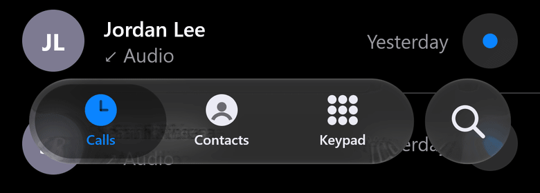
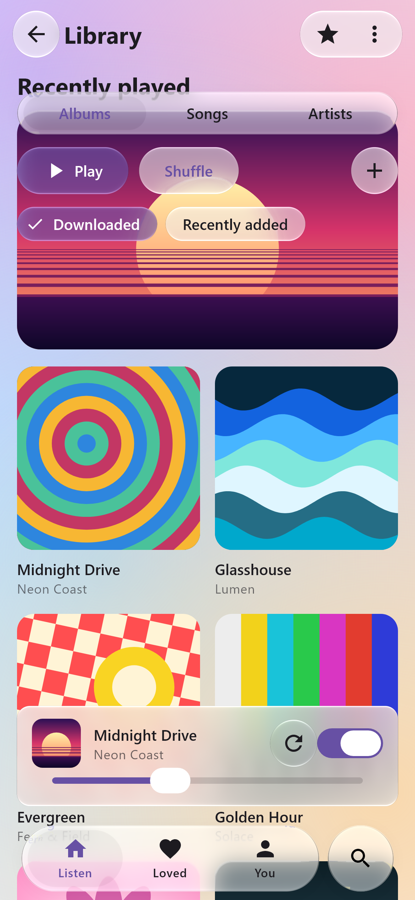
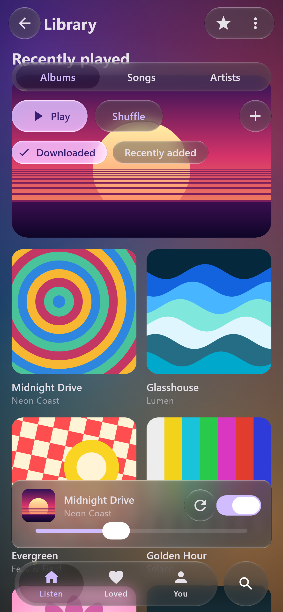
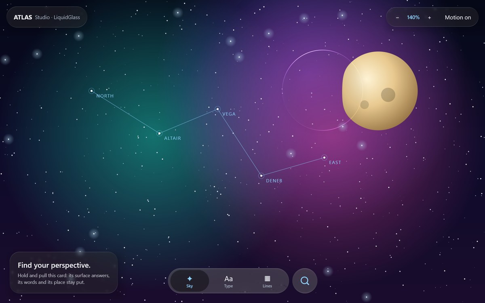

# LiquidGlass

**iOS 26's Liquid Glass for Compose Multiplatform — measured against real iOS recordings.**
Real refraction of whatever is behind a surface, the tab bar whose selection becomes a lens you can
drag and throw, and glass versions of every Material 3 component. One shader, on Android, desktop
and the web.

[](https://github.com/shayann07/liquidglass/actions/workflows/ci.yml)
[](LICENSE)
[](https://central.sonatype.com/artifact/dev.shayxo.liquidglass/liquidglass)

**[Live demo](https://liquidglass.shayxo.dev/demo/)** · [Documentation](https://liquidglass.shayxo.dev/) ·
[Getting started](docs/getting-started.md) · [Material 3](docs/material3.md) · [API](docs/api-reference.md)

<p align="center">
  
</p>
<p align="center"><sub>Rendered by the library (desktop Skia, deterministic 60 fps replay of a tap, a hold and a throw; shown at 30 fps).</sub></p>

> **Status.** `0.1.0` is on Maven Central with an earlier API. Everything below is on `main` and
> **unreleased**: `LiquidGlassTheme`, `glassEffect`, `liquidglass-material3`, the Gradle plugin and the
> web target. Motion and material are compared against iOS 26 recordings and are close but **not yet
> identical**; the [remaining differences](review/atlas/reference-replay-2026-10-13/README.md#remaining-differences)
> are listed openly.

## One line, three ways in

**A Material 3 app: change the imports.** `liquidglass-material3` has a glass version of every Material 3
component with the same name and parameters.

```kotlin
import com.wexpa.liquidglass.material3.Scaffold          // was androidx.compose.material3.Scaffold
import com.wexpa.liquidglass.material3.NavigationBar
import com.wexpa.liquidglass.material3.NavigationBarItem

Scaffold(bottomBar = {
    NavigationBar {
        tabs.forEachIndexed { i, tab ->
            NavigationBarItem(selected = i == selected, onClick = { selected = i },
                icon = { Icon(tab.icon, null) }, label = { Text(tab.label) })
        }
    }
}) { padding -> Content(padding) }
```

Or let the Gradle plugin do it: `./gradlew liquidGlassAdopt` switches the imports once.

<p align="center">
  
  
</p>

**Any composable: one modifier.** The names are SwiftUI's, so anyone who knows Apple's API knows this one.

```kotlin
LiquidGlassTheme {                       // once, around the app, as MaterialTheme is
    App()
}

Icon(Icons.Default.Edit, null,
    Modifier.size(44.dp).glassEffect(Glass.Regular.interactive(), CircleShape))

GlassEffectContainer(spacing = 20.dp) {  // close pieces melt into one
    Row { /* glassEffect pieces */ }
}
```

**The iOS tab bar on its own:**

```kotlin
GlassTabBar(itemCount = 3, selectedIndex = selected, onSelected = { selected = it }) { index, isSelected ->
    Tab(index, tint = if (isSelected) Accent else Ink)
}
```

## Install

```kotlin
plugins { id("dev.shayxo.liquidglass") version "<version>" }   // adds the right artifacts
```

or the BOM, or plain artifacts (`dev.shayxo.liquidglass:liquidglass`, `:liquidglass-material3`) —
[all three](docs/getting-started.md#install). Until the next release, build `main` with
`./gradlew publishToMavenLocal` ([step by step](docs/getting-started.md)).

## Why this one

| | LiquidGlass | [Kyant0 Backdrop](https://github.com/Kyant0/AndroidLiquidGlass) | [Haze](https://github.com/chrisbanes/haze) |
| :-- | :-- | :-- | :-- |
| Calibrated against iOS 26 recordings | yes: material levels, rim and motion ([the record](docs/research/README.md)) | not stated | not stated |
| iOS tab bar with a draggable lens | yes | in its sample app (`LiquidBottomTabs`) | not stated |
| Ready-made components | glass versions of the Material 3 components | in its sample app | not stated |
| Integration | change imports, or one modifier | backdrop source + effect modifiers | source + effect modifiers |
| Platforms (Compose) | Android, desktop, web | Compose Multiplatform | Android, desktop, iOS, macOS, web |
| Outside Compose | CanvasKit (any web framework), .NET | not stated | not stated |

Backdrop and Haze are excellent, more established libraries with their own strengths; their columns
list only what their own READMEs and docs state (checked 18 October 2026).

## Platforms

| Platform | Status |
| :-- | :-- |
| Android 13+ | Full shader (AGSL) |
| Android below 13 | Tinted fallback with rim lighting; no refraction |
| Desktop JVM | Full shader (Skia). Windows and Linux tested; macOS untested |
| Web, Compose (Wasm) | Full shader (Skia), the same code as desktop ([live demo](https://liquidglass.shayxo.dev/demo/)) |
| Web, any framework | [`<liquid-glass>` web component](ports/npm/README.md) (npm `liquidglass`, unpublished): refracts live HTML in Chromium and frosts elsewhere, or draws the production shaders over a source you give it ([evidence](review/web-component-2026-10-18/README.md)); [CanvasKit port](ports/skia/README.md) with the production shaders, scene API, Calm navigation selector and input controller; [small WebGL lens preview](ports/web/README.md) |
| React Native | [`GlassSurface` and `GlassLens` on React Native Skia](ports/react-native/README.md), Android and web (unpublished; [evidence](review/atlas/react-native-2026-10-19/README.md)) |
| .NET | [SkiaSharp painter, tab bar, WinForms, WPF and Avalonia adapters](ports/dotnet/README.md) |
| iOS | Not planned: iOS 26 draws Liquid Glass natively |

## Atlas Studio



The demo app, on desktop, Android and [in your browser](https://liquidglass.shayxo.dev/demo/): a
scene that keeps moving under every piece of glass. `./gradlew :desktop:run`.

## How it is verified

Optical constants are measured from iOS captures and kept apart from authored motion parameters;
[the research record](docs/research/README.md) says which is which. Motion is checked by replaying
the gestures of iOS screen recordings through the real renderer at a fixed 60 fps and comparing
frame by frame ([latest comparison](review/atlas/reference-replay-2026-10-13/README.md)). The test
suite compiles the production shaders and checks rendered pixels and gestures. Known limits:
[docs/limitations.md](docs/limitations.md).

## License

Apache-2.0 — see [LICENSE](LICENSE) and [NOTICE](NOTICE). Not affiliated with or endorsed by Apple.
No Apple code, shaders or assets are used; reference recordings are research material and are not
distributed. [Contributing](CONTRIBUTING.md) · [Security](SECURITY.md) · [Changelog](CHANGELOG.md)
