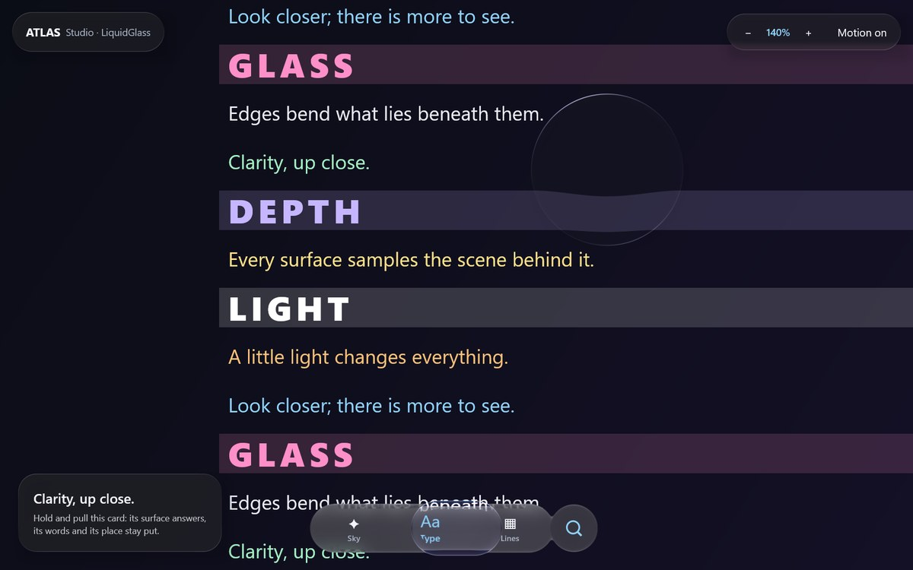

# Atlas Studio

Atlas is the shared standalone sample in `:desktop` and the Android loupe activity. One full-window
scene keeps moving under every piece of glass, so refraction is always visible over live pixels:
small labels, thin lines and saturated colour. It is not Vitals and its illustrative sky is not an
astronomical catalogue.




*Deterministic GPU replay (`:desktop:phoneReplay` with `atlas.replay.variant=atlas`, 1200 × 750 dp
at 1.5×), 14 October 2026. Not a performance measurement.*

## Run and inspect

```sh
./gradlew :desktop:run
./gradlew :web:wasmJsBrowserDevelopmentRun   # the same app in the browser (Compose for Web)
```

The Calm navigation bar (`GlassTabBarStyle.Calm()`) is the only scene switcher: Sky (a drifting
night sky with a moon), Type (a page that scrolls by) and Lines (sliding coloured stripes). It
fuses with the round button beside it while held (`GlassTabBarAccessory`); that button shows or
hides the magnifier. Drag the magnifier or the page itself; change magnification from the top bar.
On wide windows a card shows the generic scene modifier: hold and pull it to see subtle surface
strain while its words and position stay put. Motion reduced stops the drift and disables
elasticity, including navigation fling. The magnifier is dragged without press glow or press
scale, which would haze and resample the view it exists to show.

The lens has one source image. Labels are part of the recorded backdrop and are magnified with their
surroundings; no duplicate foreground text is drawn inside it. Its position is clamped in canvas-local
coordinates when dragged or resized. Sidebars never enter that coordinate system.

## Reproducible desktop evidence

```sh
./gradlew :desktop:run -Patlas.capture=/absolute/path/atlas.png -Patlas.scene=0
./gradlew :desktop:run -Patlas.capture=/absolute/path/type.png -Patlas.scene=1
./gradlew :desktop:run -Patlas.capture=/absolute/path/grid.png -Patlas.scene=2
./gradlew :desktop:desktopTest
```

The application reads its own native Skia buffer and exits after capture. It never photographs the
owner's desktop, and it does not force itself above other applications. The adjacent timing JSON
records 120 forced redraw submissions after ten warmups. This is a static-scene diagnostic, not an
FPS benchmark, gesture-latency measurement or claim about Android performance.

Desktop tests send Compose pointer events and verify controls, edge placement and recovery. Their
screenshots use the test renderer; native app captures are labelled separately in the
[stabilization record](https://github.com/shayann07/liquidglass/blob/main/review/ATLAS-STABILIZATION.md).
The production window uses the operating system's available Skia backend; Atlas does not guess its name.

## GPU selection

Atlas defaults to `-Patlas.gpu=discrete`. Override with `auto` or `integrated` when comparing
adapters. This is a process preference, not a Windows-wide graphics change. Read `ATLAS_RENDERER`
at startup and `rendererInfo` in capture metadata; a requested adapter is not proof it was chosen.
The tested Direct3D path used NVIDIA; the OpenGL comparison used Intel, so it was not a controlled
same-GPU backend comparison. [Current performance findings](performance.md).

## Motion phases and natural recording

```sh
# 33 independent native phases, selection/layout checks and app-owned snapshots:
./gradlew :desktop:run -Patlas.motionCapture=/absolute/new/path/motion
# 10 adjacent-tap phases:
./gradlew :desktop:run -Patlas.motionCapture=/absolute/new/path/short -Patlas.motionShortTaps=true
#Natural recording callbacks and own-component input/focus events; no screenshots:
./gradlew :desktop:run -Patlas.motionCapture=/absolute/new/path/natural -Patlas.motionReadback=false -Patlas.motionObserveFrames=true
```

Use a new directory per run. `capture.json` must report `checksPassed=true`; a failed run still
writes evidence and must not be counted as a pass. `events.csv` records actual event times,
dispatch and, in forced mode, redraw/readback duration. Initial layout stabilization happens
before input. The natural mode adds `frames.csv` and `input-observed.csv`, and disables forced
redraw during gestures. It measures Compose picture recording, not GPU completion or display
presentation. Missing callbacks after unchanged input are not automatically missed frames.

The complete sequence covers held travel, early/formed throws in both directions, eight drawable
window edges/corners, held reversals and intermediate landing/recovery. These are app-window bounds,
not coordinates on a physical iPhone. Each photographed phase replays input independently because
readback can be slow. A contact sheet cannot establish continuous timing agreement.


The [visual status guide](development-status.md) distinguishes current proof, original-reference
measurements, retained failures and open performance/visual-acceptance requirements.
