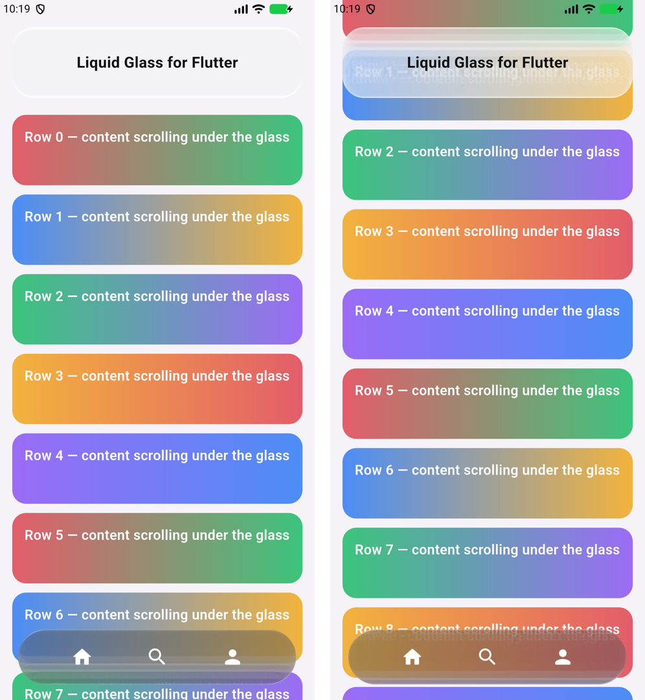

# Flutter

`liquidglass` for Flutter puts the Compose library's material over the **live** backdrop.
`GlassSurface` refracts whatever Flutter paints behind it, every frame: lists scrolling under it,
images, video. No snapshot is involved. It runs on Impeller, Flutter's renderer on Android. iOS is
not a target; on iOS 26 the system's own glass is the native choice.



*Our capture: the example on the Android 17 emulator, Impeller (OpenGL ES), at rest and scrolled.*

!!! note "Unpublished"
    The package keeps `publish_to: none` until the release. Depend on it by path:
    `liquidglass: {path: ../path/to/liquidglass/ports/flutter}`.

```dart
import 'package:liquidglass/liquid_glass.dart';

Stack(children: [
  ListView(children: rows),
  Positioned(
    left: 24, right: 24, bottom: 24, height: 72,
    child: GlassSurface(radius: 36, dark: true, child: Row(children: icons)),
  ),
])
```

`GlassSurface` takes the material's options:

- `radius`;
- `dark`, `tintAmount` and `tint`;
- `light` (`Offset(0, -1)` is iOS 27's overhead light);
- `materialize`;
- `reducedTransparency` and `increasedContrast`.

Call `LiquidGlass.ensureInitialized()` in `main` so the shader is ready for the first frame. Where
Impeller is unavailable, glass draws a frosted stand-in. The
[package README](https://github.com/shayann07/liquidglass/blob/main/ports/flutter/README.md) has
every option.

## How it works

The shader is generated, not rewritten. `tool/generate_shader.mjs` translates the material shader's
SkSL export (`ports/skia/shaders/material.sksl`) into the GLSL Flutter compiles. The translation
changes the types, the two texture reads and the entry point; `--check` fails when the copy drifts.
Each `GlassSurface` paints a backdrop filter whose filter is `ImageFilter.shader` running that
shader over the live backdrop.

One part is approximated. Compose and the CanvasKit port read the wide tone kernel from a
quarter-scale, Gaussian-blurred copy of the backdrop. A backdrop filter has a single input, so
Flutter uses thirteen taps of a Gaussian with the same sigma instead. It sets the material's tone,
never its detail.

## How it is checked

`flutter test` checks three things:

- the generated shader compiles with Flutter's shader compiler and loads;
- the Dart material's uniforms equal the CanvasKit port's for three surfaces, to 1e-6;
- the widget lays out and paints where shader filters are unavailable.

CI runs this on Linux. The example app runs on the Android 17 emulator on Impeller's OpenGL ES
backend; Vulkan, which most phones use, is not checked yet. See the
[evidence](https://github.com/shayann07/liquidglass/blob/main/review/atlas/flutter-2026-10-19/README.md).

## Limits

- Rounded rectangles only. There is no lens or navigation bar yet, and no touch response.
- The wide tone kernel is approximated (above).
- Impeller only, and checked on OpenGL ES (emulator) so far.
