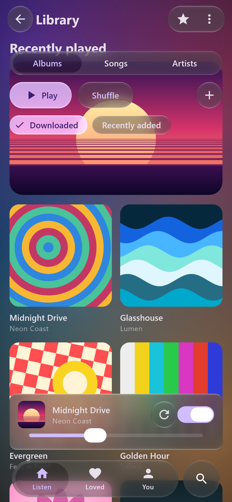

# Liquid Glass for Android and Jetpack Compose

iOS 26's Liquid Glass in Jetpack Compose: real refraction of whatever is behind a surface, the tab bar
whose selection becomes a lens you can drag and throw, and a glass version of every Material 3
component. The same code runs on desktop and on the web through Compose Multiplatform. The material
and the motion are fitted to iOS screen recordings and scored against them.



*Our render: the Material 3 showcase, desktop Skia, the same shader as Android's AGSL path.*

```kotlin
// build.gradle.kts
plugins { id("dev.shayxo.liquidglass") version "1.0.0" }
```

```kotlin
LiquidGlassTheme { App() }                       // once, as MaterialTheme is

Icon(Icons.Default.Edit, null,
    Modifier.size(44.dp).glassEffect(Glass.Regular.interactive(), CircleShape))
```

Or keep your Material 3 code and change the imports, `androidx.compose.material3.*` to
`com.wexpa.liquidglass.material3.*`; `./gradlew liquidGlassAdopt` does it for you.

## Android XML and `View` layouts

In an XML or ViewBinding layout (`Fragment`, `Activity`, `ConstraintLayout`, `CoordinatorLayout`,
`RecyclerView`), use **`LiquidGlassView`** to wrap ordinary Android XML views in a refracting glass
surface directly in XML, or **`LiquidGlassHostView`** to float interactive Compose glass controls
(such as `GlassTabBar`, FABs, or menus) over an existing `View` hierarchy with selective touch
pass-through:

```xml
<!-- Wrap XML child views in a refracting glass surface -->
<com.wexpa.liquidglass.LiquidGlassView
    xmlns:android="http://schemas.android.com/apk/res/android"
    xmlns:app="http://schemas.android.com/apk/res-auto"
    android:id="@+id/headerGlassCard"
    android:layout_width="match_parent"
    android:layout_height="wrap_content"
    app:liquidGlassBackdrop="@id/backdropContainer"
    app:liquidGlassPreset="regular"
    app:liquidGlassShape="squircle"
    app:liquidGlassCornerRadius="24dp"
    app:liquidGlassInteractive="true">

    <LinearLayout
        android:layout_width="match_parent"
        android:layout_height="wrap_content"
        android:padding="16dp">
        <!-- Ordinary TextViews, ImageViews, Buttons -->
    </LinearLayout>
</com.wexpa.liquidglass.LiquidGlassView>

<!-- Or host a Compose GlassTabBar / floating controls over an XML layout -->
<com.wexpa.liquidglass.LiquidGlassHostView
    xmlns:android="http://schemas.android.com/apk/res/android"
    xmlns:app="http://schemas.android.com/apk/res-auto"
    android:id="@+id/glassChromeOverlay"
    android:layout_width="match_parent"
    android:layout_height="match_parent"
    app:liquidGlassBackdrop="@id/backdropContainer" />
```

```kotlin
binding.glassChromeOverlay.setThemedGlassContent { host ->
    Box(Modifier.fillMaxSize()) {
        GlassTabBar(
            itemCount = 4,
            selectedIndex = selectedTab,
            onSelected = { selectedTab = it },
            modifier = Modifier
                .align(Alignment.BottomCenter)
                .glassHitTarget("tab_bar", host), // touches outside pass through to XML views below
        ) { index, isSelected -> /* ... */ }
    }
}
```

> [!NOTE]
> **Backdrop capture boundaries:** Standalone `LiquidGlassView` sizes directly to its glass surface, so its backdrop is captured within the view's layout bounds. Refraction and blur outside the view's edges blend against the configured `app:liquidGlassBackground` color. For glass controls that optically sample live surrounding pixels from neighbouring sibling views, wrap the screen layout in `LiquidGlassHostView`.

- **Android 13 and newer:** the full shader (AGSL), checked on a Samsung Galaxy S24+ ([Evidence](https://github.com/shayann07/liquidglass/blob/main/review/atlas/android-xml-interop-2026-10-26/README.md)).
- **Below Android 13:** a tinted fallback with rim lighting, no refraction.
- **Desktop and web:** the same shader on Skia. [Try it in your browser](../demo.md).

Next: [Getting started](../getting-started.md) · [Material 3, in glass](../material3.md) ·
[The tab bar](../tab-bar.md) · [Limitations](../limitations.md)
