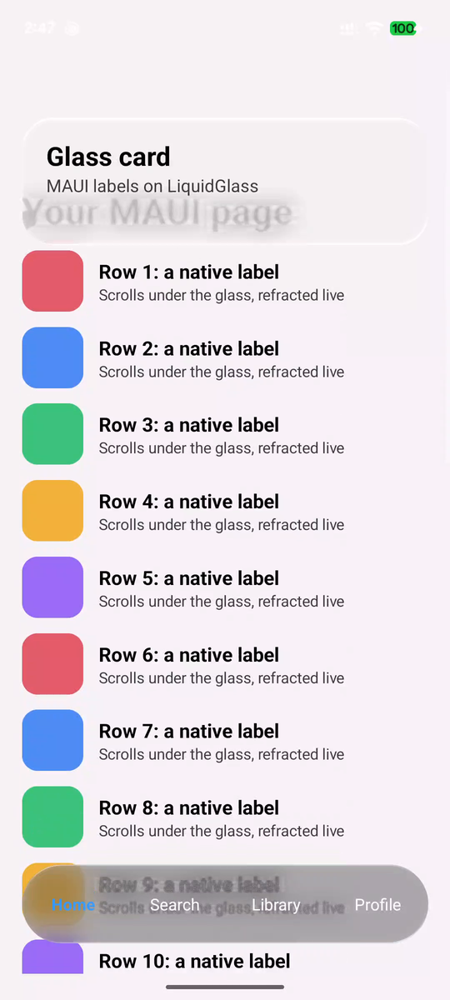

# Native .NET and Windows Forms

The experimental source adapter renders the production material on SkiaSharp without Compose,
JavaScript or a browser. It supplies a painter, a whole-surface interaction controller and a
Windows-specific control-backdrop helper. On NuGet from 0.2.1: `LiquidGlass`, `LiquidGlass.WinForms`,
`LiquidGlass.Wpf` and `LiquidGlass.Avalonia`; `LiquidGlass.Maui` from the next release ([below](#net-maui)).


Nine app-owned CPU-rendered phases. Text and hit targets stay anchored. These are deterministic
snapshots, not continuous timing or displayed-frame measurements.

## Projects and prerequisites

| Project | Target / role |
| --- | --- |
| `ports/dotnet/LiquidGlass.Skia` | .NET 8; production painter, shader passes and framework-independent controller |
| `ports/dotnet/LiquidGlass.WinForms` | .NET 10/Windows 10 build 19041+; owned-control capture |
| `ports/dotnet/WinFormsDemo` | .NET 10/Windows; interactive lens/card and native-control examples |
| `ports/dotnet/Checks` | .NET 8; renderer, fixture, lifecycle and interaction verification |
| `ports/dotnet/LiquidGlass.Maui` | .NET 10; Android and Windows (not iOS); `GlassSurface` over your own MAUI views |
| `ports/dotnet/MauiDemo` | .NET 10 Android; glass card and bar over a scrolling page |

SkiaSharp is pinned to 4.153.1 with dependency locks. Linux rendering needs matching native assets,
fontconfig and fonts. Windows Forms is Windows-only; other SkiaSharp host frameworks need their own
native assets and lifecycle wiring. The painter embeds the exported production shaders at build time.

```sh
dotnet restore ports/dotnet/Checks/Checks.csproj --locked-mode
dotnet build ports/dotnet/Checks/Checks.csproj --no-restore
dotnet ports/dotnet/Checks/bin/Debug/net8.0/Checks.dll ports/dotnet/artifacts
dotnet restore ports/dotnet/WinFormsDemo/WinFormsDemo.csproj --locked-mode
dotnet run --project ports/dotnet/WinFormsDemo --no-restore
# Editable native controls and their glass preview:
dotnet run --project ports/dotnet/WinFormsDemo --no-restore -- --controls
```

The maintainer's private SDK/cache wrapper is `tools/dotnet-port.ps1`; it does not install an SDK.

## .NET MAUI

`LiquidGlass.Maui` adds a `GlassSurface` view to .NET MAUI apps on Android and Windows. iOS and Mac
Catalyst are not targets: on iOS 26 the system draws Liquid Glass natively.



*Our capture: `ports/dotnet/MauiDemo` (Release) on a Pixel 7, Android 17, a frame of
`adb shell screenrecord` mid-scroll, scaled to 50%. The page is 24 rows of native MAUI views.
[Evidence](https://github.com/shayann07/liquidglass/blob/main/review/atlas/maui-2026-10-20/README.md).*

```csharp
builder.UseMauiApp<App>().UseLiquidGlass();             // MauiProgram.cs

var backdrop = new GlassBackdrop(rows, BackgroundColor); // the ScrollView's content
var bar = new GlassSurface { Backdrop = backdrop, Dark = true, Radius = 36, HeightRequest = 72, Content = tabs };
Content = new Grid { Children = { new ScrollView { Content = rows }, bar } };
```

`GlassBackdrop` draws the element's native view into a bitmap (Android `View.Draw`, WinUI
`RenderTargetBitmap`) once it is drawn and whenever its size changes; call `RefreshAsync()` after its
content changes. Glass follows it while it scrolls. It is a snapshot, so content animating on its own
shows its state at the last capture. `GlassSurface` takes `Radius`, `Dark`, `TintAmount`, `Light`,
`Materialize`, `ReducedTransparency` and `IncreasedContrast`. Verified on a Pixel 7; the Windows
target builds and packs in CI but has not been run. The
[package README](https://github.com/shayann07/liquidglass/blob/main/ports/dotnet/README.md#net-maui-glass-over-your-own-maui-views)
has the details.

## Painter contract

Create one painter per rendering thread/context, set its backdrop, and draw glass after the ordinary
page. Device-pixel bounds use the backdrop's top-left coordinate system. Keep your labels and
accessible native controls separate from the material drawing.

```csharp
using LiquidGlass.Skia;
using SkiaSharp;

using var glass = new GlassPainter();
glass.SetSource(backdropImage); // borrows a live opaque sRGB SKImage
glass.DrawLens(canvas, SKRect.Create(360, 50, 180, 180), magnification: 1.4f);
glass.DrawSurface(canvas, SKRect.Create(30, 260, 300, 100), radius: 24,
    options: new(Dark: true, TintAmount: 50, Density: 1));
```

| API | Lifetime and behavior |
| --- | --- |
| `SetSource(SKImage)` | Borrows the image; keep it alive until replacement/disposal. Replacing invalidates the wide-tone cache. |
| `RecordBackdrop(width, height, drawPage, background)` | Owns a new host-drawing snapshot; a failed callback preserves the previous source. Exclude glass overlays. |
| `DrawLens(canvas, bounds, magnification)` | Continuous lens, magnification 1–2.5. At1 it preserves the source pixels. |
| `DrawSurface(canvas, bounds, radius/radii, options, feedback)` | Rounded material, optional per-corner radii and material-only feedback. |
| `GlassSurfaceOptions` | Dark/light, tint 0–100, positive density, materialize/reduced-transparency/contrast 0–1. |
| `GlassEffectPass` | Low-level material/content/endpoint shader compilation and strict named input binding. Caller owns returned shaders. |
| `Dispose()` | Releases owned GPU/native objects and owned snapshots; does not dispose borrowed images. |

Canvas state is restored. Recreate the painter and sources after GPU context loss. Current native
host evidence is CPU-based; it does not verify arbitrary GPU hosts or wide-gamut/HDR conversion.

## Calm interaction

`CalmInteraction` takes `CalmGeometry` in logical pixels, optional `CalmOptions`, and monotonic
timestamps in **seconds**. Pointer movement is cumulative displacement since down, never a delta.

```csharp
var motion = new CalmInteraction(new CalmGeometry(300, 100, 24,
    X: 40, Y: 70, ViewportWidth: 800, ViewportHeight: 600));
motion.Press(seconds, dx, dy);
// On pointer-up, cancellation or lost capture:
motion.Release(seconds);
// In the host's render loop:
GlassFeedback feedback = motion.Sample(seconds);
glass.DrawSurface(canvas, deviceBounds, 24 * density,
    new GlassSurfaceOptions(Dark: true, Density: density), feedback);
```

`GlassFeedback` contains matrix A/B/C/D, logical offset, press amount, held state and `Active`.
Schedule another animation frame only while active; new input must wake an idle hold. The host
owns pointer arbitration and calls release when scrolling or another gesture cancels it.
`Resize` cancels old coordinates. `SetReducedMotion` immediately clears deformation and ownership;
release the host capture too. Older queued sample timestamps do not rewind state; stale input throws.

Defaults are authored 3% maximum press scale and 2 logical pixels per edge. Adaptive large-surface
pull stays restrained; optional area-preserving whole-bar pull shares the portable model. This is
whole-surface feedback, **not the navigation-selector travel controller**.

## Existing native controls


`ControlBackdrop.Capture(backdropControl, opaqueBackground)` returns a caller-owned opaque Skia
image from a visible, handle-created subtree on its UI thread. It includes borders, so its origin
is the root control's outer top-left. Pass that image to `SetSource`, then dispose the old image
only after successful replacement. Update after native content/layout changes; do not capture
again for every glass animation. Keep glass outside the captured subtree to avoid recursion.

Panel, Label, TextBox and CheckBox are verified. RichTextBox/ActiveX are explicitly rejected;
hidden children are omitted. Custom controls and overlapping container order require verification.
It calls `DrawToBitmap`, never a desktop screenshot API. See the
[complete lifetime example and restrictions](https://github.com/shayann07/liquidglass/blob/b46207d665725a0aa841102bfbdcbe74aaf4ac3c/ports/dotnet/README.md#use-existing-windows-forms-controls-as-the-backdrop).

## Reproduce native evidence

```sh
# Build first, then use fresh output directories:
dotnet build ports/dotnet/WinFormsDemo --no-restore
dotnet ports/dotnet/WinFormsDemo/bin/Debug/net10.0-windows10.0.19041.0/WinFormsDemo.dll --capture motion-proof
dotnet ports/dotnet/WinFormsDemo/bin/Debug/net10.0-windows10.0.19041.0/WinFormsDemo.dll --controls --capture controls-proof
node ports/dotnet/generate-motion-fixtures.mjs --check
```

Check the process exit code and verification JSON, inspect the images, and retain any failed run.
Native capture invokes only its own handlers. [Current checks, source hashes and open scope](development-status.md).
