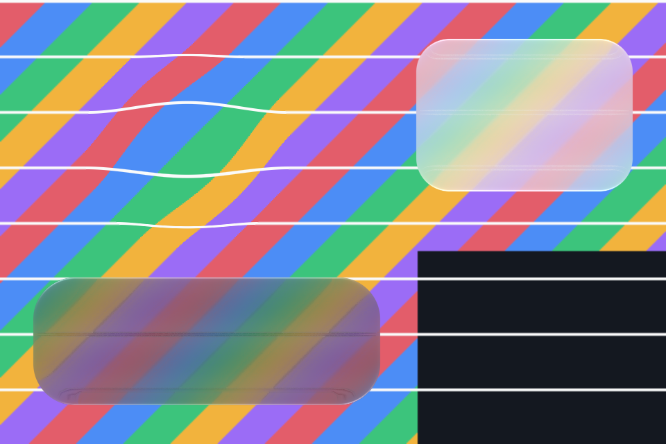

# React Native

`liquidglass-react-native` draws Liquid Glass in React Native with
[React Native Skia](https://shopify.github.io/react-native-skia/), using the library's production
shaders: the SkSL the Compose library runs, measured against iOS recordings. It targets Android and
React Native Web. iOS is not a target; on iOS 26 the system's own glass is the native choice.



*Our render: React Native Skia 2.14.0 headless (its JSI API over CanvasKit, software), pixel ratio 2.
The demo app also runs on the Android 17 emulator
([evidence](https://github.com/shayann07/liquidglass/blob/main/review/atlas/react-native-2026-10-19/README.md)).*

!!! note "Unpublished"
    The package keeps `"private": true` until the release. Install it from a checkout:
    `npm install ../path/to/liquidglass/ports/react-native`.

```jsx
import {Canvas, makeImageFromView} from '@shopify/react-native-skia';
import {GlassSurface, GlassLens} from 'liquidglass-react-native';

const [backdrop, setBackdrop] = useState(null);
useEffect(() => { makeImageFromView(pageRef).then(setBackdrop); }, []);

<View ref={pageRef} collapsable={false}>{/* the page */}</View>
<Canvas style={StyleSheet.absoluteFill} pointerEvents="none">
  <GlassSurface source={backdrop} x={16} y={height - 100} width={width - 32} height={84} radius={28} dark />
  <GlassLens source={backdrop} x={40} y={120} width={140} magnification={1.5} />
</Canvas>
```

`source` is an opaque image of what is behind the glass (give the captured view a background), at
device resolution, its top-left at the canvas's origin; positions and sizes are in the canvas's units. `GlassSurface` takes the material's options:

- `radius`;
- `dark`, `tintAmount` and `tint`;
- `light` (`[0, -1]` is iOS 27's overhead light);
- the accessibility settings (`reducedTransparency`, `increasedContrast`).

`GlassLens` takes `magnification`. For the navigation bar and its selector, `createGlassPainter()` and
`recordGlass()` expose the full painter. The [package README](https://github.com/shayann07/liquidglass/blob/main/ports/react-native/README.md)
has every prop.

## How it is checked

The painter in `ports/skia` is written against CanvasKit, and React Native Skia's API is nearly the
same. A small adapter covers the differences: `dispose()` in place of `delete()`, numeric enums, matrix
objects and offscreen surfaces. The painter and shaders run unchanged.

In React Native Skia's headless build, the glass drawn through the adapter equals the glass drawn on
CanvasKit directly, with no channel off by more than 1. The components also render inside a React
Native Skia tree. [Evidence](https://github.com/shayann07/liquidglass/blob/main/review/atlas/react-native-2026-10-19/README.md).

## Limits

- Run on the Android emulator, not yet on a phone.
- The backdrop is a snapshot: capture it again when the page changes.
- No touch response yet. The press and pull motion exists in the painter's controllers, but these
  components do not use it.
