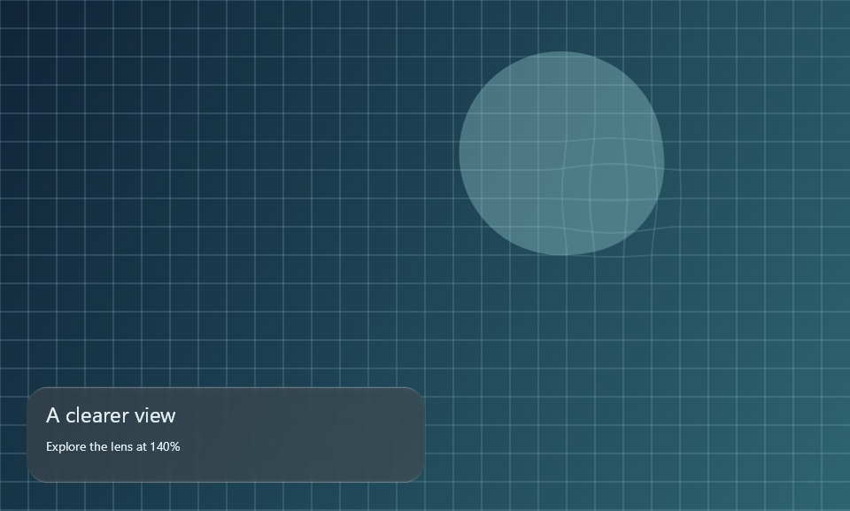

# LiquidGlass for .NET / SkiaSharp

Draw the production LiquidGlass shaders on an `SKCanvas`, without Compose, JavaScript or a browser.
`GlassPainter` owns shader compilation, uniform binding and the cached wide blur. Your application
owns the canvas, layout, input, accessibility and the pixels behind the glass.

This is an experimental, source-only adapter. Nothing is published to NuGet. The renderer targets
.NET 8; the runnable Windows Forms example targets .NET 10 / Windows 10 build 19041 or newer.
SkiaSharp is pinned to 4.153.1, with dependency locks in each project.



## Run it

From the repository root, install a .NET SDK and the .NET 8 runtime for the renderer checks.
The desktop example additionally needs the .NET 10 SDK and Windows Desktop runtime.

```sh
dotnet restore ports/dotnet/Checks/Checks.csproj --locked-mode
dotnet build ports/dotnet/Checks/Checks.csproj --no-restore
dotnet ports/dotnet/Checks/bin/Debug/net8.0/Checks.dll ports/dotnet/artifacts
```

The executable writes `verification.json` and example PNGs, and exits nonzero on failure. It compares
all four material profiles against independent JVM RGBA fixtures, compiles all three production
passes, and checks source mapping, ownership, cache invalidation and failed host recording.
Linux native assets are included in the checks project. Install `libfontconfig1` and a font such as
`fonts-dejavu-core` on Ubuntu to render the example's labels. Windows/Linux jobs run these checks in CI;
consult their result for the revision being used.

On Windows, run the interactive example:

```sh
dotnet restore ports/dotnet/WinFormsDemo/WinFormsDemo.csproj --locked-mode
dotnet run --project ports/dotnet/WinFormsDemo --no-restore
```

Drag the lens, use arrow keys to move it, and use plus/minus to change magnification. Native checkboxes
control dark glass, reduced transparency and contrast. Resizing rebuilds the backdrop and cancels a
drag. Hold and pull the card for calm material feedback; its labels and hit bounds stay anchored.
The Reduce motion checkbox cancels feedback immediately. `-- --capture <directory>` saves nine app-owned canvas snapshots and a host verification report,
then exits. Capture replay invokes the control's own mouse handlers; it never reads other windows
or moves the OS cursor. These phase images do not establish continuous timing or presented FPS.

On the maintainer's Windows checkout, `tools/dotnet-port.ps1` selects the private SDK and cache.
Build with that wrapper, then execute the DLL with the system `dotnet` when its runtime is needed.

## Add glass to a host

Reference `LiquidGlass.Skia/LiquidGlass.Skia.csproj` from your project. Keep `ports/skia/shaders`
alongside it: the build embeds those production exports. The built DLL does not fetch shader files
at runtime. For a Linux host, add the matching `SkiaSharp.NativeAssets.Linux` package and install
fontconfig/fonts. The dependency-free variant has no system font provider; a host using it must
supply its own font files when drawing text. Other platforms need their matching native assets.

```csharp
using LiquidGlass.Skia;
using SkiaSharp;

// Keep one painter per rendering thread/context, not one per frame or widget.
using var glass = new GlassPainter();
glass.SetSource(backdropImage); // borrowed opaque sRGB SKImage

// Draw the ordinary page first. Bounds are in backdrop/device pixels.
glass.DrawLens(canvas, SKRect.Create(360, 50, 180, 180), magnification: 1.4f);
glass.DrawSurface(canvas, SKRect.Create(30, 260, 300, 100), radius: 24,
    options: new(Dark: true, TintAmount: 50, Density: 1));
// Draw ordinary labels afterward; they keep their host layout and semantics.
```

The complete [Windows Forms host](WinFormsDemo/Program.cs) demonstrates one captured page shared
by a lens and a card. Its `SKControl` uses CPU Skia rendering. Move this painter into an existing
Skia draw callback to integrate it; adding a reference alone does not capture arbitrary UI widgets.

If your page already draws through Skia, the painter can own the snapshot:

```csharp
glass.RecordBackdrop(width, height, pageCanvas => DrawPage(pageCanvas), SKColors.Black);
// In the host's paint callback:
DrawPage(canvas);
glass.DrawSurface(canvas, cardBounds, 24, new(Dark: true));
```

Record again when the page changes, not when only a glass control moves. Exclude glass and overlays
from `DrawPage` to avoid recursive feedback. A failed recording leaves the preceding source usable.
This API records your drawing callback; it does not capture WinForms/WPF/MAUI/Avalonia widgets.

### Use existing Windows Forms controls as the backdrop

Reference `LiquidGlass.WinForms/LiquidGlass.WinForms.csproj` for the Windows-specific adapter
(.NET10/Windows10). On your UI thread, after handles and layout exist:

```csharp
using LiquidGlass.WinForms;

// backdropPanel contains ordinary controls only; put glass overlays outside that subtree.
SKImage next = ControlBackdrop.Capture(backdropPanel, backdropPanel.BackColor);
try { glass.SetSource(next); }
catch { next.Dispose(); throw; }
SKImage? previous = currentBackdrop;
currentBackdrop = next;
previous?.Dispose();
// Dispose currentBackdrop after the painter no longer borrows it.
```

This renders the specified control and its children through `Control.DrawToBitmap`. It never
reads the desktop or another process. The output is opaque, with its origin at the control's
outer top-left, including its border. Dimensions and renderer bounds are device pixels. Refresh
after relevant content/layout changes; coalesce invalidations rather than capture every animated
glass frame. This is CPU bitmap work and requires an intermediate GDI bitmap and Skia image.

The returned image is caller-owned; a failed capture leaves your previous snapshot untouched.
The source must be visible and have a handle, and the call must run on its owning UI thread.
An opaque background is required. Known unsupported RichTextBox/ActiveX subtrees throw instead
of returning an apparently successful incomplete image. Hidden children are omitted. Overlapping
container order and custom/native controls need host validation; this is not a universal widget
capture guarantee. See [Microsoft's DrawToBitmap limitations](https://learn.microsoft.com/en-us/dotnet/api/system.windows.forms.control.drawtobitmap?view=windowsdesktop-10.0).

Try the executable example with editable native controls beside their glass preview:

```sh
dotnet run --project ports/dotnet/WinFormsDemo --no-restore -- --controls
dotnet ports/dotnet/WinFormsDemo/bin/Debug/net10.0-windows10.0.19041.0/WinFormsDemo.dll --controls --capture controls-proof
```

The second command verifies actual TextBox glyph changes, identity/refraction pixels, retained
source after rejection, thread ownership and resizing, then exits. Windows CI runs it; Linux
continues to run the framework-independent painter/controller checks. [Native-control evidence](../../review/atlas/dotnet-controls-2026-10-13/README.md).

## Navigation: the Calm selector

`CalmNavigation` runs the Compose `GlassTabBar` gesture protocol over `CalmSelectorController`, a
line-by-line port of the Compose pose controller checked against the Kotlin-exported trajectories in
`ports/skia/fixtures/selector-calm.json` (worst 0.035 px over 456 frames). Feed bar-local pixels and
monotonic seconds; draw the body with `GlassPainter.DrawSelector` after the bar:

```csharp
var bar = CalmSelectorBar.Create(width: 300, height: 62, count: 3);
var nav = new CalmNavigation(bar, selected: 0, onSelect: index => Route(index));
nav.Down(x, y, seconds); nav.Move(x, y, seconds); nav.Up(x, y, seconds);
if (nav.Frame(seconds)) RequestRedraw();
var c = nav.Controller; var options = new GlassSurfaceOptions(Dark: true, Density: 1);
painter.DrawCalmBar(canvas, barRect, (float)c.Formation, options, (float)nav.Touch);   // Touch: the bar's lift for any touch
using var through = surface.Snapshot();   // the page with the bar's glass over it
painter.DrawSelector(canvas, barRect, c.Render(), (float)c.Formation, options,
    (float)c.TransitAppearance, (float)c.HeldTravel, through);
```

`CalmSelectorBar.Create(..., slotWidth: px)` lays the tabs on equal slots of that width centred
in the bar, as Compose's `GlassTabBarStyle.slotWidth` does: the end tabs close up until their pill
sits `pillInset` inside the bar's end. Draw your items at `bar.CentreOf(i)`; `NearestTab` maps a
bar-local x to a tab.

`DrawCalmBar(..., clear: true)` (and `CalmSelectorMaterial.Bar(..., clear: true)`) draws Compose's
`GlassTabBarStyle.CalmClear()` bar: the clearer glass of WhatsApp's and the App Store's dark iOS
bars (black at 0.10 instead of 0.41, same lift, legibility 2.5; light appearance unchanged). The ports draw no contact shadows: light
Calm's held lens casts one in Compose (`contactShadow` 0.5), which a host draws under the lens itself.

A free button beside the bar (Compose's `GlassTabBarAccessory.link`) fuses with it:
`AccessoryFuse.Compute(barWidth, barHeight, new RectD(x, y, w, h), button.Sample(t), smoothing, barPressX,
barPressY)` gives `DrawCalmBar(..., fuse:)` the rect the bar's outline reaches for; scale `smoothing` by
`1 - AccessoryFuse.Yield(formation, lensEdge, barWidth, barHeight)` as a lens arrives. Checked against the
Kotlin-exported `accessory-fuse.json`.

`DrawCalmBar` and `DrawSelector` use the Compose Calm bar and selector material itself
(`CalmSelectorMaterial`: the production styles exported by the Kotlin tests, blended by the same
rules and checked against 96 Kotlin-computed uniform sets). Pass `through` so the lens looks through
the bar as in Compose; without it the lens sees the page alone. For the selected ink, draw your items
in their selected appearance into an image at the bar's origin and pass it to
`DrawSelectorInk(canvas, barRect, c.Render(), ink, ...)` after `DrawSelector`: it shows only under the
selector, through the production content pass. Labels, accessibility and the WinForms control wiring
stay with the host.

## Geometry, options and lifetime

### Calm press and pull

`CalmInteraction` supplies a reusable controller for whole cards, bars and other surfaces. It
uses the same authored response as the portable controller, with cross-language trajectory
checks. It is not navigation-selector travel (see below) and claims no complete iOS timing parity.
Construct it once per surface; pass **logical pixels** and **monotonic seconds**, not milliseconds:

```csharp
var motion = new CalmInteraction(new CalmGeometry(
    Width: 300, Height: 100, Radius: 24, X: 40, Y: 70,
    ViewportWidth: 800, ViewportHeight: 600));

// Input callbacks: dx/dy are TOTAL displacement since this pointer went down.
motion.Press(seconds, dx, dy);
motion.Release(seconds); // pointer-up, cancellation or lost pointer capture

// Paint callback: sample once; schedule another frame only while Active is true.
GlassFeedback feedback = motion.Sample(seconds);
glass.DrawSurface(canvas, devicePixelBounds, 24 * density,
    new GlassSurfaceOptions(Dark: true, Density: density), feedback);
// Draw labels afterward using their original bounds.
```

`GlassFeedback` is an immutable value containing a centre-based2×2 matrix, logical-pixel offset,
press amount, held state and whether another animation frame is needed. The painter applies it
only while drawing the material and restores the canvas. It transforms the material's sampled
backdrop with that drawing, matching the portable scene contract; it is not arbitrary native
widget refraction or an independent measurement of the original optics.

Keep layout, text, accessibility and hit testing at their original bounds. The host must own
one pointer, arbitrate with scrolling, and call `Release` when that pointer is cancelled. A
stationary held controller can become idle; a later move must request a frame again. A queued
`Sample` older than the latest input does not rewind state; out-of-order input events throw.
`Resize(newGeometry, seconds)` cancels the old gesture. `SetReducedMotion(value, seconds)`
clears deformation immediately and cancels gesture ownership; release the host's capture too.

Both viewport dimensions are optional together. When supplied and the original bounds fit,
the controller constrains the complete rounded outline to that viewport. Partly offscreen
surfaces keep their authored shape; the host still owns clipping. Options allow per-edge press
growth and `GlassPullShape.AreaPreserving` for whole-bar feedback. Defaults remain adaptive
with3% maximum press growth and2logical pixels per edge. None of these parameters is a recovered
Apple implementation.

The [native motion evidence](../../review/atlas/dotnet-calm-2026-10-13/README.md) includes144
cross-language states,107,520independent outline probes, frame-rate checks, real shader pixel
checks and nine native host phases. Regenerate/check portable fixtures with:

```sh
node ports/dotnet/generate-motion-fixtures.mjs
node ports/dotnet/generate-motion-fixtures.mjs --check
```

CI checks fixture freshness and runs the native checks on Windows and Linux. Native host
capture remains Windows-specific; GPU and other host frameworks remain unverified.

| API / option | Contract |
| --- | --- |
| `SetSource(image)` | Borrows a live opaque sRGB image; caller keeps it alive until replacement/disposal. Never disposed by the painter. |
| `RecordBackdrop(...)` | Owns the new opaque snapshot. Replacing it or disposing the painter releases it. |
| `DrawLens(..., magnification)` | Continuous lens, 1–2.5 magnification. At 1 it is pixel-identical to the source. |
| `DrawSurface(..., radius)` | Rounded in-app material; one radius or four values in top-left, top-right, bottom-right, bottom-left order. |
| `Dark`, `TintAmount` | Default false / 50; tint is 0–100 and follows the production in-app calibration. |
| `Density` | Default 1; scales dp material constants. Bounds and radii remain physical pixels. |
| `Materialize` | Default 1, range 0–1. This is appearance, not a gesture controller. |
| `ReducedTransparency`, `IncreasedContrast` | Default 0, range 0–1; supply current host preferences. |
| `Dispose()` | Releases owned images, paint and compiled material. Idempotent; later use throws. |
| `DrawSurface(..., feedback)` | Optional calm material transform; controller offsets are logical pixels, scaled by `Density`. The default preserves existing pixels. |

Draw in the backdrop's coordinate system, with a top-left origin and matching pixel density. Use
an identity canvas matrix for device-pixel bounds; do not apply a logical-pixel scale a second time.
Canvas save/restore and paint state are preserved. Image edges clamp, including partly offscreen
surfaces. Radius and geometry must be finite and valid. Source colour space is the host's contract;
the adapter checks opacity but does not convert wide-gamut/HDR content into sRGB.

The wide tone image is cached per source and blur density. It has roughly 1/16 the source's pixel
area; a rebuild also needs a temporary surface. An owned recorded backdrop costs about four bytes
per pixel, before allocator/backend overhead. The CPU blur path is not a GPU performance claim.
Use/dispose each instance on its owning rendering thread. Recreate it and its source after context
loss if your host uses GPU-backed images.

### A free button (the Phone search button)

`FreeButton` is Compose's `GlassInteraction.Pullable` with `GlassPullShape.Free`: `Down(t)`,
`Move(t, dx, dy)` (total travel since down) and `Up(t)` in seconds, then `Sample(t)` gives the press
scale, the stretch along and across `Angle` (degrees), the offset and the lift to draw the button with.
The checks replay the Kotlin-exported `free-button.json` frame by frame. The bar's outline does not
follow it here.

## Lower-level passes and remaining gaps

`GlassEffectPass("material" | "content" | "endpoint")` exposes the same evaluated SkSL as Kotlin
and CanvasKit. `CreateUniforms()` returns fresh zero values. `CreateShader(values, children)` requires
every declared finite scalar/vector and live shader child; it rejects missing/unknown names and
returns a shader that the caller owns. `GlassPainter.ClearUniforms(...)` provides a clear-lens setup.
Follow the [compositing contract](../../docs/porting.md#combining-refracted-ink-with-glass) for custom
foreground/path effects. These low-level passes do not construct those layers for you.

Verified locally: Windows CPU rendering, the interactive Windows Forms host, four source profiles,
shared-source lens/card drawing and lifecycle checks. [Evidence and exact scope](../../review/atlas/dotnet-2026-10-10/README.md).
Windows/Linux renderer checks and Windows host compilation are in CI. macOS, GPU hosts, Android/iOS
SkiaSharp views, WPF, Avalonia and MAUI have not received native host verification here. SwiftUI,
Flutter, React Native, Qt and Unity still need their own integration. Whole-surface calm interaction
is supplied, and so are the Calm navigation-selector dynamics (`CalmSelectorController`,
`CalmNavigation`, `GlassPainter.DrawSelector`); portable refracted foreground is not supplied by
this painter. The separate WinForms adapter captures verified standard controls; automatic
arbitrary-widget capture across frameworks remains incomplete.
The full any-stack and iOS-parity goals remain open.

The adapter is Apache-2.0; see [LICENSE](../../LICENSE) and [NOTICE](../../NOTICE). SkiaSharp is MIT
and includes native third-party components. Preserve the NuGet packages' `LICENSE.txt` and
`THIRD-PARTY-NOTICES.txt` when distributing binaries. Do not edit generated SkSL here; regenerate it
from the Kotlin production source using the [shader export workflow](../skia/README.md#regenerate-do-not-hand-edit).
