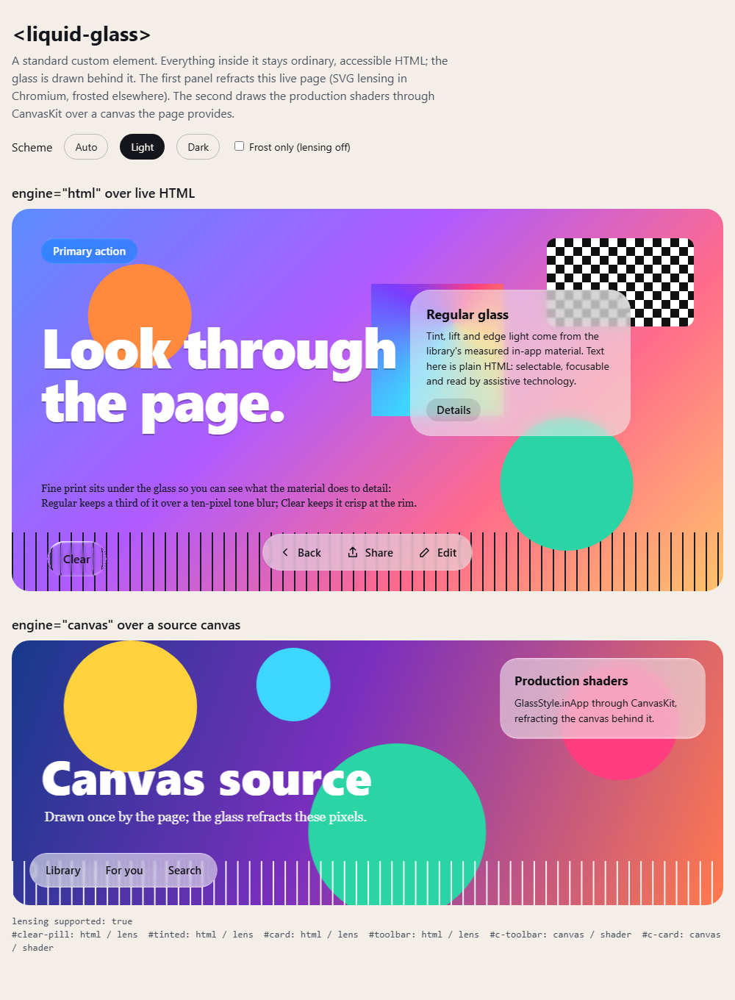

# liquidglass — the `<liquid-glass>` web component

One custom element for any web page or framework. What you put inside it stays ordinary HTML
(buttons, links, text: focusable, selectable, read by assistive technology); the glass is drawn
behind it, in the element's shadow root, and never takes clicks or focus.

```html
<script type="module" src="liquidglass/index.mjs"></script>

<liquid-glass interactive>
  <button>Back</button><button>Share</button>
</liquid-glass>
```

```sh
npm install @shayxo.dev/liquidglass
```

> The repository keeps `"private": true` and version `0.0.0` in `package.json`; the release workflow
> stamps the version and publishes with provenance. To run it from a checkout, see
> [From a checkout](#from-a-checkout). Apache-2.0; LICENSE and NOTICE are the repository's copies.



*Our render: `index.html` in Playwright's Chromium 156 headless shell, 1100 px wide, light scheme.
More captures and their limits: [review/web-component-2026-10-18](../../review/web-component-2026-10-18/README.md).*

## Two engines

| | `engine="html"` (default) | `engine="canvas"` |
| :-- | :-- | :-- |
| Refracts | the **live page** behind the element, whatever it is | only the **`source`** you give it (image, canvas, video, ImageBitmap) |
| Optics | the material's numbers re-expressed in CSS: an SVG displacement filter baked from the shader's own geometry (Chromium), or a frosted blur (Firefox, Safari) | the **production shaders, unchanged** (`GlassStyle.inApp` through the [CanvasKit painter](../skia/README.md)) |
| Exact? | no: an approximation; see [What the HTML engine reproduces](#what-the-html-engine-reproduces) | yes, for what it draws (one known difference, see [Open issues](#open-issues)) |
| Cost | about 78 kB of unminified JavaScript; no WebAssembly | adds CanvasKit: `canvaskit.wasm` is 7.3 MB (7.0 MiB) plus 121 kB of JS, loaded only when an element asks for it |
| Variants | `regular`, `clear` | `regular` only (`clear` falls back to the HTML engine) |

The HTML engine's **lensing is Chromium-only**. Chromium applies an SVG filter referenced by `url()`
in `backdrop-filter`; Firefox parses the same value but does not render it, and Safari does not support
it. Elsewhere the element frosts: the same two blur kernels, tint, lift and edge light, with no
refraction.

## Attributes and properties

| Attribute | Values | Default | |
| :-- | :-- | :-- | :-- |
| `variant` | `regular`, `clear` | `regular` | `Glass.Regular` (the measured in-app material) or `Glass.Clear` |
| `shape` | `capsule`, `rect` | `capsule` | a capsule is rounded by half its short side |
| `radius` | px | `16` | corner radius for `shape="rect"`, limited to half the short side |
| `tint` | any CSS colour | none | `Glass.tint(color)`: replaces the tint, **its alpha is the tint's opacity** (`rgb(10 132 255 / 0.5)`; an opaque colour gives 95% coverage, as in Kotlin) |
| `scheme` | `auto`, `light`, `dark` | `auto` | `auto` follows `prefers-color-scheme` |
| `engine` | `html`, `canvas` | `html` | see above |
| `interactive` | boolean | off | press feedback: the Calm press (scale and pull) and a glow under the pointer; Space/Enter on a slotted control presses too |
| `lensing` | `auto`, `off` | `auto` | `off` uses the frosted path in Chromium too, for the same look in every browser |

Each attribute is also a property (`el.variant = 'clear'`). Property-only:

- `source`: what `engine="canvas"` refracts. An element that is laid out on the page (an ``,
  `<canvas>` or `<video>`) is placed where it is on screen relative to the glass; anything else covers the
  glass's own box. Cross-origin images need CORS.
- `refresh()`: draw again after the pixels of a canvas `source` change. Videos redraw on each frame.
- `renderState`: `{engine, optics, reason}`: which engine is drawing (`optics` is `shader`, `lens`,
  `frost` or `flat`) and why a canvas request is drawing with HTML (`canvas-loading`, `canvas-no-source`,
  `canvas-variant`, `canvas-source-pending`, `canvas-unavailable`). Also reflected as `data-engine` and
  `data-optics` on the element, for styling.
- `LiquidGlassElement.lensingSupported` (static): whether this browser lenses.

The element is `display: inline-block` and sizes to its content: give the content its own padding, or
style the element (`liquid-glass { padding: 6px }`). It re-renders on resize (ResizeObserver) and
releases its observers and listeners when removed.

**Styling.** Shadow parts: `material` (every glass layer; the press transform applies here), `glass`
(the backdrop-filter layer), `tint`, `rim`, `highlight` (the press glow), `canvas` (the canvas engine's
output) and `content` (the slot wrapper). Custom properties: `--liquid-glass-saturation` (frosted path,
default `1`) and `--liquid-glass-ground` (the canvas engine's colour behind the source, default black).

## Use it

**Plain HTML**

```html
<script type="module">
  import '@shayxo.dev/liquidglass'; // registers <liquid-glass>
</script>
<liquid-glass shape="rect" radius="24" style="padding: 20px">
  <h3>Weather</h3><p>Partly cloudy</p>
</liquid-glass>
```

`import '@shayxo.dev/liquidglass'` registers the element once (guarded by `customElements.get`). To register
under another name, or not at all: `import {define} from '@shayxo.dev/liquidglass/element'; define('my-glass')`.
Importing is safe during server rendering: nothing touches the DOM until the element connects.

**React** (19 sets properties on custom elements; in 18 use a ref for `source`)

```jsx
import '@shayxo.dev/liquidglass';

export function Toolbar() {
  return (
    <liquid-glass interactive="" tint="rgb(10 132 255 / 0.5)">
      <button onClick={share}>Share</button>
    </liquid-glass>
  );
}
// TypeScript: declare the tag once.
// declare module 'react' { namespace JSX { interface IntrinsicElements {
//   'liquid-glass': React.DetailedHTMLProps<React.HTMLAttributes<HTMLElement>, HTMLElement> &
//     {variant?: string; shape?: string; radius?: number | string; tint?: string; scheme?: string;
//      engine?: string; interactive?: boolean | ''; lensing?: string} } } }
```

**Vue**: tell the compiler the tag is a custom element, then use it like any element.

```js
// vite.config.js
vue({template: {compilerOptions: {isCustomElement: tag => tag === 'liquid-glass'}}})
```

```vue
<liquid-glass interactive :scheme="dark ? 'dark' : 'light'"><button>Back</button></liquid-glass>
<liquid-glass engine="canvas" :source.prop="canvasRef">...</liquid-glass>
```

**Svelte**: works as is; Svelte sets `source` as a property.

```svelte
<script>import '@shayxo.dev/liquidglass'; let canvas;</script>
<canvas bind:this={canvas}></canvas>
<liquid-glass engine="canvas" source={canvas}>Library</liquid-glass>
```

**Angular**: add `CUSTOM_ELEMENTS_SCHEMA` to the component (or module) that uses it.

```ts
@Component({selector: 'app-bar', standalone: true, schemas: [CUSTOM_ELEMENTS_SCHEMA],
  template: `<liquid-glass interactive [attr.tint]="accent"><button>Share</button></liquid-glass>`})
export class BarComponent { accent = 'rgb(10 132 255 / 0.5)'; }
```

**The canvas engine** needs CanvasKit, an optional peer dependency (`npm install canvaskit-wasm@0.42.0`),
loaded only when an element uses `engine="canvas"`. Tell the package where it is, once:

```js
import {configureCanvasKit} from '@shayxo.dev/liquidglass';
// With a bundler (Vite shown): pass CanvasKitInit and the wasm URL.
import CanvasKitInit from 'canvaskit-wasm';
import wasm from 'canvaskit-wasm/bin/canvaskit.wasm?url';
configureCanvasKit({init: CanvasKitInit, locateFile: () => wasm});
// Or with <script src=".../canvaskit.js">: configureCanvasKit({locateFile: f => `/canvaskit/${f}`}).
```

```html
<canvas id="art" width="960" height="360"></canvas>
<liquid-glass engine="canvas" id="bar">Library</liquid-glass>
<script type="module">
  const bar = document.querySelector('#bar');
  bar.source = document.querySelector('#art'); // call bar.refresh() after drawing on it again
</script>
```

Until CanvasKit has loaded and the source has pixels, the element draws with the HTML engine, so the
content is never on bare page. All canvas-engine elements share one WebGL context (browsers cap them at
about 16); without WebGL CanvasKit's CPU raster surface is used.

## Browser support

| Browser | HTML engine | Canvas engine | Checked |
| :-- | :-- | :-- | :-- |
| Chromium (Chrome, Edge, Opera, Samsung Internet) | lens (SVG refraction) | yes | Playwright Chromium 156 headless shell: the browser suite and the captures. Chrome and Edge (headless) for the backdrop-filter behaviour checks only |
| Firefox | frost | yes (WebGL) | see [the review record](../../review/web-component-2026-10-18/README.md) |
| Safari | frost (`-webkit-backdrop-filter`) | yes (WebGL) | not checked on Safari; see the review record for Playwright WebKit |
| No `backdrop-filter` | flat: the tint at 0.9 or more, no blur | | not checked |

Lensing is detected with **both** `CSS.supports('backdrop-filter', 'url(#a)')` and a Chromium brand in
`navigator.userAgentData.brands` (User-Agent Client Hints, which only Chromium-based browsers ship).
The CSS check alone is not trustworthy: Firefox answers `true` and renders nothing. A Chromium browser
that hides its brands gets the frosted path, the safe failure.

**Where the glass can see.** `backdrop-filter` reads only up to the nearest *backdrop root*: an
ancestor with `filter`, `opacity` below 1, `mask`, `clip-path`, `mix-blend-mode`, `backdrop-filter` or
`will-change` of those. Inside one, the glass refracts what that ancestor paints, not the page outside it.
Transforms are fine (on the element or its ancestors). The element itself uses no blend modes for this
reason.

## Accessibility

- Content is light DOM: roles, names, focus order and hit targets are yours, unchanged.
- The glass layers are `aria-hidden` and `pointer-events: none`.
- `prefers-reduced-motion: reduce` stops the press scale and pull; the glow still appears (it is
  feedback, not motion) without a fade.
- `prefers-reduced-transparency: reduce` raises the tint by 0.35 (Kotlin's `uFrost` term), and
  `prefers-contrast: more` mixes the glass 0.88 toward a near-solid (Kotlin's Increase Contrast), in
  both engines.
- Check your own contrast: glass over arbitrary content can fail WCAG ratios. Clear glass in
  particular needs a calm or dimmed background, as Apple's guidance and the Kotlin docs say.

## What the HTML engine reproduces

CSS cannot run the shader. The HTML engine bakes the parts that depend only on the shape into two
images and lets CSS do the rest:

- **Refraction** (Chromium): a displacement map for `feDisplacementMap`, computed by line-by-line ports
  of the production shader's geometry (`optics.mjs`: signed distance, normals, the measured
  resting-corner source map for Regular, the Snell bevel for Clear). The tests evaluate the production
  SkSL text of those functions next to the ports.
- **Backdrop**: Regular mixes a 0.875 px and a 10 px Gaussian by the fine share 0.336 (an SVG
  `feComposite` in Chromium; two stacked `backdrop-filter` layers in the frosted path). Clear keeps a
  crisp copy at the rim, mixed into a 2.4 px blur by (1 - e)².
- **Tint and lift**: one normal-blend colour. `mix(bg, tint, s) + lift` equals one layer of colour
  `tint + lift / s` at alpha `s`, which is exact while that colour stays within 0..1.
- **Edge light**: a rim image from the shader's lighting terms, at device resolution.

Not reproduced: the legibility term (it reads the backdrop's local contrast), dispersion, Clear's
mirrored echo, inner shadow, Oklab highlight and dimming layer, and the press's backdrop swell. The rim
is composited as white over the material (bg + a(1 - bg)) where the shader adds (bg + a).

### Where the numbers come from

Every number is **inherited** from the Kotlin library (which says whether it was measured on iOS
captures or authored there) or **authored** here for CSS. `test/provenance.test.mjs` parses the Kotlin
sources and fails if an inherited value drifts. The table is `PROVENANCE` in `material.mjs`.

| Number | Value | Here | In Kotlin | Kotlin source |
| :-- | :-- | :-- | :-- | :-- |
| Regular light tint | 241/255 grey at 0.565 (stored as 144/255) | inherited | measured | `GlassMaterial.lightTint`, `LIGHT_OPACITY` |
| Regular dark tint and lift | black at 0.451 (115/255) + 35/255 | inherited | measured | `GlassMaterial.DARK_OPACITY`, `DARK_LIFT` |
| Fine kernel sigma | 0.875 dp at Tint 50 | inherited | measured | `GlassMaterial.fineKernel` |
| Wide kernel sigma | 10 dp | inherited | measured | `GlassMaterial.wideKernel` |
| Fine share | 0.95 (1 - t/100)^1.5 = 0.336 | inherited | measured | `GlassMaterial.fineShare` |
| Refraction band | 0.6 of the corner radius | inherited | measured | `GlassMaterial.BEVEL_RATIO` |
| Resting corner source map | `restSourceLegacy`; runs `u + 0.06 (1 - u)²` | inherited | measured | `GlassRestMap.kt`, `foldSource` |
| Regular rim | bevel 1.33 dp, peak 0.25, specular 0.25, power 6, counter-light 1, glow 0.05 | inherited | measured | `GlassStyle.inApp`, shader lighting |
| Light direction | (-0.35, -0.94) | inherited | authored | `GlassLight.Default` |
| Clear tint | white at 0.04 × (0.9 to 1.25 by size) | inherited | authored | `GlassStyle.Clear` |
| Clear refraction | Snell bevel, band 28 dp, depth 16 dp × (0.85 to 1.25 by size), IOR 1.5 | inherited | authored | `GlassStyle.Clear` |
| Clear scatter | radius 4 dp, sigma 0.6 × radius, crisp rim (1 - e)² | inherited | authored | `GlassStyle.Clear` |
| Clear rim | bevel 4 dp, specular 0.70, counter-light 0.35, edge light 1, fresnel 0.14 | inherited | authored | `GlassStyle.Clear` |
| Size factor | (min edge - 56) / 264 dp | inherited | authored | `elementSizeFactor` |
| Press glow | +0.06, Gaussian sigma = short edge | inherited | authored (tuned against a device) | shader touch term |
| Press feedback | Calm: scale 1.03, 2 px per edge, springs | inherited | authored | `ports/web/interaction.mjs` |
| 1 CSS px = 1 dp | | authored | | iOS Safari maps 1 CSS px to 1 pt, the unit the numbers were measured in |
| Filter pad | 32 px | authored | | |
| Frosted path | the same two kernels, no refraction | authored | | |
| Fallback saturation | `saturate(1)` | authored | | the measured model has no saturation term |
| Increase Contrast solid | 0.97 (light) or 0.02 (dark) | authored | | Kotlin picks by backdrop luma, which CSS cannot read |
| No `backdrop-filter` | tint alpha at least 0.9 | authored | | |

The canvas engine sets none of these: it calls the production painter with `dark`, `density` and the
optional tint, and the shader does the rest.

## Open issues

- No physical-device check; no Safari check; Firefox and WebKit as recorded in the review folder only.
- The HTML engine re-renders the displacement map on resize (tens of milliseconds for a large card
  on first use); it does not animate shape changes smoothly.

## From a checkout

The package is plain ES modules with no build step. From a checkout:

```sh
cd ports/npm
npm ci --ignore-scripts
npm test               # unit tests, vendored-file and type checks
npm run test:browser   # Playwright (npx playwright install chromium first)
npm run serve          # the example at http://127.0.0.1:8767/
```

In another project, `npm install ../path/to/liquidglass/ports/npm` links it.

**How it reuses `ports/skia`.** The canvas engine draws through the CanvasKit painter in
`ports/skia`. A published package cannot import a sibling directory, so the files it needs are copied
byte for byte into `vendor/skia/` by `npm run vendor`; `npm test` fails if they drift from `ports/skia`.
The same files work from the repository and from the published layout, with no bundler.
