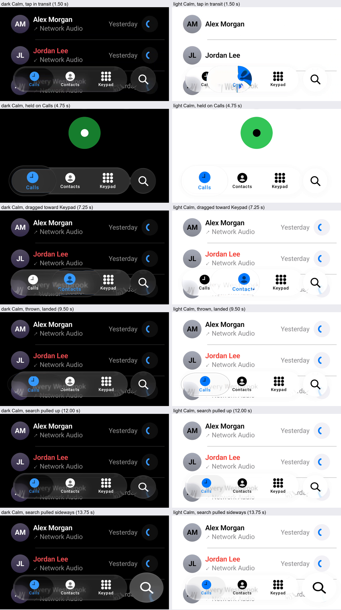
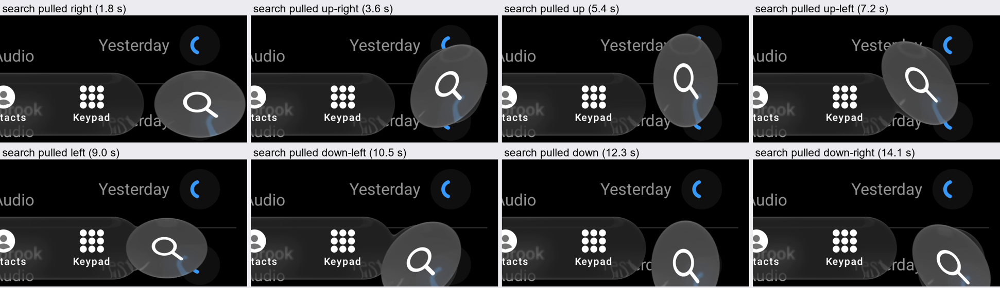

# Physical Android device check (17 October 2026)

The first check of the current Calm tab bar on a physical device, in both appearances.

**Setup.** Pixel 7 (Android 17, 1080 × 2400, display at 90 Hz), `sample` debug build of branch
`claude/light-and-gaps` (main at 1146100 plus this branch's changes). `PhoneActivity` hosts the comparison
scene `PhoneScene`: dark Calm over the natural palette, then light Calm over `PhonePalette.Light`
(`--ez light true`). Input by `adb shell input`, the same sequence in both appearances: tap Contacts,
tap Keypad, a 1.3 s stationary hold on Calls, a 1.1 s drag from Calls to Keypad, a 140 ms throw back
to Calls, the search button pulled up and then sideways, tap Contacts. Captured with
`adb shell screenrecord`; frame statistics from `dumpsys gfxinfo` over the same 22 s.

*Frames from the device's own screen recording (8 per second), bottom 600 px of the 1080 px screen,
scaled to half. The page switches with the selected tab, as the scene does.*

What it shows, on the device's AGSL path:

- a tap travels as refracting glass and lands on its tab, in both appearances;
- a hold forms the lens on Calls; a drag carries it across the bar; a throw lands on its tab;
- the search button grows when pressed and stretches toward the finger when pulled up or sideways;
- light Calm over a white page is as faint as iOS's light bar (a darker rim, a light pill).

| `dumpsys gfxinfo`, 22 s of gestures | Dark | Light |
| :-- | --: | --: |
| Frames rendered | 967 | 1014 |
| Janky frames | 3.4% | 2.4% |
| Frame time p50 / p90 / p95 / p99 | 19 / 31 / 32 / 65 ms | 20 / 30 / 32 / 44 ms |
| GPU time p50 / p90 / p99 | 12 / 17 / 20 ms | 12 / 15 / 19 ms |

**Directional extremes.** A second recording pulled the search button 250 px in eight directions
(600 ms each) and dragged the held bar 300-500 px off its axis, up and down, and past both ends. The
button stretches toward the finger in every direction and lands back on its place; the bar's drags
carry and land; no ghost disc, seam or stuck frame appears.

*Frames from the device's screen recording (10 per second), the bar's right end and the button.*

**Frame cost.** The "frame time" percentiles above run from the intended vsync to the GPU finishing,
across stages that overlap from one frame to the next; they are latency, not the frame interval. Split
by stage (`framestats`, two held drags across the bar, 120 frames), p50 / p90:

| Stage | p50 | p90 |
| :-- | --: | --: |
| UI thread: input, animation, layout, recording | 6.9 ms | 7.4 ms |
| RenderThread: issuing the draw | 1.9 ms | 2.6 ms |
| GPU, after swap | 8.5 ms | 9.3 ms |
| Vsync to GPU done (latency) | 18.1 ms | 18.9 ms |

Every stage is under the 11.1 ms budget of the 90 Hz display, so the scene keeps the display rate; the
janky share is 2-3%. Rendering the glass at reduced resolution barely changes it (same gestures, two
runs each): frame p50 17-18 / 17 / 16-17 ms and GPU p50 9 / 9 / 8 ms at `renderScale` 1.0 / 0.7 / 0.5.
On this device the glass is not GPU-bound at this size; the larger share is the UI thread's work.

**Limits.** The input is `adb shell input`, not a finger: a stationary hold sends no movement, and
swipes are straight lines at constant speed. This check shows the behaviour runs correctly on the
device; parity is measured on the desktop replay against the iOS recordings. The recordings stay local
(`.local/device/2026-10-17/`).
