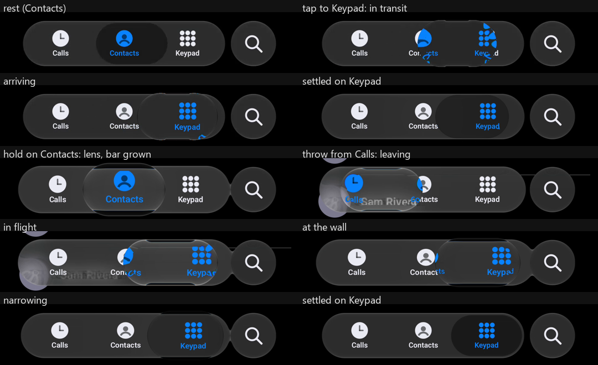
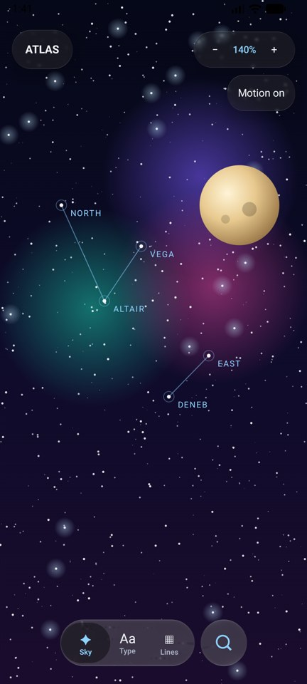

# Android verification on an emulator (14 October 2026)

No physical device was available. This verifies the current Calm selector and Atlas Studio on
Android's own rendering path (AGSL `RuntimeShader` through HWUI) on an emulator; it is not a
physical-device check and says nothing about real-device performance.

**Setup.** Android Emulator, Pixel 7 profile (1080 × 2400, 420 dpi), system image API 37
(`google_apis_playstore_ps16k`, x86_64), headless with `-gpu swiftshader_indirect` (software GPU).
`sample` debug build at this branch. `PhoneActivity` (new) hosts `PhoneScene`, the scene the
desktop replay renders, in its natural palette; input by `adb shell input` (a tap, a 1.1 s stationary
hold, a 260 ms swipe from Calls past Keypad), captured with `adb shell screenrecord`.

*Frames from the emulator's own screen recording (it writes a frame only when the screen changes,
so the spacing is irregular). Bar crops, 1080 px wide, scaled to half.*

What it shows, all on the AGSL path:

- a tap travels as refracting glass with the reflective cap mirror and lands on its tab;
- a hold forms the clear lens, taller than the bar, and the bar grows toward the finger;
- a throw stretches the lens, it presses against the bar's end, narrows from behind and settles;
- the resting inset sits darker than the bar, and the bar and search button are separate at rest.

*Atlas Studio (`LoupeActivity`) in its compact layout: top bar, motion control, the moving sky and
the Calm bar fused with the magnifier button.*

**Limits.** Software GPU: HWUI frame times were about 200 ms (median) for the moving Atlas scene,
an emulator artefact, not a measurement. Timing and continuous parity were verified on the desktop
replay, not here. A physical device check remains open.
