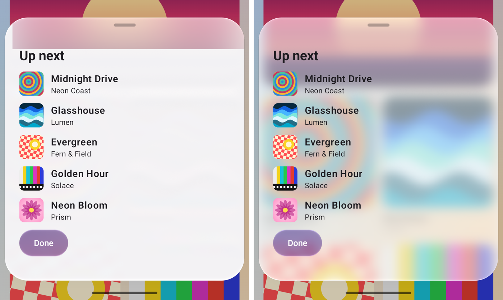

# Android: tall frosted glass loses its backdrop — fixed, 19 October 2026

Found while checking the Material 3 sheet on the Pixel 7. On Android, a tall frosted panel near the
bottom of the screen (the showcase's "Up next" sheet) showed the page only in a band at its top.
Below that band it was a flat light block with a hard horizontal edge, and the left rim was flat too.
Desktop and the web rendered the same sheet correctly.

*Pixel 7, Android 17, `adb exec-out screencap -p`, cropped to the sheet. Left: `main` before this
fix. Right: this branch. The sheet is `ModalBottomSheet` with the frosted `GlassMaterialDefaults.panel`.*

## Cause

The frost (`backdropSigma`, or the legacy `backdropBlur`) was applied on Android by chaining a blur
ahead of the glass shader (`RenderEffect.createChainEffect(glass, blur)`). Skia evaluates a chained
blur only over the region it expects to be visible, which is clipped to the window. The glass
shader, though, also samples a quarter-scale strip of wide tone that the recording keeps below the
element. For a tall sheet at the bottom of the screen that strip lies past the window's edge. Those
rows were never produced, and every pixel that read from them came out flat.

The unfrosted path never had this problem, because its strip is blurred inside its own nested layer.
A test with the same sheet in unfrosted glass on the Pixel showed the page across the whole sheet.

## Fix

On Android (`backdropBlurInRecording`), the backdrop composite is blurred in a nested layer of its own
and drawn into the panel's recording, and the panel's effect carries no chained blur. Desktop and the
web keep Skia's filter graph, which already blurs the backdrop as a separate input. Their pixels are
unchanged.

## Checks

- Pixel 7: the frosted sheet shows the blurred page across its whole height (right, above).
- `:liquidglass:jvmTest --rerun` on this branch: 413 tests, 0 failures, 27 skipped. The desktop path
  is unchanged by construction (`backdropBlurInRecording` is false there).
