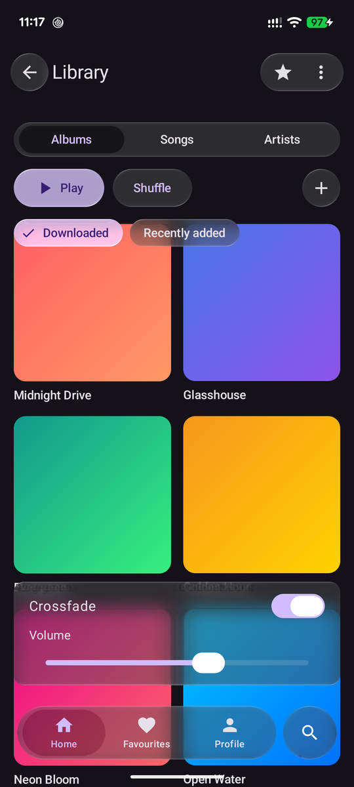
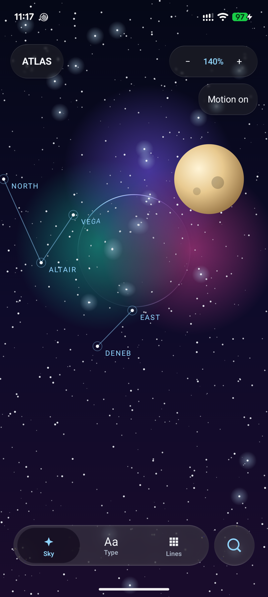
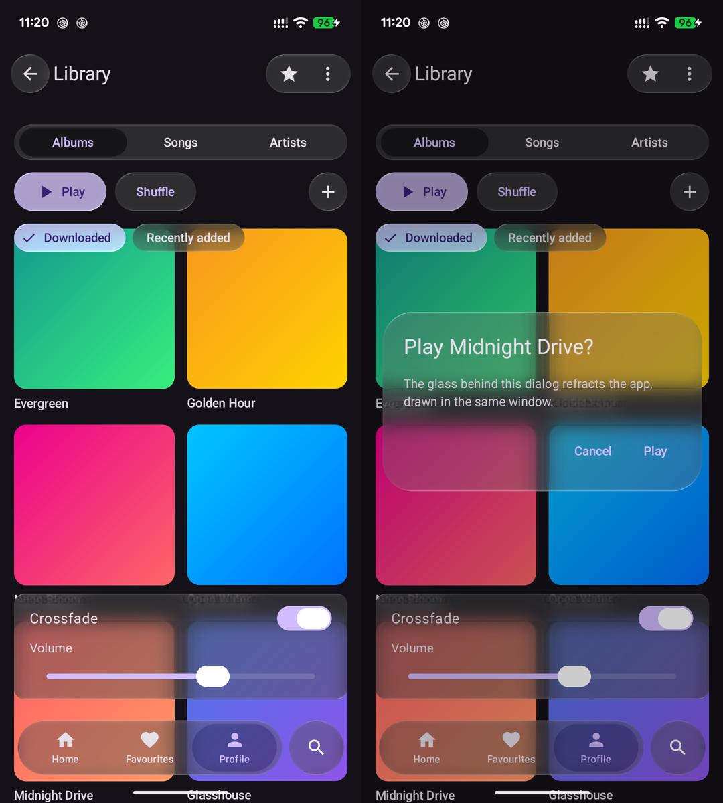
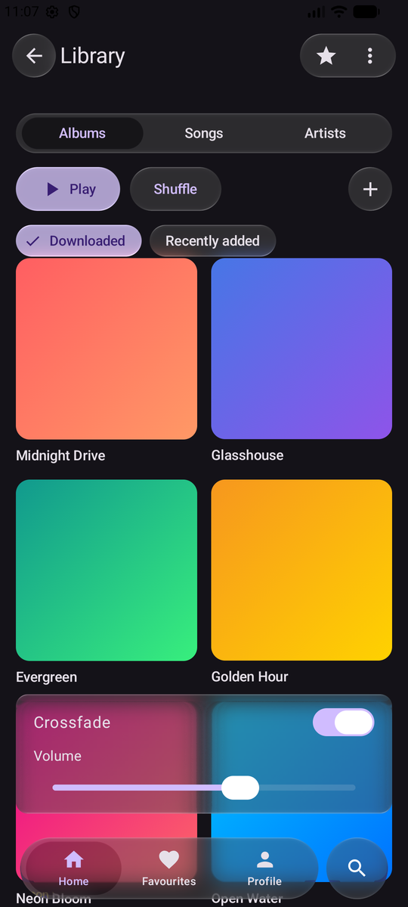
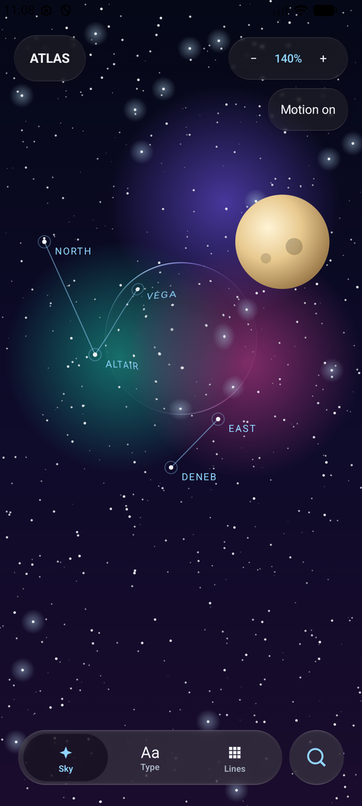

# Android: Material 3 and Atlas on the new API — 18 October 2026

## Pixel 7 (physical device)

Pixel 7, Android 17, 1080 × 2400, the owner's phone connected over USB; branch `claude/android-material`
debug build, `adb exec-out screencap` (shown at half size). The candidate build was left installed.

| Material 3 showcase | Atlas Studio |
| :-: | :-: |
|  |  |

Frame timing, Atlas (moving sky, every glass element), paired with the pre-Phase-2 build `6121bb7` on
the same phone, 10 s windows after a 6 s warm-up (`dumpsys gfxinfo`, alternating installs):

| Run | Build | Frames in 10 s | Janky | 50th / 90th / 99th percentile |
| :-: | :-- | --: | --: | :-- |
| 1 | `6121bb7` (old API) | 853 | 8.7 % | 53 / 57 / 61 ms |
| 1 | this branch | 857 | 8.5 % | 53 / 61 / 65 ms |
| 2 | `6121bb7` | 793 | 25.5 % | 61 / 77 / 89 ms |
| 2 | this branch | 731 | 27.5 % | 65 / 77 / 85 ms |

The new API draws at the same rate as the old one on this phone (the second pair ran warmer). No ANR in
any launch.

Touch, driven with `adb shell input tap` on the phone: a tap on Profile moves the tab bar's selection and
switches the covers (left); a tap on Play opens the glass `AlertDialog` over the dimmed app (right).

## Emulator

The first Android run of the Phase 2 API (`LiquidGlassTheme`, `glassEffect`) and of
`liquidglass-material3`. Source: branch `claude/android-material` (sample app, debug build). Captured
with `adb exec-out screencap` on the **Android emulator** (AVD `lg_verify_37`, Android 37.1 image,
`-gpu swiftshader_indirect`, 1080 × 2400), after about 45 s of warm-up; shown at half size.

| Material 3 showcase (`MaterialShowcaseActivity`) | Atlas Studio (`LoupeActivity`) |
| :-: | :-: |
|  |  |

*The same shared screen as the desktop renders and the web demo, drawn by the AGSL shaders: top bar,
segmented control, buttons, chips, a card with a switch and a slider, the tab bar and its search button.*

What this shows: the overlay engine draws every glass element and its content on Android, and the
tab bar's search icon is visible (it was hidden under the bar on every platform until the overlay drew
in composition order, the same day).

Limits, stated plainly:

- **An emulator with a software GPU.** It says nothing about frame timing or GPU cost on a device; the
  Pixel 7 section above does.
- **Startup on this emulator.** Shader compilation takes seconds per frame on SwiftShader. The new build
  logged one ANR (15 s input timeout) during its first frames in one of three launches; the pre-Phase-2
  build (6121bb7) logged none. After warm-up both render at a median of about 550 ms per frame on this
  emulator (`dumpsys gfxinfo`, 49 and 110 frames). The Pixel 7 shows no such startup cost (no ANR; first launch 0.7-0.8 s).
- Static frames only; interaction was not driven here.
