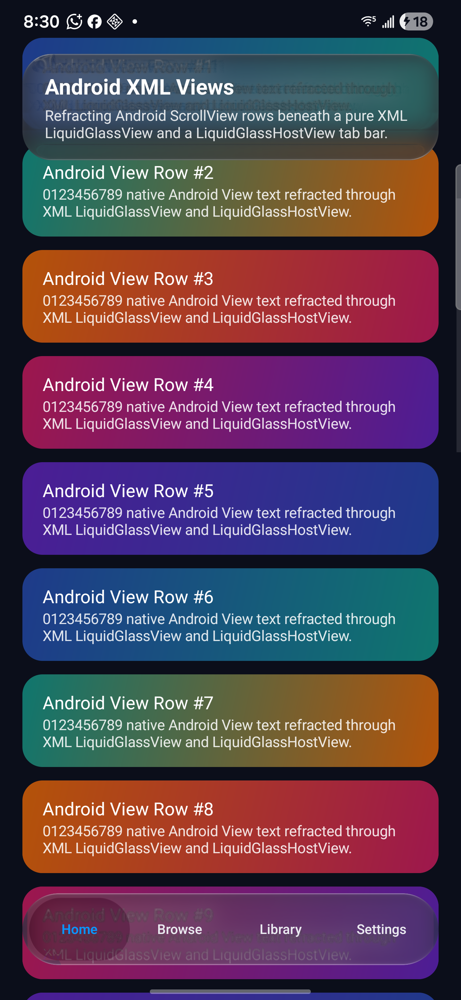

# Android XML View Interop — Physical Device Verification (2026-10-26)

## Scope

Verifies `LiquidGlassView`, `LiquidGlassHostView`, `LiveViewBackdrop`, and `Modifier.glassHitTarget`
on a physical Android device running the AGSL shader path over an Android `ScrollView` and `LinearLayout`
view hierarchy (`XmlInteropActivity` in `:sample`).

## Environment & Method

- **Device**: Samsung Galaxy S24+ (`SM-S926U`), Android 15+ (API 35+, AGSL `RuntimeShader` backend)
- **Resolution**: 1440 x 3120 px
- **Scene**: `com.wexpa.liquidglass.sample/.XmlInteropActivity` (`apps/sample/src/main/res/layout/activity_xml_interop.xml`)
- **Capture**:
  1. `./gradlew :sample:assembleDebug checkKotlinAbi`
  2. `adb install -r apps/sample/build/outputs/apk/debug/sample-debug.apk`
  3. `adb shell am start -W -n com.wexpa.liquidglass.sample/.XmlInteropActivity`
  4. `adb shell input swipe 540 1200 540 920 350` (scrolls the underlying Android `ScrollView` through the `LiquidGlassHostView` touch pass-through region)
  5. `adb exec-out screencap -p > review/atlas/android-xml-interop-2026-10-26/xml-interop-s24plus.png`

## What This Proves

*Our render on a Samsung Galaxy S24+ (Android 15, API 35, AGSL RuntimeShader backend at revision feat/android-xml-view-interop): a declarative XML `LiquidGlassView` rounded card at the top and a `LiquidGlassHostView` hosting `GlassTabBar` at the bottom, captured via `adb exec-out screencap -p` after swipe scrolling the underlying `ScrollView`. Limits: demonstrates single still scene capture over Android View hierarchy; does not measure continuous 60/120 Hz frame percentiles across third-party SurfaceView or TextureView video planes.*

1. **`LiquidGlassView` (`wrap_content` XML container)**: Wraps ordinary Android XML child views (`LinearLayout` and `TextView`s) inside a rounded `Glass.Regular.interactive()` surface configured via XML attributes (`app:liquidGlassBackdrop`, `app:liquidGlassPreset="regular"`, `app:liquidGlassShape="rounded"`, `app:liquidGlassCornerRadius="26dp"`, `app:liquidGlassInteractive="true"`), sizing to its XML children without expanding `wrap_content` to the parent frame.
2. **`LiquidGlassHostView` + `Modifier.glassHitTarget`**: Hosts a Compose `GlassTabBar` over an Android XML layout while passing touches outside the registered `glassHitTarget` bounds through to the underlying `ScrollView`.
3. **Scroll-aware `LiveViewBackdrop`**: Captures scrolled `View` viewports (`scrollX` / `scrollY`) and ancestor `ViewGroup` hierarchies while skipping `LiquidGlassHostView` / `LiquidGlassView` subtrees to prevent self-sampling and recursive `RenderNode.beginRecording()` calls.

## What This Does Not Prove

- It does not measure continuous 60/120 Hz frame-time percentiles across arbitrary third-party `SurfaceView` or hardware `TextureView` backdrops (hardware video/camera planes that bypass standard `View.draw(Canvas)` are outside the `Canvas` capture path).
