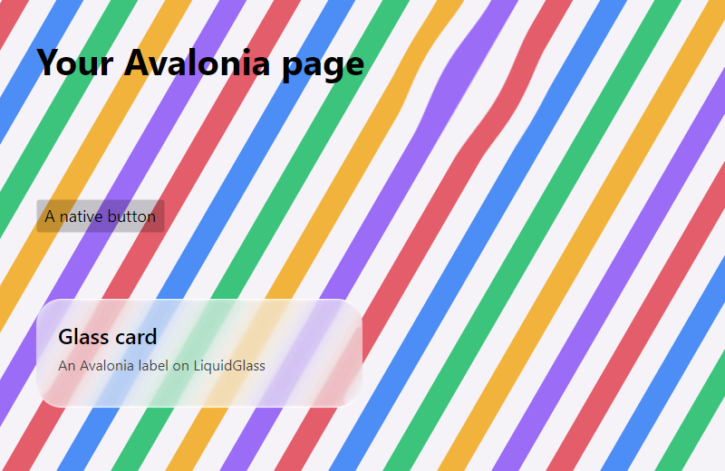

# Avalonia — 19 October 2026

`LiquidGlass.Avalonia` puts the production glass over native Avalonia 12 content, on Windows, macOS and
Linux.

*`AvaloniaDemo` on Windows 11 (.NET 10 runtime, Avalonia 12.1.4 headless, Avalonia's Skia renderer),
800 × 520 at scale 1. The page is ordinary Avalonia controls. `VisualBackdrop.Capture` renders it into
the painter's backdrop, and `GlassBitmap` takes the glass (`DrawSurface` with the measured overhead
light, and `DrawLens`). An `Image` shows it under the Avalonia labels.*

## Checks

`AvaloniaDemo` compares the rendered frame with the captured backdrop and fails unless the glass changed
the pixels under the card and the lens and left the rest alone. Here the mean difference was 106 under
the card, 35 under the lens and 0 outside. CI runs it on Linux and Windows. It also packs
`LiquidGlass.Avalonia` and checks the package (not published).

The first run swapped red and blue everywhere: the headless frame, like `RenderTargetBitmap` on some
platforms, is RGBA rather than BGRA. The capture now reads the bitmap's own pixel format.

## SkiaSharp

Avalonia 12 depends on SkiaSharp 3.119.4 or later. NuGet resolves one SkiaSharp for the process, the
painter's 4.153.1, and Avalonia's Skia renderer runs on it (this check). Avalonia 11, on SkiaSharp
2.88, cannot.

## Limits

- Headless and software-rendered in the check; a desktop window works the same way but has not had a
  scripted check here.
- The glass bitmap is drawn on the CPU, as in the WPF adapter.
