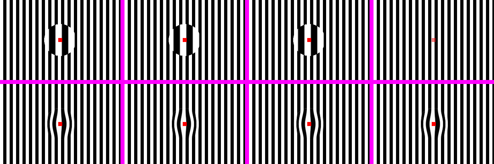
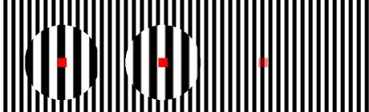
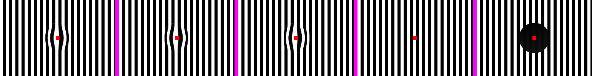
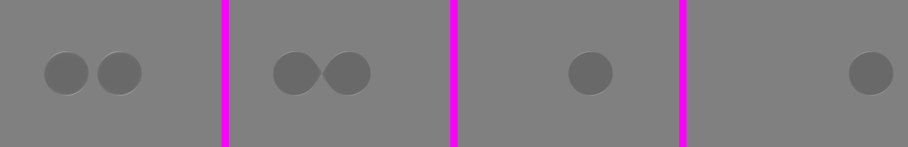

# Where glass gets its backdrop — spikes, 18 October 2026

Phase 2 lets glass sit anywhere in the tree (`Modifier.glassEffect` under one `LiquidGlassTheme`),
so it may be inside what it refracts. Two ways of keeping glass from sampling itself were built
and rendered in four placements: top level, under a `graphicsLayer`, in a scrolled column, and
under an ancestor at alpha 0.5. The test scene is 8 px black and white stripes with an 80 px
2x lens carrying a red square.

*Our renders only: `GlassBackdropSpikeTest` (branch `claude/backdrop-spikes`), JVM raster. Columns:
top level, under a layer, scrolled, under alpha 0.5.*

| | Skia backdrop `saveLayer` (top row) | Root overlay (bottom row) |
| :-- | :-- | :-- |
| Top level, under a layer, scrolled | magnifies; content sharp on top | magnifies; content sharp on top |
| Under alpha 0.5 | **glass vanishes** (the offscreen layer is empty) | **glass ignores the fade** |
| Stacking | correct | glass above other content |
| Platforms | desktop and web (Skiko); not Android | all |

The Skia backdrop behaves the same on WebGL (Compose for Web, Chromium):

*Our render: `:web` spike page, built-in Chromium; the third lens, under alpha 0.5, is gone.*

The owner chose the hybrid: the overlay on Android (13+), the Skia backdrop on desktop and web, and
Android 17 QPR2's native backdrop later. The overlay ships first on every platform (Phase 2), and
it reuses the production renderer unchanged. The Skia path needs the production shader adapted to a
backdrop filter, and follows.

## Phase 2 on the overlay

*`GlassEffectTest`: `Glass.Lens(2f)` at the top level, under a layer and scrolled; `Glass.Identity`
(content only); and no `LiquidGlassTheme` (the frosted stand-in).*

*Two pieces 12 dp apart: separate, then inside a `GlassEffectContainer` (a neck forms, with a faint
crease where the outlines meet); a piece with a `glassEffectID` mid-morph after 120 ms, then
landed.*

Checked by the tests: the lens magnifies (3 stripe transitions in 41 px against 5 outside) in every
placement; the content draws on top and is not refracted by its own glass; a click reaches the element
under interactive glass; `Identity` draws no glass; with no theme the content still draws over a
stand-in; the gap between merged pieces is glass (116 against the page's 128) and between separate ones
is not; a morphing piece is between its old and new places mid-way and lands at the new one.
