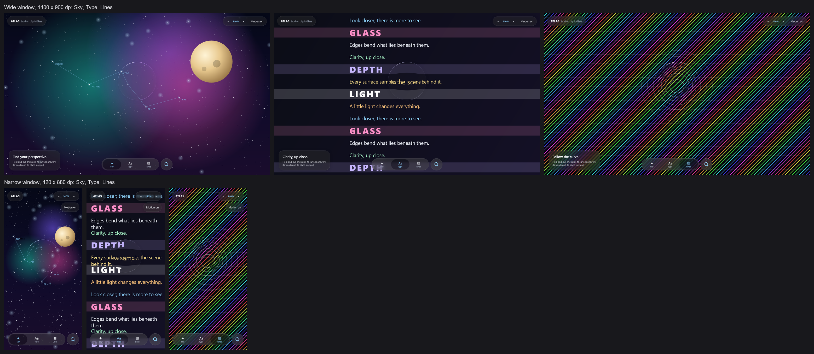

# Atlas Studio, wide and narrow windows — 18 October 2026

No physical phone was used for this pass (owner's instruction). Atlas Studio, the desktop app sharing
the Loupe screen with the Android sample, was opened at two window sizes with the new
`-Patlas.windowSize=WxH` (dp) and captured on both GPUs through the normal workspace wrapper:

```
tools/workspace.ps1 library :desktop:run -Patlas.capture=<png> -Patlas.scene=<0|1|2> -Patlas.gpu=<discrete|integrated> -Patlas.windowSize=<WxH>
```

Source: `main` at `ea46ea0` plus the uncommitted 18 October fixes (branch `claude/fix-rest`), Direct3D
through Skiko, 1.2x Windows scaling. Each capture is a static scene after 10 warmup redraws.



*Our renders only (no reference material). Top: wide window, the Sky, Type and Lines scenes. Bottom:
the narrow window. Captured on the NVIDIA RTX 3050. The Intel captures have the same layout; their pages differ only
because motion is on (the Type page scrolls and the Lines field drifts between captures).*

Inspected: every scene in both windows draws the navigation, search button, lens and card intact. In the narrow window
(under 480 dp) `LoupeScreen` is compact by design. It drops the "Studio · LiquidGlass" label, moves the
motion toggle to its own row and hides the scene card. Text under the bar and the lens reads as one soft copy in both.

## Timing

Sequential static-scene redraw submission, 120 samples after 10 warmups. This is **not** presented
FPS, continuous animation or input latency.

| Window | Scene | NVIDIA RTX 3050 p50 / p95 ms | Intel UHD p50 / p95 ms |
| :-- | :-- | --: | --: |
| 1400 x 900 dp (1733 x 1056 px) | Sky | 10.2 / 17.7 | 26.5 / 39.0 |
| | Type | 10.5 / 14.7 | 24.8 / 39.4 |
| | Lines | 9.9 / 15.9 | 28.5 / 39.6 |
| 420 x 880 dp (508 x 1053 px) | Sky | 10.0 / 18.1 | 25.3 / 38.8 |
| | Type | 10.0 / 13.4 | 21.7 / 36.5 |
| | Lines | 9.8 / 15.1 | 21.3 / 38.7 |

The narrow window costs nearly what the wide one does, a third of its pixels, so the time is
mostly per-frame overhead, not fill.

These are slower than the 11 October record ([gpu-2026-10-11](../gpu-2026-10-11/README.md): Intel 8.9 ms,
NVIDIA 4.5 ms p50 on the maximized Lines scene). A check on the same maximized scene (1920 x 1051 px, Intel)
gave 21.6 / 29.1 ms for this source and 21.4 / 28.2 ms for `02f74a4` (14 October). So the
18 October changes did not cause it. Whether an earlier commit or the machine (driver, power state)
did is not established. A build from 11 October was not timed.
