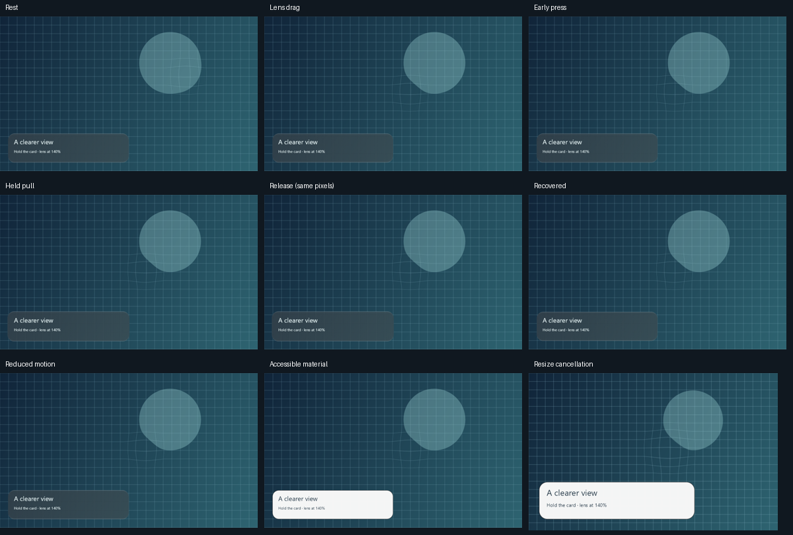

# Native .NET calm interaction — 13 October 2026

Native hosts can now use `CalmInteraction` for bounded press/pull feedback and pass its result
to `GlassPainter.DrawSurface`. The controller needs no Compose, JavaScript, UI framework or
owned timer. Hosts provide logical geometry, cumulative pointer displacement, monotonic
seconds and redraw scheduling. The existing painter's default behavior remains unchanged.

The WinForms example demonstrates it on the card: the material responds while labels and hit
targets remain anchored. Pointer release/capture loss starts recovery, resize cancels stale
coordinates, and reduced motion clears the response. A settled hold stops requesting frames;
a later pointer move restarts scheduling. All spring and deformation parameters are authored
values shared with the existing portable implementation, not recovered Apple source.

## Verification

-144 timestamped states match the existing portable controller within1e-8: small control,
  navigation-sized surface and large card; adaptive/area-preserving pull; release, re-grab,
  huge finite input, stale frame, resize and reduced motion. The fixture generator imports
  the portable implementation, and CI rejects stale fixtures when its source changes.
-107,520 independently sampled rounded-outline points stay within the viewport across
  both pull shapes, eight pull directions, edges/corners, press and release.
-30/60/90/144Hz sampling agrees with120Hz for the same timed inputs. Invalid input/geometry
  leaves controller state intact; release reaches identity and stops animation.
-Production SkiaSharp checks show optional identity feedback leaves material pixels unchanged,
  held feedback changes the material, release retains the held pixels, recovery returns exactly
  to baseline, and both successful/invalid draws preserve the host canvas.
-12 native check groups pass, including all preceding four JVM shader-profile fixtures.
  Renderer and WinForms builds have zero warnings/errors. No Kotlin library source changed.
-Nine own-handler host phases pass drag, calm interaction and resize-cancellation checks.
  Held and immediate release images are pixel-identical. Recovered and reduced-motion images
  equal the resting image after lens relocation. All1,092bright foreground pixels occupy the
  same positions at rest and during pull. All nine phases were visually inspected.

[verification.json](verification.json) records exact source hashes and test results;
[host-verification.json](host-verification.json) and [pixel-verification.json](pixel-verification.json)
retain the native evidence. Earlier diagnostic commit04d9016 passed allten required hosted checks.
This implementation's hosted result must be verified separately after publication.

## Scope still open

This adds practical native **whole-surface** interaction. Navigation-selector travel, arbitrary
native-widget backdrop capture, portable refracted foreground and additional host frameworks
remain incomplete. Windows Forms uses CPU Skia; these deterministic snapshots do not establish
GPU performance, presented FPS, owner acceptance or full1:1iOS optics/motion. The complete goal
remains in [TODO.md](../../../TODO.md).

Reproduce the checks and host capture using [the .NET guide](../../../ports/dotnet/README.md).
