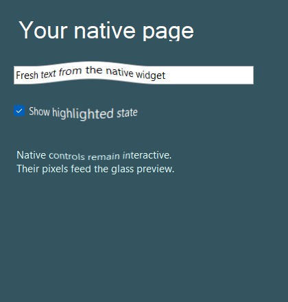

# Native control backdrop — 13 October 2026

`LiquidGlass.WinForms.ControlBackdrop.Capture` lets a host supply pixels from its own WinForms
control subtree to the existing native painter. The host no longer needs to redraw supported
controls in Skia. It retains input, layout, accessibility, snapshot lifetime and invalidation.
The example provides editable native controls alongside their refracted preview.

The capture calls `Control.DrawToBitmap` on the owning UI thread, copies its opaque pixels
into a caller-owned Skia image, and releases temporary resources. No screen capture, foreign
window handle, global input or hidden desktop content is used. Glass must be outside the
captured subtree to prevent recursive capture. Images are replaced only after capture succeeds.

## Verified behavior

-Actual TextBox content changes alter1,522pixels within its bounds, independently of any
  background change. The Panel, Label and CheckBox also appear in the inspected output.
-A production identity lens preserves captured widget pixels exactly; magnification changes
  the same source. Resizing replaces the source with the new380pixel width.
-A visible RichTextBox is rejected, and its failed capture leaves the preceding image usable
  and pixel-identical. A call from another thread is rejected before rendering.
-The native executable exits successfully; all captured images were inspected. Build has
  zero warnings/errors. Locked restore includes the new project reference without introducing
  any additional third-party package or changing the existing SkiaSharp version.
-Windows CI gains the same executable check. The preceding native-interaction commit
  `af333fa` passes allten required checks; this adapter needs its own hosted confirmation.

Results and source hashes: [verification.json](verification.json). The original build rejected
two obsolete Skia drawing overloads under warnings-as-errors; explicit sampling fixed them.
The original failed build is recorded in the research log, not counted as verification.

## Limits

Verified control types are Panel, Label, TextBox and CheckBox. RichTextBox and ActiveX are
explicitly rejected; hidden children are omitted. Microsoft documents reverse container order
and other [DrawToBitmap limitations](https://learn.microsoft.com/en-us/dotnet/api/system.windows.forms.control.drawtobitmap?view=windowsdesktop-10.0).
Overlapping layouts and custom controls require host verification. The caller owns the sRGB
content contract; wide-gamut/HDR equivalence is not established.

CPU bitmap capture is for content/layout updates, not every glass-animation frame. There is no
GPU/display-latency claim. Other native stacks and navigation-selector motion remain open;
this does not complete the any-stack or fulliOS-parity goal. See [usage](../../../ports/dotnet/README.md)
and the complete [TODO](../../../dev/TODO.md).
