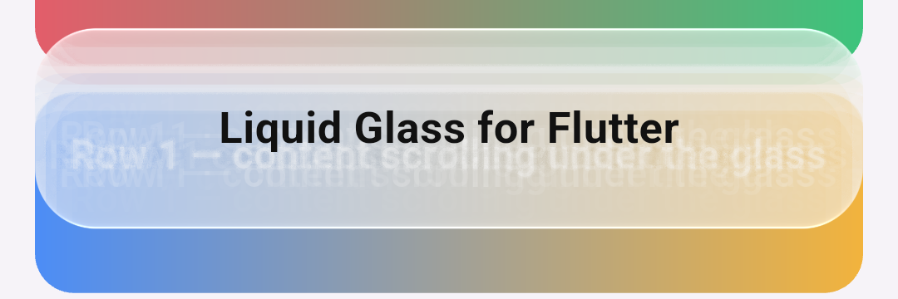
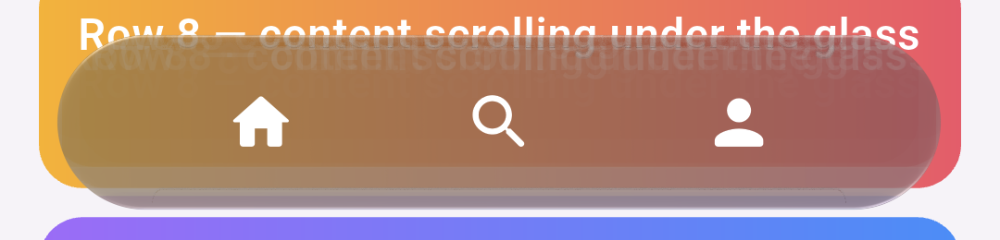

# Flutter — 19 October 2026

`liquidglass` for Flutter (`ports/flutter`) draws the Compose library's material over the live
backdrop: `GlassSurface` is a backdrop filter running the production shader, generated from
`ports/skia/shaders/material.sksl`.

*Our capture: the example app (`ports/flutter/example`, release build) on the Android 17 emulator
(`lg_verify_37`, x86_64, 1080 × 2400 at 420 dpi). Impeller on its OpenGL ES backend. Flutter
3.47.7. `adb exec-out screencap`; left at rest, right after a 400 px swipe, scaled to 45%. The page is
an ordinary `ListView`; the glass refracts it live.*

| Crop | |
| :-- | :-- |
|  | the light card (light `[0, -1]`) |
|  | the dark bar, icons as ordinary Flutter widgets |

*Full-resolution crops from the scrolled capture.*

## Checks

- `flutter test`:
  - the generated shader compiles with Flutter's shader compiler and loads;
  - the Dart material's 75 uniforms equal the CanvasKit port's for three surfaces, to 1e-6
    (`test/material_fixture.json`, generated from `ports/skia/material.mjs`);
  - the widget lays out and paints without Impeller.
- `node tool/generate_shader.mjs --check` and `node tool/generate_fixture.mjs --check` fail when
  either generated file drifts from its source.

## Found on the way

Flutter documents a y flip on OpenGL ES for `ImageFilter.shader`. Applied to a backdrop filter's
input, it turned the page upside down on the emulator: the bar showed the page's title. Without the
flip, the backdrop is the right way up. The generated shader has no flip.

## Limits

- An emulator, not a phone. Impeller's Vulkan backend (most phones, the Pixel 7 among them) is not
  checked yet.
- The wide tone kernel is approximated with thirteen Gaussian taps (see the package README).
- Rounded rectangles only. There is no lens or navigation bar, and no touch response.
