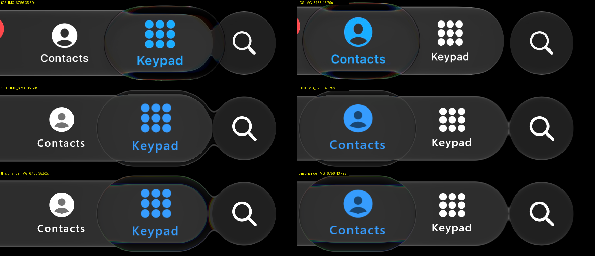
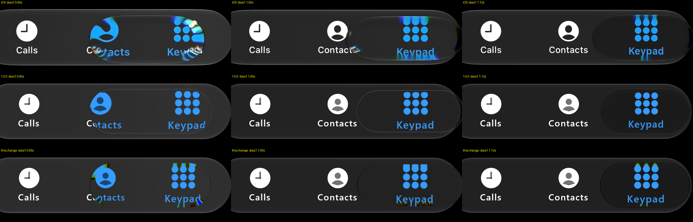
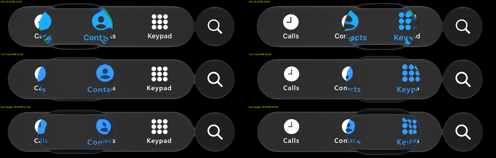
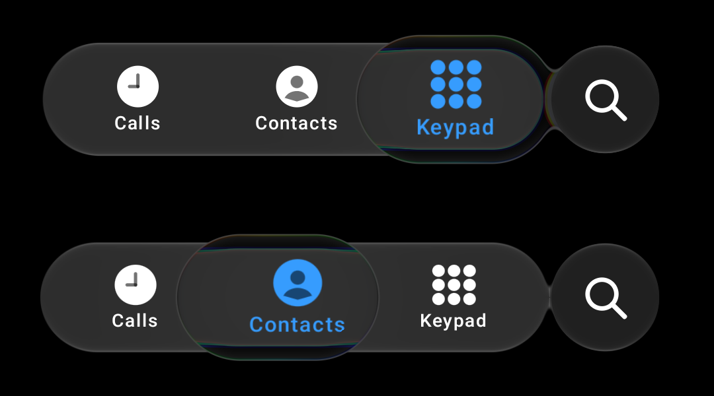
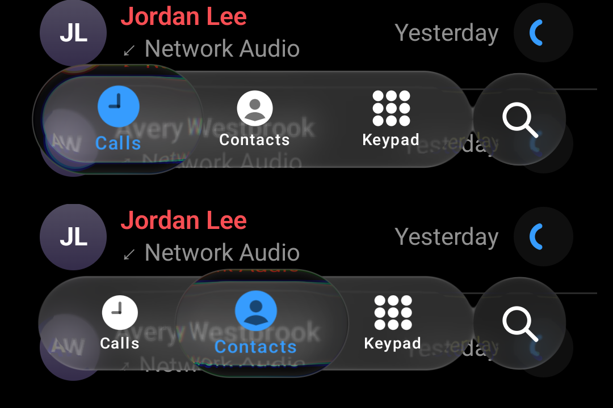

# Rim refraction and fringes against iOS — 26 October 2026

Issues #77 (refraction), #73 (fringes), #92 (rim shape), #94 (tap transit), from the
[iOS parity audit](../ios-audit-2026-10-26/README.md). The owner's instructions: choose the band "visually
more close to the ios references", and for the fringes "build the exact stuff like ios … no need for opt
ins". So these are default changes, scored against all five recordings, not opt-in flags.

## What changed

| Change | Where | Provenance |
| :-- | :-- | :-- |
| Calm held lens band `bodyBandScale` 0.3 → **1.1** (dark and light) | `GlassTabBar.kt` `GlassCalmLensBand` | authored, chosen by the rim scorer (iOS +10.9 px; 1.0 → +9.8) and by eye |
| Held material map **without the seam** at half the band: `u + w(u)(0.3u − 0.29)`, `w` fading over 0.25-0.75 | `GlassSourceMapSource.kt` `heldSourceSmooth`, used by `GlassShaderSource.kt` | the 1.3/0.29 map is inherited; the connection band is authored. The ink pass already used a continuous map |
| Held-lens colour split **proportional to the shift**: ±4·`uAberration`·\|shift\| | `GlassShaderSource.kt` | authored, sized from IMG_6756 35.5 s: a bright line pulled 11 px in shows red outside and blue inside ~10 px apart |
| **Spectral rim**: a thin hue ramp along the held lens's outline, amount 1.6·`uAberration` | `GlassShaderSource.kt` | authored, hues read from IMG_6756 35.5 / 43.8 s (green → red → orange → yellow → green → cyan → blue, chroma 40-80, outer 2-4 px) |
| Selector split still 0.05 → **0.08**, moving **0.14**, blended by held travel; the ink takes 0.3 of the held split | `GlassTabBar.kt` | authored, scored with `tools/measure_rim_fringe.py` |
| Tap transit folds again: rim mirror 1.0 → **0.3**, gain 0.4 → **0.15**, cap confinement 0.75 → **0.2**; dark Calm `tapTransitFold` back to its default | `GlassTabBar.kt` | authored against docs/1 0.95-1.12 s |
| Replay knob `+fringe=still,moving[,foldCorners,rimMirror,rimGain]` through `LiquidGlassDiagnostics.selectorFringe` | `PhoneReplay.kt`, `LiquidGlass.kt` | diagnostics only (excluded from the ABI) |

W = 0.6 R (measured) is unchanged; nothing measured was re-fitted.

## Why the seam mattered

`heldSource(u)` jumped from 0.36 to 0.5 at half the band. With the band at 0.3 the jump was ~3 px and read as
the thin second outline the owner called "two glasses" on 18 October; at 1.1 it was ~10 px and broke labels into
fragments over content (Pixel 7, 26 October). Every band tried showed the bar's edge as a straight line across the
lens. Without the seam the bar's edge bends into the rim at both ends, as iOS's crescent does.

## Evidence

Replays: `:desktop:phoneReplay`, desktop GPU (Skia, Direct3D), 60 fps, the inferred input of each recording.
"1.0.0" is replay `p20` (build `ab574ec`); "this change" is the working tree on `main` 34127d8 plus this change.
iOS frames HDR10 → display sRGB (`.local/sxs/hdr.py`). Only recordings whose crop shows nothing but the bar are
committed (IMG_6756, docs/1, LOLL8185: black pages); every image was inspected for page text.

*Held lens on Keypad (35.50 s) and on Contacts (43.79 s): iOS, 1.0.0, this change. Scene rows 420-670.*

*A tap from Contacts to Keypad, 0.95 / 1.05 / 1.12 s. Still open: our label streaks are saturated red/green
where iOS's are soft blue-teal, and the pill darkens early (#70).*

*A held drag, 22.20 / 26.50 s. Still open: our lens trails iOS's path (#95) and the swirl in the leading cap is
harder-edged than iOS's.*

*Pixel 7, Android 17, release build of this change, `PhoneActivity` dark: a still hold on Keypad, then a
drag to Contacts (`adb shell input swipe`; screenshots mid-gesture).*

*The same over the sample's call list (fictional sample names): labels stay whole; the page text above the bar
is pulled into a thin compressed strip along the lens's top rim, as iOS does with header text.*

## Scores

**Fringes** (`tools/measure_rim_fringe.py`, threshold 40, every frame of every touch; peak and integrated E
per touch, ours / iOS, median):

| Recording | fringed frames iOS / ours | integrated E ours/iOS | peak E ours/iOS | 1.0.0 peak ours/iOS |
| :-- | :-- | --: | --: | --: |
| docs/1 (37 taps) | 22.1 % / 23.0 % | 1.23 | 1.34 | 0.02 |
| docs/2 (23 holds, drags, throws) | 39.0 % / 34.5 % | 1.39 | 0.86 | 0.03 |
| IMG_6756 (4) | 27.2 % / 27.5 % | 0.94 | 1.81 | 0.00 |
| JGEY2190 (29) | 21.7 % / 39.3 % | 1.05 | 0.98 | 0.01 |
| LOLL8185 (1 long drag) | 90.5 % / 62.5 % | 0.23 | 0.57 | 0.03 |

The long held drag (LOLL8185) is still weak: a moving held lens takes the same "moving" split as a tap, and needs
more. JGEY2190's taps fringe in more frames than iOS's (39 % against 22 %): ours fade later.

**Rim refraction** (`tools/reference-replay/refraction.py`, the bar's straight edge pulled toward the lens centre,
central columns, median over frames):

| Recording | state | iOS | this change | 1.0.0 |
| :-- | :-- | --: | --: | --: |
| docs/2 | held | +10.9 px | +10.8 px | -2.2 px |
| IMG_6756 | held / moving | +11.2 / +11.3 | +10.2 / +10.4 | -2.2 / -2.2 |
| JGEY2190 | held | +10.0 | +11.6 | +0.2 |
| LOLL8185 | held / moving | +10.9 / +10.9 | +10.2 / +10.2 | -2.2 / -2.2 |
| all | held | **+10.9** (877 frames) | **+10.8** (1004) | -2.2 |

By depth inside the rim (3-20 px) ours reads +12.5 to +9.8 against iOS's +10.2 to +11.5: the same flat profile,
slightly stronger in the outermost 6 px. JGEY2190's moving rows differ because its fast reversals flatten iOS's
lens (bimodal, as the 24 October record noted).

## Limits

- The spectral rim's hue ramp is authored from two frames; iOS's hue sequence varies with what lies behind.
- The tap streaks' colour and the swirl shape are not matched yet (see captions).
- Light appearance was changed with dark (same band) and not re-scored (#104).
- Device: one Pixel 7, screenshots only.
