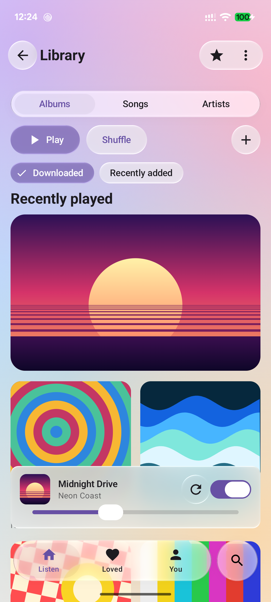
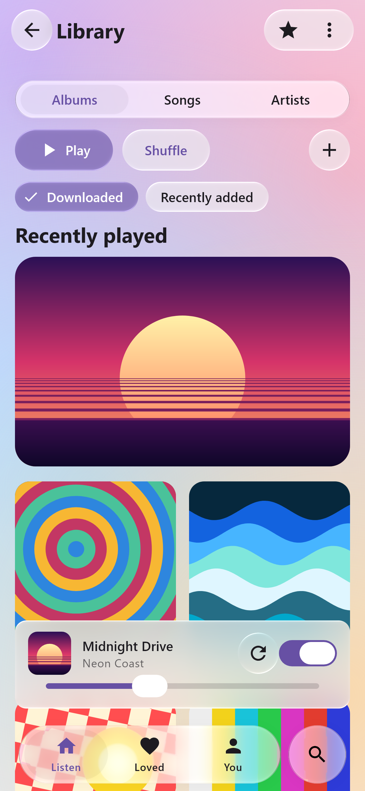
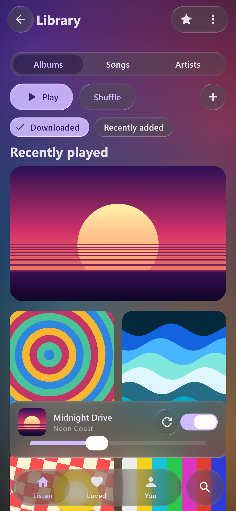
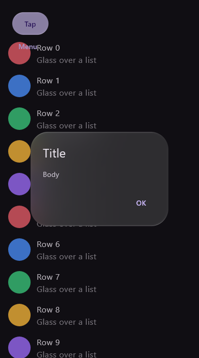
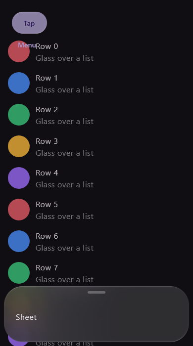
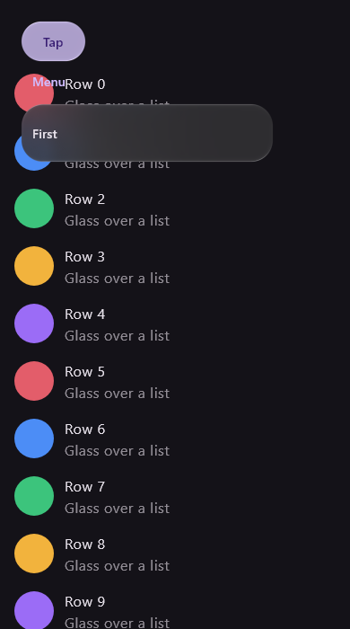
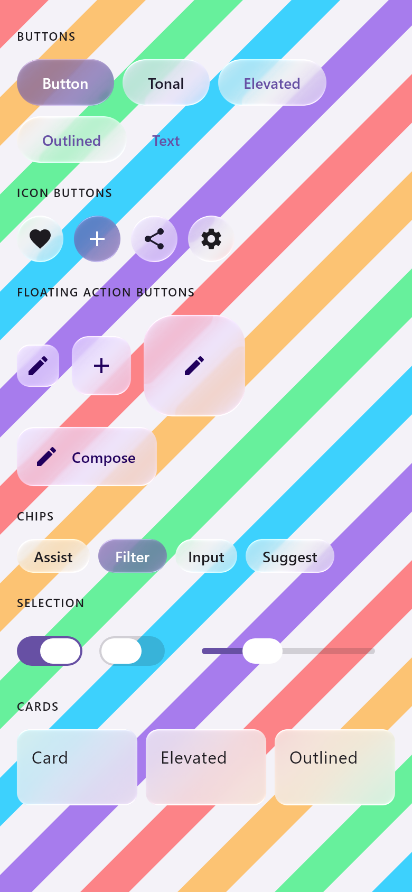
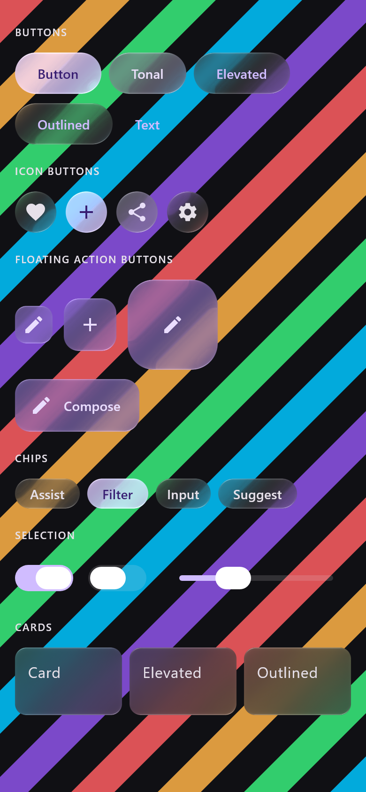
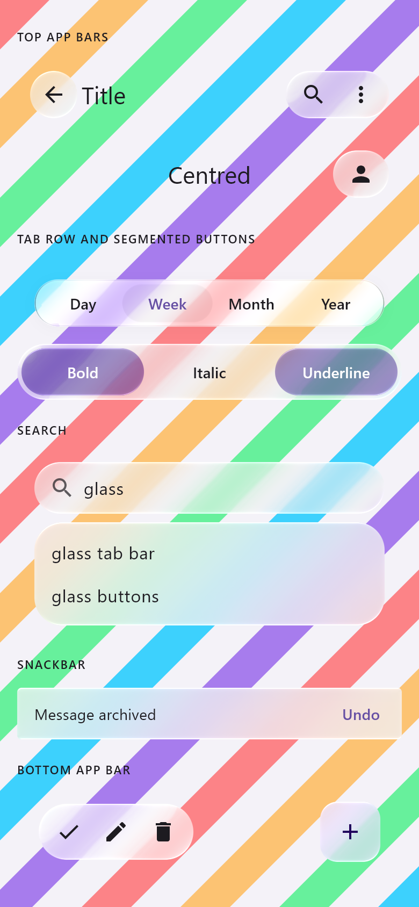
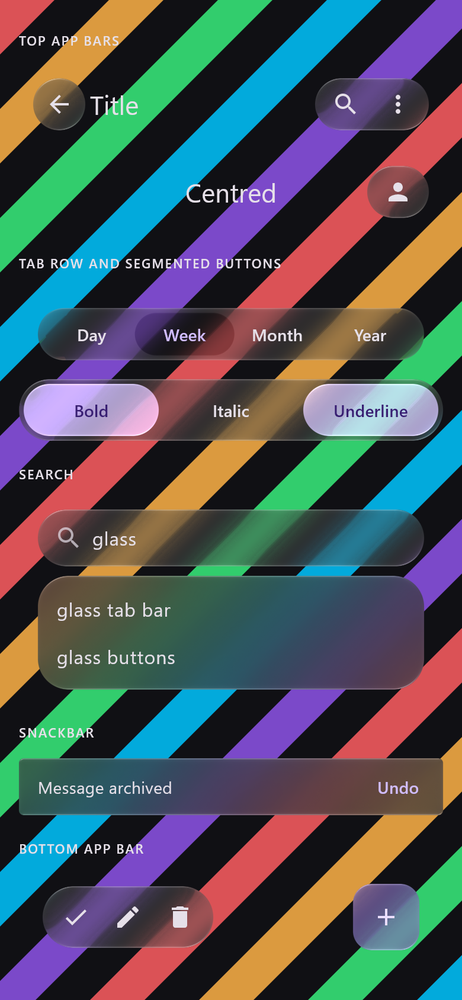

# Glass quality pass — 18 October 2026

The owner's verdict on the first Material 3 renders: the glass did not read as iOS. It looked murky and
flat, smeared text along panel edges, and had no shine. Part of that was the demo, a grid of flat
gradients on a dark page, and part was the material on large surfaces. This pass changes both. **No
measured constant changed and the core library is untouched.**

## What changed

- **Panels are frosted.** Cards, dialogs, sheets, menus, snackbars and the search results panel use
  the new `GlassMaterialDefaults.panel`. It is the same material as `regular` over a backdrop blurred
  at 7.7 dp, the sigma measured on iOS's system backdrops (`GlassStyle.backdropSigma`). Using that
  sigma for in-app panels is **authored**. Without the frost, a panel's wide rim band compressed the
  text beside it into a sharp copy along the edge, the "smears and ghosting" in the owner's list.
  Controls (buttons, chips, bars, the tab bar) keep `regular`, unblurred, as iOS's controls do.
  On a panel they take the panel's frost. Glass on glass samples the page under the panel, so an
  unfrosted button on a card showed a sharp, bent copy of the cover the card hides.
- **The showcase is a real screen.** A music library over a mesh wallpaper, with eight procedural
  album covers that have detail for the glass to bend (sunset, rings, waves, checker, colour bars,
  bloom, moons, signal), a "Recently played" hero, and a mini player. Before, it was a grid of
  two-stop gradients on Material's flat background.

## Pixel 7 (Android 17, the device's GPU)

*`MaterialShowcaseActivity` from branch `claude/glass-quality` (debug build), captured with
`adb exec-out screencap -p`, 1080 × 2400. A screenshot of a still frame: motion is not shown.*

## Desktop (Skia raster)

| Light | Dark |
| :-: | :-: |
|  |  |

*`MaterialShowcaseRenderTest` (desktop JVM, Skia raster), 390 × 844 dp at density 3. The same
`MaterialShowcase` composable as the Android sample and the web demo. The covers are procedural test
content.*

## Panels and the catalogue

From `GlassMaterialComponentsTest` and `GlassMaterialCatalogueTest` (desktop JVM, Skia raster, 390 ×
844 dp at density 2), after this change. The renders before it are kept in
[material3-2026-10-18](../material3-2026-10-18/README.md).

| Dialog | Sheet | Menu |
| :-: | :-: | :-: |
|  |  |  |

| Controls, light | Controls, dark |
| :-: | :-: |
|  |  |

| Navigation, light | Navigation, dark |
| :-: | :-: |
|  |  |

## What this is not

This is not a calibrated comparison against iOS. The changes are authored design choices: a panel
material that reuses a measured sigma, and a better demo. The measured bar and lens constants are
unchanged, so the core suite's tolerances still hold. Rim and specular work toward iOS (crisp
hairline, specular crescents) is the next step. It will be opt-in and scored against the local
references.
