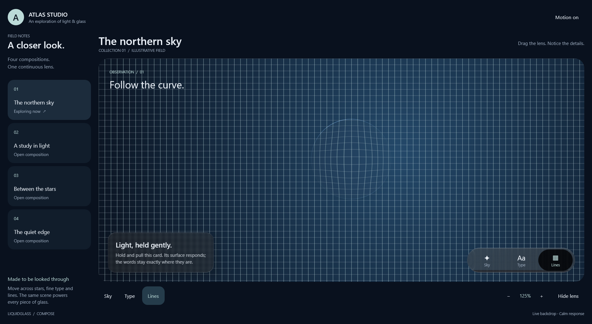

# Atlas GPU selection — 11 October 2026

The owner reported lag and requested the NVIDIA GPU. Atlas now defaults to Skiko's per-process
`skiko.gpu.priority=discrete`, configurable with `-Patlas.gpu=auto|integrated|discrete`.
Startup and capture metadata include the actual adapter name, so preference and result stay distinct.
No Windows-wide setting, driver installation or library renderer policy changed.

The installed Skiko0.150.1 implementation and its [tagged source](https://raw.githubusercontent.com/JetBrains/skiko/v0.150.1/skiko/src/jvmMain/kotlin/org/jetbrains/skiko/SkikoProperties.kt)
were checked. On this machine the default automatic preference selected Intel UHD; discrete selected
**NVIDIA GeForce RTX3050 6GB Laptop GPU**, both using Direct3D. NVIDIA driver616.92 was reported locally.

| Same1920×1051 grid scene,120 redraws after10 warmups | Median submission | p95 | Maximum |
| --- | ---: | ---: | ---: |
| Auto: Intel UHD | 8.9164ms | 15.7317ms | 18.4355ms |
| Discrete: NVIDIA RTX3050 | 4.4777ms | 7.4771ms | 11.0769ms |

These are sequential static-scene redraw submission timings on the same source, **not presented
FPS, continuous animation, input latency or a sustained-load benchmark**. Screenshot readback and
CPU work can still cause stalls. Both images were inspected for intact lens, card and navigation.

[Automatic-selection capture](auto.png), [NVIDIA timing/adapter](nvidia-timing.json),
[automatic timing/adapter](auto-timing.json) and [verification](verification.json) are retained.
Run through the normal workspace wrapper; `launch_desktop.bat` inherits the discrete preference.
No full renderer suite was repeated for this launcher/diagnostic-only change.
