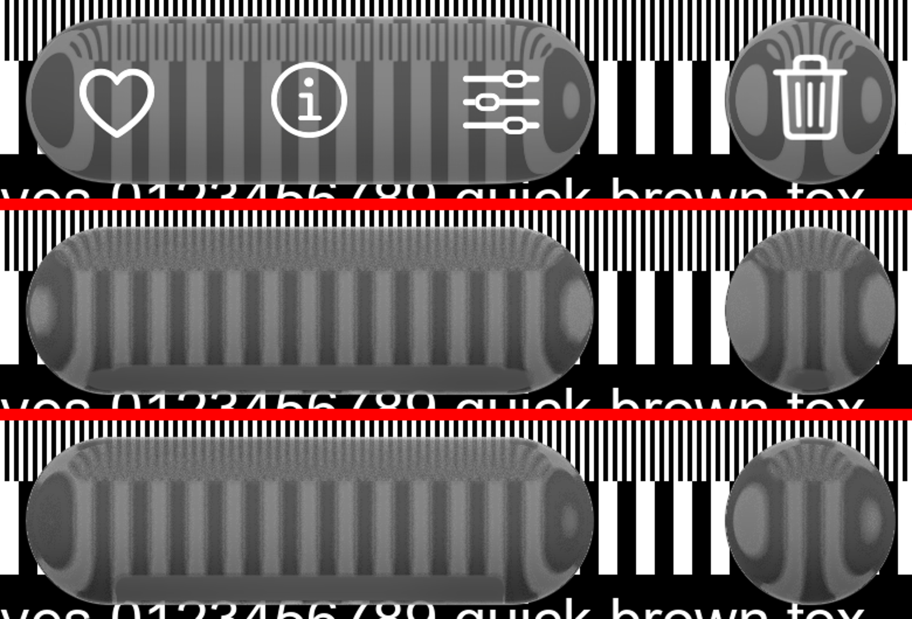

# In-app glass on the measured resting-corner map — 26 October 2026

Issue #97, audit items 56-58.

*The Photos toolbar over the calibration chart: iOS 27 (COSG3073 276 s, HDR10 → display sRGB; only the
chart and the toolbar are in the crop), then `GlassCalibrationRenderTest` (desktop JVM software render of the
same boxes at tint 50, light target, dark chrome) with the legacy resting-corner map, then with
`GlassRestMap.Measured`.*

The measured map was fitted on this toolbar's 72 px ends (190 landmark pairs) and shipped as an opt-in
candidate. With it, the toolbar's caps and the round buttons show the dark ovals iOS shows (the black band
far beyond the rim, folded in); the legacy map showed light ones. `GlassStyle.inApp` and
`GlassStyle.toolbar` use it by default now; the tab bar's bar keeps the legacy map (its caps were scored
against the recordings with their own cap lens).

Still different (left for a measured fit, #97): iOS's top run brings the broad stripes in at the very rim
(depth 2 px shows content from ~36 px deeper), fanned toward the corners; ours shows the fine stripes in
place there, blurred.

Checks: `:liquidglass:jvmTest` 437 tests, 0 failures after updating the one test that asserted the old
default; `:liquidglass-material3:jvmTest` 22/22; the tab bar's port fixture unchanged.
