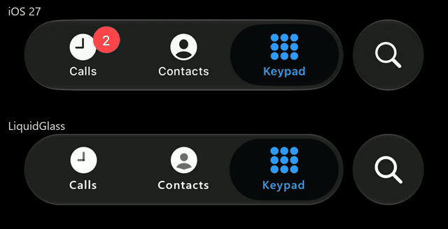
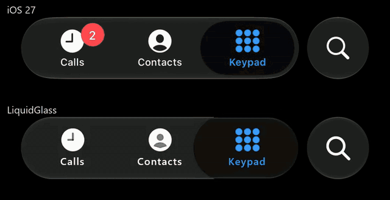
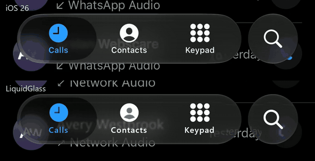
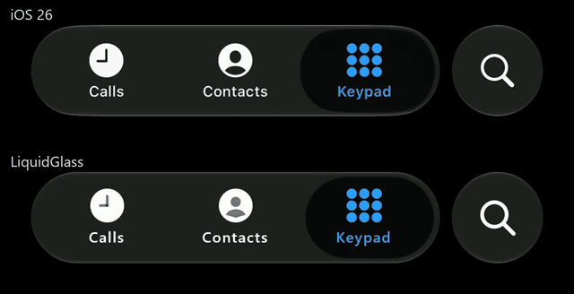

# iOS beside LiquidGlass: the tab bar's lens (20 October 2026)

**What it shows.** The Phone app's tab bar on iOS 27 (top) and the library's `GlassTabBar` (bottom),
replaying the same gesture: a hold on Keypad (34.45-36.65 s of the recording), then a 12-second held
drag from Keypad to Calls and back (41.1-53.2 s). Then a tap (`docs/1`, from 0.87 s) and a throw
(`docs/2`, from 8.47 s), both iOS 26.

**Source.** iOS: the owner's screen recording `IMG_6756` (iOS 27, Phone app), HDR10 decoded to display
sRGB with ffmpeg `zscale` (the decode in `.local/sxs/hdr.py`). The tap and the throw: the owner's recordings
`docs/1` and `docs/2` (iOS 26), decoded the same way. The recordings themselves stay private; the owner
approved publishing derived segments on 20 October 2026 provided two named contacts never appear. Every
frame of each GIF was inspected: the hold and the drag stay on the black Keypad page; in the tap and the
throw only the rows under the bar show, blurred by the glass, and neither name is among them. The red
badge on Calls is a missed-call count.

**LiquidGlass.** Pass p20 of the replay, build `ab574ec` (the v1.0.0 material and motion; the same pass for all four GIFs), rendered on
the desktop GPU (Skia) at a deterministic 60 fps, driven by the finger path inferred from the recording.
Built with `.local/review-selector/build.py`; cropped to the bar, stacked, scaled to 640 px wide and
encoded as a 25 fps, 64-colour GIF, so fine gradients band slightly.

**Limits.** The input is inferred from the recording, not the same finger, so small timing offsets are
expected (tracking: 11.0 px rms for IMG_6756). The owner's review of this page on 20 October found
the motion close but **our refraction visibly weaker than iOS's** (see how much more the iOS lens bends
the icons beneath it); that gap is open work in `dev/TODO.md`. Measured differences for all five
recordings: [the replay record](../reference-replay-2026-10-13/README.md#remaining-differences).
