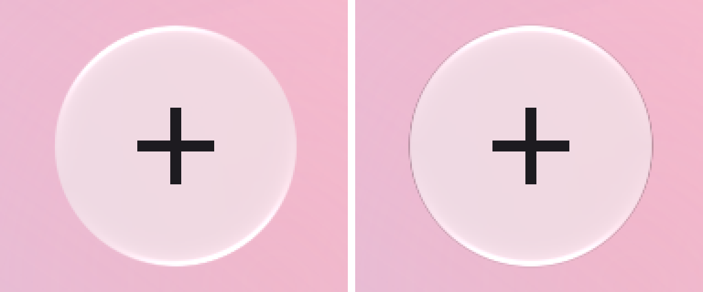
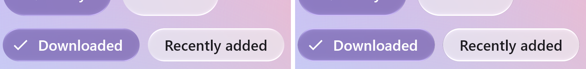
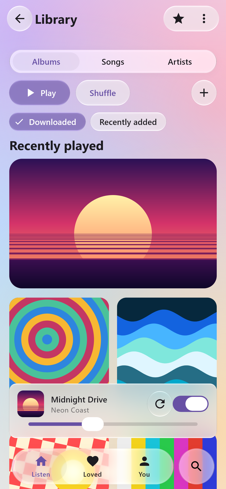
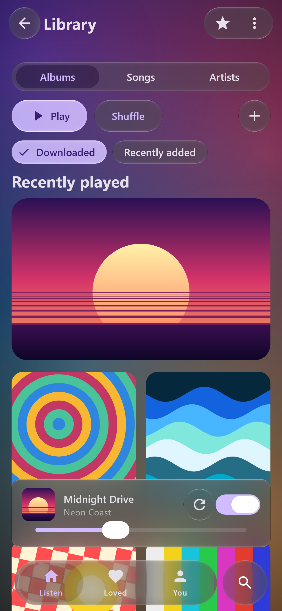
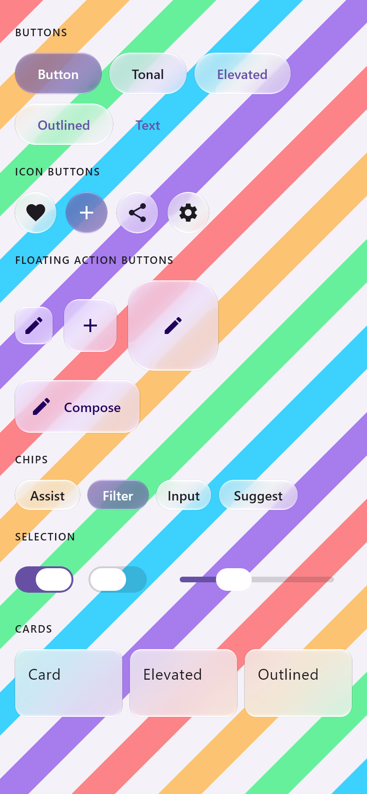
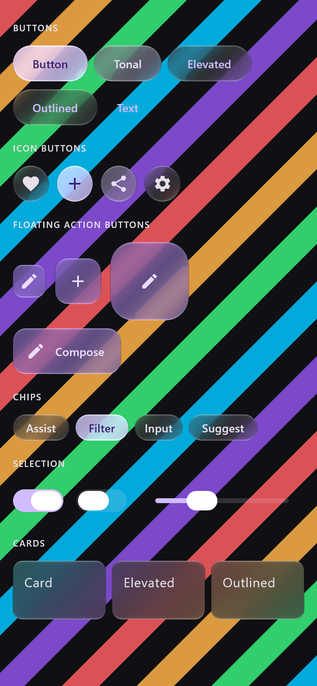
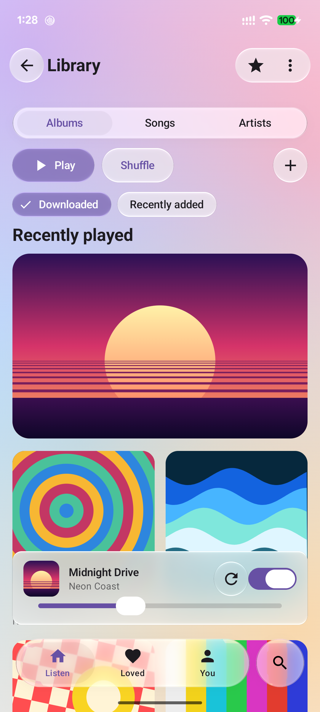
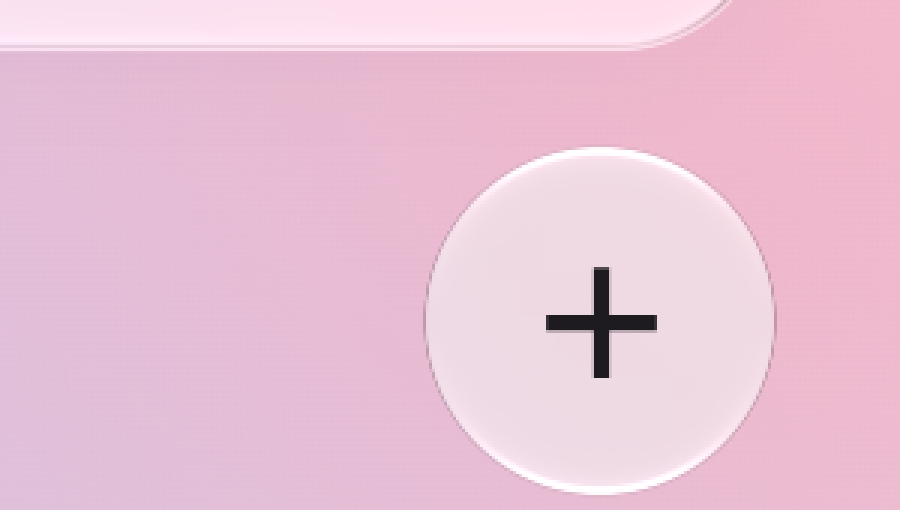

# iOS 27's rim — 19 October 2026

The owner's complaint about the glass was that it had "no shine" and read as a blur view on a
canvas. Part of it is the edge. An iOS 27 control has a crisp dark hairline at its sides where
nothing is lit, and lit edges straight above and below. Ours had no hairline, and its highlight
came from 20 degrees left of vertical. Both are measured in
[`docs/research/ios27-measurements-raw.md`](../../../docs/research/ios27-measurements-raw.md)
("The dark contour", "Set the light straight up"). The record lists them as the cheapest visible
fixes still open.

## What changed

- **`GlassStyle.outerContour` (new, opt-in, 0 by default).** A dark contour drawn *outside* the
  outline. It is about 1.5 px wide and centred 0.25 px outside, so the outermost wholly covered
  pixel is untouched, as measured. Its strength follows the angle to the light,
  `(1 - |cos|)^0.75`: zero at the lit poles and full at the sides. Over the nine measured angles
  (dark appearance) the law is within 0.04 of the side value. It is drawn as black at that
  opacity, which is multiplicative. Whether iOS's is multiplicative or additive cannot be
  determined from the captures.
- **Material 3 adopts iOS 27's measured rim** (`GlassMaterialDefaults.control` and `panel`):
  - the contour at the measured strengths: 0.61 in a dark appearance, 0.31 in a light one, with a
    quarter of it left at the poles (`outerContourFloor` 0.25);
  - light straight overhead, `GlassLight(0f, -1f)`, measured at 0.0 ± 0.3 degrees;
  - the edge highlight as iOS 27 measures it: a chamfer brightest in the outermost pixel
    (`bevelPeak` 0, where the iOS 26 pill fit is a bead at 0.25), +65 levels there, halving 2.34-2.41 px
    in (`specular` 0.27 over `bevel` 1.6 dp), with a broad lobe (`specularPower` 2.6, within the
    measured best power of 2.3-2.8; half width about 40 degrees, where power 6 gave 27). The lit rim
    now wraps further round each shape, as iOS's specular crescents do;
  - no dispersion. iOS 27 measures exactly zero, where `inApp` inherits the default 0.07.

  Using iOS 27's values for the Material layer is the authored choice. The values themselves are
  measured. The core's presets, `Glass.Regular` included, are unchanged, so every previously
  verified path keeps its tolerance.

## Before and after

*Desktop JVM, Skia raster, `MaterialShowcaseRenderTest` at density 3. Left: `claude/glass-quality`
(e06a580). Right: this branch. Crop of the + button, enlarged 3x without smoothing. In the
after image the side contour is the one-pixel grey line; it reads 166 over a 204 backdrop at
its first outside pixel, 0.19 removed, against the model's 0.21 there. The top and bottom edges
are lit and the sides are not. Over this light page the lit rim adds to near-white and clips at
255, which is what additive white does over light content on iOS too.*

| Showcase, light | Showcase, dark |
| :-: | :-: |
|  |  |

| Catalogue, light | Catalogue, dark |
| :-: | :-: |
|  |  |

*Desktop JVM, Skia raster: the showcase at density 3, the catalogue at density 2. Over dark content
the contour is invisible, as on iOS.*

## Pixel 7 (Android 17, the device's GPU)

*`MaterialShowcaseActivity` from this branch (debug build), captured with `adb exec-out screencap
-p`, 1080 × 2400; the button crop is enlarged 3x without smoothing. The contour draws outside the
outline on Android's render-effect path as on desktop: a grey hairline at the sides, lit edges top
and bottom. A screenshot of a still frame.*

## Checks

- `GlassOpticsTest.testTheOuterContourSitsOutsideTheOutlineAndOnlyWhereTheRimIsUnlit` renders the
  measurement's subject, a 132 px circle over white lit from above. The contour darkens the page at
  the side, not at the pole, and never the body, and it is off by default.
- `GlassEffectTest.theOuterContourDrawsOutsideTheOutlineAloneAndInAContainer` checks the white page
  just outside a circle's side through both shaders: 255 with the contour off, and 187 both for a
  lone element and for a container's merged body.
- The core suite (`:liquidglass:jvmTest --rerun`) on the final head: 413 tests, 0 failures, 27
  skipped. An earlier run failed one test, `GlassShaderTest`'s list of the uniforms the host sets,
  which did not yet name `uOuterContour`. The Material 3 renders, the Skia port (44 tests), the npm
  package (27 unit and 7 browser tests) and the .NET checks (16) pass with the new shader.

## Limits

- The tab bar uses the glass shader and could carry the contour. Its measured `Calm` styles leave it off,
  because they already carry a measured cap contour (`capEdgeShadow`, fitted to iOS's light bar
  ends), and adding a second would double it.
- The light appearance's profile is flatter than the law between the pole and 60 degrees. iOS
  removes 8.1% of the backdrop at 20 degrees and 11.3% at 40; the law with its floor removes
  10.7% and 15.8%.
- This is a render comparison against measured numbers, not a pixel comparison against an iOS
  capture. The captures are private and stay off GitHub.
