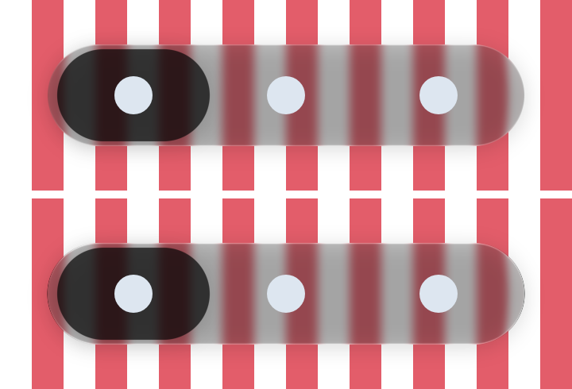

# The Ios27 tab bar preset, measured — 19 October 2026

`GlassTabBarStyle.Ios27` held guessed numbers until now; the roadmap asked for measured ones. It is
now `Dark` with iOS 27's rim as measured in `docs/research/ios27-measurements-raw.md`: the dark
contour outside the outline (0.61), the bar's lit edge scaled to iOS 27's peak (0.256 against
`Dark`'s 0.213) and half-depth (2.37 px against 1.8), and no dispersion. The lens keeps `Dark`'s
measured held optics.

*`GlassIos27BarRenderTest` (desktop JVM, Skia raster, 360 × 120 dp at density 2). Top: `Dark`.
Bottom: `Ios27`. Over the white stripe beyond the bar's left end, Ios27's contour reads 68 where
Dark's soft edge reads 110; the test asserts the contour darkens it by more than 20 levels.*

Core suite on this branch: `:liquidglass:jvmTest --rerun` passes (BUILD SUCCESSFUL); `GlassTabBarStyleTest`
checks the preset's values against the measurements.
