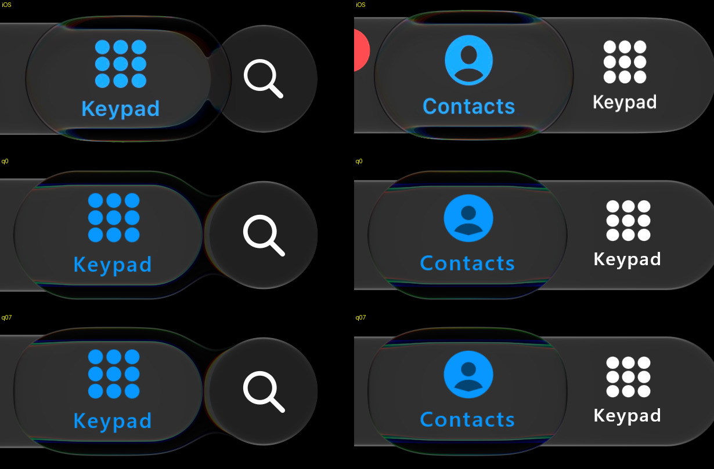

# The held lens's squircle outline — 26 October 2026

Audit item 9 / #93.

*IMG_6756 35.50 s (left, held on Keypad beside the search button) and 43.79 s (right, dragged across
Contacts). Rows: iOS (HDR10 → display sRGB), then our replay of a short script cut from the recording's input
(`.local/sxs/ref/IMG_6756/short.txt`, desktop GPU, 60 fps, source at this change) with the Calm selector's
lens as the capsule (row `q0`: `calm+squircle=0`, the old outline) and with the new default (row `q07`: `calm`, blend .7 toward n = 3).
A replay, not a device capture; the input is inferred from the video.*

iOS's held lens is not a capsule. Its top runs flat further out and turns down more squarely at the shoulders:
a superellipse `|x/A|^n + |y/B|^n = 1` over the lens's own extent fits it with n ≈ 3. The pose shader and the
CPU query now blend the capsule's distance and normal toward that superellipse by `uPoseE.x`; the Calm selector
sets the blend to `GlassPoseSpec.heldSquircle` × formation, so the resting selector and every other pose body
stay capsules. `GlassPoseShaderAgreementTest` holds the shader to the CPU at blends 0, .5 and 1 (0.49 px, normal
0.004).

**Score.** The lens's width at each depth below its crown (0-12 px; `.local/sxs/sqscore.py`, frame 114 against
35.50 s), against iOS's `48 118 148 165 177 188 196 204 210 216 221 226 230` px:

| variant | widths (px) | rms | rms below 2 px |
| :-- | :-- | --: | --: |
| capsule (was) | 136 156 167 176 184 190 196 202 206 212 216 220 224 | 27.5 | 7.8 |
| blend 1, n 3 | 61 110 134 152 165 176 187 196 204 211 218 224 230 | 9.2 | 8.9 |
| blend 1, n 2.5 | 40 82 103 120 133 144 154 164 172 180 186 194 200 | 37.8 | 39.5 |
| blend 1, n 4 | 101 157 182 200 212 224 232 240 248 254 260 266 270 | 38.7 | 37.1 |
| blend .6, n 3 | 72 130 150 164 174 184 192 198 206 212 217 222 228 | 8.2 | 3.7 |
| blend .75, n 3 | 67 120 144 160 172 182 190 198 205 212 218 223 228 | 6.8 | 4.6 |
| **blend .7, n 3 (now)** | 68 124 146 161 172 182 190 198 205 212 218 222 228 | **7.1** | **4.5** |
| blend .5, n 3.5 | 100 148 164 176 186 194 202 209 216 221 226 232 236 | 18.2 | 8.1 |

**.7 toward n = 3** is authored between the two best rows; it is not a measured constant. The exponent is the
measurement (n ≈ 3); the blend is the fit. The ports (CanvasKit, npm, React Native, .NET) carry the same spec
value and pass it as `uPoseE`; Flutter, Qt and Unity draw no pose selector and set the capsule.

Limits: one held frame of one recording is scored; the lens's top is still 2-3 px higher than iOS's (item 9's
size difference, unchanged here) and the lens sits a few px left of iOS's (the inferred input).
