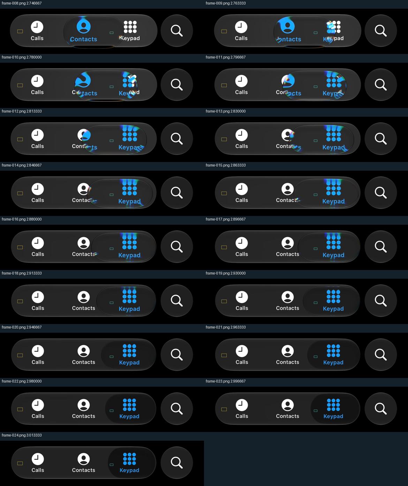
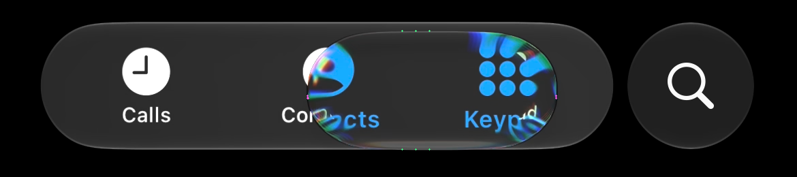
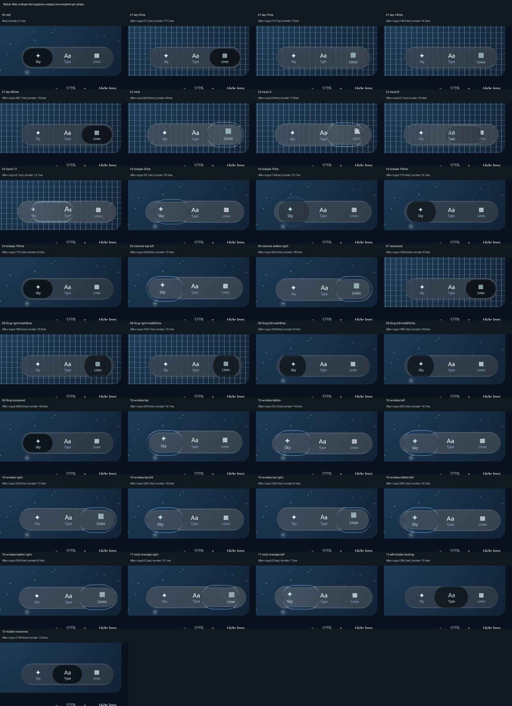
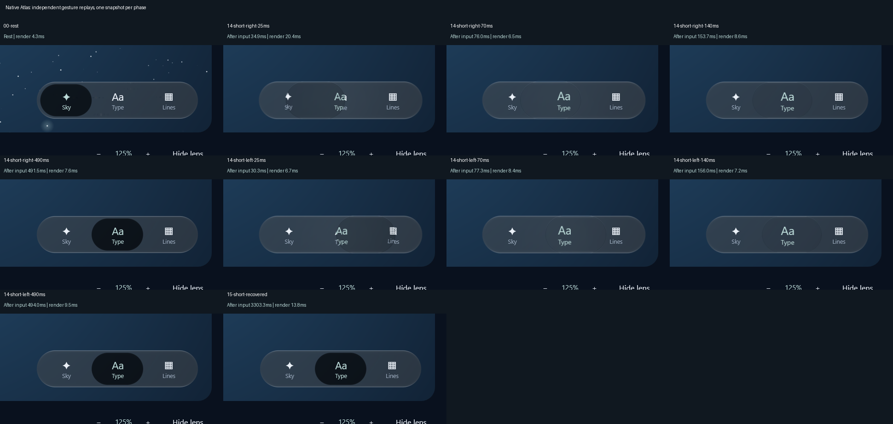

# Preserve tap clarity through long travel

The area-only tap appearance cleared the dark inset during a short trip, but restored pigment
too early during longer trips. At source time 1.08 s, the observed selector reads 38 RGB levels
over a 37-level bar; the previous interior diagnostic gives 14.45. A second long trip shows the
same sustained clarity and gradual darkening. The [earlier counterexample](../tap-optics-candidate-2026-10-11/README.md)
is retained rather than replaced by the new fit.

The candidate adds the existing axial travel stretch to the appearance demand, then lets
pigment recover gradually as demand falls. This affects pigment and selected-ink emphasis;
it does not alter held optical formation, pointer ownership, bar strain or controller geometry.
All **14,430 corresponding production-export rows** retain exactly the same centre, width,
height, phase, formation and protrusion as the previous implementation.

## Response and provenance

Projected-area demand retains its authored `0.44` normalization. Added half-spine growth is
normalized by `0.13 × resting width`, so a circular resting body does not introduce division by
zero. The squared demands add before the existing continuous-derivative shoulder into a `0.95`
ceiling. Rising appearance follows already-sprung geometry directly. Falling demand uses a
critically damped `45 rad/s` recovery, retaining value and physical-time velocity. Interruptions
carry appearance into the existing held/release recovery. Historical defaults remain disabled.

These constants are authored calibration choices, not recovered Apple mechanics. A first fit
using the original short/long episodes failed the repeated long episode: maximum error was
7.38 RGB levels, above the existing six-level gate. Further exploration used all three episodes;
**the repeated episode is therefore no longer held-out validation**. The failed studies remain
in the local research archive and are documented in the research log.

## Observed output and production comparison

| Episode | Previous RMS / maximum error | Candidate RMS / maximum error |
| --- | --- | --- |
| Short tap, 9 moving patches | 2.28 / 5.01 | 2.14 / 5.01 |
| First long tap, 8 patches | 13.82 / 23.55 | 4.33 / 5.23 |
| Repeated long tap, 17 patches | 13.89 / 20.24 | 3.60 / 5.24 |

Values are RGB levels from the same tint/lift algebra applied to the **observed surrounding bar**.
They do not reconstruct the hidden backdrop or full shader scene. Source values above the bar
also show that negative pigment alone does not explain every optical contribution.



The repeated episode uses one geometry-derived time alignment. At native time 2.796667 s,
frame 011's inspected edge probes give centre 634 px, width 365 px (RGB/row range 364–365) and
height 174 px. Inherited source endpoints 221–748 px and nominal 278 px / 40 ms model input
produce time origin 2.676277683 s. This is not a recovered finger timestamp. Exploratory ±15 ms
sensitivity was retained; alignment uncertainty is not removed by the fitted colour agreement.



[Patches](patches.json), [anchor probes](repeat-anchor.json), [production export](production-appearance.csv)
and [comparison](comparison.json) preserve the numbers. Reproduce with standard Python:

```sh
python tools/compare_phone_transit_appearance.py review/atlas/long-tap-appearance-2026-10-12/patches.json review/atlas/tap-optics-candidate-2026-10-11/production-appearance.csv review/atlas/long-tap-appearance-2026-10-12/production-appearance.csv --output .local/long-tap-comparison-new.json
```

## Verification status

Both new production-shader tests fail on the previous controller: first-long output 25 versus
42 expected, and repeated-long output 35 versus 45. The candidate passes all 25 long-tap
shader patches at the unchanged six-level gate, alongside the existing short-tap and rendered
ink checks. **38 unique focused checks pass**, including the expanded interruption case for
both distances through 340 ms, geometry equality, scale/cadence, held/throw behavior and styles.

The NVIDIA/Direct3D 33-phase native replay passes selection/layout assertions; every phase was
inspected. Rest, recovery, held/throw states and all app-window edges/corners remain intact, and
the hard vertical sampling seam did not recur. This is a contact sheet of independent replays.



The separate adjacent-tap replay also passes in 48 s, and all ten phases were inspected,
including the early leftward frame at native size. Resting and recovered images are pixel-identical
to the previous wide-input correction. The moving frames are independently timed replays.



First-tap forced redraw took **771 ms**, followed by **2904 ms readback**. The nominal 25 ms
label is not a precise presentation time; interaction latency and frame pacing remain open.
The static wide-input performance cost reported in the preceding packet also remains open.

The complete **371-case library inventory is verified: 344 passes and 27 optional skips**.
This combines 38 unchanged-source focused cases, 305 successful cases from the remaining run,
and one isolated retry. The remaining run initially timed out on the historical V3 declined-drag
test after 65.318 s; that case passed in 27.451 s at the unchanged one-minute deadline, with no
source or assertion change. The original failure remains recorded as a timing/reliability issue.
It is not relabelled as an uninterrupted green run.

All **three Atlas tests pass**, and **Android assembly succeeds** for the changed source.
The Atlas/Android completion command took 6m12s. Exact case coverage, source hashes and failure
provenance are retained in [verification](verification.json) and the local recovery archive.
The [current handoff](../../../dev/NEXT-SESSION.md) identifies subsequent work; earlier 342-pass
results still belong to the preceding source.

Matching finite interior patches does not prove complete shape, selected glyphs, rim transport,
continuous motion or every supplied gesture. Full iOS parity and owner acceptance remain open.
