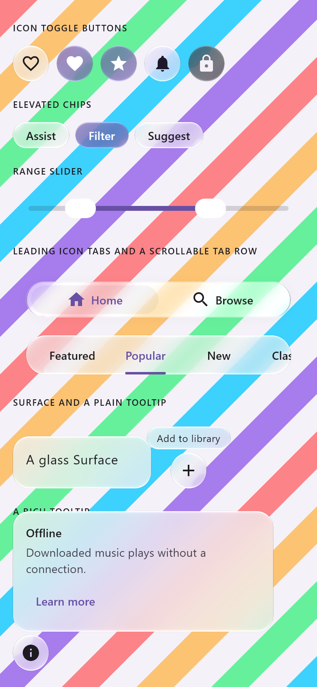
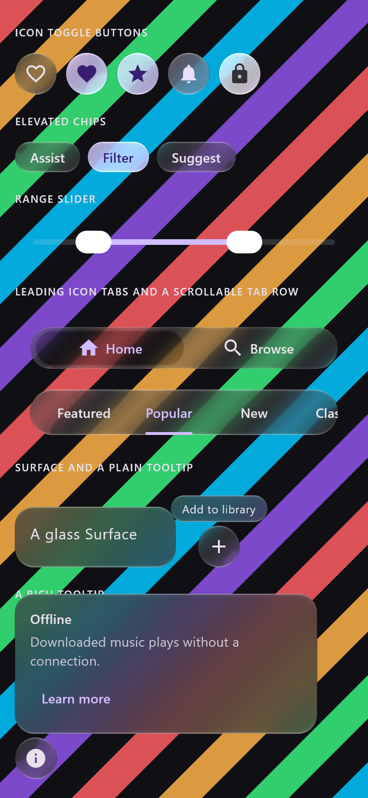
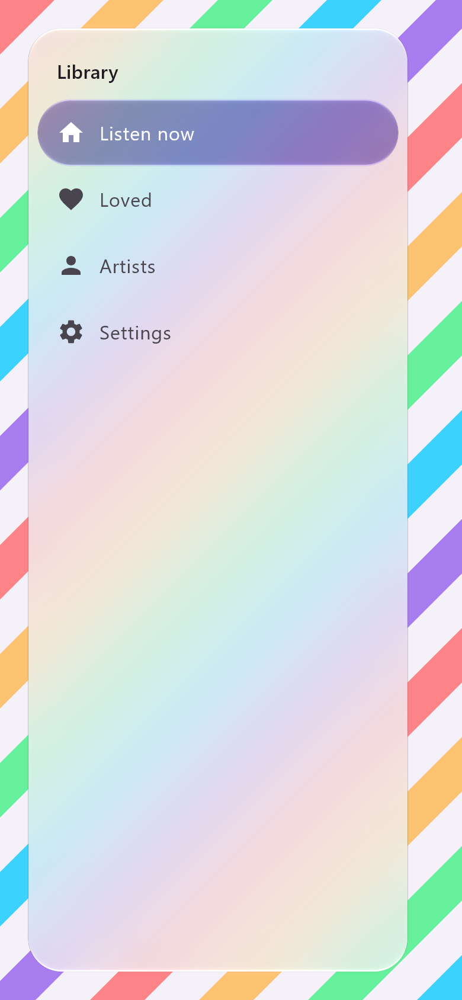
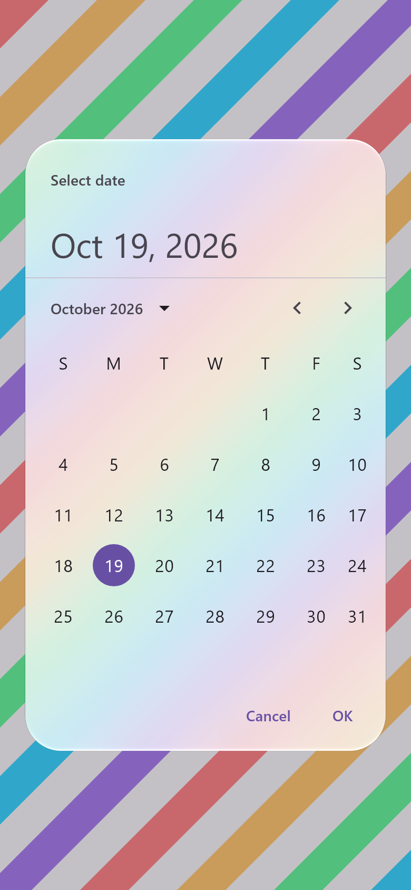

# Material 3 coverage — 19 October 2026

The owner's standing decision is that every Material 3 component gets a glass version. This pass
adds the ones with a container that were still missing. The rest of Material (text fields,
checkboxes, radio buttons, progress indicators, dividers, badges, list items) has no container that
iOS draws as glass. Those keep coming from Material, which a star import still provides.

| New glass component | What it becomes |
| :-- | :-- |
| `IconToggleButton`, `FilledIconToggleButton`, `FilledTonalIconToggleButton`, `OutlinedIconToggleButton` | round glass buttons: plain glass when off, prominent (tinted) glass when on |
| `ElevatedAssistChip`, `ElevatedFilterChip`, `ElevatedSuggestionChip` | the glass chips (glass carries its own depth) |
| `RangeSlider` | iOS's thin track filled between two thumbs, each a glass lens while dragged |
| `Surface` (both) | a frosted glass panel; Material's `color` tints it |
| `TooltipBox`, `PlainTooltip`, `RichTooltip` | a glass capsule or panel drawn in the app's window (not a popup), placed by Material's position provider; a long press or hover shows it |
| `ModalDrawerSheet`, `DismissibleDrawerSheet`, `PermanentDrawerSheet`, `NavigationDrawerItem` | iPadOS's sidebar: a floating frosted panel inside Material's own drawer; the selected item is a prominent glass capsule |
| `DatePickerDialog`, `TimePickerDialog`, `DatePicker`, `DateRangePicker` | a glass dialog in the app's window; the pickers lose their opaque container |
| `LeadingIconTab`, `PrimaryScrollableTabRow`, `SecondaryScrollableTabRow` | segments of the glass segmented control; Material's scrolling tabs in a glass capsule |

All of them take Material's parameters, so the `liquidGlassAdopt` codemod can switch their imports.
Parameters that glass replaces (elevations, container colours other than a tint, indicators,
dividers) are accepted and ignored.

The same pass routes the top app bar's buttons, the toolbars, the rail and the segmented capsules
through `GlassMaterialDefaults` (new `toolbar`), so they carry the iOS 27 rim too. Before, they
used the core's `Glass.Regular` and `Glass.Toolbar` directly and missed it.

## Renders

| Light | Dark |
| :-: | :-: |
|  |  |

| Drawer | Date picker |
| :-: | :-: |
|  |  |

*`GlassMaterialCatalogueTest` (desktop JVM, Skia raster, 390 × 844 dp at density 2), over diagonal
colour bands so every glass edge crosses a colour boundary. The two tooltips are shown with a
persistent state for the render.*

## Checks

`GlassMaterialComponentsTest.togglesToggleAndALongPressShowsATooltip` checks three behaviours:
- a glass `IconToggleButton` toggles on and off;
- a tooltip's anchor still gets its click (the tooltip observes input and never consumes it);
- a long press shows the tooltip.

## Two limits closed

- **Back.** The platform's back gesture dismisses the glass dialogs, sheets, menus and tooltips. They
  live in the app's window, so they register with Compose's navigation-event dispatcher themselves.
  An Android `ComponentActivity` provides the dispatcher; without one, back does nothing.
- **Partially expanded sheets.** A sheet taller than half the window opens at a stop showing half of
  it, iOS's medium detent. Dragging settles at the nearest stop.

`GlassMaterialComponentsTest.backDismissesOverlaysAndATallSheetStopsHalfway` checks both:
- a back event dismisses a dialog, a menu and a sheet;
- a 560 dp sheet in a 700 dp window opens partially expanded, with its top between 300 and 400 dp.

## Limits

- `TooltipBox` takes Material's `focusable` and `hasAction` and ignores them. Its caret is not drawn.
- `DatePicker` and `DateRangePicker` keep Material's own title and headline unless you pass your own.
- The drawers keep Material's `ModalNavigationDrawer` and its scrim and gestures; only the sheet and
  items are glass.
