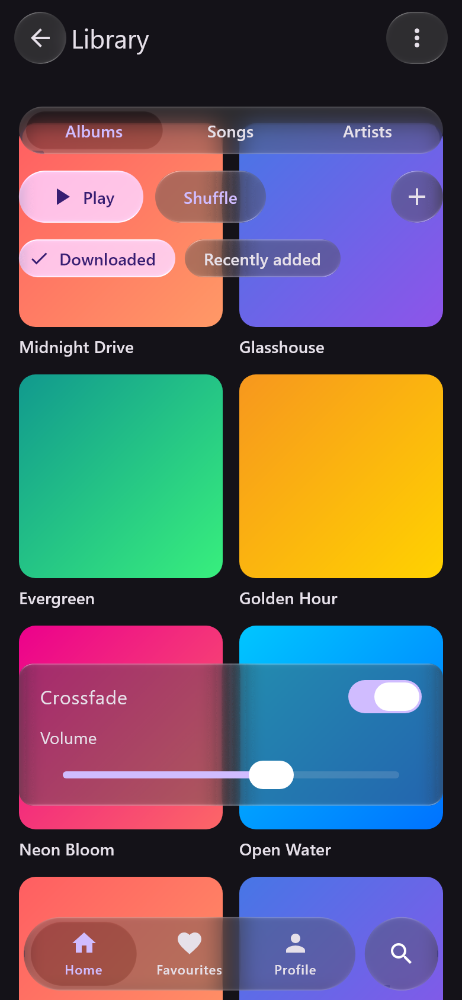
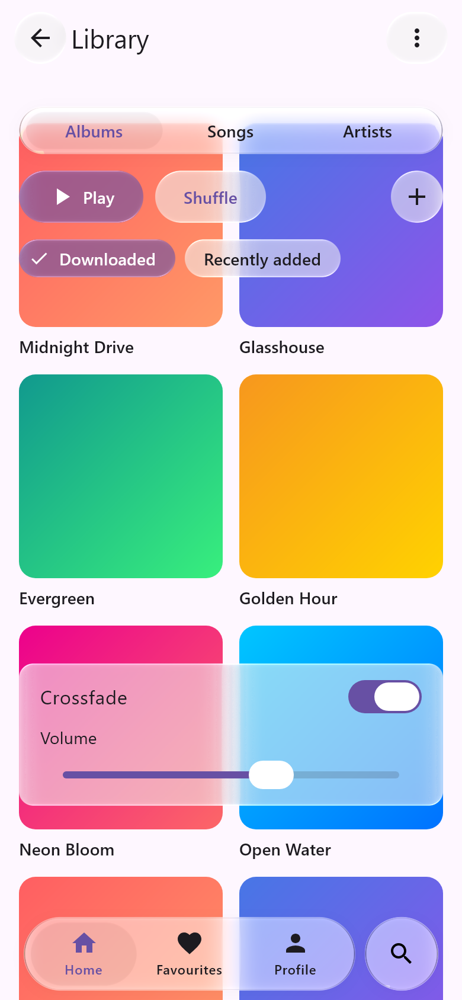
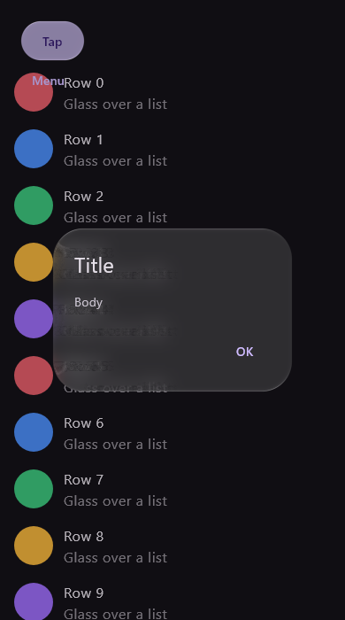
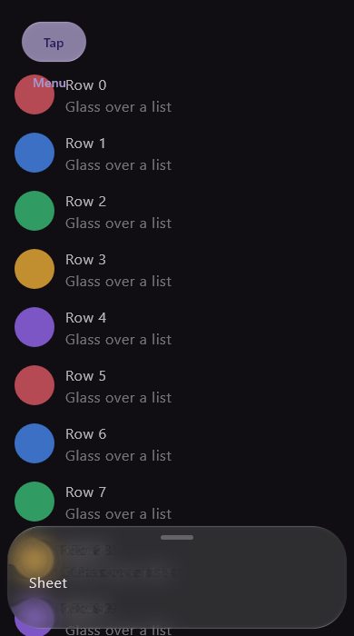
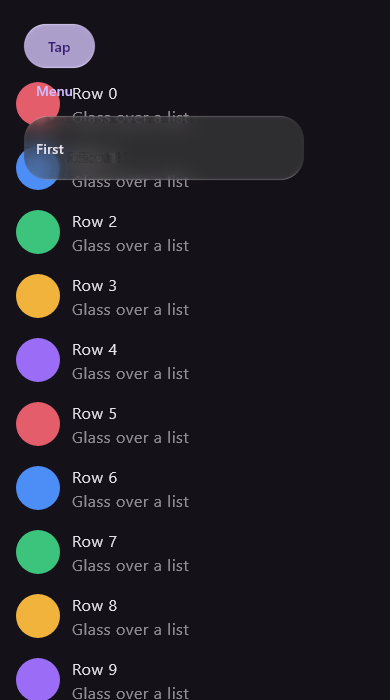
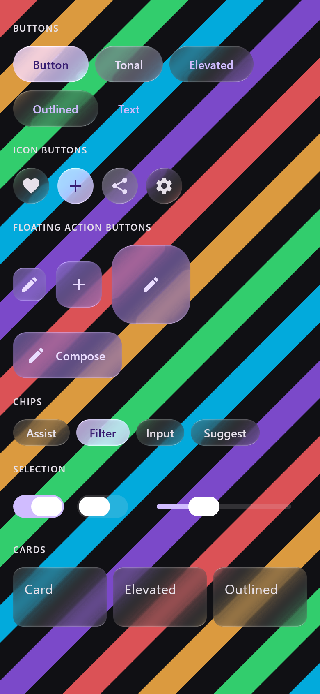
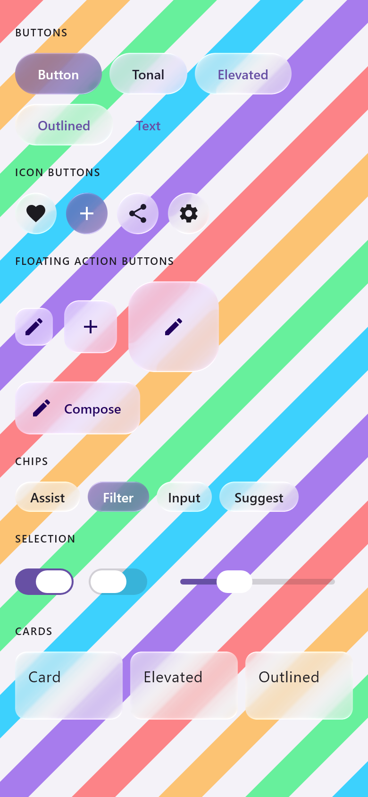
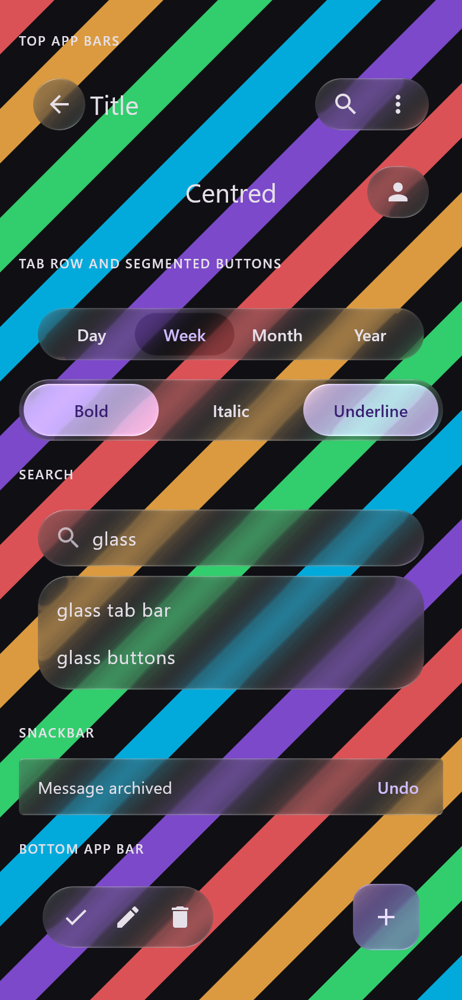
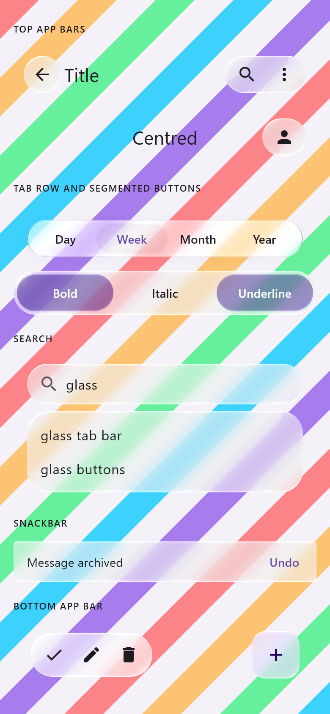
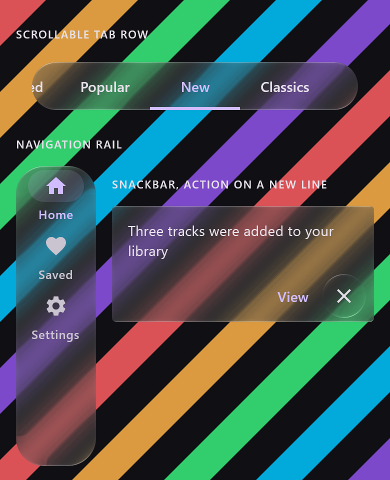

# Material 3 in Liquid Glass — 18 October 2026

`liquidglass-material3` (Phase 3): glass versions of the Material 3 components with the same names and
parameters. These renders come from `GlassMaterialComponentsTest` (desktop JVM, Skia raster, a
390 × 844 dp window at density 2, branch `claude/material3`): one screen built only from the glass
components, over a grid of gradient album covers.

 

*Our renders only. Material's `darkColorScheme()` and `lightColorScheme()`, unchanged. From the top:
`TopAppBar` with two `IconButton`s, a three-segment `SingleChoiceSegmentedButtonRow`, `Button`,
`OutlinedButton`, `IconButton`, `FilterChip`, `AssistChip`, a `Card` holding a `Switch` and a `Slider`,
and `NavigationBar` with three `NavigationBarItem`s and a search accessory. Icons from
material-icons-core. The covers are test content.*

| Dialog | Sheet | Menu |
| :-: | :-: | :-: |
|  |  |  |

## Every component (catalogue)

From `GlassMaterialCatalogueTest` (same backend and window), over diagonal colour bands so each glass
edge crosses a colour boundary.

| Controls, dark | Controls, light |
| :-: | :-: |
|  |  |

| Navigation, dark | Navigation, light |
| :-: | :-: |
|  |  |

*Fixed from the first catalogue render: checked multi-choice segments drew primary text on primary-tinted
glass (now `onPrimary`, as `Button`), and `Snackbar` showed Material's surface shadow as a rectangle
inside the glass (now drawn by the library).*

## Interaction

Checked by the test: a tap on the third tab of the glass `NavigationBar` selects it; a glass `Button`
clicks; `AlertDialog` opens and its button dismisses it; `ModalBottomSheet` shows its content;
`DropdownMenu` opens under its anchor and an item closes it.

Fixed while making these renders: the navigation bar's search accessory drew its glass but not its
icon (the overlay drew it under the bar's portal; linked accessories now draw after portals), and the
slider now uses iOS's thin continuous track instead of Material's split track.

Not checked here: Android devices, the web build, motion of the switch and slider thumbs (static
frames only), and visual parity with iOS 26 for components other than the tab bar (authored, not
measured).
