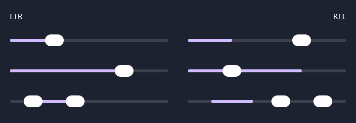
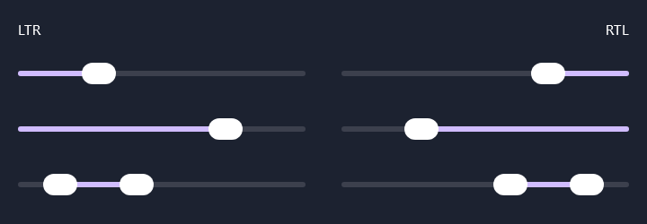

# Material 3 sliders, right to left (#89) — 24 October 2026

`GlassSlider` and `GlassRangeSlider` drew their track on a `Canvas` that was not mirrored, while Material
places the thumbs from the right under `LayoutDirection.Rtl`. The fill therefore grew from the left
edge, away from the thumb. The tracks now draw from the start edge, mirrored right to left.

| Before (`main` at `3b5ac43`) | After (this change) |
| :-- | :-- |
|  |  |

Each image shows the same three controls left to right (left column) and right to left (right column):
a `Slider` at 0.25, a `Slider` at 0.75 and a `RangeSlider` at 0.1..0.4. Before, the right-to-left fill
starts at the left edge and does not meet the thumb, and the range fill sits on the wrong side of
the thumbs. After, the fill runs from the right edge to the thumb and between the two range thumbs.

**Capture.** Desktop JVM, Skia (software raster through `runDesktopComposeUiTest`), density 1,
`darkColorScheme()`, 760 x 300 px, captured with `captureToImage()` by a throwaway test that was
not committed. The "before" image is the same test run against `main`'s `Controls.kt`.

**Checks.** `GlassSliderTrackTest` gains `rightToLeftTheFillGrowsFromTheRight` and
`rightToLeftTheRangeFillIsMirrored`. Both failed before the change and pass after it.
`:liquidglass-material3:jvmTest` passes 22 of 22. The left-to-right rendering is unchanged.

**Limits.** Desktop only; not captured on Android or in the browser. All three draw through the same
common `Canvas` code, so the mirroring applies everywhere, but it was only rendered here. Track
height, colours and overhang are the authored values from #79, unchanged.
