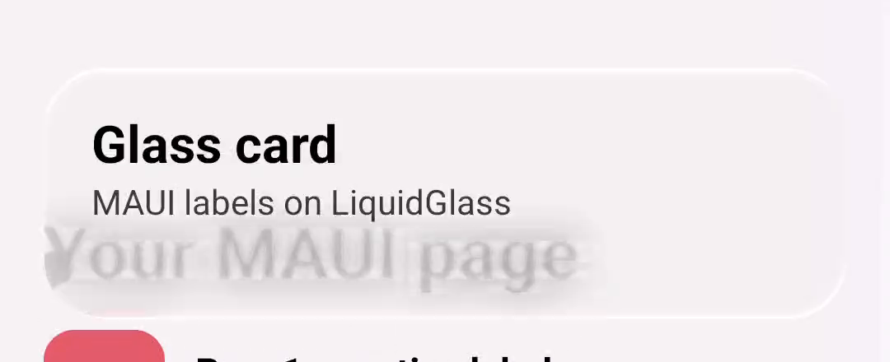
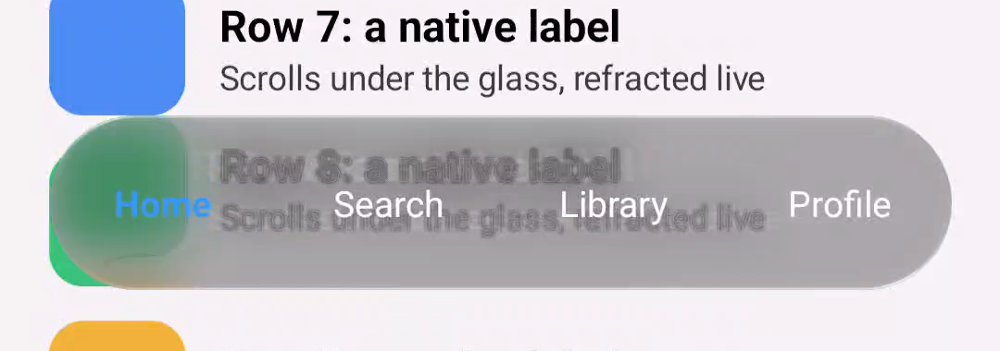

# .NET MAUI: 20 October 2026

`LiquidGlass.Maui` (`ports/dotnet/LiquidGlass.Maui`) puts a `GlassSurface` view over the app's own
MAUI content. The glass is drawn by the production shaders through `SkiaSharp.Views.Maui`. The
backdrop is the element's native view, drawn into a bitmap.

*Our capture: `ports/dotnet/MauiDemo`, Release, built from this commit's sources (branch
`claude/maui` on `c185827`), .NET SDK 10.0.402, Microsoft.Maui.Controls 10.0.110, SkiaSharp
4.153.1. Pixel 7, Android 17, 1080 × 2400. A frame at 5.5 s of `adb shell screenrecord` while
`adb shell input swipe` scrolls the page, scaled to 50%. Logcat at launch:
`LiquidGlass backdrop 1080x5397 at 2.625 px/unit`. [The recording](maui-pixel7.mp4) (9 s).*

| Crop | |
| :-- | :-- |
|  | the light card; the page title scrolls under it and is refracted live, with no new capture |
|  | the dark bar over row 8; the tab labels are ordinary MAUI labels |

*Full-resolution crops of the recording, at 5.5 s (card) and 7.6 s (bar).*

## What the first device run found

- **The glass refracted itself.** MAUI's `VisualElement.CaptureAsync` copied the window's pixels over
  the element's bounds on Android, overlays included: the captured backdrop contained the card's own
  labels, squeezed to the element's size. The capture now draws the element's own native view
  (`View.Draw` into a bitmap; WinUI's `RenderTargetBitmap` on Windows). The dumped backdrop then held
  the 24 rows alone, at 1080 × 5397.
- **`Padding` inset the glass.** ContentView applies its padding to the template, so the glass
  started at the content's edge. `GlassSurface.Padding` now insets the content only.
- **The first capture came back empty.** It ran during layout. The backdrop now captures once the element
  is loaded, retrying for about two seconds.

## Limits

- One device: a Pixel 7. The Windows target builds and packs in CI, but has not been run.
- The backdrop is a snapshot. Glass follows it as it scrolls, but content animating on its own shows
  its state at the last capture.
- Not measured: frame timing, and how capture time scales with large backdrops (this one is 23 MB of
  pixels).
- `adb shell input swipe` scrolls slowly, so the recording moves less than a finger would.
