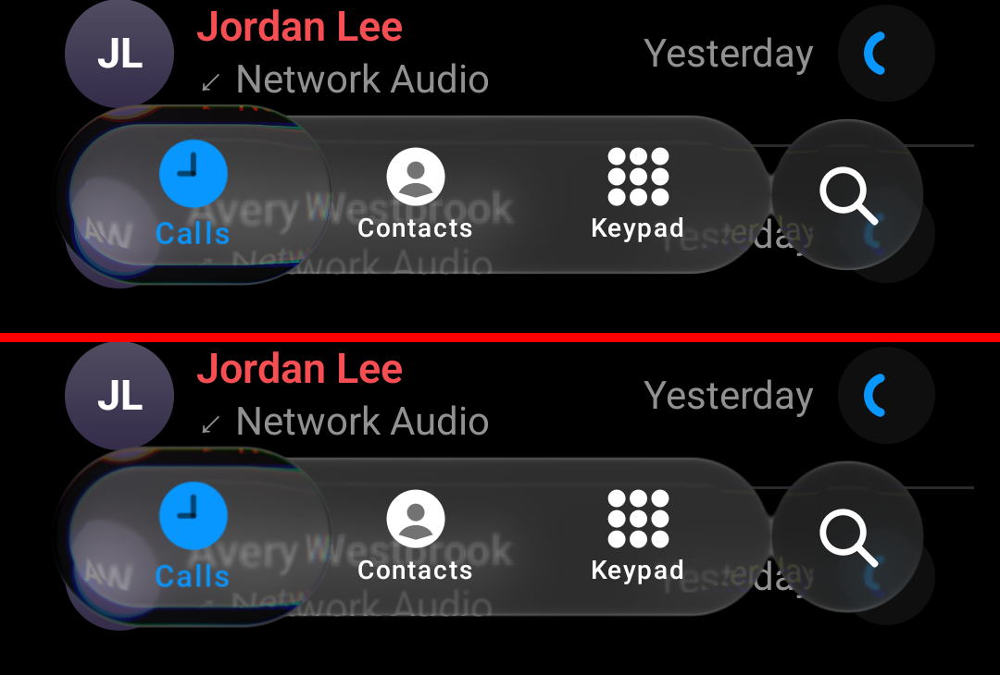

# Pixel 7 frame budget and render scale — 26 October 2026

Issue #100. Pixel 7, Android 17, 90 Hz (11.1 ms budget), sample release build (`main` after 42c16e8),
`PhoneActivity` dark, `--ef renderScale <s>`, warm-up then 8 taps (Keypad ↔ Calls), `dumpsys gfxinfo`, two
alternating series.

| renderScale | frame p50 / p90 | GPU p50 / p90 | legacy janky frames (of ~548) |
| --: | :-- | :-- | --: |
| 1 | 25 / 26, 22 / 26 ms | 14 / 17, 12 / 16 ms | 196, 203 |
| 0.75 | 16 / 25, 17 / 25 | 9 / 15, 9 / 15 | 163, 152 |
| 0.5 | 16 / 24, 15 / 24 | 8 / 14, 8 / 12 | 111, 76 |

v1.0.0 against `main` at scale 1, alternated three times: GPU p50 12 / 14 / 13 ms against 10 / 13 / 9 ms, so the
26 October optics did not make it slower.

*Pixel 7 screenshots mid-hold (`adb shell input swipe` held 2.5 s), fictional sample names.*

At 0.75 the GPU median falls under budget and the lens looks the same at phone resolution (the page text under
the bar is a little softer; the ink is drawn sharp separately). The library default stays 1; apps that need the
headroom can set `LiquidGlassTheme(renderScale = 0.75f)`. A per-state scale (lower only while the selector
moves) would keep resting frames full resolution; not built.
