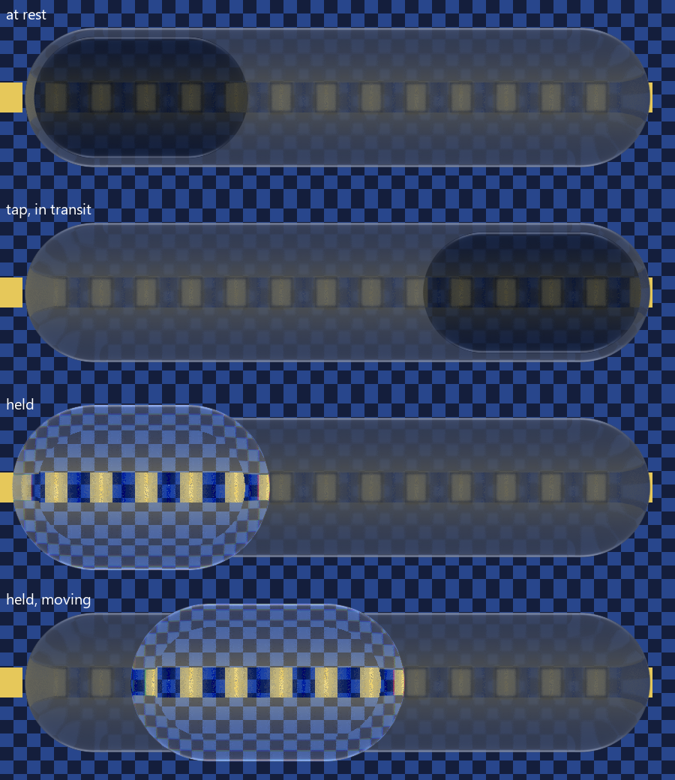
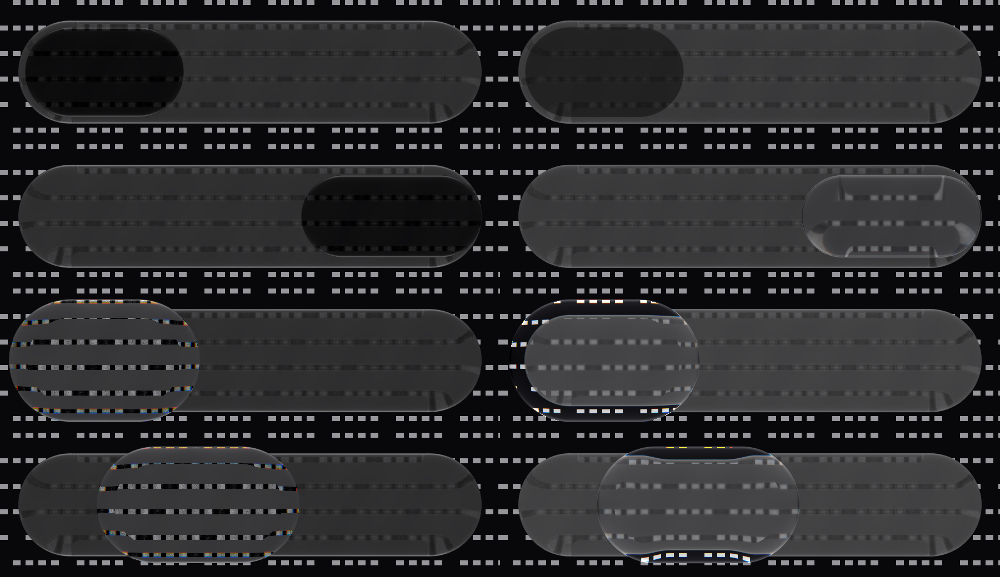

# Calm navigation selector in the CanvasKit and .NET ports (14 October 2026)

*CanvasKit 0.42 CPU raster in Node, `painter.drawSurface` for the bar and `painter.drawSelector`
for the body, over a synthetic checkerboard; 834 × 186 px bar at 3 px/dp. Not a performance
measurement.*

The ports had the material, scenes and whole-surface feedback but no navigation selector. Both now
have the Compose Calm selector's motion and gesture protocol:

- `ports/skia/selector.mjs` (`CalmSelectorController`, `calmSelectorBar`, `createCalmNavigation`)
  and `scene.addNavigation`; `ports/dotnet/LiquidGlass.Skia/CalmSelector.cs`
  (`CalmSelectorController`, `CalmNavigation`) and `GlassPainter.DrawSelector`.
- A line-by-line port of `GlassPoseDynamics.kt` / `GlassPoseGeometry.kt` with the `GlassPoseSpec.Calm`
  preset, and of `GlassTabBar`'s gesture protocol (touch-down aims, hold or horizontal slop starts a
  drag, a vertical scroll before the hold cancels, a flick carries one tab further). The velocity
  estimate is a 100 ms least-squares slope standing in for Compose's `VelocityTracker`.

**Verification.** `GlassSelectorPortFixtureTest` exports five scenarios from the Kotlin controller at
60 Hz (adjacent tap, far tap, held throw into the wall, held reversals, stationary hold;
`ports/skia/fixtures/selector-calm.json`). The JS port matches every frame's mode, centre, extents,
formation, tap appearance, held travel and pose matrix within 0.05 px and 1e-4; the .NET port within
0.035 px over 456 frames. Event times are compared exactly as Kotlin does (a 1e-9 tolerance there
shifted one input a frame and diverged by 14 px until removed). CanvasKit 31/31 tests, .NET 13/13
checks, including drawing checks that the resting selector darkens its bar and leaves the bar's far
end untouched.

## Material (second pass, 14 October)

*CanvasKit 0.42 CPU raster in Node over a dark page with light stripes; left the earlier approximate
material over the in-app bar, right the Compose Calm bar and selector material with the lens looking
through the bar. 834 × 186 px bar at 3 px/dp.*

The first port drew the selector in the in-app material blended toward the held-lens profile: an
approximation (the resting inset read 12 grey levels over a dark page where Compose and iOS read
24–33). It now uses the Compose material itself:

- `GlassSelectorPortMaterialTest` exports the production Calm pill, lens and bar styles as shader
  uniforms, the fold and rim-mirror constants, and 96 uniform sets computed by the production
  `glassSelectorMaterial` / `glassSelectorFormation` (`ports/skia/fixtures/selector-material.json`).
- `calmSelectorMaterial` / `calmBarMaterial` (CanvasKit, `selector-material.mjs`) and
  `CalmSelectorMaterial` (.NET) blend them by the same rules (field lerp, identity fields snapping
  at the midpoint, premultiplied 8-bit tint, transit pigment fade, moving fold and held rim mirror).
  Both reproduce all 96 samples: worst difference 1e-7 (CanvasKit) and 2e-7 (.NET).
- `drawCalmBar` / `DrawCalmBar` draw the bar in the Compose Calm bar material, its held lift
  following the selector. `drawSelector` / `DrawSelector` take the selector's transit and held
  travel, and an optional `through` image (the page with the bar's glass drawn over it): like
  Compose, the lens looks through the bar, with the raw page's `rawShare` added on top. The
  navigation scene layer does this itself. Over a dark page the resting inset now reads 33
  (12 before).

CanvasKit 33/33 tests and .NET 13/13 checks, including the 96 material samples and drawing checks
that the lens looks through the bar (+20 luminance over the bare page inside the resting pill) and
leaves the bar's far end untouched.

**Limits.** The ports draw no selected ink: labels, ink inside the lens and accessibility stay with
the host, so the content pass (selected-ink fold, held ink) is not ported. The bar's press reach,
release spring and accessory fusion are Compose-side; the port bar uses the scene's press scale.
Accommodation to item bounds is supported when the host passes them; the scene layer does not.
