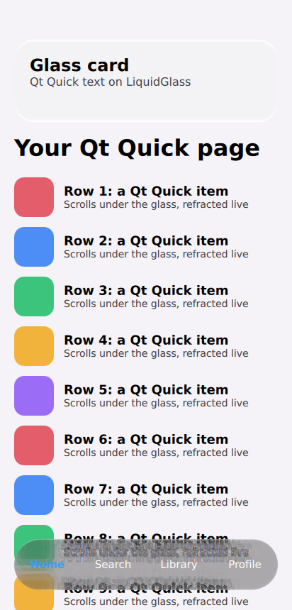
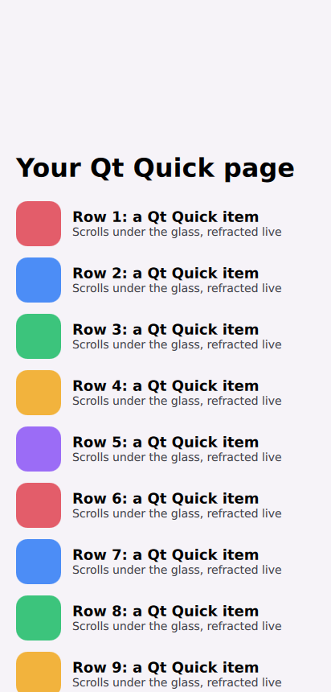
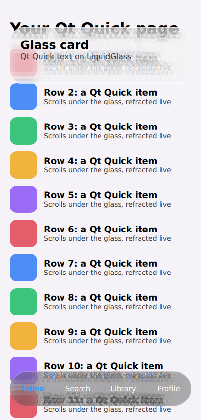

# Qt Quick: 20 October 2026

`ports/qt` puts the liquidglass material in Qt Quick as a `ShaderEffect`: `GlassSurface` refracts the item
behind it through a live `ShaderEffectSource`. These are renders from CI; there is no capture from a GPU.

*Our render: `ports/qt/examples/pyside/main.py --grab` in CI (`qt` job, run 39334633465), Ubuntu 24.04,
PySide6 6.11.2, Xvfb, Qt's OpenGL RHI on Mesa llvmpipe 25.2.8 (OpenGL 4.5, software), 412 × 860 at
device pixel ratio 1. Shaders compiled by `pyside6-qsb` in the same job. `QQuickWindow.grabWindow`.*

| | |
| :-- | :-- |
|  | the same frame with both surfaces hidden: what the glass sits on |
|  | after scrolling the list 150 px: the bar shows the rows now under it |

The check passes when neither shader reports an error, both surfaces change the pixels under them
(card 13.5, bar 79.3 levels mean) without flattening them, the dark bar is darker than the page under it,
the light card stays light, and the bar's pixels change when the list scrolls (20.2 levels).

## Limits

- Software rendering only (Mesa llvmpipe); no GPU, Windows or macOS host has run it.
- The card's `ShaderEffect.status` reads Uncompiled while it draws; the pixel checks are the evidence.
- The text under the bar is grainy here: the material's fine blur is a few rotated taps per pixel, which
  llvmpipe renders without the GPU's filtering. Not compared with a GPU render.
- Not measured: frame timing. Qt 5 is not supported (Qt 6 shader pipeline only).
