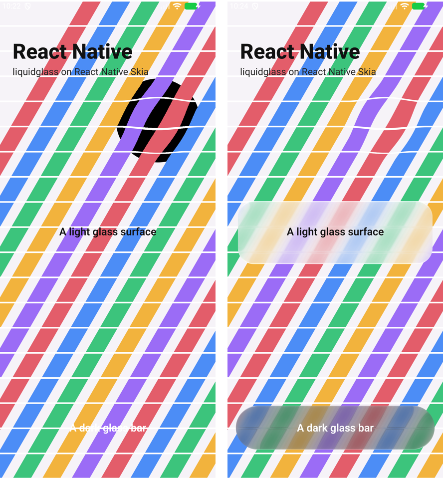
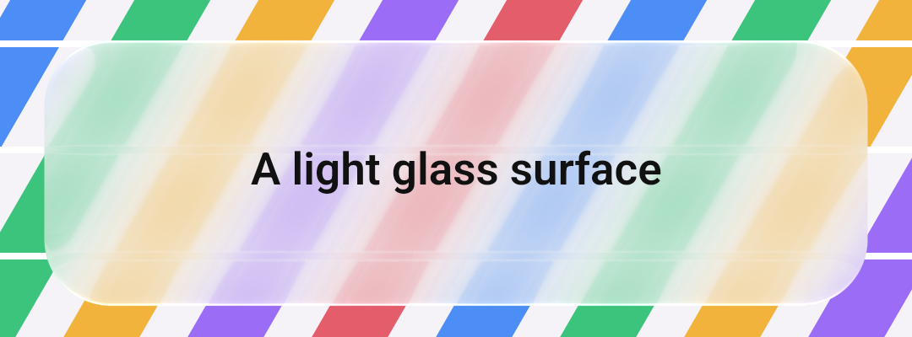
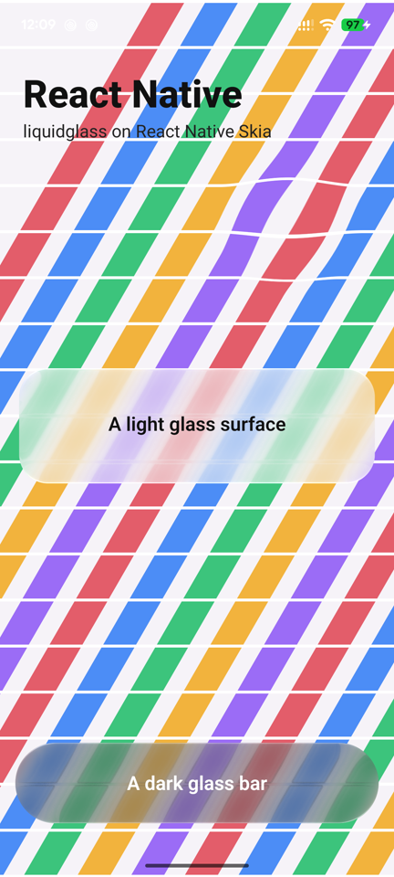
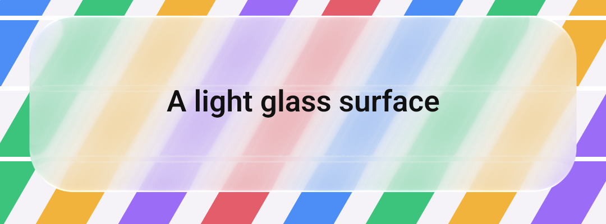

# React Native — 19 October 2026

`liquidglass-react-native` (`ports/react-native`) draws the production glass with React Native Skia,
through a small adapter that lets the CanvasKit painter run on React Native Skia's API unchanged.

*Our render: `npm run example` in `ports/react-native`, on React Native Skia 2.14.0's headless build
(its JSI API over CanvasKit 0.41, software rendering in Node). 960 × 640 at pixel ratio 2. The page
is an image drawn in Skia. `GlassLens` (magnification 1.5), and `GlassSurface` light with the overhead
light and dark with the default light, are the components an app puts in a `<Canvas>`.*

## On Android (emulator)

*Our capture: the demo app (React Native 0.87.1, React Native Skia 2.14.0, release build) on the
Android 17 emulator (`lg_verify_37`, x86_64, 1080 × 2400), `adb exec-out screencap`, scaled to 40%.
The page is ordinary React Native views captured with `makeImageFromView`; labels are React Native
`Text` above the canvas. Left: the first build. Right: after the fix.*

The first device run found two things the headless checks could not:

- **The surfaces drew nothing.** The painter's offscreen buffer (the wide tone kernel) came from a GPU
  surface made on the JS thread. A picture replayed on React Native Skia's render thread cannot draw
  that texture. The adapter now makes raster surfaces.
- **Black inside the lens.** The captured view was transparent where the page drew nothing, and the
  painter expects an opaque source. The demo now gives the page a background, and the README says so.

## On a phone: Pixel 7 — 20 October

*Our capture: the same demo release build on a Pixel 7 (Android 17), `adb exec-out screencap`, scaled to
40%. Its `liquidglass-react-native` files equal `ports/react-native` on `main` (`fdb8114`) apart from line
endings. The lens, the light surface and the dark bar draw as on the emulator after the fix; nothing
new was found.*

## Checks (`npm test`)

- Two surfaces and a lens drawn through the adapter equal the same glass drawn by the painter on
  CanvasKit directly: no channel differs by more than 1.
- In a React Native Skia element tree, `GlassSurface` and `GlassLens` change the page under them
  (mean difference over 10 and over 5 levels) and leave it alone elsewhere (under 1).
- Disposal is idempotent, and a shader that fails to compile is reported.
- `tsc` compiles the declared types.

## Limits

- One phone (Pixel 7) and the emulator. Pixel-level equality with CanvasKit is checked headlessly
  only; on Android the result is inspected by eye.
- The backdrop is a snapshot (`makeImageFromView`, or an image drawn in the canvas). No live view
  capture and no touch response yet.
