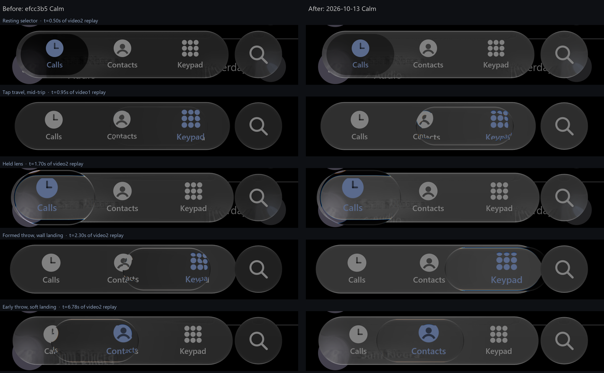
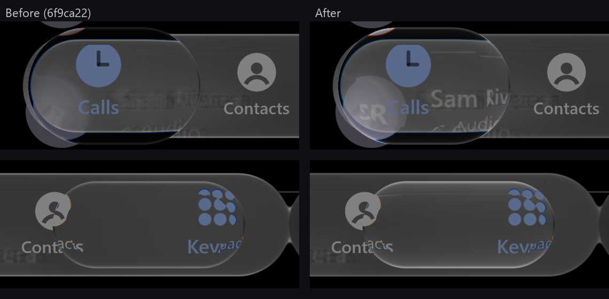

# Continuous reference replay — 13 October 2026

The first evaluation of the Calm navigation selector against the owner's two iOS recordings
(`docs/1.MP4`, `docs/2.MP4`, private and git-ignored) as **continuous sequences**, not selected
frames. It found five visible defects in the handoff build and corrected them. Owner visual
acceptance is still pending.

*Left: handoff build `efcc3b5`. Right: this change. Both rendered by `PhoneReplay` from the same
inferred input script on an NVIDIA RTX 3050 (Direct3D) at a deterministic 60 frames per scripted
second. The private reference is not shown; the three-row comparisons including it stay in
`.local/comparisons/`.*

## Method

1. **Scene.** `PhoneScene` (sample/shared) reproduces the reference geometry measured at 3 px/pt:
   a 278 × 62 pt bar at x = 21 pt, a 62 pt search button, three tabs, a call list or keypad on
   black. Content is neutral placeholder text. Colours are in the recordings' own (dimmer)
   brightness space so levels can be compared directly.
2. **Input.** The reference has no touch data, so finger timing is **inferred** from the
   selected (blue) ink's centroid: tap onsets for video 1 (60 ms taps beginning at visible
   motion onset), and for video 2 a press at the start of the held shift, a finger path that
   follows the ink while travelling, and a stop-then-lift on arrival. Catalogue of video 2: one
   stationary hold, early throws (including the soft landing on Contacts at 6.7 s), fourteen
   formed throws into both walls, and held reversals from 18.7 to 22.3 s.
3. **Rendering.** `./gradlew :desktop:phoneReplay -Patlas.replay.script=… -Patlas.replay.out=…`
   drives Compose with a virtual clock: frame N is composed at N/60 s however long it takes, and
   is read back from an offscreen GPU target on the layer's own context (about 50 ms per frame,
   2 minutes per recording). **This says nothing about interactive frame rate, input latency or
   display presentation.**
4. **Comparison.** Three-row video (reference / before / after), 0.25× episode excerpts, paired
   bar-crop strips at 33 ms spacing, and median grey levels in fixed regions over black.

## Findings and changes

| # | Observed in the reference | Handoff build | Change (Calm only) |
| :-- | :-- | :-- | :-- |
| 1 | A tapped selector travels as clear, refracting glass that magnifies the ink it crosses, at roughly resting size | Pigment faded to an almost invisible ghost; optical formation capped at 0.25 | `GlassTabBarStyle.tapOptics = 1`: transit appearance drives the lens optics; geometry unchanged |
| 2 | A thrown lens stays formed through travel and the wall impact and becomes the pill about 170 ms after landing | Formation target dropped to 0 at lift-off; the lens collapsed in flight | `GlassPoseSpec.releaseFormationSpeed = 3` slots/s: released formation follows travel speed and only subsides |
| 3 | Wall landing is a wide, flattened capsule pressed into the end | The impact model converted speed into cap growth: a tall circle protruding above and below the bar | Impact exchange off (`releaseImpactGain = 0`); previous values kept as `GlassPoseSpec.CalmImpact` |
| 4 | The lens sits under the (inferred) finger during fast throws | The authored 40/s grasp spring trailed by ~100 ms at release | Default 78/s grasp; ~1–2 frames remain on the fastest throws |
| 5 | Soft refractive rim with a faint top highlight | A crisp white specular outline | Held-lens specular 0.49 → 0.2 |
| 6 | Bar 45 at rest / 53 held; resting selector 24–30; search 44 (grey levels over black) | 32 / 44; selector 6–8; search 34 | Calm dark: bar lift 45/255, held lift 8/255, selector black 0.42 with no negative lift. Now 45 / 53 / 28 / 47 |
| 7 | Page text under the bar is one soft, legible copy | The bar's authored straight-run fold (`edgeFold` 0.8) doubled and reversed it into a garbled smear | Calm bar `edgeFold = 0`; V3 keeps 0.8 |
| 8 | A tapped icon reads 79/69 px (1.145×) inside the moving selector | With lens optics on, the tap ink scale and the lens magnification compounded to 1.27× | Ink scale compensates for transit optics; held scale unchanged |

Rows 1–5 and 7 are behaviour observed in continuous sequences; their rates and gains are
**authored** to match them. Rows 6 and 8 are **measured** from these recordings (row 6 at eight
resting positions across both videos: selector 24–31 on a 42–45 bar). Values derived from older stills
(V3's 32/44 plateau and "0.5 × bar − 10" selector law) are left unchanged in `V3()`.

### Pass 2: the bar fuses with the search button

Video 2 at 1.37–2.23 s: while held, the bar grows (about 5%), closes the 8 pt gap to the separate
search button and joins it through a neck about 61 px (20 pt) tall at its narrowest; the neck
carries the bar's material (52) right up to the button's edge, where the button's own glass (44)
begins. It parts within about 70 ms of the bar shrinking. New opt-in API:
`GlassTabBar(trailingAccessory = GlassTabBarAccessory(62.dp, gap = 8.dp))` makes the bar's outline a smooth union
(6 dp) with the button's circle, anchored so only the bar's growth closes the gap.

At 1.80 s the rendered top silhouette across the neck matches the reference within 1 px at every
sampled column (x 840–936) and the narrowest neck is 59–61 px against 61 px. Differences: the
neck forms later and parts later than iOS (it follows our bar press timing), a brighter rim line
crosses it where the button's edge lies, and during holds on Keypad iOS shows no neck in some
frames (confounded by the overhanging lens; not resolved). iOS's bar also appears to grow more
on the finger's side (48 vs 26 px at one row while holding Calls); ours grows symmetrically.

### Pass 3: fast held reversals

Video 2 at 18.7–22.4 s: the finger sweeps Calls ↔ Keypad about every 0.3 s. In iOS the lens stays
under the finger, stretches to roughly 1.6–1.8 slots and flattens to about the bar's height, with
strong refraction at its ends. The blue-ink centroid is a poor finger proxy here (it snaps between
tabs mid-sweep), so this episode's input was rebuilt from its 24 unambiguous turning points (ink at
Calls or Keypad) with cosine sweeps between them, plus one partial first stroke peaking at 627 px
(`tools/reference-replay/reversal-script.txt`; **inferred**).

With the rebuilt input, most of the difference was the model trailing the finger. Changes (Calm
only, authored): grasp 120/s (was 40, then 78) and held formation rise 50/s (was 30; taps keep
30/s). A larger stretch gain (0.45 slot at 16 slots/s, 60/s spine, squeeze 0.6) was tried: it
matched the reversal length slightly better but broke the measured IMG6735 flattened pair
(314 × 142 px on the five-tab bar) and the 136 px compression bound, so stretch and squeeze stay
at 0.28 and 0.47.

Like-for-like (same rebuilt input, previous commit `c65c212` against this one): the median gap
between lens centre and inferred finger falls from 77 to 37 px during the reversals and from 97 to
68 px during formed throws; maximum lens width is unchanged (394 px). Most of the earlier "too
short, too far behind" impression therefore came from the ink-centroid input, not the model. With
the rebuilt input the lens follows the sweeps, stretches across Contacts–Keypad and flattens
toward the bar's height. Remaining: iOS warps icons more strongly
near the moving lens's ends; our lens still trails the inferred finger by about a frame at each
turn; the hold onset relative to the (inferred) finger-down is later than iOS.

### Pass 4: lens edge and interior optics

Measured in video 2 at full resolution, over columns where both pages are black outside the bar:

| Region (grey level) | iOS | Before | After |
| :-- | :-- | :-- | :-- |
| Bar rim at rest, outermost 4 px | 82, 72, 64, 53 | 84, 117, 90, 61 | 82, 80, 68, 57 |
| Held lens outer edge line | 62 | 27 (specular .2) | 63 |
| Band inside it, 3 px steps | 29, 21, 17, 14, 11, 9 | 21, 4, 3, 3, 2, 2 | 29, 16, 13, 11, 10, 8 |
| Page text inside the lens, p95 / p99 | 104 / 114 | 76 / 79 | 107 / 110 |

The bright white outline seen in pass 1 was the **bar's own rim** (about twice too bright) seen
through the lens, not the lens's specular; pass 1 had dimmed the wrong term. Changes (Calm):
bar bevel peak and specular halved; held lens specular .26, glow ×2 with a new
`GlassStyle.heldGlowReach` of 6 dp (new `uHeldGlowReach` shader uniform; 0 keeps the historical
bevel-length glow, so every other preset is unchanged) and `rawShare` .28 (was .01) so the page
shows through the lens as clearly as in iOS. Port shaders were regenerated; CanvasKit tests and
the .NET checks pass.

Not solved: near the ends of a **moving** lens iOS swirls and strongly magnifies the icons it
passes over. On the pose path our band is a fixed measured map (0.6 R, stepped seam from the held
stills), so this needs a different optical map in motion — the next optical task. Also visible:
a vertical seam where that map hides part of the band, and a faint doubled copy of page content
near the lens's left end (raw share over the mirrored band).

### Re-reading the landing evidence

The removed impact model was calibrated to one frame, video 2 at 2.5567 s ("frame082": width
242 px, a left-cap fit of R 116.14 px; its full height was recorded as unobservable). In the
continuous sequence that frame is the **dark resting inset about 0.33 s after the wall impact**,
briefly narrower than its 285 px rest and still inside the bar. It is not a glass circle during
the impact. The narrowing itself is real and is listed below.

## Remaining differences

- After a hard landing the resting inset briefly narrows (242 px against 285 px at rest, about
  0.3 s after impact) and recovers; ours stays at or above its rest width.
- iOS warps the icons more strongly near the ends of a fast-moving lens.
- The rebuilt reversal input and the full video 2 script (`v2-script.txt`) are inferred; the
  per-episode lag numbers above are relative to that inference.
- Hold formation appears about 150 ms later than the reference; finger-down time is inferred,
  so part of this may be input, not model.
- Selected ink inside a moving lens is magnified less than iOS.
- Page text under the bar is slightly more smeared than iOS.
- Calibration conflict, unresolved: an earlier early-transit patch (video1 frame 6) reads the
  inset at 0.38 of the bar, against 0.57–0.69 at rest. Its test keeps the previous pill law.
- The repeated long tap's pigment returns about 50 ms (≈7 grey levels) later than the measured
  patches with the corrected pill; its test also keeps the previous pill law.
- Android is not re-verified; no physical device is available.

## Verification

- Full library suite before the bar-fold change: 374 cases, 347 passed, 27 optional showcase
  skips, 0 failures (`:liquidglass:jvmTest --rerun`, 12 m 46 s).
- After the bar-fold change, every tab-bar, Calm, Phone, bar, ink, endpoint, material and replay
  class: 167 cases, all passed. `:desktop:desktopTest` and `:sample:assembleDebug` passed.
- Six earlier tests asserted the replaced behaviour. Three now target the retained
  `GlassPoseSpec.CalmImpact` (impact landing, its middle-landing isolation, the measured post-landing
  narrowing), two keep the previous pill law (see the calibration conflict above) and the Calm
  material reference now checks the new 53 held level. `GlassContinuousReplayTest` covers the new
  behaviour.
- Tests check behaviour and stated envelopes; owner visual acceptance is separate and pending.

## Files

- `before-after.png` — public, our renders only.
- Local only: `.local/comparisons/2026-10-13-baseline/` (first comparison, original scripts) and
  `.local/comparisons/2026-10-13-pass1/` (reference / before / after).
- Harness: `desktop/src/jvmMain/.../PhoneReplay.kt`, `sample/.../PhoneScene.kt`; script generators
  and tracker are in `.local/sxs/` with the private recordings they read.
