# Continuous reference replay — 13 October 2026

The first evaluation of the Calm navigation selector against the owner's two iOS recordings
(`docs/1.MP4`, `docs/2.MP4`, private and git-ignored) as **continuous sequences**, not selected
frames. It found five visible defects in the handoff build and corrected them. Owner visual
acceptance is still pending.

*Left: handoff build `efcc3b5`. Right: this change. Both rendered by `PhoneReplay` from the same
inferred input script on an NVIDIA RTX 3050 (Direct3D) at a deterministic 60 frames per scripted
second. The private reference is not shown; the three-row comparisons including it stay in
`.local/comparisons/`.*

## Method

1. **Scene.** `PhoneScene` (sample/shared) reproduces the reference geometry measured at 3 px/pt:
   a 278 × 62 pt bar at x = 21 pt, a 62 pt search button, three tabs, a call list or keypad on
   black. Content is neutral placeholder text. Colours are in the recordings' own (dimmer)
   brightness space so levels can be compared directly.
2. **Input.** The reference has no touch data, so finger timing is **inferred** from the
   selected (blue) ink's centroid: tap onsets for video 1 (60 ms taps beginning at visible
   motion onset), and for video 2 a press at the start of the held shift, a finger path that
   follows the ink while travelling, and a stop-then-lift on arrival. Catalogue of video 2: one
   stationary hold, early throws (including the soft landing on Contacts at 6.7 s), fourteen
   formed throws into both walls, and held reversals from 18.7 to 22.3 s.
3. **Rendering.** `./gradlew :desktop:phoneReplay -Patlas.replay.script=… -Patlas.replay.out=…`
   drives Compose with a virtual clock: frame N is composed at N/60 s however long it takes, and
   is read back from an offscreen GPU target on the layer's own context (about 50 ms per frame,
   2 minutes per recording). **This says nothing about interactive frame rate, input latency or
   display presentation.**
4. **Comparison.** Three-row video (reference / before / after), 0.25× episode excerpts, paired
   bar-crop strips at 33 ms spacing, and median grey levels in fixed regions over black.

## Findings and changes

| # | Observed in the reference | Handoff build | Change (Calm only) |
| :-- | :-- | :-- | :-- |
| 1 | A tapped selector travels as clear, refracting glass that magnifies the ink it crosses, at roughly resting size | Pigment faded to an almost invisible ghost; optical formation capped at 0.25 | `GlassTabBarStyle.tapOptics = 1`: transit appearance drives the lens optics; geometry unchanged |
| 2 | A thrown lens stays formed through travel and the wall impact and becomes the pill about 170 ms after landing | Formation target dropped to 0 at lift-off; the lens collapsed in flight | `GlassPoseSpec.releaseFormationSpeed = 3` slots/s: released formation follows travel speed and only subsides |
| 3 | Wall landing is a wide, flattened capsule pressed into the end | The impact model converted speed into cap growth: a tall circle protruding above and below the bar | Impact exchange off (`releaseImpactGain = 0`); previous values kept as `GlassPoseSpec.CalmImpact` |
| 4 | The lens sits under the (inferred) finger during fast throws | The authored 40/s grasp spring trailed by ~100 ms at release | Default 78/s grasp; ~1–2 frames remain on the fastest throws |
| 5 | Soft refractive rim with a faint top highlight | A crisp white specular outline | Held-lens specular 0.49 → 0.2 |
| 6 | Bar 45 at rest / 53 held; resting selector 24–30; search 44 (grey levels over black) | 32 / 44; selector 6–8; search 34 | Calm dark: bar lift 45/255, held lift 8/255, selector black 0.42 with no negative lift. Now 45 / 53 / 28 / 47 |
| 7 | Page text under the bar is one soft, legible copy | The bar's authored straight-run fold (`edgeFold` 0.8) doubled and reversed it into a garbled smear | Calm bar `edgeFold = 0`; V3 keeps 0.8 |
| 8 | A tapped icon reads 79/69 px (1.145×) inside the moving selector | With lens optics on, the tap ink scale and the lens magnification compounded to 1.27× | Ink scale compensates for transit optics; held scale unchanged |

Rows 1–5 and 7 are behaviour observed in continuous sequences; their rates and gains are
**authored** to match them. Rows 6 and 8 are **measured** from these recordings (row 6 at eight
resting positions across both videos: selector 24–31 on a 42–45 bar). Values derived from older stills
(V3's 32/44 plateau and "0.5 × bar − 10" selector law) are left unchanged in `V3()`.

### Pass 2: the bar fuses with the search button

Video 2 at 1.37–2.23 s: while held, the bar grows (about 5%), closes the 8 pt gap to the separate
search button and joins it through a neck about 61 px (20 pt) tall at its narrowest; the neck
carries the bar's material (52) right up to the button's edge, where the button's own glass (44)
begins. It parts within about 70 ms of the bar shrinking. New opt-in API:
`GlassTabBar(trailingAccessory = GlassTabBarAccessory(62.dp, gap = 8.dp))` makes the bar's outline a smooth union
(6 dp) with the button's circle, anchored so only the bar's growth closes the gap.

At 1.80 s the rendered top silhouette across the neck matches the reference within 1 px at every
sampled column (x 840–936) and the narrowest neck is 59–61 px against 61 px. Differences: the
neck forms later and parts later than iOS (it follows our bar press timing; see pass 8), a brighter rim line
crosses it where the button's edge lies, and during holds on Keypad iOS shows no neck in some
frames (confounded by the overhanging lens; not resolved). iOS's bar also appears to grow more
on the finger's side (48 vs 26 px at one row while holding Calls); ours grows symmetrically.

### Pass 3: fast held reversals

Video 2 at 18.7–22.4 s: the finger sweeps Calls ↔ Keypad about every 0.3 s. In iOS the lens stays
under the finger, stretches to roughly 1.6–1.8 slots and flattens to about the bar's height, with
strong refraction at its ends. The blue-ink centroid is a poor finger proxy here (it snaps between
tabs mid-sweep), so this episode's input was rebuilt from its 24 unambiguous turning points (ink at
Calls or Keypad) with cosine sweeps between them, plus one partial first stroke peaking at 627 px
(`tools/reference-replay/reversal-script.txt`; **inferred**).

With the rebuilt input, most of the difference was the model trailing the finger. Changes (Calm
only, authored): grasp 120/s (was 40, then 78) and held formation rise 50/s (was 30; taps keep
30/s). A larger stretch gain (0.45 slot at 16 slots/s, 60/s spine, squeeze 0.6) was tried: it
matched the reversal length slightly better but broke the measured IMG6735 flattened pair
(314 × 142 px on the five-tab bar) and the 136 px compression bound, so stretch and squeeze stay
at 0.28 and 0.47.

Like-for-like (same rebuilt input, previous commit `c65c212` against this one): the median gap
between lens centre and inferred finger falls from 77 to 37 px during the reversals and from 97 to
68 px during formed throws; maximum lens width is unchanged (394 px). Most of the earlier "too
short, too far behind" impression therefore came from the ink-centroid input, not the model. With
the rebuilt input the lens follows the sweeps, stretches across Contacts–Keypad and flattens
toward the bar's height. Remaining: iOS warps icons more strongly
near the moving lens's ends; our lens still trails the inferred finger by about a frame at each
turn; the hold onset relative to the (inferred) finger-down is later than iOS.

### Pass 4: lens edge and interior optics

Measured in video 2 at full resolution, over columns where both pages are black outside the bar:

| Region (grey level) | iOS | Before | After |
| :-- | :-- | :-- | :-- |
| Bar rim at rest, outermost 4 px | 82, 72, 64, 53 | 84, 117, 90, 61 | 82, 80, 68, 57 |
| Held lens outer edge line | 62 | 27 (specular .2) | 63 |
| Band inside it, 3 px steps | 29, 21, 17, 14, 11, 9 | 21, 4, 3, 3, 2, 2 | 29, 16, 13, 11, 10, 8 |
| Page text inside the lens, p95 / p99 | 104 / 114 | 76 / 79 | 107 / 110 |

The bright white outline seen in pass 1 was the **bar's own rim** (about twice too bright) seen
through the lens, not the lens's specular; pass 1 had dimmed the wrong term. Changes (Calm):
bar bevel peak and specular halved; held lens specular .26, glow ×2 with a new
`GlassStyle.heldGlowReach` of 6 dp (new `uHeldGlowReach` shader uniform; 0 keeps the historical
bevel-length glow, so every other preset is unchanged) and `rawShare` .28 (was .01) so the page
shows through the lens as clearly as in iOS. Port shaders were regenerated; CanvasKit tests and
the .NET checks pass.

Not solved: near the ends of a **moving** lens iOS swirls and strongly magnifies the icons it
passes over. On the pose path our band is a fixed measured map (0.6 R, stepped seam from the held
stills), so this needs a different optical map in motion — the next optical task. Also visible:
a vertical seam where that map hides part of the band, and a faint doubled copy of page content
near the lens's left end (raw share over the mirrored band).

### Pass 5: the moving lens's map

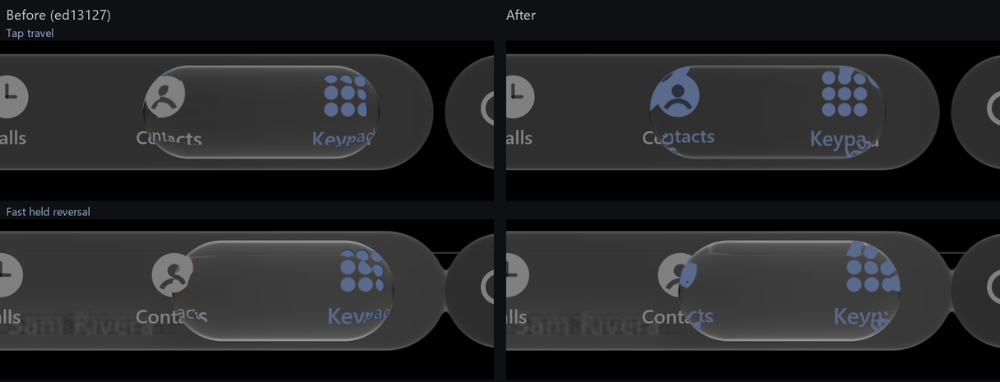

At the ends of a travelling iOS lens the rim shows the lens's own nearby content **mirrored and
wrapped along the cap** (blue icon strokes following the curve), and every icon under the lens
shows its selected colour. Ours used the held map (exterior pulled in, measured on still holds)
and drew only the active item's selected ink, so icons were clipped at the cap and the one being
left stayed grey. Tried and rejected: a stronger, wider held band (no visible effect on the pose
path), and the measured cover-sheet fold (its constant-source seam zone stretched labels into
tall streaked glyphs, even when confined to the caps).

Adopted (Calm dark, authored):

- `GlassStyle.rimMirror` / `uRimMirror`: within a fraction b of the band a pixel at depth u shows
  depth 2b − u (a reflective rim; continuous, no seam), identity inside. b = 0.3.
- `GlassStyle.foldAtCorners` / `uFoldCorners`: confine that to the cap arcs; long top and bottom
  runs keep a thin band, as iOS does.
- An unheld moving selector (`tapOpticsFold`) uses it at its transit strength; a held lens keeps
  the measured held map when still and blends toward the rim mirror at its caps with its travel
  speed (new `heldTravel` signal, optics only).
- `lensInkAll`: every item's selected ink inside the aperture.
- Dispersion is off while the rim mirrors; with the band's split it produced saturated orange and
  blue wedges where iOS shows faint fringes.

Both new uniforms default to 0, leaving every other preset unchanged. Still different: iOS's cap
swirl is larger and carries faint rainbow fringes; ours is smaller and colourless.

### Pass 6: wall landings and the resting inset (14 October)

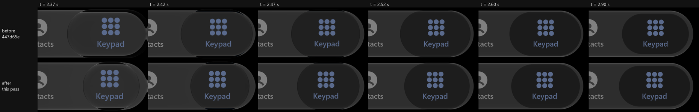

*Our renders only (`447d65e` above, this pass below), video 2's first formed throw into the right
wall; 60 fps deterministic GPU replay of the inferred input. Crops 440 × 210 px around the end.*

Measured on one clear row (y = 568 px, between the icons and labels) of video 2, across six
consecutive right-wall landings (2.3, 9.9, 12.4, 14.9, 25.6 and 28.6 s) and eight resting
positions:

- **Resting inset:** 285 px (95 pt) wide; end insets sit 8 pt from the bar's ends (centres 218,
  480 and 742 px). `PhoneScene` used a slot-wide 266 px pill with 6 pt ends, so every resting
  frame was 19 px narrow. `PhoneGeometry` now sets `pillWidth = 95.dp`, `contentPadding = 8.dp`;
  resting edges now match the reference to within 1 px (603 / 880 against 603 / 881).
  This is scene geometry: library defaults are unchanged.
- **Landing:** the pill reaches the wall and presses against it (its outer edge on the bar's end
  for about 130 ms) while its trailing edge keeps moving toward the wall, about 42 px past its
  rest (to 645 px), then returns over about 0.35 s without overshooting. The leading edge then
  sits at its rest position. Width falls to about 237 px on this row (241 full width), and the
  height never grows. Slower landings narrow less (28.6 s: 3 px; the early throw at 7.7 s: 11 px).
- **Ours (`447d65e`):** the leading edge flew about 77 px past the bar's end (the free centre
  spring overshooting) and the trailing edge never overshot; no narrowing.

Adopted, Calm only (`GlassPoseSpec.Calm`; previous behaviour kept as `CalmFreeLanding`):

- `GlassPoseSpec.releaseTrailingEdge`: after a fast release toward an end tab, the leading edge
  recovers on the centre spring and stops at the bar's end (a wall, resolved after each step so
  it does not depend on the frame cadence); the trailing edge recovers on its own spring from
  its actual position and velocity. The spine is what the edges leave beside the caps, so the
  pill narrows from behind without the impact model's area exchange (no tall circle).
- Trailing-edge rate 13/s, critically damped, **authored** against the measured consecutive width
  series already in `GlassPhoneLandingSequenceTest` (241 → 285 px over 0.47 s, both walls):
  rms 3.4 / 3.2 px. 12/s and 14/s gave 4.0 and 7.3 px. Not a measured Apple constant.

Tried and rejected: the impact model's spine impulse without its area exchange collapsed the
pill into a 171 px circle; an underdamped trailing spring (ζ 0.35–0.7) cannot make a release at
rest narrow without undershooting the fast case by 50+ px.

In the full replay, landings where the inferred finger is still moving at lift (2.3, 12.4 s)
now narrow like iOS (peak 660 / 637 px against 645 / 646), about 100 ms early. Landings where
the inferred finger stops at the end tab before lifting (9.9, 25.6 s) release slowly and do not
narrow, while iOS narrows by the same 42 px. The ink tracker cannot see the finger past the end
tab (the ink stops when the lens reaches the wall), so the script's stop-before-lift is probably
an input artefact on those throws; it is recorded here rather than tuned away.

### Pass 7: input, cap swirl, finger-side growth and Atlas Studio (14 October)

**Inferred input.** Finger-down is invisible in the recordings, so a held press now begins 137 ms
before the ink's visible held shift (our 120 ms hold threshold plus a frame): hold onset is
aligned **by construction** and is no longer a test of the model. Into an end tab the finger now
lifts one frame after the ink first reaches the tab, still moving: the ink stops there when the
lens meets the wall, so it cannot show the finger beyond it. With this input the wall landings at
2.3, 12.4 and 25.6 s narrow like iOS (trailing-edge peaks 670 / 647 / 655 px against 645 / 646 /
646). At 9.9 s ours narrows only about 10 px against iOS's 42. Frame by frame, iOS's lens arrives
about two frames earlier and much more stretched (about 1.3 times its resting width, its leading
end pressed past the bar's end), then contracts from behind straight through its resting width;
ours is as long but is slowed by the held end-tab clamp before the finger lifts (about 800 px/s
at release), so its trailing edge carries little momentum. iOS's held lens instead hits the wall
at speed and protrudes past it. Tried: handing a share of the finger's own (unclamped) speed to the
trailing edge at release. At 0.8 the 9.9 s landing matched (peak 645 px against 645) but the
2.3, 12.4 and 25.6 s landings overshot by 20–40 px; at 0.6 the 9.9 s landing moved only 5 px.
Neither was a net gain, so it was not adopted. Modelling the held lens striking the wall is open. `tools/reference-replay/v2script.py` and
`v2-script.txt` are updated; the reversal episode is spliced in by the generator.

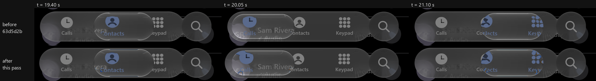

*Our renders only, the same rebuilt reversal input; `63d5d2b` above, this pass below.*

**Cap swirl.** The moving lens's reflective rim now mirrors the whole band (1.0; was 0.3; the shader
now allows up to 1), so icons near the caps wrap along a larger arc, as in iOS. A
faint colour split (0.025) is confined to the mirrored band. Authored; iOS's swirl is still
somewhat stronger.

**Finger-side growth (tried, not adopted).** Holding Calls, the iOS bar's top row grows 43 px on
the finger's side and 25 px on the other, about 8% wider overall against 5% taller: iOS grows
the bar more horizontally than vertically, with a bias toward the finger. Ours grows 28 / 24 px.
Shifting the pressed material toward the finger (an authored 0.04 share of the touch offset)
gave 35 / 13 px, but it starved the far side, so the measured fusion neck to the search button
(taken while holding this same tab) fell below its test, and two measured bar envelopes broke.
Matching iOS needs anisotropic press growth, which would conflict with the measured 1.05 press;
the shift was removed.

**Finger-side growth (adopted).** A closer look at the same rows: iOS's far side grows exactly as
a plain 1.05 press does (25 px against our 24); only the finger's side grows more (43 against 28).
So the bar reaches toward the finger rather than moving. New opt-in
`GlassInteraction.pressReach`: while pressed, the side nearer the touch grows by up to that share
of the width more (scaled by the touch's offset from the centre), with the far edge held where
the ordinary press puts it. Dark Calm's bar uses 0.03 (authored from these rows). Bar edges on
three rows, our replay against iOS, in px:

| Held tab (time) | iOS left / right | Before | After |
| :-- | :-- | :-- | :-- |
| Calls (1.80 s) | 58 / 883 | 73 / 882 | 62 / 881 |
| Calls (5.75 s) | 58 / 883 | 77 / 881 | 63 / 880 |
| Keypad (3.90 s) | 76 / 901 | 88 / 892 | 78 / 897 |

The fusion neck, the bar-envelope tests and the extreme full-screen pulls are unchanged: the
touch is bounded to the panel and the reach is drawing only.

**Atlas Studio.** Redesigned around the material: one full-window scene moving under all the glass
(a drifting night sky with a moon, a page of type that scrolls by, sliding coloured lines), the
Calm bar fused with a round magnifier button as the only scene switcher, a glass top bar and an
anchored card. A clear magnifier being dragged now takes no press glow or press scale: both
hazed and resampled its view. [Recording](atlas-studio.mp4) (deterministic GPU replay, 9 s).

### Pass 8: bar release and fusion timing (14 October)

After the finger lifts, iOS's bar returns from its grown width to rest in about 0.12 s with about
10% overshoot (left edge 44 → 65 → 63 px at three releases); ours took 0.3–0.35 s with none, and
the bar/search neck followed it, parting 70–180 ms after iOS's. New opt-in
`GlassInteraction.releaseStiffness` / `releaseDamping` (a release spring overriding the
response's own); dark Calm's bar uses 530 / 0.6, authored from that overshoot and time. The bar
now returns at iOS's rate and the neck parts 60–70 ms after iOS's. That residual is the same as
the delay of our bar's first shrink at every release, so it is attributed to the inferred lift
time, not tuned away. Also tried and rejected: handing the finger's own speed to the trailing
edge at an end-tab release (see pass 7).

### Pass 9: landing, cap swirl, neck timing and port material (14 October, second pass)

**Wall landings, scored on every landing.** Pass 6 fitted the landing to one measured width series
re-aligned at its narrowest frame. Scoring all ten right-wall landings of video 2 instead (the dark
pill's trailing edge on the clear row y = 568 against the same controller driven by the inferred
input, at the source frames' own timestamps) showed that iOS behaves the same way every time: after
the lift the trailing edge keeps travelling for about 0.3 s, passes its rest by about 40 px
(29–41 px on eight of them), then comes back without a second overshoot. Ours passed it 0.1–0.2 s
early and by anything from 5 to 55 px. The 2.2 s and 9.9 s landings, which ours handled very
differently, are the same landing in iOS.

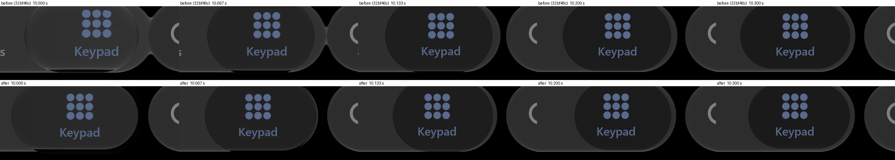

*Our renders only: `32bf46c` above, this pass below; video 2's 9.9 s throw, 60 fps deterministic GPU
replay of the inferred input. The trailing edge now carries on to about 636 px against iOS's 645
(615 before).*

Adopted (Calm; the previous Calm kept as `GlassPoseSpec.CalmCriticalLanding`):

- `releaseTrailingInOmega` / `releaseTrailingInZeta`: while the trailing edge still moves toward
  the wall it follows a softer, underdamped spring (9/s, damping .3); once it turns, the 13/s
  critical recovery takes over. `releaseTrailingCarry` .1: it keeps a tenth of its own speed once
  the leading edge meets the bar's end (within 0.3 bar heights of it): the impact, not the lift,
  takes the rest, so a lens released far from the end travels whole until then (taking the speed
  at the lift stretched an extreme 8 ms throw by 40 px per 2 ms step). Authored: across nine landings rms 4.9 px against 15.4 for the critical landing
  (`.local/sxs/wallscore.py`). The 9.9 s landing passes its rest by 33 px against iOS's 41 (12
  before); the measured width series, now compared at their own timestamps (2.52 s right,
  4.57 s left), rms 3.0 / 6.8 px against 14.4 / 21.5. The left landing's first frames still narrow
  up to 14.5 px less than iOS (253 against 239 px at its narrowest).
- `releaseWallGive` .35: a still-formed released lens may press up to .35 bar heights past the
  bar's end, the give receding with formation. iOS's clear lens protrudes about 60 px (957–960 px
  at 9.92–9.95 s); ours now reaches 951 px (911 before).
- Input: the finger now leads the ink by 33 ms through every throw (`v2script.py` `LEAD`). The
  selected-ink centroid trails the lens's leading edge (in iOS the lens reaches the end tab about
  three frames before the ink does); 33 ms is the lead the landings fit best (4.9 px against 5.5
  without it, 6.0 at 17 ms, 5.5 at 50 ms). The lens darkening after each landing now matches iOS
  within one to three grey levels on the same frames.

Excluded and recorded: the 28.66 s landing. iOS's trailing edge stops at its rest (2 px) where ours
passes it by 53 px: the source has a frame gap in that throw, so the inferred finger jumps 228 px
in one step and our lens is released 166 px short of the wall.

**Cap swirl.** Pass 7's rim mirror of 1.0 never reached the shader: the uniform builder clamped
`GlassStyle.rimMirror` to 0.5 (`LiquidGlass.kt`), so the moving lens mirrored half its band. Fixed
(clamp 0–1). New opt-in `GlassStyle.rimMirrorGain` (`uRimMirrorGain`, both passes; 0 or 1 the plain
mirror): within the mirrored band a pixel at depth u shows b + (b − u) × gain, so cap content is
drawn out radially toward the rim, magnified by 1 / gain. The moving Calm selector uses 0.4. In iOS
the icons under a moving lens's caps stretch into long petals reaching the rim; ours now does the
same at a comparable scale. Authored and judged on side-by-side frames; the rainbow fringes along
iOS's petals are still fainter in ours.

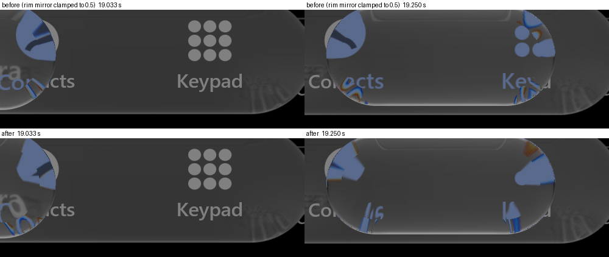

**Bar/search neck timing.** The neck parted 60–70 ms after iOS's. Two causes, measured on the bar's
far edge (row y = 495, above the neck) and the gap (row 568, x 903–915) over all 23 releases:

- At a throw into the search-button end iOS's neck goes as the lens arrives, before the lift: the
  clear lens protrudes over the gap. Ours lasted until our bar shrank. New opt-in
  `GlassTabBarAccessory.yieldsToLens`: a formed pose selector pressing into the accessory's end
  takes the neck's place (its fusion fades with the lens's formation and reach). Phone and Atlas
  Studio use it.
- After a stationary hold iOS's bar starts returning about 100 ms before ours. That lift was
  inferred as "50 ms before the held shift disappears"; it is now where the iOS bar starts to
  return, less our own bar's 43 ms release latency (`v2script.py`; 5.797 s against 5.890 s).

The neck now parts a median 33 ms after iOS's (67 ms before; stationary hold −33 ms, was +83);
most releases are within two frames. Larger residuals: the end of the rebuilt reversal episode
(+200 ms), 34.8 s (+150 ms) and two throws away from the button (+100 ms).

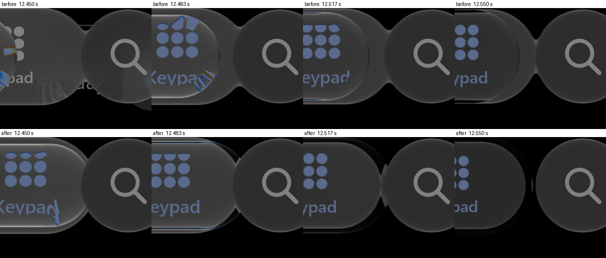

**Port material.** See [the ports record](../ports-selector-2026-10-14/README.md): the CanvasKit and
.NET selectors now use the Compose Calm material itself, checked value by value.

### Pass 10: left landings, the late necks and the still release (14 October)

**Left-wall landings, scored.** Row y = 568 cannot see the left pill (the page behind it is
bright), so the left landings are measured on rows 495–498, above the icons, where the resting
pill reads about 30 against the bar's 48 (`.local/sxs/wallscorel.py`). All ten left landings, on
the same controller: rms 5.5 px with pass 9's landing. The formed ones matched (3–6 px); the early
throws and the first 0.1 s of the narrowing lagged, because a lens released more stretched (the
left throws release about 420 px wide, the right about 375) closed at the same rate. Adopted
`releaseTrailingStiffening` .5: the trailing edge's in-spring quickens by half per resting width
still to close. Left rms 4.1 px (5.5), right 5.5 (4.9), together 4.8 (5.2); the measured width
series, at their own timestamps, rms 3.0 / 6.3 px (left worst 11.2, was 14.5); the 9.9 s landing
passes its rest by 36.5 px against iOS's 41 (33 before). Rendered against iOS on rows 495–498 the
left landings now match from their peak on within 1–3 px. A later lift for the left throws was
also tried: it fitted better, but our lens already darkens 17–33 ms before iOS's there, so the
lift is not late and it was not adopted.

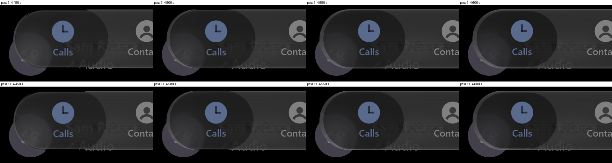

**The two late necks.**

- End of the held-reversal episode (+200 ms). The bar is back at rest by 22.40 s and the lens
  darkens on a throw's timing, so iOS's finger lifted while still sweeping toward Calls, about
  22.29 s; the rebuilt input held it still at Calls and lifted at 22.42 s. `reversal-script.txt`
  now ends with a moving lift at 22.288 s.
- Every release: our bar began returning 28–46 ms after the lift, iOS's at it. Compose shows an
  animation's first change a frame after its target moves, on top of the frame that observes the
  lift; the release spring now starts one frame in (`GlassInteraction.releaseStiffness`).

The neck now parts a median 17 ms after iOS's (33 ms in pass 9, 67 before). Largest residuals:
34.8 s (+133 ms: the bar says the finger lifted about 100 ms before the lens's darkening does, at
a throw with a source frame gap) and +83 ms at 7.7, 10.6 s and the reversal end.

**The still release.** Pass 9 moved the stationary hold's lift to where the iOS bar starts to
return. That made our lens lose its glass about 180 ms before iOS's: after a still lift iOS keeps
the lens formed about 240 ms past the bar's onset. New opt-in `releaseStillHoldSeconds` (Calm .18):
a lens released under half a slot per second keeps its formation that long before subsiding.
Throws are unaffected (their travel keeps them formed); only the stationary hold changes: its lens
now loses its glass on iOS's frames (within 3 grey levels from 6.03 s). The controller stays awake
while it holds; an idle report there had let the GPU replay's frame loop sleep with the lens
formed (`aStillReleaseKeepsItsGlassBrieflyThenLosesIt`).

### Pass 11: the bar while dragging, the last neck, fringes, port ink (14 October)

**The bar while a lens is dragged.** iOS's bar grows about 25 px a side while held still, but
once its lens is dragged it keeps only about 10 px, wherever the finger is (left edge 44–47 px
against 55 at rest, through the reversal episode and every held throw). Ours kept the whole press,
its reach and its pull, so its finger-side edge swung between 17 and 45 px with the finger. New
opt-in `GlassInteraction.dragPressShare` (dark Calm .7): once the press drags something (the tab
bar marks it when the finger passes touch slop; a hold alone does not), its growth, reach and pull
keep that share. Our bar's left edge against iOS's over the drags and holds: rms 4.9 px, mean
−1.9 (6.3 / −4.4 before; .45 gave 6.0 / +1.0).

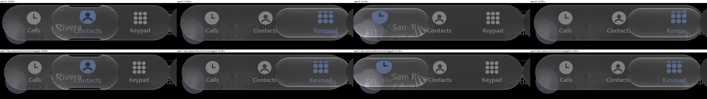

**The neck.** With the bar no longer swollen through drags, it now separates a median 0 ms from
iOS's (17 ms in pass 10); 22 of 23 releases are within ±67 ms. The input also stops stalling
mid-throw: where the selected-ink centroid snaps to the middle tab's icon for up to four frames
while the lens passes, the generator now interpolates through it (`v2script.py`, landings
unchanged at 4.8 px). One outlier remains: at 34.8 s iOS's bar starts returning about 80 ms
before the lift that the lens's arrival and darkening both place, and nothing else in the
recording separates the two; ours parts 100 ms late there.

**Landings.** A fixed-overshoot trailing model (the edge heading for a point past its rest) fit
worse (6.3 px) and a finer search of the current one gains under 0.1 px, so the parameters stay.
Rendered, the 9.9 s landing now peaks at 639 px against iOS's 645 and returns within 2 px; the
remaining differences are of the size of one frame of the inferred lift. The 28.66 s throw's
arrival falls across a dropped source frame next to a snapped centroid; neither the ink nor the
bar (whose reach shifts during a throw) places its lift, so it stays excluded.

**Fringes.** The moving selector's rim colour split rises from .025 to .05: icon fragments drawn
out at the caps now carry rainbow edges of iOS's extent; .12 was garish. Authored on side-by-side
frames.

**Port ink.** `drawSelectorInk` (CanvasKit; scene layer `setSelectedInk`) and
`GlassPainter.DrawSelectorInk` (.NET) draw the host's selected-appearance items through the
production content pass with the selector's own uniforms: only what lies under the selector shows,
refracted and folded like the material. CanvasKit 34/34, .NET 13/13, each with a check that the
ink shows inside the selector and not beyond it. Compose additionally composes ink and material in
one endpoint pass; the ports draw the ink over the material.

**For owner review (local only, contains the private recordings).**
`.local/comparisons/2026-10-14-pass11/v1-bar.mp4` and `v2-bar.mp4`: iOS / before (32bf46c) /
after, the bar region at full resolution, 60 fps.

### Pass 12: held ink, outline, moving shape, tap fold, throw timing, scene (14 October)

The owner compared the pass 11 videos with the recordings and listed six differences. Each was
measured on the private recordings, changed, and re-measured on full replays of both videos.

**Held ink.** iOS's selected icon under a still held lens sits where the bar's 1.05 press puts it:
203.6 px at 1.8 s, 203.2 at 5.75 s (the unselected Keypad icon 755.7, ours 755.1). Ours sat at
166.5. Two causes: the selected ink followed the bar's reach toward the finger
(`GlassMaterialDrawing.contentPull`, now the press and pull without the reach), and it was scaled
about the selector node's origin instead of the bar's centre, because the foreground modifier draws
in the bar-sized child's frame (`GlassTabBar.kt`, the endpoint ink's `glassMaterialForeground`).
Now 203.1 and 203.8 px.

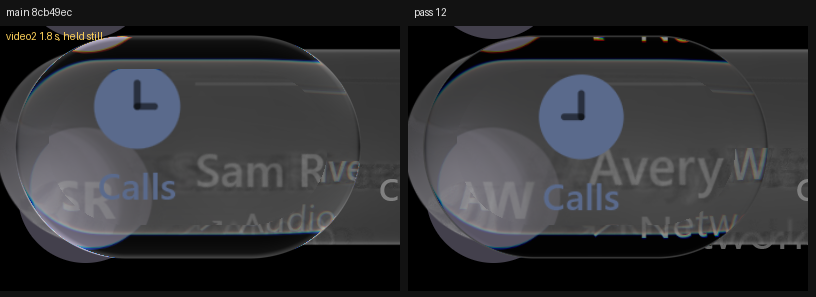

**Outline.** iOS's held lens outline is a grey line of about 65 levels over the bar (83) and over
the black page alike. Ours was a white ring (top rim 102, bottom 136) from the additive bevel lobe
and the inward glow. New opt-in `GlassStyle.heldEdgeTone` draws the outermost pixels as that grey;
Calm's lens uses 65/255 with specular .08 (was .26) and `heldGlow` 0 (was 2). Column profile
through the still lens: top rim 86 then 66 (iOS 85, 66). The bottom edge is still brighter (100
against 83), and iOS's soft halo outside the lens over the black page (about 35-50 levels) is not
reproduced.

**Moving shape.** At the 19.0 s reversal (finger about 15 slots/s) iOS's lens is 458 x 145 px on a
192 px bar, 0.755 of its height, with continuously curved ends; ours was a full-height capsule,
375 x 182. New opt-in `GlassPoseSpec.heldTravelStrain`: a held lens travelling fast widens by e^u
and flattens by e^-u (constant area), built at `heldTravelStrainOmega` so a sustained drag strains
and a quick flick releases nearly unstrained. The two-edge landing reads the strained width, so it
stays continuous. Calm: strain .5 at 10/s, held reference speed 8 slots/s (was 12), squeeze .52
(was .47): 427 x 144 at 19.0 s (port probe, 186 px bar; iOS scaled to it 444 x 140). Costs: the
wall-landing scores move from 5.3 / 4.3 to 5.7 / 5.1 px rms (right / left); the first two landing
width series from 3.1 / 6.7 to 3.1 / 6.1. The travelling lens's bounding box is 0.80 of the still
lens's against iOS's 0.91. The earlier spine-only attempt (elongation .46) widened it but doubled
the landing error and was dropped. The previous Calm is `GlassPoseSpec.CalmWallLanding`.

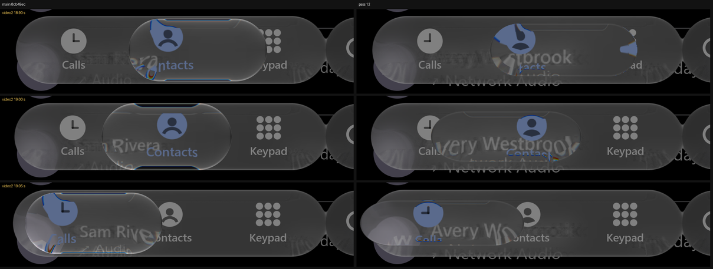

**Tap fold.** On a tap iOS's lens bends what lies under its straight top and bottom too, not only
its caps: the Keypad dots stretch up the top rim and the label bends along the bottom as it lands
(video1 0.95-1.03 s). Ours folded the caps only (`foldAtCorners` 1), so icons near the rim stayed
clean. The transit fold now runs at a quarter strength along the runs (`foldAtCorners` .75;
.5 folded the label away, .85 left the runs nearly clean). Tap timing itself already matched (both
arrive 1.00-1.03 s; the pill darkens over 1.10-1.25 s in both).

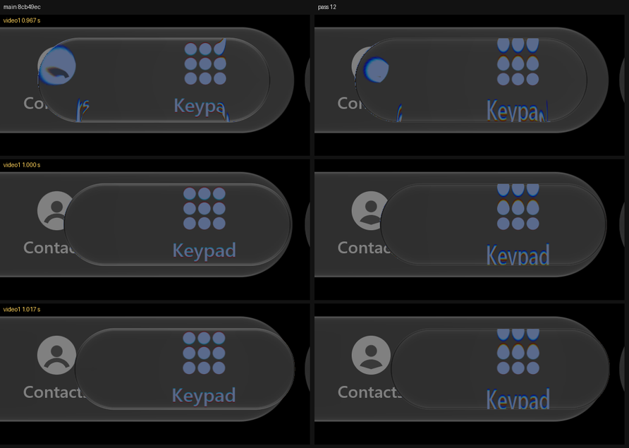

**Throw timing.** Mid-throw the lens trailed iOS by about one frame (2.157 s: lens centre 265 px
against iOS's 345). The controller was not the cause: the ported controller, driven by the same
input, was on time. The Compose frame loop sleeps during a still hold; the move that woke it had
already advanced the simulation to its own timestamp, but the first frame after waking added no
time, so the whole throw ran 1.5 frames behind. A woken loop now presents its frame's own time
(the gap from the waking input, used only when the two clocks are 0-50 ms apart; travel-only
specs). Lens centre at 2.15 s 312 px (port controller 302), 2.167 s 418 (428). Taps move by under
a fifth of a frame. A faster grasp (220/s) was tried first; it overshot and worsened landings.

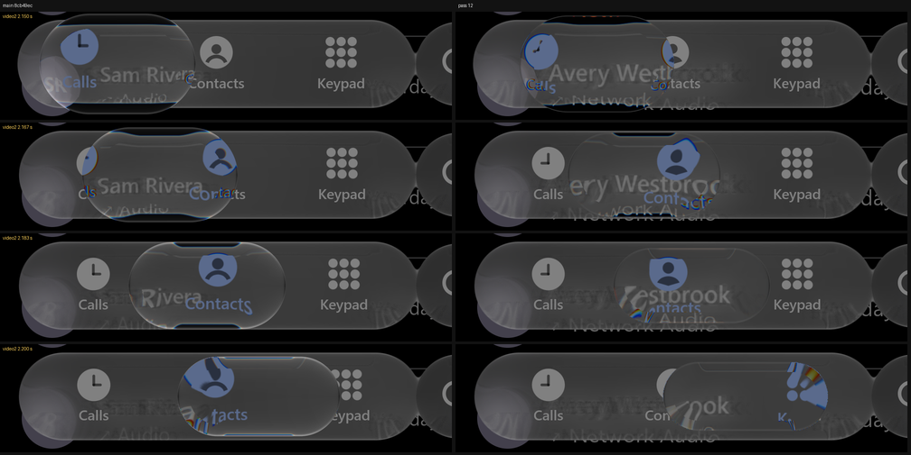

**Scene.** `PhoneScene`'s page uses neutral placeholder names and iOS-like call-log typography
(17 sp names, 16 sp detail rows, handset and person glyphs).

**For owner review (local only, contains the private recordings).**
`.local/comparisons/2026-10-14-pass12/v1.mp4` and `v2.mp4`: iOS / main (8cb49ec) / pass 12.

### Pass 13: the pass 12 residuals (15 October)

**Where the held lens sits.** Brightened, iOS's held lens at Calls shows a dark band 23 px wide
inside its left cap (outer edge 30, bar material from 52); ours showed bar material out to the
lens edge, a lighter crescent beyond the lens's own outline. Hiding our lens showed why: our bar
grew 37 px on the finger side (63 to 26) against 22-26 on the far side, which matches iOS's far side
(+24-28). Inverting the held map at iOS's cap puts its bar end about 39, an even 1.05 press. iOS's
lens is centred on the pressed tab (203 px, where its icon is), not on the finger (ours 219), so it
is the lens, not the bar, that extends toward the finger. Now the drawn body follows the bar's
pressed content (`GlassPoseHandle.barShift`, from the bar's own drawing transform; navigation,
touch and selection stay in the controller's frame) and Calm's bar has no reach (`pressReach` 0,
was .03). The cap reads 33 / dark to 48 / bar from 51-54 against iOS's 30 / 33-48 / 51-54. The
neck to the search button is unchanged (medians within half a frame, 21 of 22 within 67 ms).

**The band glow.** Between the lens edge and the bar iOS glows inward over the black page: 36, 22,
20, 17, 15, 13, 12, 10, 9 at the top, the same at the bottom, but a travelling lens adds nothing
over its bar. Pass 12 turned the glow off because, added over the bar, it drew bright lines on a
moving lens. New opt-in `GlassStyle.heldGlowFloor` lays it as a floor instead: Calm glow 1.5 over
5 dp gives 26, 25, 22, 19, 17, 15, 14, 12, 11, 10, and the 19.0 s lens has no inner lines. The edge
line is two pixels wide (bottom 54 against iOS's 76; 38 before).

**The page through the lens.** Text under the held lens read p95/p99 108/112 against iOS's
84/109: the lens adds its raw page share on top of a bar that already shows the page. Re-scored,
`rawShare` .05 (was .28) reads 82/105.

**The travelling lens.** Measured at one bar size, our still held lens is 2-4 % larger than
iOS's, so pass 12's shortfall at 19.0 s was width alone. Strain .6 with the squeeze back at its
earlier .47 gives 444 x 145 (iOS about 444 x 141 at this bar), landing series 2.8 / 5.2 px rms
(pass 12 3.1 / 6.1) and wall landings 6.0 / 5.4 (5.7 / 5.1).

**Timing over the whole video.** The selected-ink centroid of every moving frame, ours against
iOS's at its own timestamps (`.local/sxs/inklag.py`): pass 13 is best aligned 4 ms late (main
8cb49ec: 20 ms late).

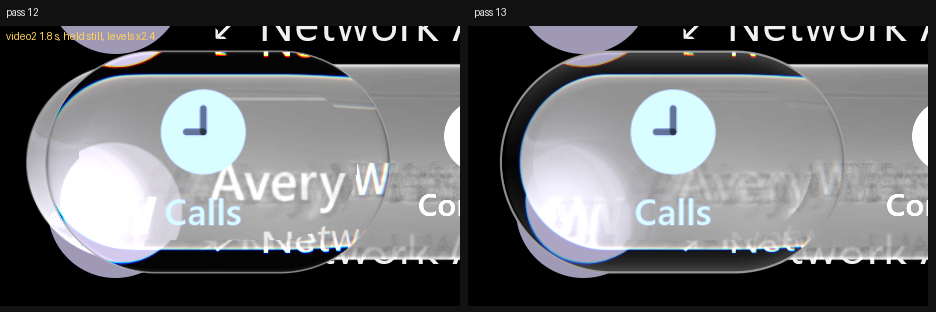

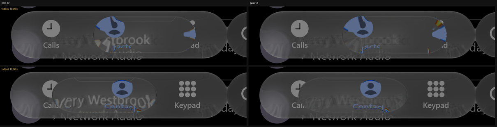

**For owner review (local only).** `.local/comparisons/2026-10-15-pass13/v1.mp4` and `v2.mp4`:
iOS / main (8cb49ec) / pass 13.

### Pass 14: the pass 13 residuals (15 October)

**The page under the held lens.** iOS's held lens adds about the same to whatever it shows: the
plain bar 45 to 64, the page avatar under the bar 62 to 81. Ours added 12 to the plain bar and 35
to the avatar. Not the raw page share, the lens's magnification, its blur, its legibility or the
bar's fingertip illumination (each tested: under 5 levels); the bar it looks through already shows
the avatar at full strength, and a clear lens passes it on. iOS's lens pulls what it shows toward a
mid grey. Calm's lens now carries a grey veil (tint .55 of 0x3A) with the raw page share at .22 so
text keeps its edge: avatar 82.5 against 80, text p95/p99 80/105 against 84/109, plain interior
62 against 64. Read at the lens pixel, the bar's tint mask also tinted the black band the lens
pulls in beyond the bar (24 against 15); a held lens now reads the mask where its refracted view
comes from (15.4 against 15.3-15.8). Other profiles keep the pixel's own mask.

**The reversal.** Pass 13's "65 px ahead at 19.0 s" was read from a crop by eye. Measured as the
times the lens's selected ink first reaches each icon (`.local/sxs/revevents.py`; the ink shows
only inside the lens), the episode was within a frame going left (median 3 ms early) but going
right in its first second 13-30 ms late. The finger there is inferred from turning points; its
rightward moves in 18.7-19.6 s now start 20 ms earlier (`reversal-script.txt`). Over the whole
episode the lens reaches each icon a mean 2 ms after iOS's going right (10 before) and 3 ms going
left. Landings and the 19.0 s shape are unchanged (wall scores 6.0 / 5.4 px).

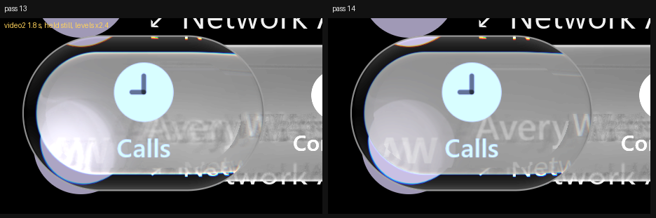

**For owner review (local only).** `.local/comparisons/2026-10-15-pass14/v1.mp4` and `v2.mp4`.

### Passes 15 and 16: display colours and five recordings (15 October)

**Every level above this section was read in the wrong colours.** The owner's recordings are HDR10
(HEVC Main 10, PQ, BT.2020); passes 1-14 decoded them as if they were sRGB, which lifts every dark
level (the bar read 45 where a display shows 33). The geometry and timing results do not depend on
it and were re-scored on the correct decode (research/README.md II.4, within a level on the
calibration target's grey ramp): wall landings 5.95 / 4.40 px rms, reversal icon crossings +2 /
+6 ms, whole-video ink timing +4 ms, neck median 0 ms. Levels were re-fitted in display colours over
five Phone-bar recordings (docs/1, docs/2 and three in the private dataset), with the page palette
of our comparison scene re-measured the same way.

**Presses read from the bar.** The scripts for the three new recordings came first from the
selected ink, which misses a hold on the middle tab and splits a long held drag into separate
throws (one recording's last 12 s is a single touch dragged across all three tabs). iOS's whole bar
lifts while touched, within two frames of the press, so the touches are read from it (rows above
the icons; the lift from the bar's far end returning, the rule the docs/2 script used for holds).
On docs/2 this reproduces the checked script's downs (21 of 23 within 20 ms) and lifts (16 of 23,
median 0); on docs/1 its taps (32 of 37). A tap and a flick cannot be told apart by timing, so the
owner's answer decides which short touches are taps.

**Levels, ours against iOS (display grey levels, median over the moments):**

| | iOS | pass 14 | pass 15 | pass 16 |
| :-- | --: | --: | --: | --: |
| Bar at rest (docs/1, docs/2) | 32-33 | 45-46 | 32-33 | 32-33 |
| Resting pill, docs/1 (black) / docs/2 (Calls page) | 10 / 15 | 26 / 27 | 15 / 15 | 14 / 14 |
| Bar held (docs/2, LOLL8185) | 45-47 | 54 (docs/2) | 42-43 | 46 |
| Held lens over a black page (LOLL8185) | 48 | not scored | 55 | 48 |
| Tap's travelling pill at +100 ms (docs/1, 37 taps) | 53 | 54 | 42 | 51 |

Pass 15 is the display-colour re-fit (bar lift 32/255, pill black .55, held lift 10/255); pass 16
adds the touch lift, held lift 13/255, lens tint 0x2B and pill black .58.

The tap pill needed a behaviour, not a level: iOS's bar lifts for any touch, a tap included (+13
at the tab a tap never visits, back by 350 ms), and the travelling pill shows the bar through it.
`GlassTabBarStyle.touchLift` (off by default, on in dark `Calm()`) lifts ours the same way; its
pass-15 plateau was 38-43. The earlier calibration is `GlassTabBarStyle.CalmRecordedSpace()`.

**The comparison scene.** Measured on the decoded recordings, iOS's tab labels are 11% wider than
ours at the same height and lighter, and its keypad grid 10% wider: labels are now Medium with
0.7 sp spacing and the grid 72 x 69 px like iOS's. The held lens's ink magnification already matched
(x1.17 against x1.18): the earlier "magnified less" was the glyph size.

**Generalisation.** Holds and drags on the two new recordings that have them track iOS's selected
ink at 11.0 and 9.2 px rms (best shift -8 ms), against the docs/2 baseline's 31.5 px with throws.

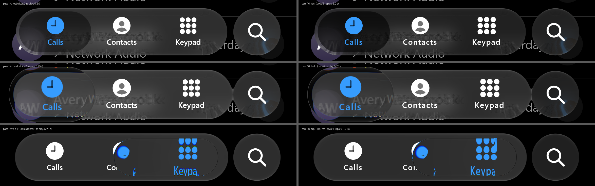

### Pass 17: the search button (15 October)

iOS's Phone search button is its own glass, and IMG_6756 presses and pulls it seven times. Measured
per frame in display colours: pressed, it grows 1.27 times and lightens from 32 to 95, joining the bar
through a neck; pulled, it leaves its place with the finger (up to 114 px), 297-303 px tall and
158-166 wide, dimming to 70; released, it springs back, and its edge away from the pull stays at its
resting position while the near edge overshoots 32 px, so it lands squashed (154 x 182 px against a
186 px rest) and rebounds. Ours was passive.

The pull law was already in the library (`GlassInteraction.Pullable`, fitted on this button in
September) but anchored to the layout, as generic controls are. `GlassPullShape.Free` keeps the
measured travel and carries the glyph with the body; the landing floor gives the squash; the release
spring is re-fitted on the leading edge (the centroid fit reads more damped because the floor halves
the centroid's overshoot); the glow settles to 0.7 once dragged. The bar follows the button through
`GlassAccessoryLink`, read while drawing: read during composition, its fused copy of the button
trailed by a frame and showed as a ghost at landing speed. The finger is inferred from the body's
travel through the modifier's own resistance (`.local/sxs/searchscript.py`).

| Seven presses, ours against iOS (rms) | passive (pass 16) | pass 17 |
| :-- | --: | --: |
| Centre x / y | 14.3 / 41.1 px | 1.9 / 3.0 px |
| Height / half-width | 6.4 / 4.4 px | 4.3 / 2.8 px |
| Brightness | 19.1 levels | 8.0 levels |

The rise peaks 106-109 px against iOS's 110-114; after a sideways pull iOS's body overshoots its rest
by 6 px against our 2 for ~100 ms (the "8 px less squash" first recorded here). Ported to CanvasKit (`createFreeButton`) and .NET (`FreeButton`) on 17 October, checked frame by
frame against a Kotlin-exported trajectory (worst 0.009 px, 0.0018); the bar's outline link is not ported.

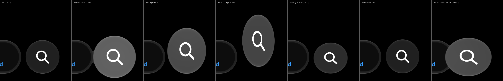

### Pass 18: what the glass shows of the page (15 October)

Over a black page a tint and a clear glass with an offset read the same; over content they do not.
iOS's resting pill passes the page under it (its 75th percentile 51 over docs/2's Calls page, ours
29), and its held lens follows held = 41-46 + 1.33-1.48 x the same pixel at rest (three docs/2 holds;
`.local/sxs/lensgain.py`). Fitted by replay on a content page and a black page together
(`pillfit.sh`): the resting pill is the bar less 22/255 with no tint, which is the inset's original
measured law ("0.857 of the bar minus 17/255", read on the sRGB-decoded recordings); the held lens is
the bar plus 0.30 of the raw page less 3/255.

| docs/2 p10 / p50 / p75 (black page) | iOS | pass 17 | pass 18 |
| :-- | --: | --: | --: |
| Resting pill | 15 / 25 / 51 (10) | 14 / 21 / 29 (13) | 12 / 29 / 47 (10) |
| Held lens | 62 / 80 / 135 (48 / 49) | 50 / 60 / 87 (48 / 48) | 52 / 75 / 135 (48 / 49) |

**Text under the bar.** iOS's bar shows the page's text as one soft, legible copy. Ours drew ghost
copies of every glyph about 16 and 34 px to either side (the fine term is a high-pass along the bar,
its average taken from five taps along it) and turned the rest into grain (its scatter is rotated per
pixel). `GlassStyle.softDetail` draws the detail as the wide kernel's tone plus a share of an unrotated
fine blur: horizontal detail over the text 2.72 against iOS's 2.77 (4.94 before). On dark Calm's bar
and lens. The along-bar high-pass was measured on screenshots of the Photos toolbar over the calibration
target (display colours, so the decode error did not touch it) and remains the default; see the check
below for what that comparison says about the tab bar.

With both, over all five recordings: rest bar and pill 0, held bar +0.5, held lens over a black page
+1, a tap's travelling pill 47-50 against iOS's 48-53. Still open: iOS's held lens adds a milky haze
over dark parts near content (docs/2's lens p10 52 against 62).

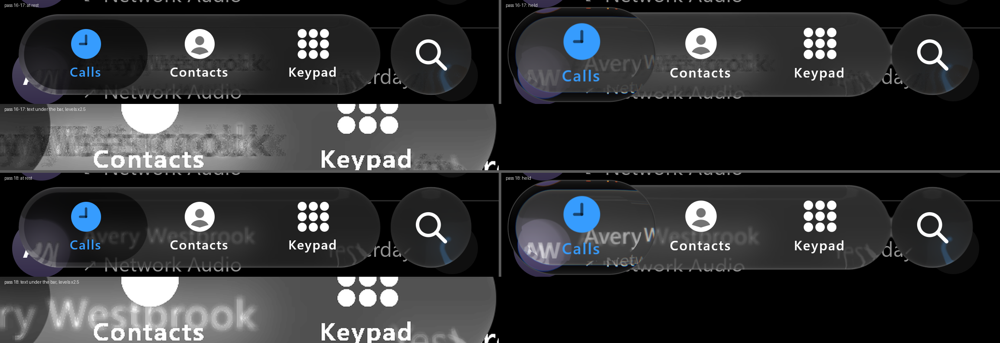

### Checked against the calibration target (17 October)

The in-app dark law of the record (III.2-III.3) was measured on screenshots of the Photos toolbar
over the calibration target, where every page pixel is known and the decode error never applied.
`GlassCalibrationRenderTest.renderTheCalmBarOverTheDarkTarget` (opt-in, `-Pliquidglass.calibration=`)
renders dark Calm's bar in the toolbar capsule's box over the same target, for the C1a stills:

| Capsule interior over the dark target | iOS, Tint 50 (C1a) | Calm, pass 18 | `CalmRecordedSpace()` |
| :-- | --: | --: | --: |
| Mean / standard deviation | 102.6 / 20.6 | 102.2 / 20.8 | 112.6 / 20.6 |
| p5 / p50 / p95 | 67 / 106 / 133 | 69 / 103 / 131 | 77 / 116 / 143 |

The re-fit made on the videos in display colours lands on the screenshot law at the default tint,
independently: iOS's in-app dark glass is linear in its page (no compression), and the earlier
calibration was 10 levels too light. The App Store bar's gap over its card (pass 18 notes) is then
most likely our page, not the material: the law reproduces iOS's 68 if the blurred page under its
bar averages about 60, which iOS's large headline would give.

The detail is the open part. Over the target's stripes the measured along-bar high-pass reproduces
the toolbar row by row (3.0 levels rms), and the soft copy dark Calm now uses does not (7.9; 14 at the
rows a boundary crosses). On the Phone bar's video the soft copy matches the text under the bar and
the high-pass draws ghost copies. A smooth along-bar Gaussian (no discrete taps) fixes the text but
not the stripes (7.0-8.2): the stripes need the high-pass's side lobes, and those lobes are what
draw the copies. The toolbar is its own role in the record; whether the Phone tab bar shares its
kernel cannot be settled from these two sources. Kept: the soft copy on dark Calm (the role
measured), the high-pass as the default.

### The App Store bar (17 October, in progress)

A second bar from the same system: the App Store's five tabs in dark appearance (LOLL8185 36-44 s, a
hold and slow drag from Today to Search and back over an editorial card). Replayed with the sample's
`AppStoreScene`, from a touch-driven script (`.local/sxs/genas.py`): the lens's path follows iOS's at
10.1 px rms with the same -8 ms best shift as the Phone recordings, so the pose dynamics carry to a
five-tab bar unchanged. Two findings for the material, not yet changed:

- The touch detector read a page scroll as a press: a card scrolled in under the untouched bar at
  38.0 s and lifted its level. A touch now needs the bar's end to move out 6 px as well (the held bar
  grows); the card's edge alone moves it 3.
- Over the card, iOS's bar reads 68 at its median against our 54, and over a black page both read 32:
  iOS's bar is close to clear glass plus 32/255 for dark content, as its pill and lens are (pass 18),
  but it compresses bright content (blurred text 45-79 where a clear bar gives 64-110). A tint cannot
  do both, nor can a lower fine share (the excess is in the wide tone). Next: fit a compressive response
  on iOS against itself, before and after the card scrolls in (37.9 against 38.5 s).

### The App Store bar is clearer glass (17 October)

With the headline matched where it is visible (the third line 115-471 px against iOS's 121-491), the
App Store bar over its plain card reads 57 against 32 over black: it passes about 0.9 of the page. The
Phone bar from the same device and session (JGEY2190 at 8.25 s, over a 77-level avatar) reads 87
against 42 over black at that moment: 0.58, the regular tinted glass dark Calm has and the Photos
screenshots measured. So the App Store's tab bar is a clearer glass, a per-app difference, not a
flaw in the law. Its exact response is not fitted: a clear bar gets the plain card (60) but carries
the text under it too brightly (p50 / p75 73 / 115 against 68 / 79), wider blur or less detail does
not close it (77-83 / 105-113), and the page under iOS's bar is not visible for its first two lines.
Dark Calm keeps the Phone bar's glass.

**The held lens's haze is not a wide tone.** Adding a wide kernel to the lens (fine share 0.6 / 0.4,
10 / 16 dp) lowers its middle and top on docs/2 (p50 72 / 67, p75 120 / 101) and leaves the dark end
(50-51 against iOS's 62). The haze sits in the lens's top band, which pulls the page from above the
bar; it belongs to the held map, not to a parameter.

### The held lens without the raw page (17 October)

Pass 18 gave dark Calm's held lens 0.30 of the raw page, to reach docs/2's percentiles over the
whole lens. Scored by region (docs/2 at 5.75 s, tab 0, and IMG_6756's black keypad page at
35.47 s), that share drew the page's text under the lens sharp and white: p90 155 against iOS's
102. iOS's lens veils that text as its bar does. Five regions, iOS / ours:

| | top band | bottom band | text p90 | text p50 | black interior | rms |
| --- | --- | --- | --- | --- | --- | --- |
| raw share 0.30 (pass 18) | 64 / 53 | 75 / 64 | 102 / 155 | 82 / 89 | 47 / 48 | 24.9 |
| raw share 0 (now) | 64 / 52 | 75 / 63 | 102 / 91 | 82 / 75 | 47 / 48 | 9.7 |

Dark Calm's lens then had no raw share (`rawShare` 0). A black page is unchanged. The bands near the
rims still read 11-12 below iOS's over content. An additive wide glow would also light them over a
black page, where they already match, and a blur does not change them.

### The raw page returns, blurred (17 October)

What iOS's lens adds over ours is page-shaped: about 10 levels wherever the page has content (bands
+12, text +7 to +11) and nothing over black. That is a share of the raw page, blurred so that it
carries no edges. `GlassStyle.rawBlur` blurs the share `rawShare` adds. Fitted by replay over five
candidates (share / blur dp), same regions, iOS / ours:

| | top band | bottom band | text p90 | text p50 | black interior | rms |
| --- | --- | --- | --- | --- | --- | --- |
| no share (earlier today) | 64 / 52 | 75 / 63 | 102 / 91 | 82 / 75 | 47 / 48 | 9.7 |
| 0.12 / 6 | 64 / 52 | 75 / 65 | 102 / 101 | 82 / 85 | 47 / 48 | 7.1 |
| 0.18 / 6 | 64 / 52 | 75 / 66 | 102 / 106 | 82 / 89 | 47 / 48 | 7.6 |
| 0.18 / 12 | 64 / 52 | 75 / 68 | 102 / 100 | 82 / 85 | 47 / 48 | 6.5 |
| 0.15 / 16 | 64 / 52 | 75 / 68 | 102 / 96 | 82 / 81 | 47 / 48 | 6.9 |
| **0.22 / 20 (now)** | 64 / 53 | 75 / 70 | 102 / 99 | 82 / 83 | 47 / 48 | **5.6** |

Dark Calm's held lens adds 0.22 of the raw page blurred 20 dp. The top band does not move with any
candidate: our page under the bar's upper half is black, so the share adds nothing there, while
iOS's band near its lens reads 9-11 above the bar it sits in and the bar farther away matches ours
(47 / 47). That band is local to iOS's lens and stays a residual of the held map. A deeper refraction band does
not move it (refraction depth 20 and 28 dp score the same as 14). The "~8 px higher" note does not
hold at this frame: the lens's top and bottom outlines sit at rows 436 / 654 on both (iOS 436-438),
within 2 px.

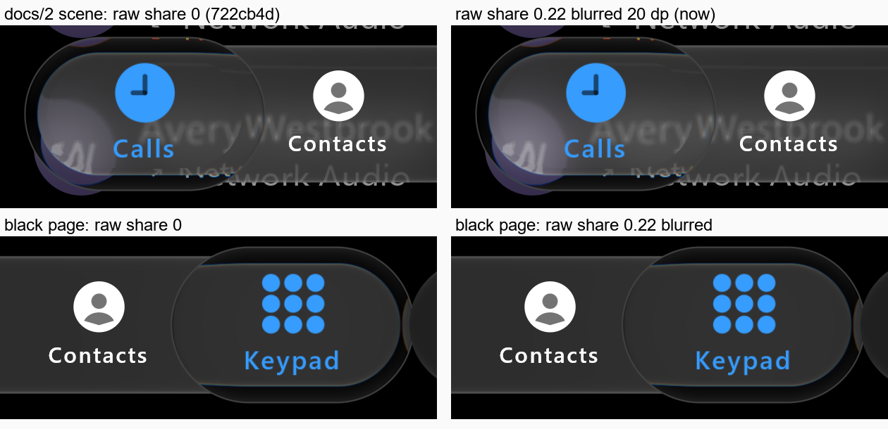

*Our renders only: the Phone comparison scene, desktop GPU replay at 3x, branch `claude/parity-2`
after 722cb4d, inferred input (docs/2 at 5.75 s, IMG_6756's keypad hold at 35.47 s).*

### WhatsApp's slots (17 October)

WhatsApp's dark five-tab bar (JGEY2190 50-74 s, the same device as the App Store bar, 3 px/pt) is
348 x 62 pt on the Phone bar's row. Its tabs are not equal shares. The tab centres are 193 / 370 /
584.5 / 799.25 / 976 px, symmetric about the bar's centre, 214.6 px apart inside and 177 px at the
ends. The resting pill is 78 pt wide and sits 4 pt inside the bar's end when an end tab is selected.
The labels are 119 / 69 / 190 / 81 / 51 px wide. Two rules were scored against the centres:

- Equal slots of the inner spacing, 71.5 pt, centred in the bar, with an end tab moved in until its
  pill fits 4 pt inside the bar: every centre within 2 px. The inner spacing is the widest item,
  "Communities" at 63.3 pt, plus 8 pt. That is a reading of one bar, not a law.
- Slots of each item's width plus an equal gap: up to 13 px off ("Chats" and "You").

The App Store bar fits the first rule with 64 pt slots and nothing closed up: centres 201 / 393 /
585 / 777 / 969 against the measured 200 / 393 / 585 / 777 / 969. `GlassTabBarStyle.slotWidth`
implements the first rule. It is opt-in, and every preset keeps its shared-out slots. The new
sample `WhatsAppScene` uses it with neutral placeholders (a plain disc for the profile tab, a
settings list behind the bar).

At rest, our label runs land within 1.5 px of iOS's, and their widths within 3 px. In the replay,
a tap on the first tab lands at 129 px from the bar's left (iOS 130). A drag from the first tab to
the last steps through every index and lands at 915 (iOS 913). Selected ink stays white over the
dark pill, as on the recording.

Over the same grey settings card (23), iOS's bar reads 54 and ours 46. Its pill reads 30 and ours
25. This is the clearer bar the App Store showed. It is recorded and not fitted: dark Calm keeps
the Phone bar's glass.

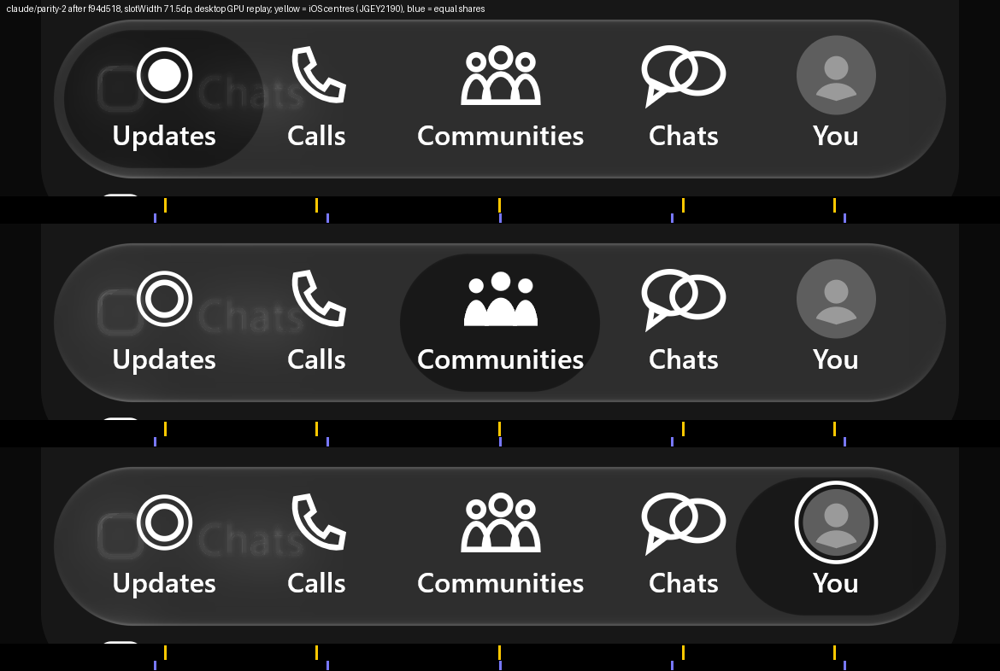

*Our renders only: `WhatsAppScene`, desktop GPU replay at 3x, branch `claude/parity-2` after
f94d518. Yellow ticks are iOS's measured tab centres, blue ticks where equal shares inside a 6 dp
padding would put them.*

### The clearer bar, fitted (17 October)

WhatsApp's bar over three pages, in display colours at rest (JGEY2190: the chats page, 10, at
59.5 / 64 / 67 s; the settings card, 23, at 58 / 65.5 s) and the App Store's over black (LOLL8185
74.5 s): iOS's bar reads 43 over the chats page, 54 over the card and 32 over black, and its resting
pill 19 and 30. That is about 0.9 of the page plus the Phone bar's 32/255 lift; the Phone bar passes
0.59. The pill is the bar less 22/255 here too, as on the Phone bar. `GlassTabBarStyle.CalmClear()`
is dark Calm with the bar black at 0.10 instead of 0.41, fitted over the four page levels (0, 10, 23
and the App Store card's 28 against 32 / 43 / 54 / 57). Scored by replay (rest frames, our scenes):

| At rest | iOS | `CalmClear()` | `Calm()` |
| :-- | --: | --: | --: |
| WhatsApp bar / pill over the grey card | 54 / 30 | 53 / 31 | 46 / 24 |
| WhatsApp bar / pill over the bare page (iOS: chats page, with text) | 43 / 19 | 41 / 19 | 38 / 16 |
| App Store plain bar, four gaps between tabs (38.5 / 43.9 s) | 67 / 65 / 64 / 59 | 66 / 64 / 63 / 58 | 54 / 53 / 52 / 49 |

Text under the App Store bar stays brighter in ours (band p75 107 against 80): iOS compresses bright
content under that bar, which no tint reproduces (pass 18 notes). Dark `Calm()` is unchanged; the
WhatsApp and App Store scenes default to `CalmClear()`.

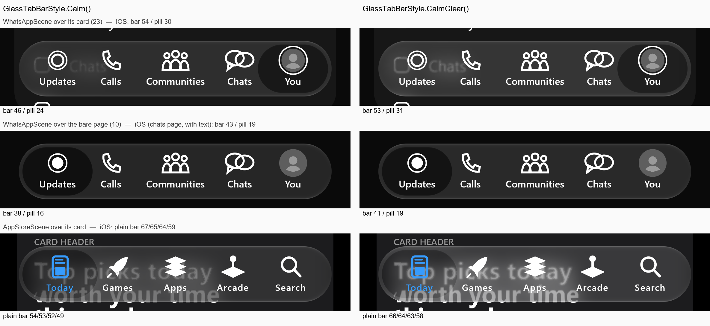

*Our renders only: `WhatsAppScene` and `AppStoreScene`, desktop GPU replay at 3x, branch
`claude/parity-2` after 722cb4d. The iOS levels are measurements on the owner's recordings.*

### Light appearance and the blur under the bar (17 October)

The owner recorded light mode (IMG_7048: Phone 4-60 s, App Store 64-100 s, WhatsApp 108-140 s, Threads
148-170 s; bottom 570 rows, 3 px/pt) and the Contacts list under the bar in both appearances
(IMG_7049). Measured in display colours:

| Light, at rest | iOS | light `Calm()` | before (light toolbar) |
| :-- | --: | --: | --: |
| Bar over page levels 171-245 (least squares) | 0.58 B + 116 | 0.59 B + 115 | 0.42 B + 140 |
| Bar over white | 255 | 255 | 255 |
| Rim top / bottom / ends | 246 / 242-247 / 179-221 | 246 / 246 / 234 | 255 |
| Shadow under the bar | 253 | 251-253 | 255 |
| Resting pill, Phone keypad page / WhatsApp | 246 / 236 | 242 / 242 | 235 |
| Held lens edge | soft band to ~244, shadow to 242 below | 2 px line at 243; shadow 241-243 since 18 October | 175 |

A light tap travels as refracting glass with growing ink, as in dark (6.8-6.9 s), so light Calm takes
dark Calm's tap optics. The App Store's resting pill is invisible over white (255 at 95 and 98 s, Games
selected); the 217-228 first read here was its cards seen through it (a light-blue card reads ~230 under it).
Under the bar,
in both appearances, iOS shows text as one soft copy, legible, without the ghost copies a toolbar's
high-pass draws: the tab bar is the soft-copy role the Calm presets use. An edge-slope estimate puts
iOS's text edges under the bar at 0.74 px (dark) / 0.61 px (light) against ours 0.62 / 0.61.

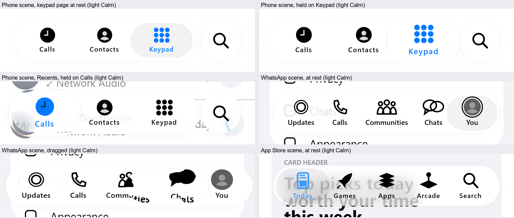

*Our renders only: desktop GPU replay at 3x, branch `claude/light-and-gaps`.*

### The owner's device check (18 October)

The owner tried the build on a phone and listed six differences. Each was compared with the recordings:

| Note | iOS (recording) | Before | Now |
| :-- | :-- | :-- | :-- |
| Icons jump on a tap | an icon the lens does not cross holds within 0.1 px through a tap (IMG_7048 6.3-7.6 s); on a hold Calls moves 14 px out, w 68 -> 71 (38.1-38.3 s) | the deselected icon slid 7 px and back on a 150 ms tap | holds still on a tap; a hold moves it 13 px, w 68 -> 71 |
| Tap travel | a clear lens that bends ink at its rim and lands clean (IMG_7048 6.7-6.9 s) | the fold smeared the carried icon and lingered ~150 ms | the held lens's optics (`tapTransitFold` 0) |
| Two glasses in the lens | the bar fills the held lens nearly to its rim; what lies beyond bends into a thin crescent (IMG_6756 35.47 s) | the bar's edges and rounded end showed as a second capsule | rim band 0.3 (`bodyBandScale`); region levels within 2 (top band 53 -> 51) |
| Search button too sensitive | no finger trace in the recordings | gain 0.35 | 0.2 (authored, from the owner's check) |
| Lens against the search button | the held lens pinches into the button (IMG_7048 38.5 / 42 s) | stopped short, a gap | joins it through a 12 dp neck (`lensFusion`) |
| Text under the bar's ends | the caps lens what lies beyond them: an icon's edge outside the bar shows ~30 px inside the cap (IMG_7049 5.0 s) | the caps sampled inward only and mirrored the letters | the caps use the held lens's map (`capFold` 1); straight runs unchanged |

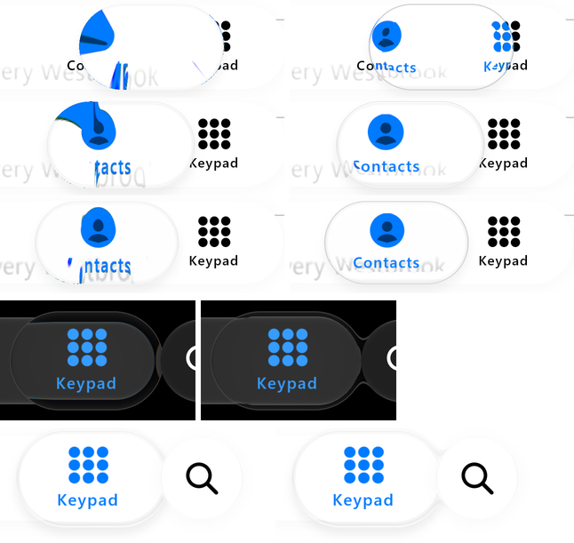

*Our renders only: desktop GPU replay at 3x, branch `claude/residuals-2`. Top: a tap from Keypad to
Contacts, before (left) and after (right), every 4th frame. Middle: the dark held lens at the search end,
before (left) and with its 0.3 band and 12 dp neck (right). Bottom: the light held lens at the search end without and with its neck.*

The App Store bar (dark) now blurs the text under it (7 dp) with `legibility` 2: band p50 / p75 68 / 79
against iOS's 69 / 80 (was 67 / 98); p90 133 against 207 (the brightest text pixels, softer than iOS's).

### Landing timing (18 October)

WhatsApp's motion re-scored on the 18 October build (the same inferred script, the same white-fill tracker
on both sides, 49.8-67.0 s, 14 touches): the selection path rms 62.7 px (79.9 on 17 October), p90 109 px
(140), and the best time shift between the two paths -17 ms (-42 ms): one frame of the 60 fps recording,
its time resolution. The lift is inferred, so its calibration was swept:

| Lift calibration (`genwa.py` UP_CAL) | path rms | p90 | best shift |
| :-- | --: | --: | --: |
| +10 ms | 58.3 px | 106 px | -25 ms |
| **+27 ms (kept)** | 62.7 px | 109 px | -17 ms |
| +48 ms | 68.1 px | 121 px | -17 ms |

No lift moves the shift below a frame, so the remaining offset is not the inferred input; at one frame
it is at the recording's resolution. The per-touch "settle" times (ink within 8 px for 0.1 s) now read
120-280 ms after the lift against iOS's 129-611 ms: since taps travel with the held lens's optics the ink
no longer smears, so the tracker sees it settle sooner; this is an ink reading, not motion. Landings 14/14.

### The dark held lens's top band and the search button's sideways release (18 October)

The dark held lens read ~10 below iOS's over content in its upper half (top band 51 against 64) and
matched over black. Its blurred raw page, wider and stronger, closes it without touching black:

| Raw page (share, blur) | top band | bottom band | text p90 | text p50 | black | rms |
| :-- | --: | --: | --: | --: | --: | --: |
| iOS | 64 | 75 | 102 | 82 | 47 | |
| 0.22, 20 dp (before) | 51 | 70 | 99 | 84 | 48 | 6.6 |
| 0.4, 40 dp | 58 | 74 | 101 | 86 | 48 | 3.6 |
| **0.5, 50 dp (shipped)** | 60 | 73 | 101 | 86 | 48 | 2.8 |
| 0.6, 60 dp | 62 | 74 | 103 | 87 | 48 | 2.7 |

A clamp of the raw page to the bar's bounds was tried first and changed nothing (52); the haze above
the bar inside the lens is the held glow, not the raw page.

The search button's finger script was re-inferred for the new drag gain (0.2): the replay scores as well
as before (half-width rms 2.7, was 3.4). Released sideways, iOS's body springs further past its place
than upward; a separate x damping fits it:

| x release damping | centre x (sideways) | half-width (sideways) | narrowest (iOS 78) |
| :-- | --: | --: | --: |
| 0.45 (shared) | 2.6 / 2.1 / 1.6 | 2.7 / 2.2 / 2.1 | 86 |
| **0.3 (shipped)** | 2.3 / 2.0 / 1.5 | 2.2 / 1.8 / 1.9 | 83 |
| 0.2 | 3.1 / 2.7 / 1.6 | 2.2 / 1.8 / 1.8 | 80 |

### The held lens's shadow (18 October)

A lens casts its contact shadow from its own body now. A selector's node spans the whole bar, and the
shadow was drawn as that node's rectangle, so a lens given a shadow shaded the bar far from itself
(218 over white across the bar's right half); light Calm's lens had its shadow turned off for that
reason. With the shadow cast by the lens's capsule (`glassShadowCaster`, the pose body through its
matrix), light Calm's lens takes a shadow, scored on IMG_7048 at 38.5 s and 42 s (a lens held on
Keypad over the white keypad page). First at the panel's own shadow geometry, `contactShadow` 0.5:

| Below the light held lens, every 3 px from its edge | levels |
| :-- | :-- |
| iOS | 245 242 242 242 242 242 244 246 247 249 252 254 255 |
| ours, `contactShadow` 0.5 | 241 242 243 244 245 246 247 248 249 249 250 251 252 |
| ours, 1.0 | 231 232 234 236 237 239 241 243 244 245 246 247 249 |

rms 2.6 levels at 0.5; the interior over the bar is unchanged (253.3 / 254.8 against 253.4 / 255.0),
because the bar's own image covers the shadow inside the lens, as on iOS. Where the lens overhangs the
page above the bar it reads 248-251 (iOS 244-252).

Then with the shadow's own geometry (`contactShadowBlur`, `contactShadowOffset`, `contactShadowInside`,
18 October), scored by profile (12 px above the lens, the overhang above the bar, 36 px below):

| Shadow | above | overhang | below | all (rms) |
| :-- | --: | --: | --: | --: |
| none | 0.5 | 3.1 | 6.5 | 4.2 |
| panel geometry, 0.5, inside 0.5 | 4.8 | 2.9 | 3.2 | 3.7 |
| 0.45, inside 0.5, blur 6 dp, 5 dp down (shipped) | 0.6 | 3.1 | 3.2 | 2.6 |
| 0.45, inside 1, blur 6 dp, 5 dp down | 0.6 | 2.9 | 4.1 | 2.9 |
| 0.40, inside 0.5, blur 8 dp, 6 dp down | 1.0 | 3.1 | 3.1 | 2.6 |

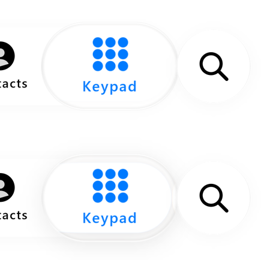

*Our renders only: desktop GPU replay at 3x, `hold2` (1.2 s on Keypad), branch `claude/residuals`;
top `contactShadow` 0, bottom 0.5.*

### WhatsApp's motion (17 October)

WhatsApp's selected ink stays white, so the blue-ink tracker of the Phone and App Store bars does not
apply. A selected glyph fills, though, and every glyph under the held lens fills (as `lensInkAll`
draws): `.local/sxs/trackwa.py` reads the selection as the centroid of white fill in the icon band,
each column weighted by how filled it is against that column's own selected fill, so the photo tab
(a ring only) counts as much as a filled glyph. Each tab's resting centroid maps to its centre.
Touches come from the bar: WhatsApp changes page with its tab, so a touch is the bar's level jumping
(+4 within two frames) with its ends growing within ten frames (`genwa.py`). Fourteen touches in
JGEY2190 49.8-67 s: two taps, three quick drags and nine throws.

The finger is inferred, and throws needed one more rule. While iOS's lens rests on a tab its finger
keeps going, so a finger led by the lens is nearly still at the lift and never flings. Where iOS
settles past the lens's tab at the lift, the inferred finger leaves the tab before at 1.5 times the
fling speed over the last 100 ms (Compose fits the lift velocity over 100 ms); otherwise it stands
on its tab for those 100 ms. A touch under 0.2 s that settles on another tab is a tap there. The
landing tabs of the throws therefore agree by construction. What is scored is the path and the
timing, read by the same tracker on our replay (`cmpwa.py`; `CalmClear()` on `WhatsAppScene`):

| | |
| :-- | :-- |
| Landing tabs | 14 / 14 (9 throws inferred from iOS's landing) |
| Settling after the lift, ours − iOS | median −21 ms, p25 / p75 −31 / +75 ms |
| Selection path | median 3 px, p75 59 px, p90 140 px; best shift −42 ms |

The large errors are in throws' flights: ours reaches the far tab about 40 ms before iOS's tracker
shows it, which is within what the inferred lift (one to three frames) and WhatsApp's glyph-fill
cross-fade can account for. The motion model is unchanged: the pose dynamics fitted on the Phone
bar carry to WhatsApp's five-tab bar on set slots.

### Re-reading the landing evidence

The removed impact model was calibrated to one frame, video 2 at 2.5567 s ("frame082": width
242 px, a left-cap fit of R 116.14 px; its full height was recorded as unobservable). In the
continuous sequence that frame is the **dark resting inset about 0.33 s after the wall impact**,
briefly narrower than its 285 px rest and still inside the bar. It is not a glass circle during
the impact. The narrowing itself is real and is listed below.

## Remaining differences

**Scoreboard, 20 October (build `ab574ec`, replay `p20`).** All five recordings replayed through today's
renderer (desktop GPU, deterministic 60 fps, Calm) from the same inferred scripts as passes 16-18, and
scored in display colours (HDR10 decoded) against iOS. Levels are the median of ours minus iOS's, in
8-bit levels; tracking is the selector's path against iOS's ink over holds and drags.

| Recording | rest bar | rest pill | held bar | held lens | tap pill | tracking rms | best shift |
| :-- | --: | --: | --: | --: | --: | --: | --: |
| docs/1 (37 taps) | 0 | 0 | | | +0.8 (pass 18: -8.9) | | |
| docs/2 | 0 | -3 | +1.3 | -5.0 (pass 18: -13.3) | | 31.6 px (31.5) | 0 ms |
| IMG_6756 | 0 | 0 | 0 | -0.1 | | 11.0 px (11.0) | -8 ms |
| JGEY2190 | 0 | -1.5 | | | -2.0 (pass 16: -7.7) | 26.8 px | -8 ms |
| LOLL8185 | 0 | 0 | -1 | +1 | | 9.2 px (9.2) | -8 ms |

No region regressed since passes 16-18. Neck timing on docs/2 is unchanged (forms -50 / 0 / -67 ms, parts
0 / -33 / +100 ms). Still open: the tap pill's plateau ends about 50 ms sooner than iOS's (docs/1 profile:
iOS 53 at 150 ms and 51 at 183 ms after the ink leaves, ours 47 and 42; equal again from 250 ms); docs/2's
held lens over the avatar (-5).
Tried and rejected (20 October): a slower appearance fall (`tapAppearanceFallOmega` 20 instead of 45) leaves the
profile identical to 233 ms and only lengthens the tail (35 against iOS's 30 at 250 ms), so the early dip is not
the fall rate.

- Pass 16 (display colours): a held lens over page content: iOS's brightens what it shows (docs/2:
  88 against our 61 over the avatar); no tint or raw page share reproduces it (fits by replay). The
  resting pill reads 3 above iOS's on black pages. iOS's bar lights 33 ms before a tap's ink
  leaves; our inferred tap presses 16 ms before (finger timing).
- Held lens over content (18 October, blurred raw share 0.5 / 50 dp): every region within 4 of iOS's
  (top band 60 against 64, text p50 86 against 82), five regions 2.8 rms.
- WhatsApp motion (18 October): the paths agree within one recording frame (best shift -17 ms, was -42),
  path p90 109 px (140); landings 14/14.
- App Store bar: p50 / p75 68 / 79 against iOS's 69 / 80 since 18 October (7 dp blur, `legibility` 2);
  p90 133 against 207 until the scene's glyphs were drawn 1.12x larger with SemiBold labels (18 October):
  p50 / p75 68 / 80, p90 236. The p90 falls on the icons' edges, so it swings with glyph weight; the
  scene's drawn glyphs are stand-ins for Apple's symbols, not the library.
- Light appearance (IMG_7048, 17 October): the held lens casts its shadow since 18 October (profile rms
  2.6); the bar's ends darken toward their outermost point since 18 October (`capEdgeShadow` 2: 177-186
  against 178-182; left end 12.1 levels rms along its outline, was 45.4; 5-10 overshoot, rms 58-144).

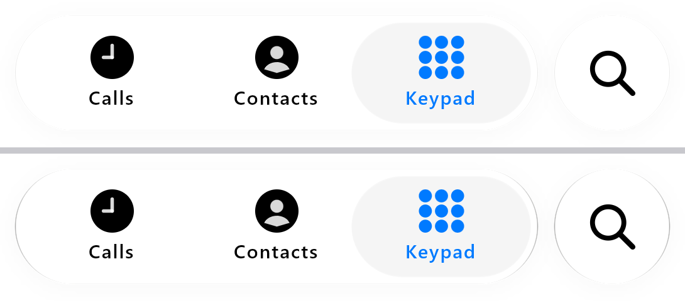

*Our renders only: desktop GPU replay at 3x, light Keypad at rest, branch `claude/fix-rest`; top
`capEdgeShadow` 0, bottom 2. The search button shares the bar's material; its sides are not scored.*
 Resting pills per app since 18 October (245 / 236 / 255).
- Text under the bar's rounded ends: lensed since 18 October (`capFold`), judged by eye against IMG_7049;
  not scored by region.

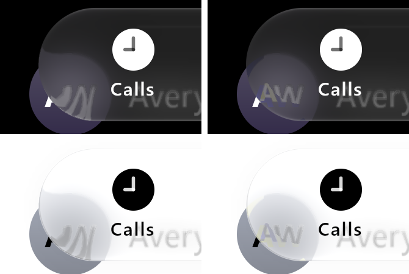

*Our renders only: desktop GPU replay at 3x, branch `claude/bar-ends`. Dark (top) and light (bottom),
before (left) and with `capFold` 1 (right).*
- Search button (pass 17, drag gain 0.2, x release damping 0.3 and lift share 0.65 since 18 October;
  scripts re-inferred for the new gain): the rise within 1-2 px of iOS's (3-6 short at 0.6); brightness
  6.4 levels rms (7.1); after a sideways release its
  narrowest is 83 px against iOS's 78. The "min half-width 86 against 78" of sideways pulls is not the pull: it
  falls in the ~100 ms after release, when iOS's body overshoots its rest by 6 px against our 2 and
  squashes deeper against its held edge. Width ratio rescored on 18 October: 1.0 (shipped) half-width
  rms 3.4 / height 3.9 px; 0.8 4.4 / 5.3; 0.6 6.6 / 6.8 (over-wide upward pulls). The ports have the free pull and, since 17 October, the bar's fusion with it
  (`accessoryFuse` / `AccessoryFuse`, checked against Kotlin).
- Pass 14's level residuals (58 against 67, 62 against 64) were read on the sRGB-decoded recordings
  and are superseded above.
- Wall landings (pass 13): rms 6.0 px right / 5.4 px left (pass 10: 5.5 / 4.1). A trailing damping of 0.33 was
  tried on 18 October and rejected. Over all 19 landings (edge positions, display space, ported controller)
  it scored slightly better: mean 4.2 / 5.5 px left / right against 4.3 / 5.8, worst 8.1 / 13.0 against
  10.2 / 14.9. But it widened the two width series the suite pins: rms 3.8 / 6.8 px against 2.8 / 5.2.
  0.3 is kept; the 9.9 s landing passes its rest by
  36.5 px against 41; the left width series' first frames narrow up to 11.2 px less; the 28.66 s
  landing is an input artefact (source frame gap).
- Cap swirl (pass 9, fringes pass 11): comparable petals, judged by eye. The fringes were scored on 24 October
  ([rim fringe score](../rim-fringe-score-2026-10-24/README.md), #73): iOS's are 30 to more than 100 times ours on all five
  recordings, grow with speed and fade 110-120 ms after a lift; ours are near absent. Not changed.
- Neck timing (pass 11): median 0 ms; 34.8 s 100 ms late (bar and lens disagree on its lift).
- The rebuilt reversal input and the full video 2 script (`v2-script.txt`) are inferred; the
  per-episode lag numbers above are relative to that inference.
- Hold onset is aligned by construction (pass 7); it cannot be tested from these recordings.
- Page text under the bar is slightly more smeared than iOS.
- Calibration conflict, unresolved: an earlier early-transit patch (video1 frame 6) reads the
  inset at 0.38 of the bar, against 0.57–0.69 at rest. Its test keeps the previous pill law.
- The repeated long tap's pigment returns about 50 ms (≈7 grey levels) later than the measured
  patches with the corrected pill; its test also keeps the previous pill law.
- Android was verified on an API 37 emulator through the AGSL path ([record](../android-emulator-2026-10-14/README.md)); no physical device was available.

## Verification

- 17 October (slots, lens raw share): full library suite 395 cases, 0 failures, 27 optional showcase
  skips (11 m 44 s, fixtures re-exported); CanvasKit 36/36, portable web 14/14, .NET checks 14/14.

- Pass 18: full library suite 391 cases, 364 passed, 27 optional showcase skips, 0 failures (14 m);
  `:desktop:desktopTest` and `:sample:assembleDebug` passed; CanvasKit port 35/35 and .NET checks 13/13
  with the material fixture and shaders re-exported (`uSoftDetail`). All five recordings replayed
  (IMG_6756 with its search episodes); owner videos `.local/comparisons/2026-10-15-pass18/` (local).
- Pass 17: full library suite 391 cases, 364 passed, 27 optional showcase skips, 0 failures
  (12 m); `:desktop:desktopTest` and `:sample:assembleDebug` passed. New: `GlassFreePullTest` (free
  travel against anchored Adaptive, the landing floor, the stadium inside a stretched accessory).
  Default shapes and presets unchanged. IMG_6756's first 34.4 s replayed on the desktop Direct3D path
  (`.local/sxs/searchscore.py`); owner video `.local/comparisons/2026-10-15-pass16/IMG_6756-search.mp4`.
- Passes 15-16: full library suite 388 cases, 361 passed, 27 optional showcase skips, 0 failures
  (`:liquidglass:jvmTest --rerun`, 26 m); `:desktop:desktopTest` and `:sample:assembleDebug`
  passed; CanvasKit port 35/35 (a new touch-lift check), .NET checks 13/13, with the Kotlin
  fixtures and shaders re-exported. The Calm held-bar reference now checks `Calm()` against iOS's
  45 in display colours and `CalmRecordedSpace()` against the earlier 53; a new test pins
  `touchLift` to dark `Calm()` only. All five recordings replayed on the desktop Direct3D path
  (`.local/sxs/levels.py`, `trackscore.py`, `tapprofile.py`); owner videos with the references in
  display colours: `.local/comparisons/2026-10-15-pass16/` (local only).
- Pass 12: full library suite 387 cases, 360 passed, 27 optional showcase skips, 0 failures
  (`:liquidglass:jvmTest --rerun`, 12 m 23 s). CanvasKit port 34/34, .NET checks 13/13, with the
  Kotlin fixtures (`selector-calm.json`, `selector-material.json`) and shaders re-exported. Two
  IMG6735 envelope tests now target the retained `CalmWallLanding`; a new test replays video2's
  reversal (`calmHeldTravelWidensAndFlattensLikeVideo2`). Both videos replayed on the desktop
  Direct3D path; main (8cb49ec) replayed from a separate worktree for the before images.

- Full library suite before the bar-fold change: 374 cases, 347 passed, 27 optional showcase
  skips, 0 failures (`:liquidglass:jvmTest --rerun`, 12 m 46 s).
- After the bar-fold change, every tab-bar, Calm, Phone, bar, ink, endpoint, material and replay
  class: 167 cases, all passed. `:desktop:desktopTest` and `:sample:assembleDebug` passed.
- Six earlier tests asserted the replaced behaviour. Three now target the retained
  `GlassPoseSpec.CalmImpact` (impact landing, its middle-landing isolation, the measured post-landing
  narrowing), two keep the previous pill law (see the calibration conflict above) and the Calm
  material reference now checks the new 53 held level. `GlassContinuousReplayTest` covers the new
  behaviour.
- Tests check behaviour and stated envelopes. Owner acceptance: the Calm tab bar was accepted on the
  device by finger on 18 October, after the six-point check above.

## Files

- `before-after.png`, `lens-edge.png`, `moving-lens.png`, `landing.png`, `cap-swirl.png`,
  `landing-99.png`, `landing-left.png`, `drag-bar.png`, `swirl-gain.png`, `neck-timing.png`,
  `pass12-held.png`, `pass12-moving.png`, `pass12-tap.png`, `pass12-throw.png`, `pass13-held.png`,
  `pass13-moving.png`, `pass14-held.png`, `atlas-studio.mp4` —
  public, our renders only.
- Pass 9 scoring (local, reads the private recording's row dumps): `.local/sxs/wallscore.py`
  (right landings), `wallscorel.py` (left landings), `neck.py` (neck timing), `liftonset.py` and
  `baredge.py` (bar release onset).
- Local only: `.local/comparisons/2026-10-13-baseline/` (first comparison, original scripts) and
  `.local/comparisons/2026-10-13-pass1/` (reference / before / after).
- Harness: `desktop/src/jvmMain/.../PhoneReplay.kt`, `sample/.../PhoneScene.kt`; script generators
  and tracker are in `.local/sxs/` with the private recordings they read.
