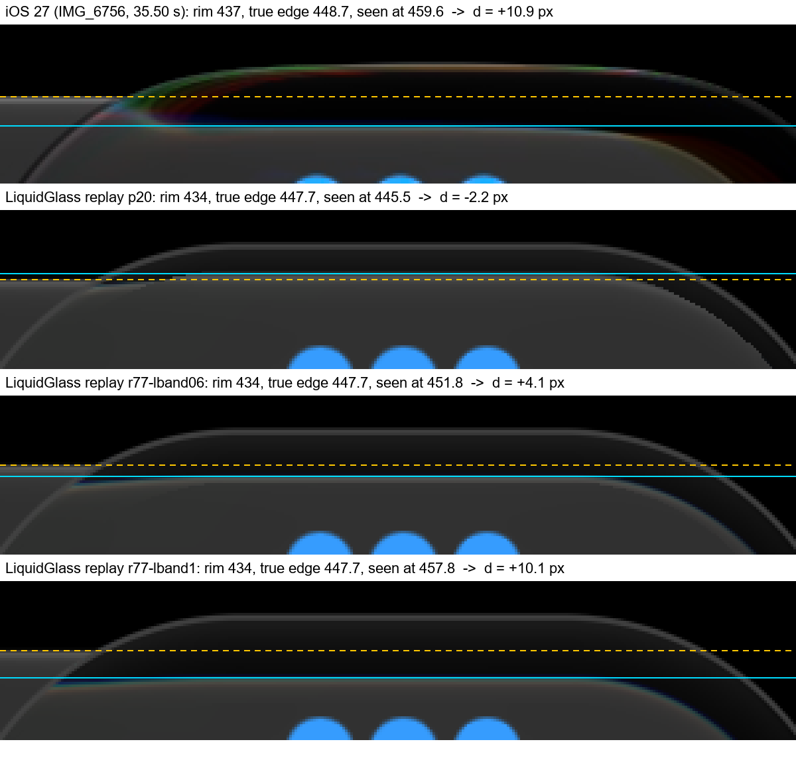
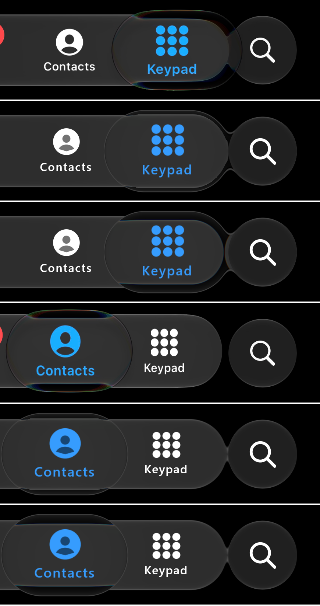

# Refraction gap against iOS: 24 October 2026 (issue #77)

How far the glass selector bends what lies beneath it, in the five iOS reference recordings and in our replay
of the same recordings. **Measurement only. No optic, constant or shader was changed.** The owner
reviewed the side-by-side page ([ios-side-by-side-2026-10-20](../ios-side-by-side-2026-10-20/README.md)) and
said our refraction reads much weaker than iOS's. This record measures that gap.

*IMG_6756 at 35.50 s (iOS 27, Phone app, black Keypad page, a finger holding Keypad), rows 422-482 of the
scene at 4x. Dashed: the bar's true top hairline, read beside the lens. Solid: where it appears inside the
lens. Top to bottom: iOS (HDR10 decoded to display sRGB); replay p20 (the shipping Calm, lens
`bodyBandScale` 0.3); replay candidates with the band at 0.6 and at 1.0 (replay-only variants
`calm+lband=0.6` / `calm+lband=1`, not library changes). Replays come from `:desktop:phoneReplay` on the
desktop GPU (Skia, Direct3D), deterministic at 60 fps, driven by the finger path inferred from the recording.*

## Result

**At the lens's rim, iOS's refraction is about 13 px stronger than ours. Inside the body the two match.**

| Where | iOS | Ours (p20, 1.0.0 Calm) | Gap |
| :-- | --: | --: | --: |
| Held lens, rim: bar edge pulled inward (d) | **+10.9 px** | **-2.2 px** | **13.1 px** (about 4.4 pt) |
| Moving held lens, rim (black pages) | +10.9 to +11.3 px | -2.2 px | 13.2-13.5 px |
| Held lens, body: icon scale under the lens | 1.22-1.24 | 1.20-1.22 | 0.00-0.04 |
| Tap pill in transit, body: icon scale where the pill covers it (\|u\| 20-140 px) | 1.16-1.21 | 1.10-1.14 | 0.04-0.09 |
| Resting pill: icon scale | 1.00-1.04 | 1.00-1.02 | ≤ 0.02 |

On a 3 px/pt scene, iOS's lens moves the bar's straight edge 11 px (3.6 pt) toward its centre. The
displacement is nearly **uniform across the rim band**: +10.3 to +11.5 px at every depth from 3 px to 20 px
inside the rim, and at every column across the lens. Ours moves it -2.2 px, slightly *outward*, at the
depth where the edge sits (12-15 px inside the rim). It reaches only +0.7 to +1.4 px in the outermost 3-9 px.
The black around the bar therefore becomes a ~20 px dark band inside iOS's lens edge. Ours shows no
such band. This is the "bends more" the owner saw.

### Per recording (rim, held and moving lens, central columns |x - cx| ≤ 60 px)

Each value is the median over frames of each frame's median. Brackets: 95 % bootstrap interval of that
median over frames. p10-p90 is the spread of the per-frame values. h is the true edge's median depth inside
the lens rim.

| Recording | State | iOS d | ours d | gap | iOS h / ours h | frames iOS / ours | per-frame p10 to p90, iOS ; ours |
| :-- | :-- | --: | --: | --: | :-- | :-- | :-- |
| docs/1 (iOS 26, 37 taps) | no held lens | - | - | - | - | - | - |
| docs/2 (iOS 26) | held | +10.9 [10.9, 10.9] | -2.2 [-2.2, -2.2] | **+13.2** | 11.7 / 13.7 | 204 / 218 | 9.8 to 11.0 ; -2.4 to +0.2 |
| IMG_6756 (iOS 27) | held | +11.2 [11.2, 11.3] | -2.2 [-2.2, -2.2] | **+13.5** | 12.3 / 13.7 | 314 / 396 | 10.9 to 11.6 ; -2.3 to -2.0 |
| IMG_6756 | moving | +11.3 [11.3, 11.4] | -2.2 [-2.2, -2.1] | +13.5 | 11.8 / 12.4 | 120 / 68 | |
| JGEY2190 (iOS 27) | held | +10.0 [9.9, 10.2] | +0.2 [0.0, 1.1] | **+9.7** | 22.8 / 11.2 | 160 / 132 | -0.9 to 11.3 ; -2.5 to 24.0 |
| LOLL8185 (iOS 27) | held | +10.9 [10.9, 11.0] | -2.2 [-2.3, -2.2] | **+13.2** | 11.8 / 15.2 | 199 / 278 | 10.9 to 11.0 ; -2.4 to -2.2 |
| LOLL8185 | moving | +10.9 [10.9, 11.0] | -2.2 [-2.3, -2.2] | +13.2 | 11.6 / 14.1 | 123 / 65 | |
| **All, held** | | **+10.9** (877 frames) | **-2.2** (1024) | **+13.1** | | | |

The bootstrap intervals are narrow because the per-frame values are quantised and nearly constant. The
p10-p90 spread is the more honest uncertainty. The edge position is sub-pixel (half-rise crossing), so
the gap is good to about ±1 px. JGEY2190 is the noisy one. Its lens there hangs deeper over the bar
(h 22.8 px on iOS against 11.2 px in ours), and its tails (iOS -0.9, ours +24) are frames where the
call-list page beside the bar breaks the dark-band detection. Its median still shows the same sign and
size of gap. docs/2 and JGEY2190 "moving" rows are omitted. During their fast reversals the lens flattens
to about the bar's height, so its rim no longer overhangs the bar and the per-frame values are bimodal.
docs/1 has only taps, and the tap pill's rim sits inside the bar, so it gives no rim reading. Its taps are
scored by the icon measure.

### Rim profile: d against the edge's depth inside the rim (all lens columns, held + moving)

| h (px) | docs/2 iOS / ours | IMG_6756 iOS / ours | JGEY2190 iOS / ours | LOLL8185 iOS / ours |
| :-- | :-- | :-- | :-- | :-- |
| 3-6 | +10.7 / +1.1 | +10.3 / +1.4 | +11.4 / +1.1 | +10.2 / +1.4 |
| 6-9 | +11.0 / +0.7 | +11.4 / +0.8 | +11.4 / +0.3 | +10.9 / +0.8 |
| 9-12 | +11.0 / -1.1 | +11.5 / -0.8 | +11.0 / -0.8 | +11.0 / -0.6 |
| 12-15 | +10.9 / -2.2 | +11.3 / -2.2 | +10.8 / -2.3 | +10.9 / -2.2 |
| 15-20 | (content) / +3.1 | +11.0 / -2.2 | +10.1 / +3.5 | +10.5 / -2.3 |

Column counts are in [summary-p20.txt](summary-p20.txt) (the scorer's full output, including the
icon tables). Across the lens (held, all recordings), iOS stays +10.9 to +12.6 at every 60 px column bin
from -200 to +120 px. Ours stays -2.2 to +0.1.

*IMG_6756, scene rows 410-680, columns 300-1170. Rows: 35.50 s (holding Keypad) iOS / p20 / band-1.0
candidate, then 43.79 s (the held drag resting on Contacts) in the same order. The Keypad page is black and
only the bar shows, so no contact names appear. Every row was inspected. With the band at 1.0 the black
around the bar shows as a dark band inside the lens edge, as on iOS. The candidate also changes how the
lens reads over the bar's right end and the fused search button. The owner judged a similar change as "two
glasses" on 18 October (see below), and nobody has judged this candidate yet.*

### Body and transit (icon measure)

The icon-scale fit puts the held lens's body magnification within 0.02-0.04 of iOS on every recording. iOS
reads 1.22-1.24 under the lens and ours 1.20-1.22. Icons away from the lens read 1.04-1.08 on both, which
is the bar's own held growth. The tapped pill in transit magnifies less than iOS's: 1.10-1.14 against
1.16-1.21 on docs/1 and JGEY2190 (37 + 30 taps), where the pill covers an icon off its centre. The
fitted centre shift points the other way, though (ours pushes the icon 6-10 px away from the pill centre,
iOS 0-2 px). Scale and shift trade off in the fit, so the transit difference is real in sign but its size
is not well determined. The same is true of the moving-lens shift rows in `summary-p20.txt`, which have
few samples and depend on how well the ink centroid stands for the lens centre. The resting pill is
1.00-1.04 on both.

## Method

Scorer: [`tools/reference-replay/refraction.py`](../../../tools/reference-replay/refraction.py), with
tables from [`refraction_summary.py`](../../../tools/reference-replay/refraction_summary.py). The
private copy is `.local/sxs/refraction.py`. Run them from the main checkout's root. They need the private
recordings and replay catalogues (`.local/sxs/ref/<name>/catalogue3.txt` and the replay frames).

- **Sources.** iOS: `docs/1.MP4`, `docs/2.MP4` (iOS 26), `IMG_6756`, `JGEY2190`, `LOLL8185` (iOS 27): the
  five recordings of the [replay record](../reference-replay-2026-10-13/README.md#remaining-differences).
  All are HDR10 decoded to display sRGB with the decode chain of `.local/sxs/hdr.py`. Ours: replay
  `p20` (build `ab574ec`, the 1.0.0 material), the frames scored by `levels.py`. `IMG_6756` re-rendered at
  this branch's base (`dc79d5b`) is bit-identical to p20 on 71 sampled frames (max difference 0). Every
  frame of each touch, from 0.35 s before to 0.6 s after, is sampled at 30 Hz in both sources.
- **RIM.** The bar's straight top and bottom edges carry a bright hairline. Where a held lens overhangs the
  bar, each lens column shows, going inward: the lens rim, a band of page, then the bar's hairline.
  Its apparent row is the half-rise crossing after the band's minimum. The true row is the same crossing
  at bar columns ≥ 230 px from the lens in the same frame (straight run), so the bar's own held growth
  (4-13 px on iOS) cancels. d is positive when the edge appears moved toward the lens centre, that is when
  the exterior is pulled inward. A column counts only where the page just outside the bar is dark (row
  405 / 675 ≤ 12) and a band at least 18 levels darker than the hairline is found.
- **ICON.** Each tab's icon and label box (rows 474-612, ±82 px) is matched by normalised
  cross-correlation, over scale 0.90-1.50 and shift, against the same tab at rest with the selector at
  least 200 px away, from the same recording and source. u is the tab centre minus the selector centre. The
  selector centre is the selected (blue) ink's centroid (track.py's mask) in each source. Matches below
  NCC 0.6 are dropped. Under the selector the icon is the selected ink, so the scale includes any ink
  scale (ours: `tapSelectedScale` 1.15 compensated for transit optics) as well as refraction. That is
  why the rim measure, which reads only the bar's edge, is the clean one.
- **States.** rest: no touch for 0.6 s. tap: 0-0.4 s after a tap. held: inside a hold or held drag,
  ink speed < 1.5 px/frame. moving: inside a held drag, faster. The touch intervals come from the
  replay catalogues (`catalogue3.txt`).

## What governs displacement in our model

For the Calm selector, the band width and the source map are the only levers. `refractionDepth`,
`indexOfRefraction` and `bevelPower` do not enter this branch of the shader. The pass-4 record already
noted that refraction depth 20 and 28 dp score the same as 14.

| Parameter | Where | Value | Provenance | Role |
| :-- | :-- | :-- | :-- | :-- |
| Band width W = 0.6 R | `GlassPoseGeometry.kt:463` (`band()`), `LiquidGlass.kt:547-549` | 0.6 × the lens's end radius (R ≈ 36 dp, so W ≈ 65 px at 3 px/pt) | **measured**: "W = 0.6 R — 0.55 ± 0.11" (research/README.md III.4). On a selector body it is **inherited** ("the optical band on the body", README 0.1) | scale of every shift |
| `bodyBandScale` | default 1 at `GlassStyle.kt:97`; **Calm lens 0.3** at `GlassTabBar.kt:1671` (dark) and `:1707` (light); clamp 0.25-4 at `LiquidGlass.kt:548`; morphed at `GlassMorph.kt:88` | 0.3 → W ≈ 19.5 px | **authored** (18 October, against IMG_6756 35.47 s and docs/2 5.75 s, to remove the "two glasses" second outline) | **the gap** |
| Held map `heldSource(u) = 1.3u − 0.29` (u < 0.5, identity beyond) | `GlassSourceMapSource.kt:35-37`; applied at `GlassShaderSource.kt:532`, shift at `:537` | max outward sample 0.29 W at the rim | **inherited** ("The 1.3 and 0.29 are inherited effective-map values", `GlassSourceMapSource.kt:44-46`) | the shape of the rim band |
| `heldLens` / `tapOptics` | `GlassTabBar.kt` (lens 1, pill 0, transit via `tapOptics` 1) | 0-1 | authored | turns the held map on; the resting pill has no displacement by design |
| `heldMagnification` | `GlassStyle.kt:157` | ink pass only | authored | no backdrop displacement |

**Why ours reads -2 px.** An edge at true depth h shows at the depth y where `src(y/W)·W = h`, that is
`y = (h + 0.29 W) / 1.3`, as long as y < W/2. With the shipping W ≈ 19.5 px, the outer half band reaches
only 9.8 px deep and samples no deeper than 7 px. The bar's edge sits 12-15 px inside our rim, past
the band, so it is shown where it is. The small outward value is our edge seen through the band's inner
end. With the full band (W ≈ 65 px), an edge at h = 12-14 shows at y ≈ 24-25, so d ≈ +11. That is
iOS's number.

**Candidates scored (replay-only variants, IMG_6756, all 314 iOS held frames; no library change):**

| Lens band | ours d held (moving) | gap to iOS |
| :-- | --: | --: |
| 0.3 (shipping) | -2.2 (-2.2) | 13.5 |
| 0.6 (`calm+lband=0.6`) | +3.8 (+3.8) | 7.5 |
| 1.0 (`calm+lband=1`) | +9.8 (+9.5) | 1.4 (1.9) |

Linear between these points, the band that matches iOS's +11.2 is about 1.1. The rim profile at 1.0
(+11.1 at h 3-6, +10.1 at h 12-15, +9.5 at h 15-20) has nearly iOS's flat shape (+10.3 to +11.5). Body
magnification is unchanged by the band (1.20 in both candidates). Summaries:
[summary-IMG_6756-lband06.txt](summary-IMG_6756-lband06.txt),
[summary-IMG_6756-lband1.txt](summary-IMG_6756-lband1.txt).

## Proposal (not applied; for the owner to decide)

Restore the held lens's rim band toward its full measured width, **opt-in**, keeping 0.3 as the default
until the owner accepts:

- A new Calm option, for example `GlassTabBarStyle.Calm(dark, lensBand = 0.3f)`, or a named preset
  `GlassTabBarStyle.CalmRefractive` whose lens and transit pill use `bodyBandScale` ≈ 1.0-1.1 (dark
  and light). Today's value stays the default, so every previously scored path keeps its tolerance. No new
  shader uniform is needed.
- Score it against all five recordings: rim d (this scorer), plus `levels.py` and the held-lens regions
  of pass 16, because a wider band also moves the levels inside the lens. Then judge it by eye over the
  bar's rounded end and the fused search button. That is where the 18 October owner check found the full
  band showed the bar's edge and end as "two glasses". iOS also shows the bar's hairline inside its lens,
  11 px in, so the straight-edge part of that look is iOS's. The end-cap part was not measured here and
  is the open risk. If the caps misbehave, a variant that widens the band only on the straight runs
  (the caps keep 0.3) is the fallback.
- The tap pill in transit inherits the lens's band through `GlassMorph`. With the lens at 1.0 the
  transit pill would keep the full band throughout, which goes the direction the icon measure suggests
  (ours 1.10-1.14 against iOS's 1.16-1.21). That needs its own replay score on docs/1 and JGEY2190.
- This is not a re-fit of a measured constant. W = 0.6 R is measured and unchanged. The 0.3 is an
  authored scale, and the 1.3u − 0.29 map stays inherited. The scored evidence for the choice is this
  record.

## Limits

- Inferred input: our lens follows the finger path inferred from the recordings, so moments are matched by
  state (held, moving), not frame by frame. Tracking rms 9-32 px (replay record).
- The rim measure needs a dark page beside the bar. It is solid on IMG_6756's and LOLL8185's black pages
  and in docs/2's gaps between rows, and noisy on JGEY2190. It measures one feature (a straight
  horizontal edge) at depths 3-20 px. Displacement deeper in the band, and the lens's left and right ends,
  are covered only by the icon fit, which mixes ink scale with refraction.
- Our lens hangs about 1-3 px deeper over the bar than iOS's (h 13.7 against 12.3 on IMG_6756), because
  our bar does not grow vertically when held (iOS: 4-13 px). That is a geometry difference, separate from
  refraction, and it is not corrected here.
- The candidate renders cover IMG_6756 only, and they are replay variants: no device capture, no owner
  acceptance. Desktop GPU (Skia, Direct3D) at a deterministic 60 fps. Nothing here says anything about
  device frame rate.
- Chromatic fringes at the rim are visible in the iOS crops and are #73's subject. They are not scored
  here.
