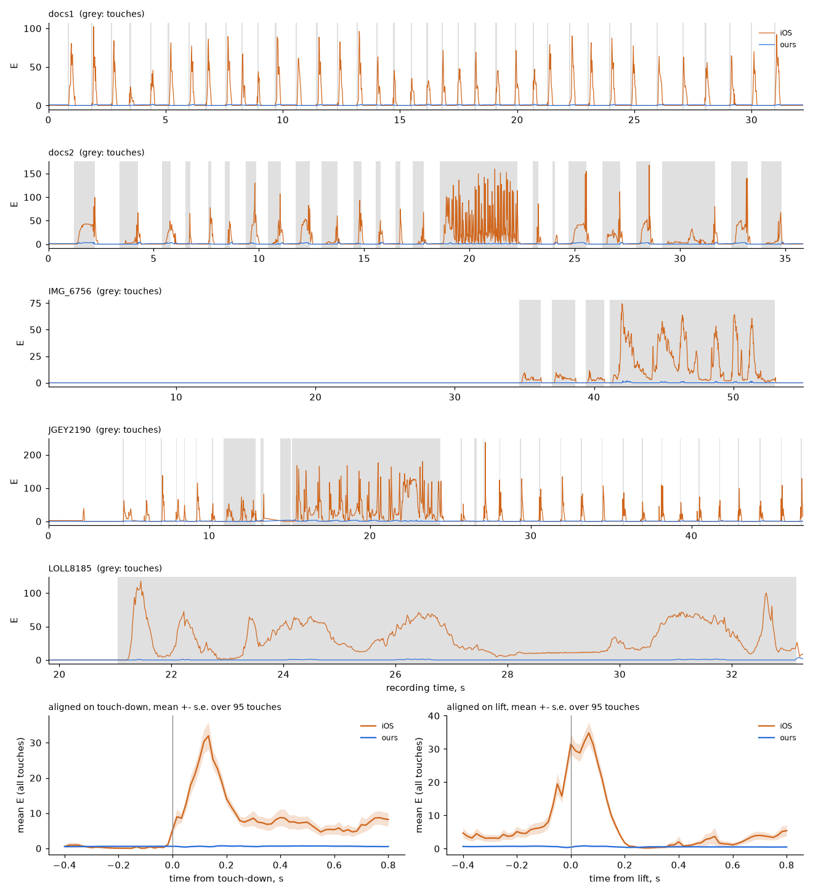
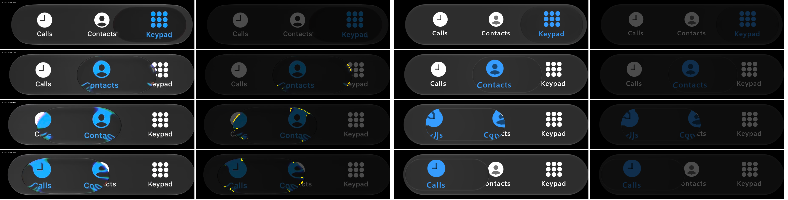

# Rim fringe score — 24 October 2026 (issue #73)

The rainbow fringes along the moving selector's caps were compared with iOS by eye since passes 9
and 11 ("comparable petals and fringes", `review/atlas/reference-replay-2026-10-13/README.md`).
This record replaces that judgement with a per-frame score over all five Phone-bar recordings.
**Measurement only: no optic, constant or shader was changed.**

**Result.** iOS's fringes are about **30 to more than 100 times stronger** (peak per touch) than ours on every recording. Ours
are close to absent: the moving or held selector never shows more fringe than about 80 px at the
detection threshold. iOS's fringes **grow with the selector's speed** (5–10× from still to fast),
**peak at the lift** of a held gesture, and are gone **110–120 ms after it**. Ours do not change
with speed. Our fringe timing can be scored only on docs/2, where it agrees with iOS's
(peak +50 ms, fade +108 ms against 0 and +117 ms). On the other recordings ours is too faint to
time. The parameters that govern our split, and an opt-in way to test a stronger one, are listed
below. Nothing is applied. The owner decides whether a change is wanted.

*Fringe strength E (summed chroma of fringe pixels / 1000, defined below) per frame. Orange: iOS
(HDR10 decoded to display sRGB). Blue: our replay. Grey: the inferred touches. The bottom panels
average all 95 touches, aligned on touch-down and on lift (mean ± standard error). Source: replay
of `dc79d5b` (docs/1, docs/2) and `ab574ec` (the other three, pixel-identical; see Method).
Desktop Direct3D (RTX 3050), deterministic 60 fps, inferred input. Derived numbers only: no
recording pixels are in this figure.*

*docs/2, the throw from Keypad to Calls over the black Keypad page, at 8.522, 8.572, 8.605 and
8.622 s. Columns from the left: iOS (bar crop, rows 430–660, x 0–915), iOS with the pixels the
scorer counts as fringe in yellow, ours at the same instant, ours with its mask. The crop shows
only the bar's own labels. iOS's petals carry orange and green edges a few pixels wide. Ours
carry the same petal shapes with almost no colour beyond the blue ink. Ours: `dc79d5b`, desktop
Direct3D replay at 60 fps from the inferred script. iOS: owner's screen recording, HDR10 decoded
with `hdr.py`'s chain.*

## Method

**Sources.** The five recordings the replay record uses: docs/1 (37 taps), docs/2 (23 holds,
drags and throws), IMG_6756 (three holds and a 12 s drag; the search-button episodes before
34 s are not in its script), JGEY2190 (taps, a hold and a held scrub) and LOLL8185 (one 12 s
drag across all tabs). The recordings are private and stay out of git.

**Decode.** Each recording is HDR10 (HEVC Main 10, PQ, BT.2020). Every source frame is decoded
to display sRGB with the chain in `.local/sxs/hdr.py` (research/README.md II.4), keeping the
variable frame rate. The scene is the recording's bottom 702 rows. Each iOS frame at time t is
paired with our replay frame `round(t × 60)`. Frames outside the Phone scene (the `phone` flag in
the recording's track) are skipped.

**Ours.** `:desktop:phoneReplay` through `.local/sxs/rrw.sh` with `WT` set to this worktree
(`dc79d5b`, origin/main), dark `Calm()`, from the same inferred scripts as the p20 scoreboard:
`v1-script.txt` / `v2-script.txt` for docs/1 and docs/2, `ref/<name>/script3.txt` for the
others. docs/1 and docs/2 were re-rendered here (`p73`). The other three could not be re-rendered
on this machine: the JVM ran out of commit memory while other builds were running. They use the
20 October `p20` frames (`ab574ec`) instead. This is like-for-like for three reasons:

- `p73` and `p20` are pixel-identical on 179 sampled frames of docs/1 and docs/2.
- Between `ab574ec` and `dc79d5b`, the library changed only in the path-field cache and region
  lifetime (`GlassPathField.kt`, `GlassRegion.kt`, `GlassEffectContainer.kt`, four lines of
  `LiquidGlass.kt`). That cache is used for custom shapes only, and the tab bar has none.
- No shader or style changed between the two revisions.

**The score.** All of it lives in `tools/measure_rim_fringe.py`, identical to the private
`.local/sxs/fringe.py`.

1. The region is rows 430–660 and x 0–915: the bar, the selector's protrusion above and below it,
   and not the search button. Each pixel has a chroma C = max(R,G,B) − min(R,G,B) and a hue H.
2. The only coloured thing in the Phone scene is the selected ink, which is system blue with a
   hue of 180–240° in both sources. A **fringe pixel** has C > 40 levels and a hue outside
   180–240°.
3. Two kinds of hue are excluded because they are page content, not fringe:
   - any hue the page above the bar (rows 0–420, either source) shows in that frame with
     C > 40, in 15° bins, widened by one bin. These are red missed-call names and avatars that
     a lens magnifies;
   - any hue the bar region shows at rest in that recording. In IMG_6756 and JGEY2190 this is the
     red missed-call badge on Calls (0–30° and 330–360° excluded for both sources there).
4. Each frame then gives these values:
   - **n**: the number of fringe pixels;
   - **E**: their summed chroma / 1000;
   - **chroma**: their mean chroma;
   - **warm**: the share with a hue below 90° or above 300°;
   - **width**: the area-weighted median over fringe components of 2 × the largest distance to
     the component's edge, in px;
   - **R−B**: the p90 over up to 400 strong edges of the shift that best aligns the R and B
     derivative profiles, in px.
5. A frame is **fringed** when n exceeds that source's rest p99 + 50 px. Rest means more than
   0.6 s from any touch.
6. Each touch is timed from the script's down and up, the same inferred input both sources
   received. The window runs from 0.2 s before down to 0.8 s after lift. Onset is the first
   fringed frame, peak is the largest E, and fade is the last fringed frame.
7. Where ours never becomes fringed, the timing comes from the touch-averaged E curve instead
   (rest median removed, 10 % of its own peak, 500 bootstrap resamples over touches). This
   compares shapes rather than levels.

**Controls.**

- At rest the detector finds 0–7 px in iOS (rest p99). JGEY2190 is the exception at 292 px, from
  content that is not fully excluded; the threshold is relative to it.
- The detector finds 0–24 px at rest in ours, so it does not fire on still ink or text.
- **Codec.** iOS's frames are 4:2:0 HEVC and ours are lossless. Passing ours through 4:2:0 chroma
  sampling (`--ours420`) does not create fringes: docs/2 fringed frames 29 against 68, docs/1 0
  against 0. Chroma subsampling therefore does not explain iOS's fringes. The same control moves
  ours' R−B p75 from 0.01 to 0.67 px, so the R−B offset follows the codec more than the optics.
  It is reported here but not used as evidence.
- **Threshold.** On docs/2, iOS / ours fringed frames are 918 / 1 at a threshold of 25, 777 / 68
  at 40 and 495 / 0 at 60. Peak E ours/iOS is 0.01–0.03 at all three, so the conclusion does
  not depend on the threshold.

## Results

### Strength, extent and width, per recording (threshold 40)

| Recording | paired frames | touches | fringed frames iOS / ours | n in fringed frames, iOS median (IQR) | chroma iOS | warm share iOS | width iOS | peak E per touch, ours/iOS median (IQR) |
| :-- | --: | --: | --: | :-- | --: | --: | --: | :-- |
| docs/1 | 1750 | 37 | 386 (22 %) / 0 | 376 (188–605) | 71 | 0.23 | 5.7 px | 0.02 (0.01–0.02) |
| docs/2 | 1992 | 23 | 777 (39 %) / 68 (3 %) | 372 (145–671) | 54 | 0.35 | 4.5 px | 0.03 (0.02–0.06) |
| IMG_6756 | 2871 | 4 | 781 (27 %) / 0 | 170 (80–372) | 56 | 0.47 | 2.0 px | 0.00 (0.00–0.01) |
| JGEY2190 | 2524 | 30 | 547 (22 %) / 51 (2 %) | 694 (472–1002) | 73 | 0.11 | 5.7 px | 0.01 (0.01–0.02) |
| LOLL8185 | 728 | 1 | 659 (90 %) / 3 | 439 (242–740) | 57 | 0.67 | 2.0 px | 0.03 (n = 1) |

Ours' fringed frames are a single faint feature: about 77 px with chroma 42.5, violet-blue
(warm 0.00) and 5.7 px wide, on the held lens's rim. It reaches the threshold on docs/2, JGEY2190
and LOLL8185 and never on docs/1 or IMG_6756. Summed over the touches, our E is 1.5–28 against
iOS's 204–602. Most of ours is the rest floor of about 0.5 per frame, which iOS does not have.

The **width** of iOS's fringe strokes is 4.5–5.7 px (1.5–1.9 pt at 3×) where the fringes cross
the ink's petals (docs/1, docs/2, JGEY2190). It is 2.0 px on IMG_6756 and LOLL8185, where the
long held drags show mostly thin rim lines. iOS's fringes are mixed hues, not one colour: between
11 and 67 % are warm (orange, red, yellow) and the rest are green, cyan or violet. A pure R/B
channel offset of one pixel over blue ink cannot produce orange. iOS also splits the bright
(white) content and rim, not only the ink. This last point is an inference from the hue mix and
was not measured directly.

### Dependence on motion (mean E per frame, binned by iOS's ink speed)

| Recording | still (< 50 px/s) | 50–400 | 400–1500 | > 1500 px/s |
| :-- | :-- | :-- | :-- | :-- |
| docs/1 | 0.7 / 0.6 | 15.2 / 0.5 | 27.6 / 0.8 | 22.8 / 0.5 |
| docs/2 | 5.4 / 0.7 | 5.7 / 1.0 | 20.1 / 1.3 | 39.1 / 0.7 |
| IMG_6756 | 1.6 / 0.0 | 23.5 / 0.2 | 44.3 / 0.5 | — |
| JGEY2190 | 4.5 / 0.7 | 13.8 / 0.8 | 36.6 / 0.9 | 43.2 / 0.5 |
| LOLL8185 | 16.1 / 0.05 | 44.4 / 0.3 | 61.6 / 0.3 | 75.5 / 0.2 (6 frames) |

Values are iOS / ours. iOS's fringe rises 5–30× from a still selector to a fast one. Ours is flat
within noise. iOS's held, still lens also fringes (docs/2 5.4, LOLL8185 16.1); ours does not.

### Timing (iOS's, from the inferred touch)

| Recording | onset after down | peak | fade after lift | Method |
| :-- | :-- | :-- | :-- | :-- |
| docs/1 (taps) | +33 ms (IQR 16–67) | +116 ms after down, +56 ms after lift | +173 ms (123–190) | per touch, n = 37 |
| JGEY2190 (mostly taps) | +50 ms (0–88) | +84 ms after down, +19 ms after lift | +82 ms (23–111) | per touch, n = 28 |
| docs/2 (holds, drags, throws) | +204 ms (179–245) | −17 ms from lift (−42–0) | +116 ms (108–116) | per touch, n = 23 |
| docs/2, touch-averaged curve | rise +92 ms [75, 200] | 0 ms from lift [−17, 0] | +117 ms [108, 125] | bootstrap 95 % |
| IMG_6756 (holds, drag) | +220 ms (216–224) | (inside the drag) | +24 ms (16–32) | per touch, n = 4 |
| LOLL8185 (one drag) | +203 ms | +17 ms after lift | +118 ms | n = 1 |

On a tap the fringe starts with the selector's motion and peaks about 120 ms after the press,
during transit. On a held gesture it peaks within a frame of the lift and fades about 110–120 ms
later, as the lens subsides. Our touches that cross the threshold (17 of 23 on docs/2) are timed
as follows, ours − iOS paired: onset +83 ms (IQR 67–550), peak +50 ms (−167–83), fade −50 ms
(−200 to −33). The touch-averaged curve on docs/2 gives a peak at +50 ms [−142, +75] and a fade at
+108 ms [+75, +133] after lift: the same shape as iOS within the intervals, at 1.5 % of its
amplitude. On docs/1, IMG_6756 and JGEY2190, our curve stays within its rest floor, so its timing
is undefined. **There is not yet enough of our fringe to judge its timing.** The timing columns
above are the target for any candidate.

**Uncertainty.**

- The touches are inferred from the recordings (ink and bar lift). The docs/2 script matched its
  checked script within 20 ms for 21 of 23 downs.
- The frame spacing is 8–17 ms for iOS (variable frame rate) and 16.7 ms for ours.
- IMG_6756 and LOLL8185 have 4 and 1 touches, so their timing rows are single observations.
- The hue exclusions remove some genuine iOS fringe hues, about 30 % of iOS's fringe pixels on
  docs/2 (the content bins). That makes the iOS numbers a lower bound.

## What governs our split

| Where | Value | Provenance |
| :-- | :-- | :-- |
| `GlassTabBar.kt:2235` `GlassSelectorRimDispersion` | 0.05 | **authored**: pass 11, judged on side-by-side frames (.025 → .05; .12 "garish") |
| `GlassTabBar.kt:2224` (unheld moving selector, transit fold) and `:2227` (held lens travelling, rim-mirror blend) | sets `dispersion` and `inkDispersion` to the constant above | authored (passes 5, 9, 11) |
| `GlassTabBar.kt:2089` V3 held lens `dispersion`, inherited by `Calm()` through `CalmRecordedSpace()` → `V3()` | 0.05 | **authored** ("chromatic rim parity is verified separately", `:2078`; this is that verification) |
| `GlassTabBar.kt:2055` V3 lens `inkDispersion` / `:2036` pill | 0.03 / 0 | authored (r16 phone review) / measured rule (V3-MODEL 8.3: no bulk ink split) |
| `GlassTabBar.kt:1947` `HeldLensMeasured.dispersion` | 0.006 | **measured** (research/README.md: rim over black, channels apart by at most 16 levels, about 0.45 px), overridden by V3's 0.05 |
| `GlassStyle.kt:138` default `dispersion` | 0.07 | **measured** on the cover sheet's fold band |
| `GlassShaderSource.kt:546` `delta = uAberration × W × 0.5 × mirrorZone × mat`; R and B pushed ±delta about G (`:551–553`); `rimZone` `:326`; `mirrorZone` `:544`. Ink: `GlassContentShaderSource.kt:248` | — | model (inherited from the fold measurement: R shows content 0.07 W deeper than B) |
| `LiquidGlass.kt:547–548` band W = the body's 0.6 R × `bodyBandScale`; dark `Calm()` lens `bodyBandScale` 0.3 (`GlassTabBar.kt:1671`) | — | authored (18 October) |

So the split is a fraction of the band. For a lens about 218 px tall (R about 109 px, W about
65 px), 0.05 gives delta = 0.025 W, about 1.6 px per channel and a 3.3 px R-to-B separation, at
full formation and in the mirrored zone only. The held Calm lens's `bodyBandScale` 0.3 reduces
that to about 1 px. Three things keep the result below the threshold:

- the split is set by the band, not by speed;
- it acts on the ink and the page only, and the ink is blue, so moving its weak R channel makes
  little colour;
- `mirrorZone` scales it by formation, and formation is already near its plateau.

These sizes are computed from the code, not measured on frames.

## An opt-in change that could be scored (not applied)

Nothing below is in the code. Each step would arrive behind a style field whose default is
today's behaviour, and would be scored with this tool on all five recordings before any preset
adopts it:

1. **Make the constant a style field.** `GlassTabBarStyle.selectorRimDispersion` (default
   `GlassSelectorRimDispersion` = 0.05) would replace the hard-coded value at `GlassTabBar.kt:2224`
   and `:2227`, so that candidates can be rendered without editing a constant.
2. **Scale the split with speed.** iOS's fringe grows 5–30× from still to fast. Add a gain on the
   existing travel signal: split = base + gain × `heldTravel` (or the transit appearance for an
   unheld selector). With base 0 the still lens is unchanged. An opt-in
   `GlassTabBarStyle.rimFringeTravelGain` would default to 0.
3. **Size the split in pixels, not as a fraction of a band scaled by 0.3.** iOS's strokes are
   4.5–5.7 px (about 1.5–1.9 pt) where they cross the ink. An opt-in
   `GlassStyle.dispersionWidth: Dp` (unspecified by default, which keeps the fraction) would set
   delta directly.
4. **Score it.** Run `fringe.py` with a sweep over the base, the gain and the width. The targets
   are the iOS columns above: fringed frames per recording, n and chroma in fringed frames, the
   speed curve, and the timing (peak at lift, fade +110–120 ms). Also re-run `levels.py`,
   `hazescore.py` and the eye check on the docs/2 reversal, because pass 11 found 0.12 "garish".
   That judgement was made on the sRGB-decoded recordings (before pass 15). This record shows
   iOS's fringes are stronger than either value, but whether a stronger split reads as iOS's or
   as a saturated ghost (the r16 finding at `:2053–2054`) has to be decided on frames.

The research record forbids reading rim colour over black as transmitted wavelength dispersion
(research/README.md IV.3). This record makes no claim about the physics. It scores what the
display shows.

## Files

- `tools/measure_rim_fringe.py`: the scorer. Self-contained (ffmpeg, numpy, scipy, Pillow). The
  recordings, scripts and replays are read from `--ref` (default `.local/sxs`, private).
  Identical to `.local/sxs/fringe.py`.
- `fringe-timeline.png`: per-frame E for all five recordings and the touch-aligned averages. Our
  numbers only, no recording pixels.
- `throw-docs2.png`: four instants of a docs/2 throw over the black Keypad page. iOS bar crops
  with fringe masks beside ours. Inspected by eye: only the bar's own labels (Calls, Contacts,
  Keypad) and no page text or contact names.
- Local only: `.local/sxs/ref/<name>/fringe--40.csv` (per-frame values), `fringe-.txt`
  (reports), and the `-25`, `-60` and `-420` control runs on docs/1 and docs/2.

Reproduce, from the main checkout's root:
`python tools/measure_rim_fringe.py docs1 p73 docs2 p73 IMG_6756 p20 JGEY2190 p20 LOLL8185 p20 --csv`.
