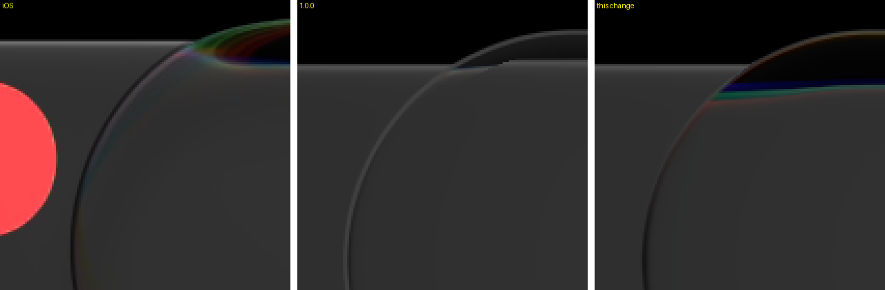

# Held lens outline and inner glow — 26 October 2026

Audit items 6 and 7 / issue #92: iOS's held lens has a crisp outline (a bright line at the top and bottom over
the page, a dark step at the sides over the bar) and almost no glow inside it; ours drew a fixed grey ring all
round and a glow that ran 15 px inward.

*IMG_6756 43.79 s (held lens on Contacts), scene rows 420-560, x 280-420, nearest-neighbour 3x. iOS HDR10 →
display sRGB; ours `:desktop:phoneReplay` (desktop GPU, 60 fps). Only the bar and a black page are in the crop.*

| Column / row through the rim | iOS | 1.0.0 | this change |
| :-- | :-- | :-- | :-- |
| top, over the black page (x 480, outward → inward) | 54 76 59 34 **13 10 9 7 6 5** | 37 63 51 26 **26 25 23 22 21 19** | 36 63 47 **13 9 8 7 6 5 5** |
| side, over the bar (row 540, outside → inside) | 48 48 **14** 25 | 47 **59 63** 47 32 41 | 46 **25 21** 32 40 |

## What changed

- **Shader** (`GlassShaderSource.kt`): the held lens's fixed-tone outline (`heldEdgeTone`) is weighted by
  `n.y²`, so it draws at the top and bottom only; at the sides the existing edge shadow (0.12) is the outline.
  It used to paint the sides 59-63 over a bar of 47 where iOS reads 14.
- **Dark `Calm()` lens**: inner glow 0.4 over 2 dp (was 1.5 over 5 dp, from the 14 October measurement in the
  superseded recorded colour space). Authored against the profile above.

## Checks

- `levels.py`, all five recordings, every region against 1.0.0: rest bar, rest pill, held bar and held lens
  unchanged (held lens +0.1 median, docs/2 -5 as before); tap pill -1.1 (was -0.7; JGEY2190 -3, was -2).
- `GlassSelectorPortMaterialTest`, `GlassShaderBundleTest` and the ports regenerated; full `jvmTest`: 437 tests, 0 failures, 27 opt-in skips (Windows, JBR 21).

## Still open

- iOS's lens top sits ~7 px higher than ours (row 427 against 434): the bar grows when held on iOS (#93).
- At the top corners iOS's outline turns into the rainbow and the bar's edge curves up to meet it; ours meets
  the rim at an angle.
