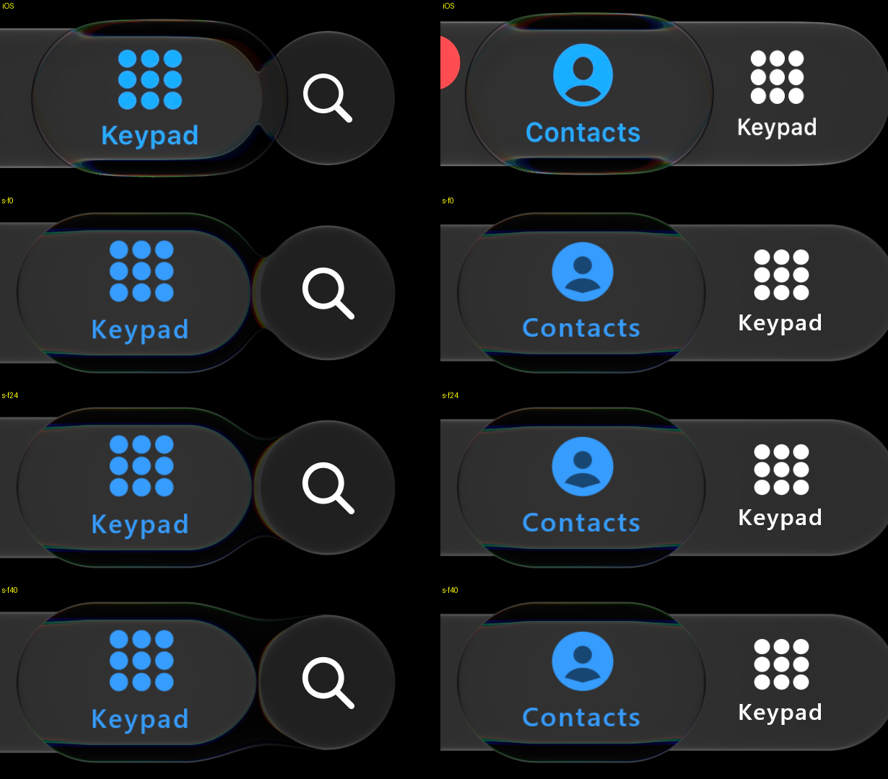

# The held lens and the search button — 26 October 2026

Audit items 8-10 / #93.

*IMG_6756 35.50 s (left, held on Keypad beside the search button) and 43.79 s (right). Rows: iOS (HDR10 →
display sRGB), then our replay of a short script cut from the recording's input (`.local/sxs/ref/IMG_6756/short.txt`,
desktop GPU, 60 fps) with the sample's `GlassTabBarAccessory.lensFusion` at 12, 24 and 40 dp. The right column
does not involve the button.*

iOS joins the held lens to the button with a shallow notch at the top and bottom; the lens's outline is visible
over the button's left side. 12 dp (from the light IMG_7048, 18 October) pinched a waist; 40 dp loses the notch.
**24 dp** is the sample's default now (`PhoneScene.kt`, and the replay). The library default (0 dp) is unchanged.

Measured alongside (no change made):

- **Bar growth (item 8).** At a still hold our bar grows as iOS's does (top 448 against 449, bottom 643 against
  642, IMG_6756 35.5 s) and through LOLL8185's long drag it stays within 2-3 px. IMG_6756's drag at 43.8 s shows
  iOS's bar 12 px taller at the top only, which is the finger pulling up: the inferred script keeps the finger's
  height constant. A limit of the inferred input, not the material.
- **Lens size (item 9).** At 35.5 s the lens spans the same columns within a few px; its top is 2-3 px higher than
  iOS's.
