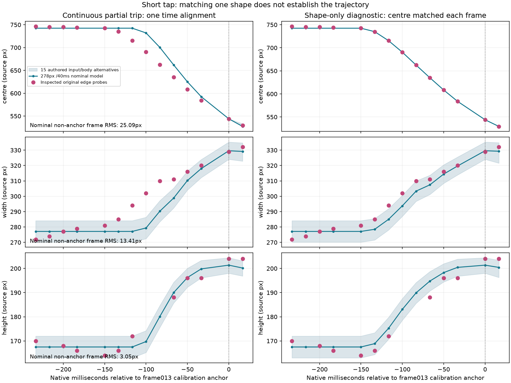
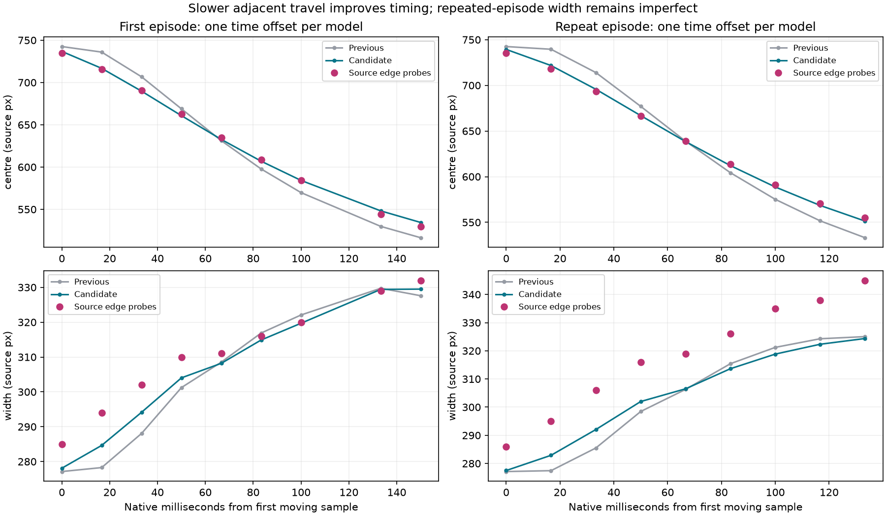
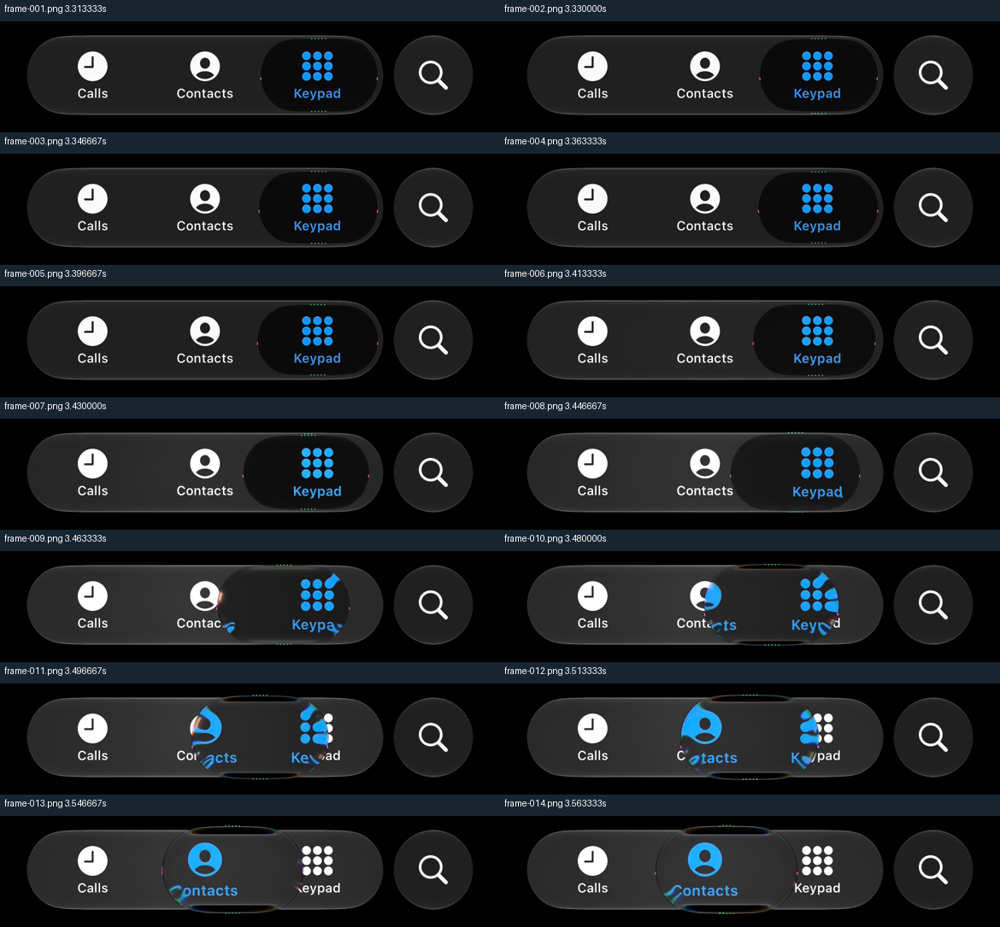
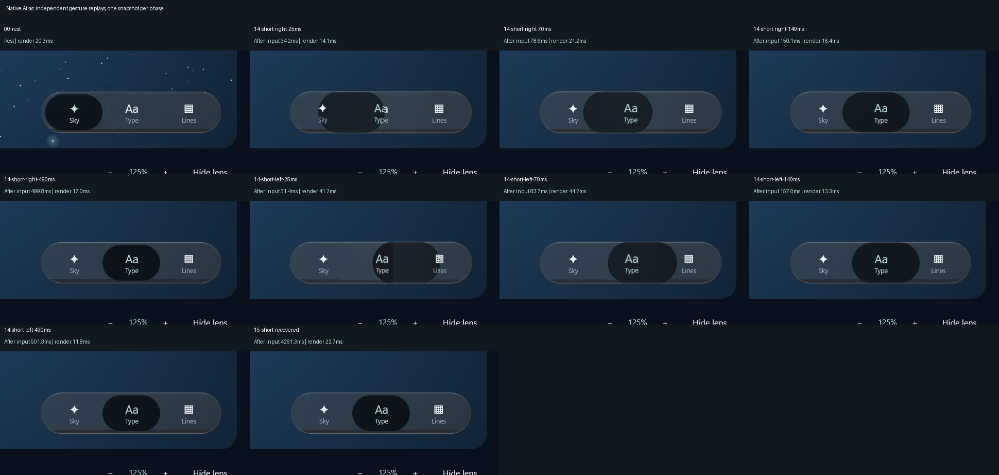

# Short-tap timing: consecutive output exposes the still-frame blind spot

**Verified local checkpoint, 11 October; full iOS parity remains open.** This packet preserves the failing
production baseline and two inspected adjacent-tap episodes. It does not establish full iOS parity.

The earlier coupled-area change matched one short-tap shape but missed how the selector reached
it. Fourteen native frames from the first episode show the body widening and growing taller during
travel. Comparing the unchanged production contour at the **same scanlines**, with one time shift
at the old calibration frame, gives centre RMS25.09px / maximum41.58px over the other moving frames.
All15 authored body/contact alternatives have essentially the same centre error. Matching each
frame's centre separately reduces width RMS to5.68px, but removes the timing evidence.



The left column retains native timestamp differences. The right column is only a shape diagnostic.
Ambiguous heights are omitted; the shaded range contains authored input alternatives, not confidence
intervals. Initial rest differences and original pointer timing remain unresolved.

## Two episodes, one candidate rate

The first episode's analytical critical-response output fit gives18.374/s instead of the current
24/s. Holding18.374/s fixed on a second Keypad-to-Contacts episode, with only one time translation,
gives centre RMS3.476px / maximum5.041px versus24/s RMS15.670px. The second episode's optical
material and shared-bar expansion differ; its raw crops contain private text and remain local.
Its full numeric probes, native timestamps, hashes and rejected heights are retained here.

The local production candidate uses an **authored0.75 clock ratio** for adjacent coupled taps
(18/s), blending smoothly to the existing rate at two slots. Coupled area/spine rates and
speed-driven demands share the ratio to preserve the shape at a given travel phase. It keeps
velocities in real seconds, including re-grabs. Held/released motion, ordinary growth, whole-bar
interaction and long-trip rates retain their existing paths. This is not an identified Apple law.

| Centre comparison with one globally fitted time offset | Previous24/s RMS | Candidate18/s RMS |
| --- | ---: | ---: |
| First episode, nine moving samples | 12.819px | 2.550px |
| Repeated episode, nine moving samples | 15.668px | 2.541px |

These production results use the same alignment freedom for both models. Original pointer-down
and pointer-up times are unknown. The time offset is fitted once across each sequence; there is no
time scaling or per-frame rematching. The first regression instead pinned the last optical edge
exactly; it failed and is retained in the research log. That alignment magnifies small uncertainty
in a late optical midpoint. The replacement keeps the8px maximum gate, adds RMS4.5px, and explicitly
requires the old model to fail with RMS greater than12px.

The first expanded scale/cadence test also found a premature settling defect. At half size, a
transient crossing of the subpixel position window could snap the slower body to rest before its
shape finished oscillating. The candidate now requires quiet actual contour/centre velocity as well
as position. The velocity threshold is normalized by body width; its value is authored. This
candidate passes28 focused checks, including scale/cadence, re-grab, original shape pairs and
held/landing regressions. Complete inventory verification and native inspection are recorded below.



[The complete production comparison](timing-comparison.json) retains both traces with the same
one-offset fitting method. The independent exporter samples at480Hz versus the regression's960Hz,
giving small interpolation differences: centre RMS2.550/2.533px. **Repeated-episode width remains
wrong: RMS14.34px / maximum20.64px** for the nominal input. First-episode width RMS5.25px and height
RMS3.93px are also imperfect. Improved timing is not full shape or optical parity.

## Measurement quality and retained failures



Strongest-gradient probes can find the wrong object while agreeing numerically. The first attempt
picked the outer bar's bottom in early frames. Corrected windows isolate the inset where possible;
frame002 and frames008/009 heights remain unresolved. Rows146/148/150 avoid refracted glyphs in
frames010–012. Model polygon intersections use those same rows, not full bounding-box width.
The repeated episode's first attempt picked the bar's right edge and keypad ink in two frames;
corrected windows/rows were inspected. **All repeated-episode height readings remain rejected.**

The long-tap source also has a near-repeated frame at0.905/0.930s: only485 of912,600 RGB channels
change, with mean absolute difference0.000679 and maximum4. That25ms presentation plateau is not
silently removed or converted into an inferred finger pause. A Contacts-to-Calls episode was also
decoded, but private text crosses its contour and no blind fit was accepted.

## Reproduction and boundaries

- [Original first probes](first-measurements.json), [windows](first-windows.json), and
  [repeated probes](repeat-measurements.json) / [windows](repeat-windows.json).
- [Frozen production baseline](production-baseline.csv):7,215 samples from15 authored alternatives.
- [Separate candidate export](production-candidate.csv): the new rate, with the same15 alternatives.
- [Comparison and every aligned sample](comparison.json), [first analytical fit](first-centre-fit.json),
  [repeated analytical audit](repeat-centre-fit.json), [provenance](verification.json).

Use the existing native decode and `tools/measure_phone_tap.py` with these annotations. Compile
`tools/PhoneTapSequenceProbe.java` against the library JVM classes and matching Kotlin stdlib as
described in the [original baseline packet](../new-motion-2026-10-08/README.md). Use a new output
path; the probe refuses to overwrite an earlier trace. Then, from the repository root:

```powershell
python tools/compare_phone_tap_sequence.py review/atlas/short-tap-timing-2026-10-10/first-measurements.json review/atlas/short-tap-timing-2026-10-10/production-baseline.csv --output .local/new-short-comparison
python tools/fit_phone_tap_centre.py review/atlas/short-tap-timing-2026-10-10/first-measurements.json --first-frame 6 --rest-x 742.5 --target-x 479 --output .local/new-short-fit.json
python tools/compare_phone_tap_timing.py review/atlas/short-tap-timing-2026-10-10/first-measurements.json review/atlas/short-tap-timing-2026-10-10/repeat-measurements.json review/atlas/short-tap-timing-2026-10-10/production-baseline.csv review/atlas/short-tap-timing-2026-10-10/production-candidate.csv --output .local/new-production-comparison
```

Requires NumPy/Pillow for measurement, Matplotlib for comparison and SciPy for the exploratory fit.
The baseline belongs to e597b59, before the new rate. Regenerating a trace from newer code produces
a candidate, not that baseline. These are partial optical edge tracks and controller geometry,
not matched rendered refraction/colour, a complete gesture, presented-frame performance or a
physical-device test. Follow [PROGRESS](../../../PROGRESS.md) and the live log for current acceptance.

## Completed verification and native inspection

**333 library tests passed,27 optional skips,zero failures; both Atlas tests passed; Android
assembled.** The first full run was cancelled after its client disconnected. Gradle's saved
binary results recovered322 completed passes. Only the11 unfinished required cases,27 optional
cases and Atlas tests ran in the3m15s follow-up. The cancelled case passed on retry. The
[per-method aggregation](test-aggregation.json) matches the full360-case inventory and records
the frozen source and binary hashes; this is not represented as one uninterrupted full run.

The33-phase native replay passed in3m10s and the static capture in14s. Their contact sheet and
individual endpoint/recovery crops were inspected: the resting inset remains intact, the rejected
dark exterior caps remain removed, and the grid magnifier remains continuous. A faint outer
selector rim is still visible. The33-phase tap crosses two tabs, so a separate focused replay
was added to cover the actual changed path.



That10-phase replay passed in1m2s; all phases were inspected, including native-size moving crops.
The selector changes shape while retaining inset material, moves to the middle from both sides,
and returns to rest with fixed layout. These are independently replayed phases, not a continuous
recording or a recovered Apple gesture. [Full replay](native-motion.png), [static studio](desktop.png),
[focused metadata](short-capture.json) and [actual input/render times](short-events.csv) are retained.

Static1920×1051Direct3D submission median8.6425ms/p9512.014ms/max12.4433ms does **not** establish
presented FPS or input latency. The first held redraw still took726.52ms; its readback took2527.69ms.
The timing outlier is preserved. No physical-device, complete optics/shape or owner-acceptance
claim is made. The sample-only diagnostic extension compiled and passed its actual native replay;
unchanged library, normal Atlas UI, portable shader and .NET evidence was reused.
