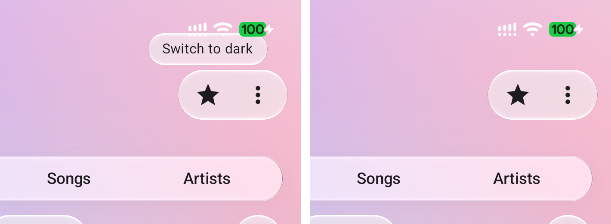

# The showcase, scrolled, and its tooltip — 19 October 2026

Glass is only as visible as what is behind it. At rest, the showcase's top controls sit over a smooth
wallpaper, which gives the rim nothing to bend. Scrolled, as an app is most of the time, the album art
passes under the top bar, the segmented control, the buttons and the chips. The refraction, the lit
rims and the iOS 27 contour then read the way they do on an iPhone.

| Light | Dark |
| :-: | :-: |
|  |  |

*`MaterialShowcaseRenderTest.scrolled` and `scrolledDark` (desktop JVM, Skia raster, 390 × 844 dp at
density 3). `MaterialShowcase(startScroll = 170.dp)` starts the grid scrolled. These are the README's
hero images.*

## The showcase's tooltip, on a Pixel 7

*Pixel 7, Android 17, `adb shell input swipe` held for 900 ms on the star, captured with `adb exec-out
screencap -p` 0.3 s and 2.3 s later, cropped to the top right. The first build also toggled the
theme on release. The tooltip now consumes the release after a long press, as Material's does, and
`GlassMaterialComponentsTest` checks that the anchor does not click.*
