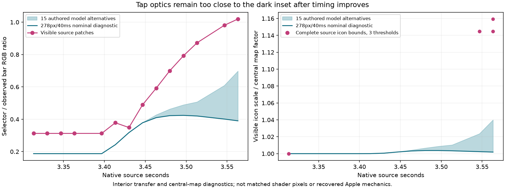
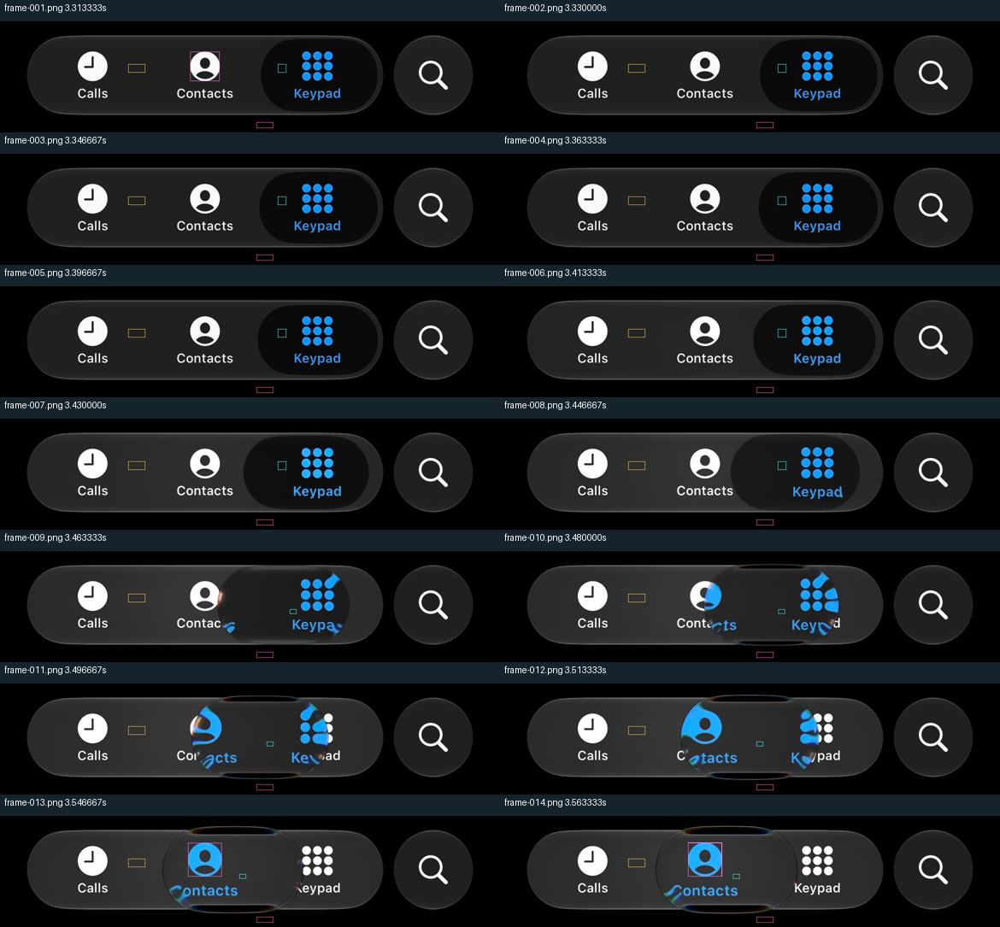
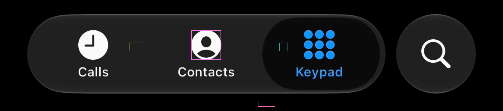
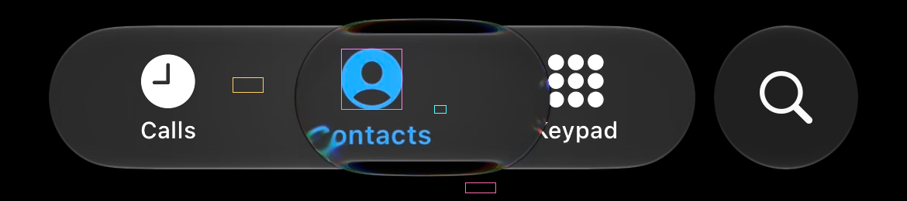

# Tap material remains mismatched after the timing correction

**Open defect, no optical correction adopted.** The short-trip timing change does not establish
material parity. This audit measures the visible selector/bar relationship and complete icon
size in the same clean14-frame source window used by the timing comparison.



The selector's clear interior rises from10 to50–52 RGB levels while the nearby bar rises from32
to51. Early probes that crossed keypad ink were rejected; the inspected replacement patches
retain every RGB value and have at most3 levels of variation. The first episode's outer bar
stays186px high, independently of these material readings.

The complete Contacts icon measures69×69px before travel. At3.546667s it is79×79 at thresholds
160/180/200; the next frame is79–80px across both axes. That is visible enlargement of14.5–15.9%.
Intermediate refracted fragments cannot define an icon's size and are excluded. The size change
could include native selected-item emphasis as well as refraction; the recording does not separate them.

| Late source state | Observed selector on51-level bar | Current shader,40ms contact | Current shader,240ms contact |
| --- | ---: | ---: | ---: |
| Frame013 | 50 | 20 | 31 |
| Frame014 | 52 | 20 | 36 |

The native JVM probe runs the existing production material/content/aperture shader helpers using
a uniform backdrop equal to the **observed bar**, isolating the interior transfer from the unknown
page behind it. Its central69px test disk remains69–71px at these formation strengths. A full-strength
control reaches78px and selector brightness51. Thus the current shader has enough central zoom
capacity to approach this observed scale; its tap formation currently supplies too little strength.
The complete29-sample [shader output](shader-output.csv) and [input](shader-input.csv) are retained.

This probe does not reproduce the complete source scene, actual pose, fonts, fringe, fold or backdrop.
It verifies the central transfer diagnostic, not full optical agreement. The existing interpolation
scales both `heldMagnification` and `heldLens`, producing a quadratic central-zoom dependence on
formation. That is a finding about the current model, not proof that removing either factor is
the correct change. Stationary hold, early throw and release need to remain independently verified.

## Source quality and attribution



| Original complete icon | Late complete icon and clear interior |
| --- | --- |
|  |  |

The outside-bar patch remains black, but that **does not establish the hidden backdrop beneath
the bar**. Its brightening therefore cannot identify a new bar-lift constant. In particular,
the earlier44-level held-bar calibration must not be silently changed to51 using this sequence.
The comparisons instead use the visible bar as their input. Original pointer-down/up times remain
unknown;40–240ms durations and three resting bodies are authored alternatives aligned using the
preceding nominal centre trajectory, not recovered finger events.

The [measurement JSON](measurements.json) retains native PTS, image hashes, every patch pixel,
three icon thresholds and quality flags. [Comparison JSON](comparison.json) retains all15
input/body alternatives. [Verification](verification.json) hashes the tools and current source.
Only this inspected, text-free first episode is published; later private page transitions stay local.

## Reproduction and next experiment

From the repository root, using a new output directory:

```powershell
python tools/measure_phone_tap_material.py .local/motion-2026-10-08/video1-short-first-v2 review/atlas/short-tap-timing-2026-10-10/first-measurements.json --output .local/new-tap-optics
python tools/compare_phone_tap_material.py .local/new-tap-optics/measurements.json review/atlas/short-tap-timing-2026-10-10/production-candidate.csv review/atlas/short-tap-timing-2026-10-10/timing-comparison.json --output .local/new-optics-comparison
```

The measurer requires NumPy/Pillow, the plotter also Matplotlib. Compile
`tools/PhoneTapOpticsProbe.java` against the library's `jvmTest` runtime classpath with JDK21;
run it with `shader-input.csv` and a new output CSV. It checks the helper ABI and refuses to
overwrite an existing result. It renders actual shaders without invoking the full test suite.

The next implementation experiment must separate transient tap optics from held ownership,
preserve legitimate travel deformation and the corrected outside-bar tint coverage, and compare
actual rendered output through the sequence. Increasing the global held strength, shrinking the
selector, or declaring the current dark inset visually correct would not address this evidence.
