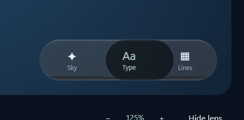
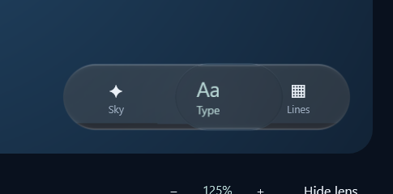
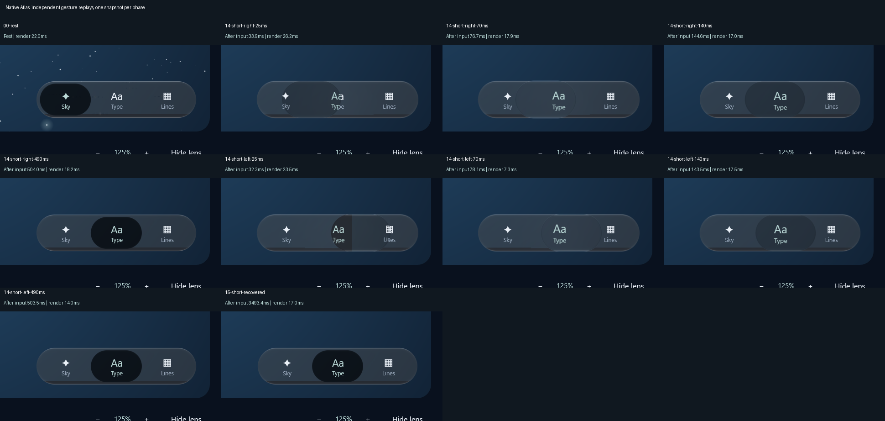
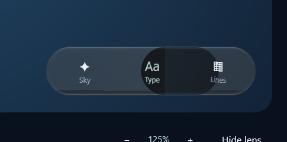
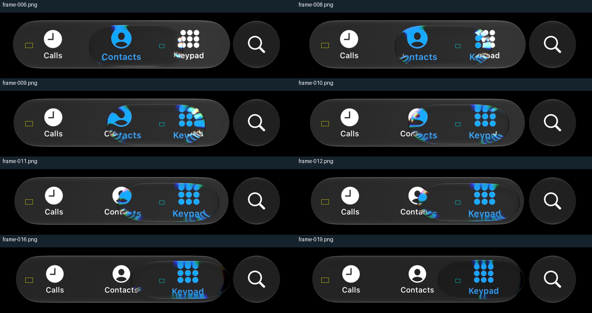

# Transient tap pigment and ink — working candidate

**Full optical acceptance remains open.** This packet recorded a hard vertical selector seam
and the independent long-tap opacity failure below. The later
[wide-input correction](../wide-input-2026-10-11/README.md) removes that seam in native replays;
the premature darkening during long taps remains unresolved.
The subsequent [long-tap appearance candidate](../long-tap-appearance-2026-10-12/README.md)
addresses the finite interior-patch failure using axial travel strain and gradual recovery.
Its results and limitations are separate; this packet preserves the earlier failure unchanged.
The [preceding optical audit](../tap-optics-audit-2026-10-11/README.md) found that improved motion
timing still left a nearly opaque dark inset and too little selected-ink enlargement during taps.

**Subsequent verification:** the JVM wide-strip correction changes the renderer and passes
the corrected fail-first deferred-layer test and full native replay. Its complete local regression inventory is now verified (342pass,27optional skips;3Atlas pass).
The full passes in this packet cover the preceding optical candidate, not that correction. See
[the current handoff](../../../NEXT-SESSION.md) before reusing these results.

The candidate gives coupled tap travel a separate appearance channel. Increasing projected area
fades only the inset pigment and emphasizes selected ink about its own anchor. Held ownership,
held-band refraction, rim parameters, whole-bar lift and drag strain retain their existing response.
The source does not identify the page hidden beneath the bar, so its observed brightening is
not used to change the older bar-lift calibration.

| Independent native replays, leftward adjacent tap | |
| --- | --- |
| Before:  | Candidate:  |

These photographs have independent real scheduling and readback delays; they are not an exact
pixel-aligned temporal comparison. The body law is unchanged. The resting and recovered native
images are **pixel-identical** to the preceding checkpoint.

## What changes

The existing coupled tap area supplies an authored appearance demand: squared relative excess
area divided by `0.44²`, with a continuous-derivative shoulder into a `0.95` ceiling. Area is
already sprung; adding another onset spring would add latency. The appearance carries its
value and real-time derivative through re-grab, hold and release, then decays using the existing
material recovery rate. Relayout, reduced motion and explicit rest clear it.

The draw adapter uses that channel for two opt-in style fields:

| Field | Default / light and historical presets | Dark Calm candidate |
| --- | --- | --- |
| `tapTintFade` | `0f` | `1f`, attenuating the inset tint and lift during travel |
| `tapSelectedScale` | `1f` | `1.15f`, transient emphasis around each item's own anchor |

Ink emphasis declines as the existing held zoom increases, avoiding the earlier double-zoom
defect. The same scale feeds ink recording and admission bounds. It never resizes item layout
or hit targets. The selector's tint coverage still uses the actual bar mask, so making transit
lighter does not restore the rejected dark caps beyond the bar.

These are authored choices fitted to visible source output, not recovered Apple mechanics.
Tap `heldLens` strength remains on its preceding response; no tap becomes a held gesture merely
because its pigment becomes more transparent. The shader implementation and portable bindings
receive no new uniforms or changed lens equations.

## Evidence and checks so far

- The fail-first optical test rejected the old response: source frame009 reads29 RGB levels,
  while the previous transfer gives20.06, outside the predeclared6-level gate.
- At the two late source frames, candidate interior values48.24/48.19 approach the measured50/52
  on the same observed bar. The original9-frame patch gate passes without changing its tolerance.
- Actual production content/aperture shader output gives a **79×79px** synthetic selected icon,
  versus measured complete source bounds79–80px; the unchanged69px input previously gave69–71px.
- **36 focused checks pass**, including exact pose/held-formation equality with the appearance
  channel disabled, source timing and paired shapes, held/landing regressions, 30/60/90/120Hz,
  half/full/double scale, reversal, re-grab, cancellation, reduced motion and relayout.
- The five optical tests passed again after adding the actual selected-ink pixel assertion.
- The focused10-phase Atlas replay passed in40s. All phases were inspected: moving tint clears,
  ink emphasis appears, selection/layout stay fixed, and rest returns exactly. This replay used
  the earlier automatic adapter selection; it did not record the actual adapter.

The complete local run passed in11m11s: **338 library passes,27 optional skips,zero failures,
both original Atlas cases passed and Android assembled**. After the preceding commit's hosted
combined Atlas case exceeded six minutes, scene/control and extreme-drag checks were separated
into independent scenarios. All three resulting desktop cases passed in2m7s. Their800×600 scene,
inputs, assertions and six-minute per-case deadlines were retained; post-release bounds are also
checked. This is a test-structure correction, not a renderer change or a claim that CI is repaired
before the next hosted run. The full NVIDIA33-phase replay passed in2m24s and the focused10-phase
replay in41s. Both report the RTX3050/Direct3D adapter, and all phase panels were inspected.
First-tap forced redraw still took439.30ms, with1679.49ms readback; the image is not an exact25ms
observation. No first-input latency claim follows from the faster static GPU check.

### Rejected early selector seam

| Previous checkpoint | Current NVIDIA candidate |
| --- | --- |
|  |  |

Native-size review of the leftward25ms phase reveals a hard vertical interior step. It is also
present in44f01de and the earlier automatic-adapter candidate capture. The lighter pigment makes
it more obvious. Earlier contact-sheet inspection missed this defect; visual sign-off is withheld.
Disabling the shared bar transform and substrate mask in an isolated diagnostic leaves the seam,
so removing that mask is not the correction. The exact sample source was restored after this
experiment. Subsequent isolation identified the clipped packed tone input; the
[wide-input packet](../wide-input-2026-10-11/README.md) records the correction, regression proof
and its measured performance cost. The images in this section preserve the earlier failure.

## Independent long-tap counterexample

The short sequence alone does not validate the new appearance curve. Eight clear native long-tap
patches show the selector staying bright longer. At1.08s the source selector reads38 over a37-level
bar, while the nominal candidate transfer gives14.45. At1.13s the source reads29 and the candidate
9.98. Across these samples RMS improves26.64→13.82 levels, but maximum error remains23.55 levels.
The response still restores dark pigment too early late in the long trip.

These are interior-transfer diagnostics over the **observed** bar, with one time shift at the
earlier long80% shape anchor. The early near-duplicate source frame and unknown original contact
time remain limitations. No framewise time warping or changed tolerance hides the mismatch.
[Raw long patches](long-measurements.json), [comparison](long-comparison.json) and the separate
[14,430-sample production appearance export](production-appearance.csv) preserve this failed
cross-check. The long optical response needs further work before complete visual acceptance.

[Focused source hashes and results](verification.json), [native metadata](native-capture.json),
[actual input/render timestamps](native-events.csv) and the original audit retain the evidence.
The shader icon is a controlled central shape, not a complete font/pose/source-scene reconstruction.
Band/fold/dispersion, full optical timing through every gesture, repeated-episode width and native
frame pacing remain unproven. The appearance change does not justify final owner acceptance.
