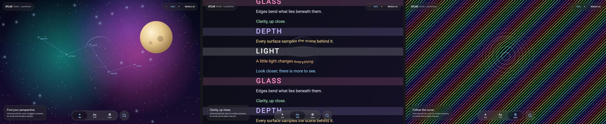

# Compose for Web (Wasm) — 18 October 2026

The library now builds for Compose for Web (`wasmJs`). Web draws through the same Skia (Skiko) as
desktop, so desktop's actuals moved to a shared `skikoMain` source set and both targets render the
same production shaders. Nothing in the optics changed.

`:web` is Atlas Studio compiled to WebAssembly: the same Loupe screen as the desktop and Android
apps (`sample/src/main/kotlin/shared`).

```sh
./gradlew :web:wasmJsBrowserDistribution   # web/build/dist/wasmJs/productionExecutable
./gradlew :web:wasmJsBrowserDevelopmentRun # dev server
```



*Our renders only: the production bundle (`claude/web-target`) served locally and captured in the
Claude desktop app's built-in Chromium at a 1280 x 800 viewport, downscaled to 800 x 500. Sky, Type and
Lines, each after tapping its tab.*

Checked in that browser:
- the magnifier, tab bar, search button, card and top bar all draw as glass;
- tapping a tab moves the selector and switches the scene;
- no console errors;
- frame interval p50 13.9 ms, p95 20.9 ms over 170 frames (`requestAnimationFrame`; not a GPU
  measurement).

Not checked: other browsers, mobile browsers, a held lens driven by touch, and the full renderer suite
in Wasm (the suite runs on the JVM, which shares the same Skia actuals).

The tab icons were text glyphs (✦, ▦). Compose for Web's bundled font has neither, so they drew as
empty boxes on first load. The shared sample now draws them as vectors on every platform.
