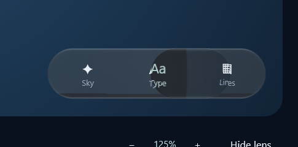
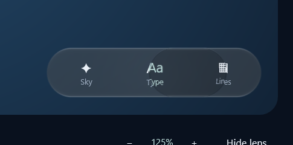
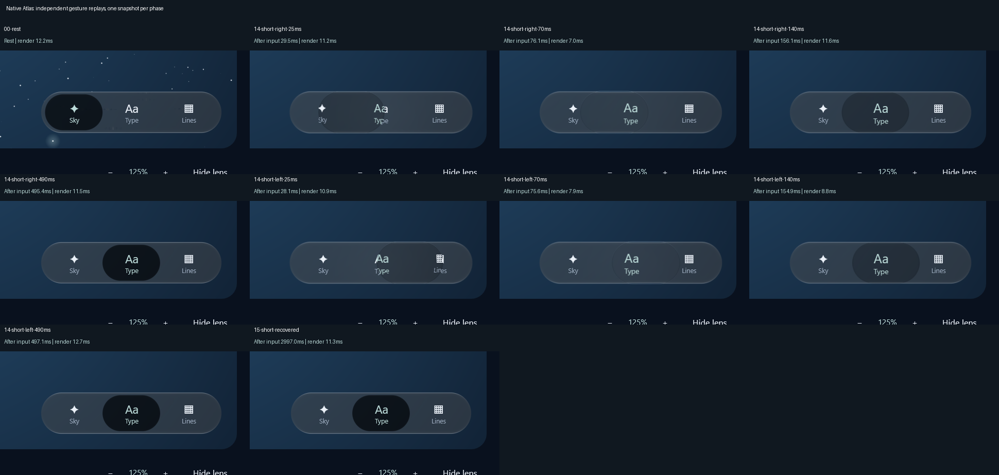
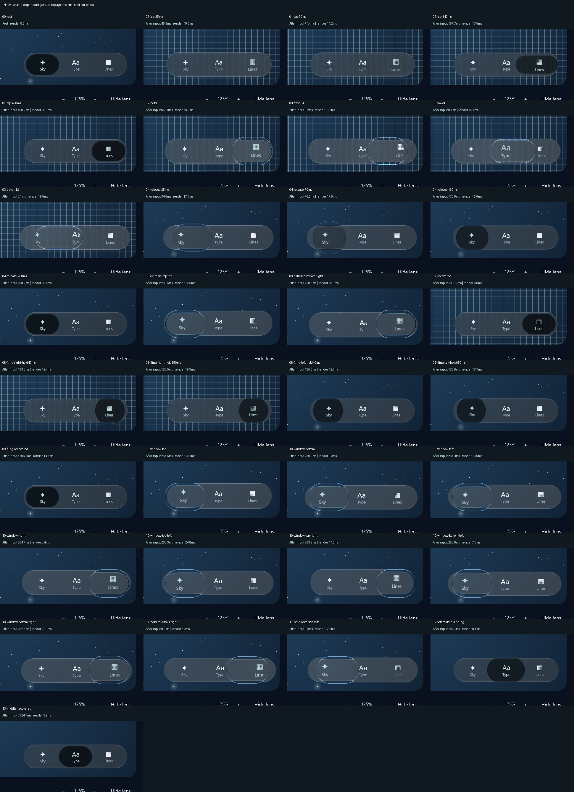
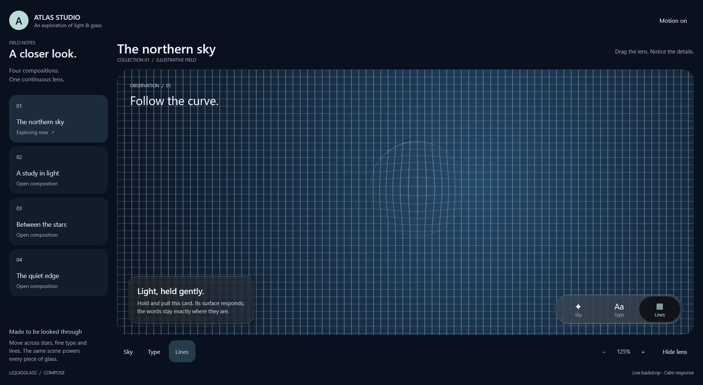

# Preserve the blurred backdrop through clipped layers

The desktop bar stored its quarter-size tone image below the visible panel. Its runtime
shader sampled that strip through an input whose filter bounds assumed same-coordinate reads.
Replaying the bar beneath a moving selector could therefore drop part of the tone input,
producing a hard vertical seam and a darker strip at the bar's lower edge.

The candidate gives that existing tone strip a separate runtime input. Its translation and
scale are declared in Skia's filter graph, so destination clipping retains the required pixels.
The blur, material parameters, through-bar layer, substrate mask and motion model are retained.
The adaptation is JVM-only; it does not change Android or the portable shader contract.

| Previous native early leftward tap | Corrected native early leftward tap |
| --- | --- |
|  |  |

The two frames are independent app-owned input replays with real scheduling/readback delays.
They demonstrate the seam correction, not pixel-aligned motion or timing parity.
All10 adjacent-tap phases were inspected, including native-size early frames in both directions.
Selection and anchored-layout assertions pass on NVIDIA RTX3050Laptop6GB/Direct3D.



## Verification and rejected test

The first regression placed its image at an offset while leaving panel-local uniforms at the
origin. Both implementations returned zero in the misaligned region. That test was corrected
to translate the canvas instead. A pre-existing raster image then passed on both implementations,
so it could not prove the native clipping defect.

A deferred filtered layer reproduces the missing input: the old renderer returns red0 instead
of56.875±1.1 at the first interior sample. The corrected graph passes. Four bounds cases now check
both panel and container factories, both raster-image and deferred-layer input, two-dimensional
gradients and six viewport placements. Together with endpoint, substrate and tap-optics regressions,
**13focused cases pass**. Failure logs and original XML remain in the local recovery snapshot.

Resting/recovered inset interiors remain intact. Overall images change in a narrow lower-edge
region where the previous bar also lost tone input; full-image identity is not claimed.

Full native33 and grid/static capture also pass and were inspected. All app-window edges/corners,
held reversals, early/formed throws and middle landing are represented. The complete369-case library inventory is verified:342pass and27optional skips, with3Atlas
cases passing and Android assembly successful.330completed cases were recovered from the
interrupted run,4unchanged bounds cases reused, and8required cases completed in a targeted
follow-up. Original failed/interrupted evidence is retained. The independent long-tap appearance error remains open: this repair does
not establish full iOS parity.
See [the live progress](../../../PROGRESS.md) and [resume instructions](../../../NEXT-SESSION.md).





The initial static capture measured10.97ms median/16.38ms p95. A subsequent controlled NVIDIA
comparison (old/new/new/old; same optical candidate, grid,1920×1051,120samples after10warmups)
found old medians8.92/8.58ms versus corrected11.21/12.36ms. P95 changed14.28/14.87ms to16.22/16.10ms.
**The sampling correction adds about3ms median submission cost in this workload.** It repairs
missing pixels; it is not a performance improvement or proof that interaction lag is solved.

Cropping the wide input before upscaling produced identical static pixels and passed13focused
checks, but its12.26ms median supplied no useful speedup. That attempt was rejected and the exact
verified uncropped source restored. Raw timings and the rejected candidate are retained in
[verification.json](verification.json). These figures are GPU submission durations, not presented
FPS or input latency.

## Reproduce

```powershell
./tools/workspace.ps1 library :liquidglass:jvmTest --tests '*GlassWideInputBoundsTest' --tests '*GlassEndpointInputBoundsTest' --tests '*GlassInsetMaterialTest' --tests '*GlassPhoneTapOpticsTest'
./tools/workspace.ps1 library :desktop:run '-Patlas.motionCapture=<new-absolute-directory>' '-Patlas.motionShortTaps=true' '-Patlas.gpu=discrete'
```

The explicit transform follows [Skia's image-filter coordinate and sampling contract](https://api.skia.org/classSkImageFilters.html).
Installed Skiko0.150.1 has no RuntimeShader sampling-radius overload; the separate input lets
the filter graph represent this offset/scale without readback or another blur.
