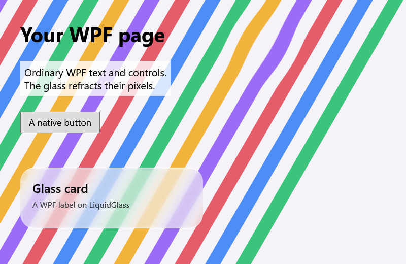

# WPF — 19 October 2026

`LiquidGlass.Wpf` puts the production glass over native WPF content.

*`WpfDemo --capture` on Windows 11 (.NET 10, WPF software rendering through `RenderTargetBitmap`,
800 × 520 at 96 DPI). The page is ordinary WPF elements. `VisualBackdrop.Capture` renders it into the
painter's backdrop. `GlassBitmap` takes the glass (`DrawSurface` with the measured overhead light,
and `DrawLens`), and an `Image` shows it under the WPF labels "Glass card" and "A WPF label on
LiquidGlass".*

## Checks

`WpfDemo --capture` compares the rendered frame with the captured backdrop and fails unless the glass
changed the pixels under the card and the lens and left the rest of the page alone. Here the mean
difference was 74 under the card, 40 under the lens and 0 outside. CI runs it on Windows. It also
packs `LiquidGlass.Wpf` and checks the package (not published).

The capture pins the visual brush to the element's own bounds. Without that, children that overflow
the element (the rotated bands here) moved the captured image away from the screen; the check caught
it.

## Limits

- Offscreen and software-rendered in the check; an interactive window works the same way (drag the
  lens) but has not had a scripted check.
- The glass bitmap is drawn on the CPU. Large windows that redraw the glass every frame cost more than
  a GPU host would.
- Avalonia has its own adapter since: see [avalonia-2026-10-19](../avalonia-2026-10-19/README.md).
