# `<liquid-glass>` web component — 18 October 2026

Visual evidence for the npm web component in [`ports/npm`](../../ports/npm/README.md) (package
`liquidglass`, unpublished). Every image is our own render of the package's example page,
`ports/npm/index.html`: CSS gradients, CSS type and a checkerboard behind the HTML engine; a canvas
drawn by the page behind the canvas engine. No external assets, no reference recordings.

**Source.** Branch `claude/web-component`, based on `e4cf496`, with the package's uncommitted working
tree as of this capture. **Method.** Playwright 1.64.0, `npm run test:browser` with
`LIQUIDGLASS_CAPTURE_DIR` set (the `capture the example for review` test), served by
`ports/npm/serve.mjs` on loopback. Full pages: `locator('main').screenshot()` at a 1100 × 1250 viewport,
1 device px per CSS px. Crops: the same page at 2 device px per CSS px, 14 CSS px around each element.

**What these show and what they do not.** They are regression captures of the rendering paths, not
calibrated comparisons with iOS and not owner acceptance. The HTML engine's numbers are inherited
from the Kotlin material and re-expressed in CSS (an approximation; the package README lists what
is and is not reproduced). The canvas engine draws the production shaders through the CanvasKit
painter. Nothing here was captured on a physical device or in a visible browser window: these are
headless browsers on the owner's Windows machine.

## Chromium: both engines, light and dark

Backend: Playwright's Chromium 156.0.8078.4 headless shell, Windows 11. `lensing supported: true`.

*Light scheme. Top panel, `engine="html"` over live HTML: a tinted button, the Regular card over the
conic tile and checkerboard (blurred through the glass by the two kernels), Clear over the stripes, and
the interactive toolbar. Bottom panel, `engine="canvas"`: a toolbar and a card drawn by the production
shaders over the page's canvas.*

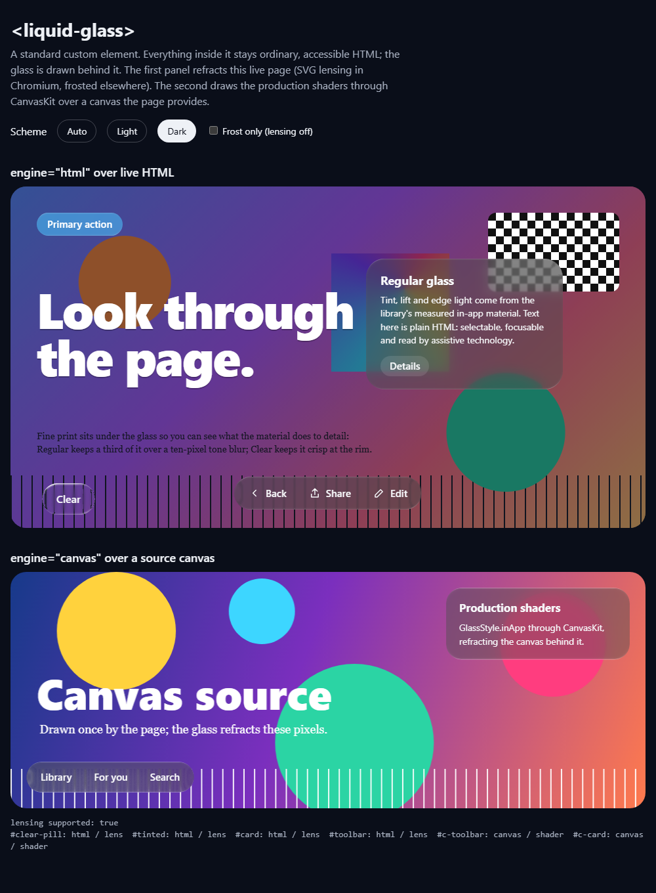

*Dark scheme: the same page; Regular glass is black at 0.451 plus the 35/255 lift. The stage behind
the HTML engine is dimmed by the page's own overlay, not by the element.*

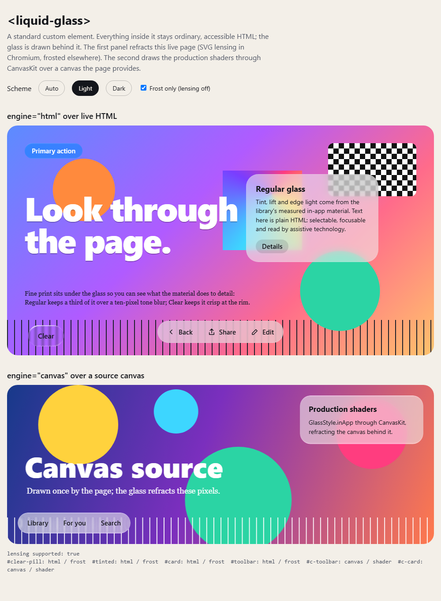 

*`lensing="off"`: the frosted path that Firefox and Safari get, rendered in Chromium so the two paths
can be compared on one backend. Same tint, lift, kernels and rim; no refraction.*

### Crops at 2x

| | Lens (Chromium) | Frost (`lensing="off"`) |
| :-- | :-- | :-- |
| Regular toolbar, light | 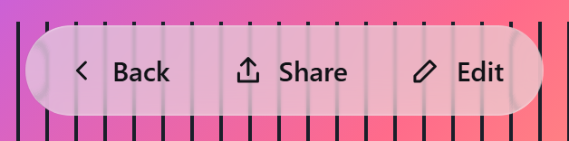 | 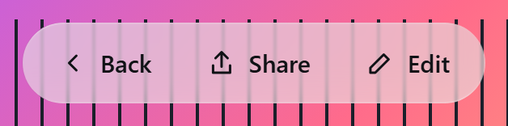 |
| Regular toolbar, dark | 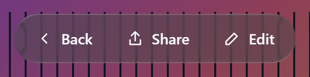 | |
| Clear pill, light | 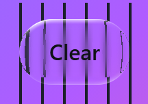 | 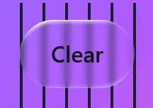 |
| Clear pill, dark | 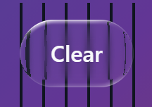 | |

*At the toolbar's rounded ends the stripes under the lens path bend into the rim (the measured
resting-corner map); along the straight runs they stay nearly in place, and in the frosted path they
stay straight everywhere. Clear keeps the stripes crisp near its rim and pulls the content just outside
it inward (the legacy Snell bevel). Labels stay legible in all six.*

| Regular card, light | Regular card, dark | Canvas toolbar, light | Canvas toolbar, dark |
| :-- | :-- | :-- | :-- |
| 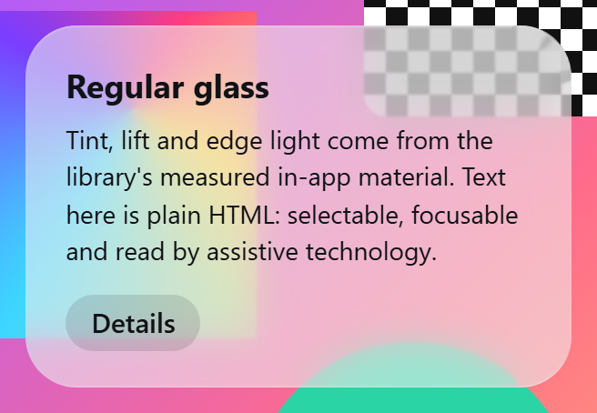 | 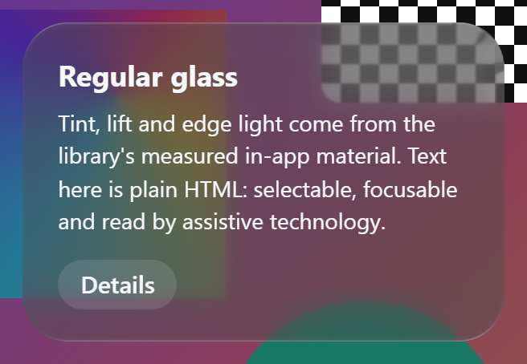 | 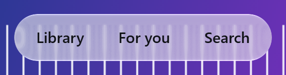 |  |

## Firefox and WebKit

Backends: Playwright's Firefox 157.0 and WebKit 27.2 (the Windows build; this is not Safari),
headless, light scheme, captured by a one-off script with the same viewport after clicking Share.

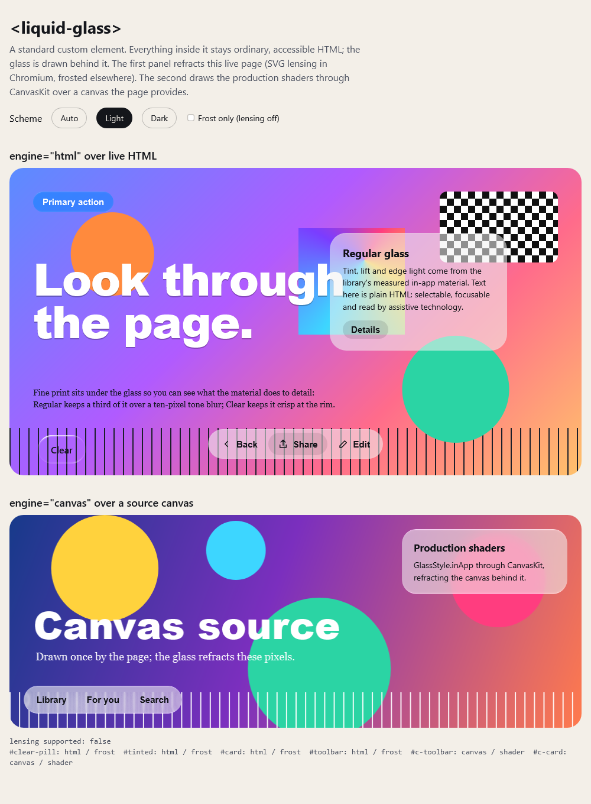

*Checked in both: the element upgrades, every HTML-engine element selects the frosted path
(`lensing supported: false`; computed `backdrop-filter: blur(0.875px) saturate(1)` with the 10 px layer
at opacity 0.664), slotted buttons receive clicks, and the canvas engine draws (both cards show the
shader output). **Not shown:** the blur itself. In these headless builds `backdrop-filter` renders
nothing even on a minimal test page (one blurred div over stripes, no element involved), so the glass
here shows tint and rim over an unblurred page. The frosted look in a real Firefox or Safari is not
established by this record.*

## Not checked

Safari on macOS or iOS, any mobile browser, a GPU-backed browser window, high-contrast and
reduced-transparency rendering beyond the automated assertions, performance, and comparison with iOS.
